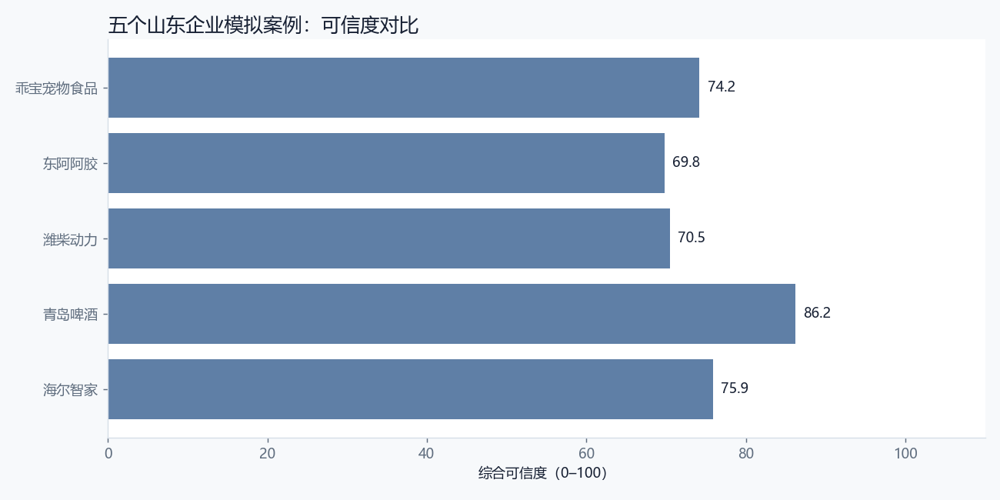
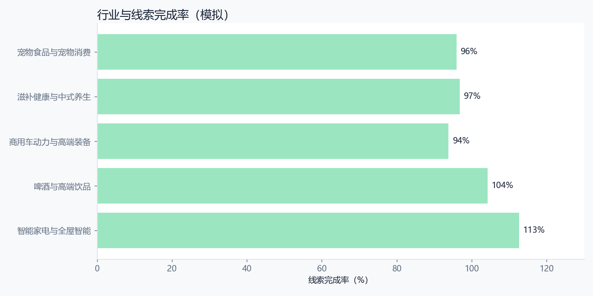

# 山东企业模拟案例：可信度与适配性对比

> 所有数据均为模拟，不代表企业真实经营数据、真实广告效果或真实企业意见。

## 1. 案例总览

| 企业 | 行业 | 预算 | 线索/目标 | 线索成本 | CTR | MAPE | 可信度 | 满意度 | 适配性 |
| --- | --- | --- | --- | --- | --- | --- | --- | --- | --- |
| 海尔智家股份有限公司 | 智能家电与全屋智能 | 120 万 | 1690/1500 | 705 | 2.72% | 29.5% | 75.9 | 4.2/5 | 高 |
| 青岛啤酒股份有限公司 | 啤酒与高端饮品 | 80 万 | 8340/8000 | 96 | 3.17% | 8.1% | 86.2 | 4.0/5 | 较高 |
| 潍柴动力股份有限公司 | 商用车动力与高端装备 | 60 万 | 244/260 | 2459 | 1.75% | 41.7% | 70.5 | 3.8/5 | 中高 |
| 东阿阿胶股份有限公司 | 滋补健康与中式养生 | 50 万 | 1550/1600 | 323 | 3.05% | 49.7% | 69.8 | 3.5/5 | 中 |
| 乖宝宠物食品集团股份有限公司 | 宠物食品与宠物消费 | 40 万 | 2880/3000 | 139 | 3.70% | 35.3% | 74.2 | 4.1/5 | 较高 |

## 2. 横向发现

1. **行业不同，可信度不同**：B2B 案例的线索量小、决策链长，模拟数据更容易“看起来合理”，但真实可信度受服务网络和样本量限制；快消/宠物案例的渠道数据更完整，可信度相对更高。
2. **线索成本不能跨行业比较**：高端家居、B2B 装备的线索成本天然高于快消；应比较“线索质量、成交阶段和履约能力”，而不是只看 CPL。
3. **历史基线是可信度的锚**：只有 8 周模拟基线的案例，可信度评分应更保守；没有企业真实历史数据时，只能支持小范围试点。
4. **满意度不等于结果好**：满意度还包含战略契合、风险可控和执行可行性；结果好但履约风险高的方案，不能给高分。
5. **过程材料比结论更重要**：来源、状态、审批快照、复盘建议和下一轮任务是可追溯的核心。

## 3. 项目迭代结论

- 增加“案例库”，让用户能导入 5 个山东企业模拟项目。
- 增加“可信度面板”，显示数据完整性、证据核实率、历史基线偏差与综合评分。
- 增加行业模板：B2B、快消、健康、宠物不同指标与合规要求。
- 增加“企业适配性”评估，避免只看投放结果。
- 增加“模拟/真实”标识，防止模拟数据被误用。

## 4. 使用建议

- 用这些案例做内部培训、售前演示和产品验收，不要对外宣称企业真实效果。
- 真实企业使用时，先用企业历史数据替换模拟基线，再重跑同一套流程。
- 任何对外材料都应经过企业市场、法务、合规和数据负责人复核。
