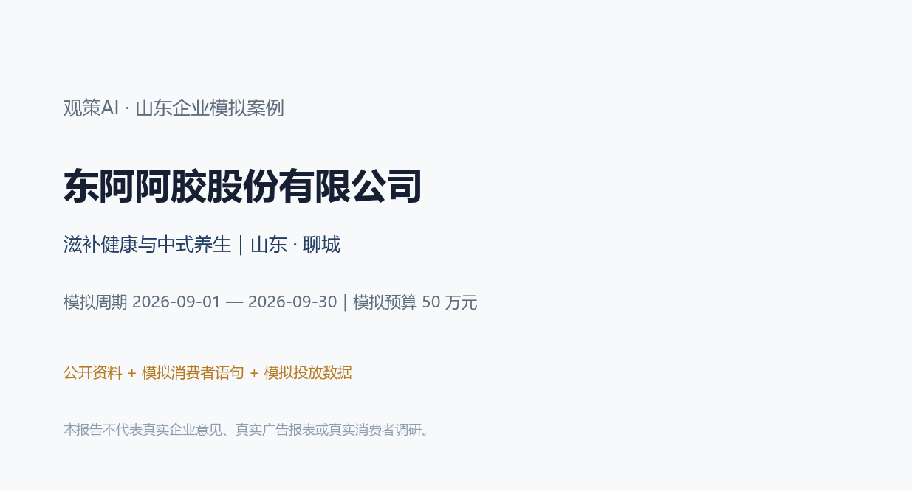
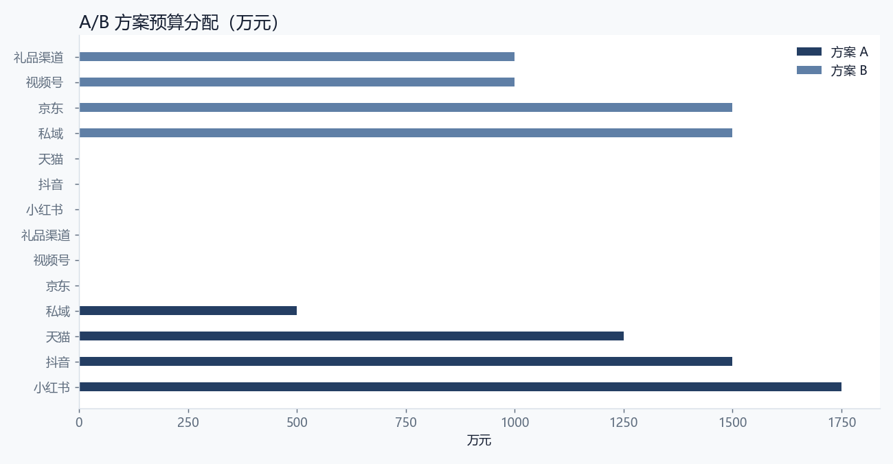
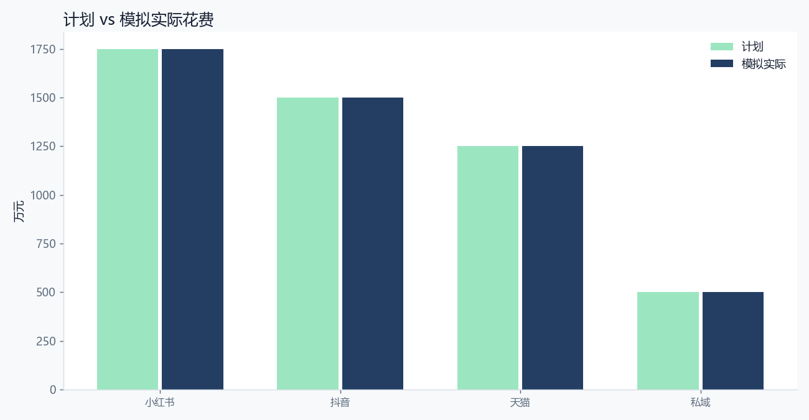
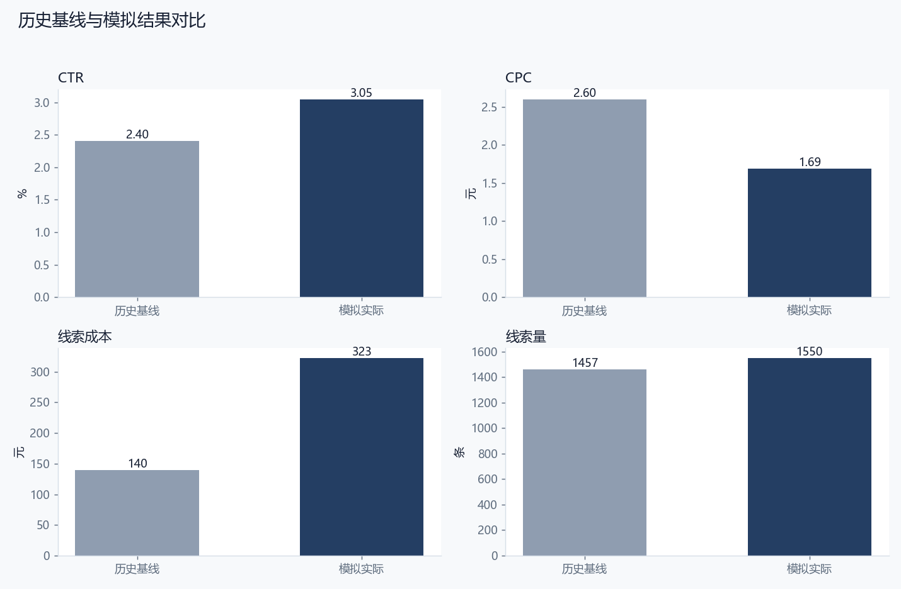
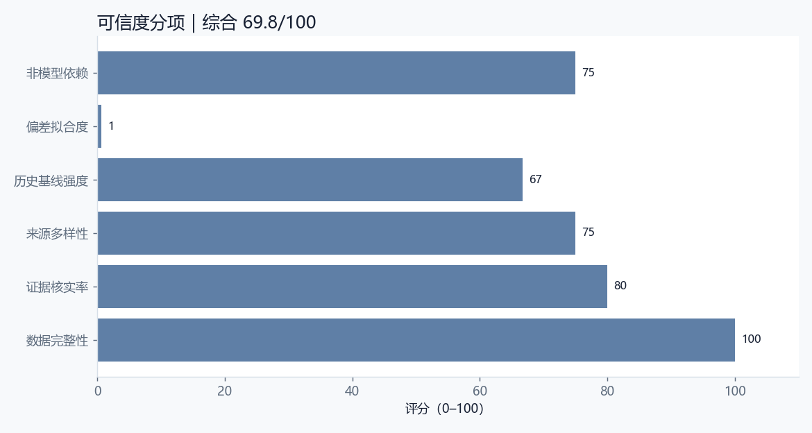

# 东阿阿胶股份有限公司｜观策AI 山东企业模拟案例

> **重要声明**：本报告是企业营销决策的模拟验收材料。企业名称与业务方向来自公开资料；消费者语句、竞品观察、渠道数据、复盘结果和“企业满意度”均为模拟，不代表企业真实意见、真实广告账户、真实消费者调研或真实经营数据。任何对外使用前，必须由企业市场、法务、合规和数据负责人复核。

## 0. 阅读指引与结论摘要

本案例把完整的营销决策闭环跑一遍：明确企业与行业背景 → 设计资料收集范围 → 建立来源台账 → 对模拟消费者语句、竞品动态和行业材料去重、分类、证据核验 → 归纳主题和机会 → 形成 A/B 方案 → 预算校验与审批快照 → 模拟投放与复盘 → 历史基线回测与可信度评分 → 企业适配性与满意度模拟 → 迭代建议。

本案例的核心判断是：**本次模拟比较“即食化年轻化”与“礼品+私域”两条路径。前者解决尝试门槛，后者解决客单和复购。** 从模拟结果看，方案 A 的线索完成率为 96.9%，线索成本为 323 元，CTR 为 3.05%；与历史基线相比，MAPE 为 49.7%，可信度评分为 69.8/100。这个结果说明方案有可执行性，但仍有明确的复核边界。

**模拟企业满意度：3.5/5。** 模拟企业市场负责人视角：即食化方向符合年轻化战略，但功效表达、口感和复购仍需验证；礼品方案稳健但增长慢，适合作为辅助。

## 1. 企业公开资料与模拟边界

### 1.1 企业基本情况

| 项目 | 内容 |
| --- | --- |
| 企业 | 东阿阿胶股份有限公司 |
| 品牌 | 东阿阿胶 |
| 行业 | 滋补健康与中式养生 |
| 区域 | 山东 · 聊城 |
| 阶段 | 老字号品牌，A股上市公司 |
| 模拟产品 | 阿胶及即食滋补组合（模拟：阿胶块、复方阿胶浆、桃花姬等） |
| 产品说明 | 即食化、便携化与礼品装组合；具体产品与功效表达以企业合规口径为准 |
| 模拟目标 | 提升年轻女性与礼品场景的尝试、复购与私域沉淀 |
| 模拟预算 | 500,000 元 |
| 模拟周期 | 2026-09-01 — 2026-09-30 |
| 模拟线索目标 | 1,600 条 |

### 1.2 公开资料如何使用

东阿阿胶是聊城的老字号滋补品牌，产品包括阿胶块、复方阿胶浆、桃花姬等。公开资料显示，企业持续推动品牌年轻化和即食化。

本案例不引用未核实财务数字；消费者语句、产品组合、投放数据和复盘结果均为模拟，功效表达需以企业合规口径为准。

本案例只把公开资料用于“企业背景、行业方向、品牌与产品语境”，不把公开资料当作真实消费者证据，也不引用未核实的财务数字。所有“消费者原话”均来自模拟材料，不能作为真实用户调研引用。所有渠道数据均为假设值，不能作为企业真实广告效果。

### 1.3 为什么选择这家企业

选择标准不是“名气大”，而是同时满足三点：第一，企业处于山东，具有区域代表性；第二，行业决策链有差异，能检验观策AI是否只会做一种模板；第三，企业有明确的战略关键词，可以用来判断方案是否“符合企业发展”。本案例的战略关键词是：**滋补健康与中式养生、品牌升级、场景化与可验证交付**。

滋补健康市场正在年轻化、即食化和零食化。年轻用户愿意尝试，但对功效夸大、口感和价格非常敏感。老字号的优势是信任，难点是让年轻人觉得“跟我有关”。

礼品场景仍然重要，但企业采购和节日送礼决策周期长。即食化适合拉新，礼品和私域适合做高客单与复购。

## 2. 研究问题与判断标准

### 2.1 本次模拟要回答什么

本次模拟比较“即食化年轻化”与“礼品+私域”两条路径。前者解决尝试门槛，后者解决客单和复购。

### 2.2 判断标准

1. **战略契合**：方案是否服务于企业当前的产品、品牌和渠道方向。
2. **证据充分**：主题是否有多条信号支撑，关键结论是否能追溯到来源。
3. **执行可行**：预算、渠道、承接能力是否匹配，是否存在明显履约风险。
4. **结果可信**：模拟结果与历史基线的偏差是否在可解释范围内。
5. **企业可接受**：以模拟企业市场负责人视角，是否愿意进入小范围试点。

### 2.3 本次模拟的边界

- 不使用企业真实广告账户、真实订单或真实用户个人信息。
- 不声称“企业已经满意”，只做模拟满意度访谈与适配性判断。
- 不把模拟数据当作行业结论，也不把单案例结论外推到整个行业。
- 涉及功效、医疗、金融、未成年人等敏感表达时，必须由企业合规部门复核。

## 3. 资料收集过程

### 3.1 采集设计

本案例采用“多源交叉”的采集设计：消费者侧看小红书、抖音、电商评价和问卷；竞品侧看行业媒体与竞品动态；行业侧看行业观察、政策/平台公告和线下走访；企业侧只使用公开资料。这样做的目的不是追求数据量，而是让同一判断能从不同来源被交叉验证。

### 3.2 来源清单

| 来源ID | 来源名称 | 平台 | 类型 | 日期 | 状态 |
| --- | --- | --- | --- | --- | --- |
| SRC-01 | 小红书滋补/即食笔记摘录（模拟） | 小红书 | consumer | 2026-08-17 | 模拟 |
| SRC-02 | 抖音养生短视频评论（模拟） | 抖音 | consumer | 2026-08-18 | 模拟 |
| SRC-03 | 天猫阿胶/即食滋补评价摘要（模拟） | 电商平台 | consumer | 2026-08-19 | 模拟 |
| SRC-04 | 京东礼品与健康品评价摘要（模拟） | 电商平台 | consumer | 2026-08-20 | 模拟 |
| SRC-05 | 中式养生行业观察（模拟） | 行业媒体 | industry | 2026-08-21 | 模拟 |
| SRC-06 | 竞品零食化滋补动态（模拟） | 行业媒体 | competitor | 2026-08-22 | 模拟 |
| SRC-07 | 私域用户访谈纪要（模拟） | 私域 | consumer | 2026-08-23 | 模拟 |
| SRC-08 | 消费者问卷 n=110（模拟） | 问卷 | consumer | 2026-08-24 | 模拟 |

### 3.3 采集时间线

| 时间点 | 过程动作 | 状态 |
| --- | --- | --- |
| T-15 | 确定企业与公开资料范围 | 完成 |
| T-12 | 建立来源清单与采集模板 | 完成 |
| T-8 | 采集模拟消费者/竞品/行业信号 | 完成 |
| T-6 | 去重、分类、标注证据状态 | 完成 |
| T-5 | 人工核验与冲突保留 | 完成 |
| T-3 | 归纳主题与 A/B 方案 | 完成 |
| T-2 | 预算校验与审批快照 | 完成 |
| T | 模拟投放 | 模拟 |
| T+2 | 渠道数据复盘 | 完成 |
| T+3 | 历史基线回测与可信度 | 完成 |
| T+5 | 适配性判断与迭代 | 完成 |

### 3.4 采集过程中的质量控制

1. **来源可追溯**：每条信号保留来源 ID、平台、采集时间和备注。
2. **模拟标识**：所有模拟材料在来源备注中明确标注，不与真实数据混用。
3. **去重**：同一来源的重复语句只保留一条，并在备注中说明。
4. **冲突保留**：不同来源出现相反判断时，不强行合并，保留为待核实或争议状态。
5. **敏感内容**：涉及功效、价格承诺、竞品贬损的内容，进入人工复核清单。

## 4. 数据清洗、编码与证据核验

### 4.1 清洗规则

- 删除明显的广告、无关评论和重复语句。
- 统一平台名称、日期格式和类别编码。
- 将“消费者/竞品/行业”作为一级类别，将“高/中/低”作为优先级。
- 将“已核实/待核实/有争议/重复”作为证据状态，不用“看起来合理”代替核实。
- 所有模拟数据保留 `simulated: true` 或 `dataKind: simulated` 标识。

### 4.2 信号清单

| ID | 平台 | 类别 | 优先级 | 状态 | 标题 | 影响 |
| --- | --- | --- | --- | --- | --- | --- |
| S-01 | 小红书 | consumer | high | verified | 即食化/便携是年轻用户尝试的第一理由 | 即食化是降低尝试门槛的关键。 |
| S-02 | 行业媒体 | industry | high | verified | 功效表达必须合规，用户也在找证据 | 功效表达必须合规、可验证。 |
| S-03 | 小红书 | consumer | high | verified | 口感与甜度影响复购 | 口感是即食化的第二道门槛。 |
| S-04 | 问卷 | consumer | high | disputed | 价格带与日常滋补频次不匹配 | 需要用小规格/组合装降低日常门槛。 |
| S-05 | 抖音 | consumer | high | verified | 送礼场景看重品牌与包装，自用看重方便 | 礼品与自用需要分开沟通。 |
| S-06 | 行业媒体 | industry | medium | verified | 国潮与“新中式养生”带来内容窗口 | 国潮内容要现代、轻松。 |
| S-07 | 行业媒体 | competitor | high | verified | 竞品用零食化产品切年轻市场 | 零食化是竞争方向，但需保持功效信任。 |
| S-08 | 私域 | consumer | medium | verified | 私域用户更愿意接受组合装 | 私域适合做周期装和复购。 |
| S-09 | 电商平台 | consumer | high | pending | 电商评价里“是否上火/适合人群”被反复询问 | 需要把适用人群和禁忌讲清楚。 |
| S-10 | 问卷 | consumer | high | verified | 用户对阿胶功效的信任来自长期品牌而非单次广告 | 品牌信任是资产，但不能替代合规证据。 |

### 4.3 单条信号研判记录

**S-01｜即食化/便携是年轻用户尝试的第一理由**

- 观察：年轻用户愿意尝试即食、便携、口感友好的滋补产品，但不愿处理传统阿胶块的复杂做法。
- 原话/证据：“阿胶块我不会熬，即食的可以当零食试试。”
- 判断：即食化是降低尝试门槛的关键。
- 状态：verified；相关性 5/5；标签：即食、便携、年轻化
- 下一步：进入主题聚合，优先用于方案 A/B 的证据引用。

**S-02｜功效表达必须合规，用户也在找证据**

- 观察：消费者关注功效，但对夸大宣传警惕，愿意看成分、工艺和真实体验。
- 原话/证据：“别说包治百病，告诉我适合什么人群、怎么吃就行。”
- 判断：功效表达必须合规、可验证。
- 状态：verified；相关性 5/5；标签：功效、合规、证据
- 下一步：进入主题聚合，优先用于方案 A/B 的证据引用。

**S-03｜口感与甜度影响复购**

- 观察：即食产品的口感、甜度和腻感直接影响复购。
- 原话/证据：“太甜了吃一次就不想再买，口感很重要。”
- 判断：口感是即食化的第二道门槛。
- 状态：verified；相关性 5/5；标签：口感、甜度、复购
- 下一步：进入主题聚合，优先用于方案 A/B 的证据引用。

**S-04｜价格带与日常滋补频次不匹配**

- 观察：部分用户认为日常滋补价格偏高，难以形成高频复购。
- 原话/证据：“偶尔吃可以，天天吃有点贵。”
- 判断：需要用小规格/组合装降低日常门槛。
- 状态：disputed；相关性 5/5；标签：价格、频次、复购
- 下一步：保留为待核实或争议记录，不进入对外承诺；先补充原始证据或企业确认。

**S-05｜送礼场景看重品牌与包装，自用看重方便**

- 观察：送礼用户看重品牌、包装和体面；自用用户更关心方便、口感和价格。
- 原话/证据：“送长辈要看起来正式，自己吃越方便越好。”
- 判断：礼品与自用需要分开沟通。
- 状态：verified；相关性 5/5；标签：送礼、自用、场景
- 下一步：进入主题聚合，优先用于方案 A/B 的证据引用。

**S-06｜国潮与“新中式养生”带来内容窗口**

- 观察：年轻消费者对国潮养生感兴趣，但要求现代、轻松、可执行。
- 原话/证据：“新中式养生可以，但别搞得太玄。”
- 判断：国潮内容要现代、轻松。
- 状态：verified；相关性 4/5；标签：国潮、养生、年轻化
- 下一步：进入主题聚合，优先用于方案 A/B 的证据引用。

**S-07｜竞品用零食化产品切年轻市场**

- 观察：竞品用即食、零食化、便携包装吸引年轻用户，降低传统滋补的距离感。
- 原话/证据：“现在很多即食的，像零食一样，方便带。”
- 判断：零食化是竞争方向，但需保持功效信任。
- 状态：verified；相关性 5/5；标签：竞品、零食化、便携
- 下一步：进入主题聚合，优先用于方案 A/B 的证据引用。

**S-08｜私域用户更愿意接受组合装**

- 观察：私域用户对组合装、周期装的接受度更高，但需要明确使用周期。
- 原话/证据：“组合装可以，但要告诉我怎么吃、吃多久。”
- 判断：私域适合做周期装和复购。
- 状态：verified；相关性 4/5；标签：私域、组合装、周期
- 下一步：进入主题聚合，优先用于方案 A/B 的证据引用。

**S-09｜电商评价里“是否上火/适合人群”被反复询问**

- 观察：用户对适合人群、体质和食用禁忌有疑问，需要清晰说明。
- 原话/证据：“我这种体质能不能吃？会不会上火？”
- 判断：需要把适用人群和禁忌讲清楚。
- 状态：pending；相关性 5/5；标签：适合人群、禁忌、信任
- 下一步：保留为待核实或争议记录，不进入对外承诺；先补充原始证据或企业确认。

**S-10｜用户对阿胶功效的信任来自长期品牌而非单次广告**

- 观察：消费者更信任老字号品牌和长期口碑，单次广告难以建立功效信任。
- 原话/证据：“老品牌肯定更信，但广告说效果多好我不太信。”
- 判断：品牌信任是资产，但不能替代合规证据。
- 状态：verified；相关性 5/5；标签：品牌、信任、功效
- 下一步：进入主题聚合，优先用于方案 A/B 的证据引用。

### 4.4 证据核验结果

本案例共 10 条信号，其中已核实 8 条，待核实 1 条，争议 1 条。已核实信号用于主题和方案，待核实信号用于提示风险和后续任务，不直接进入对外承诺。

## 5. 市场洞察与主题研判

### 5.1 主题清单

| 主题 | 标题 | 置信度/类型 | 证据信号 | 边界 |
| --- | --- | --- | --- | --- |
| TH-01 | 即食化降低尝试门槛 | high/观测事实 | S-01、S-03、S-07、S-05 | 即食化可能削弱传统阿胶的专业形象。 |
| TH-02 | 功效表达必须合规且可验证 | high/分析推断 | S-02、S-09、S-10 | 合规审核可能限制内容表达。 |
| TH-03 | 礼品与自用场景分开沟通 | medium/分析推断 | S-05、S-08、S-04 | 两套内容可能造成品牌信息分散。 |

### 5.2 主题一：即食化降低尝试门槛

即食、便携、口感友好的产品更容易让年轻用户第一次尝试。

这个主题之所以成立，不是因为某一条评论，而是因为多条信号从不同角度指向同一件事：用“像零食一样方便”降低距离感，同时保留品牌专业感。 在方案上，它对应的动作是：用即食子品牌和小规格承接年轻用户。。但必须保留边界：即食化可能削弱传统阿胶的专业形象。

### 5.3 主题二：功效表达必须合规且可验证

消费者关注功效，但对夸大宣传警惕，需要成分、工艺和适用人群说明。

这个主题更适合用来解释“为什么某些渠道有效、某些渠道无效”。把功效表达转为“适用人群+使用方式+可核验信息”。 方案动作是：用合规内容建立信任，而不是夸大承诺。。边界是：合规审核可能限制内容表达。

### 5.4 主题三：礼品与自用场景分开沟通

送礼看重品牌、包装和体面，自用看重方便、口感和价格。

这个主题提醒我们：不要把单一人群或单一渠道当成全部市场。用两套内容分别承接礼品和自用需求。 方案动作是：礼品渠道做定制与履约，自用渠道做即食与复购。。边界是：两套内容可能造成品牌信息分散。

### 5.5 机会与风险

| 机会 | 事实依据 | 可执行动作 | 验证条件 | 语气 |
| --- | --- | --- | --- | --- |
| 即食子品牌年轻化内容 | 即食产品认知高于阿胶块。 | 用即食子品牌做年轻用户入口，再引导了解品牌。 | 需核对真实产品线与功效口径。 | positive |
| 私域周期装 | 私域用户接受组合装。 | 设计周期装和复购提醒，提升复购。 | 需要真实用户数据与合规触达。 | positive |
| 企业礼品合规履约包 | 礼品渠道需要发票、定制和交付证明。 | 做企业礼品服务包，明确开票、定制和交付。 | 需要供应链与财务支持。 | neutral |

## 6. A/B 方案设计与预算

### 6.1 方案对比

| 方案 | 名称 | 总预算 | 渠道 | 核心信息 |
| --- | --- | --- | --- | --- |
| A | 方案 A：即食化年轻化 | 500,000 元 | 小红书、抖音、天猫、私域 | 像零食一样方便，但保留老字号的讲究。 |
| B | 方案 B：礼品与私域 | 500,000 元 | 私域、京东、视频号、礼品渠道 | 送得体的同时，也把滋补做成可以坚持的习惯。 |

### 6.2 方案 A：方案 A：即食化年轻化

- 定位：把阿胶从“传统滋补”翻译成“现代即食养生”。
- 人群：25-40 岁年轻女性、都市白领、新中式养生人群
- 核心信息：像零食一样方便，但保留老字号的讲究。
- 节奏：秋季滋补季前两周启动，覆盖中秋送礼前的自用与送礼需求
- 理由：即食化是降低尝试门槛的最短路径，年轻用户需要口感、方便和合规功效说明。
- 约束：功效表达必须合规；不能暗示治疗作用；口感与价格需真实匹配
- 不确定项：年轻用户复购意愿；即食产品与传统阿胶的品牌冲突；竞品零食化速度

### 6.3 方案 B：方案 B：礼品与私域

- 定位：用礼品场景和私域周期装，做高客单与复购。
- 人群：企业礼品采购、节日送礼人群、私域老客
- 核心信息：送得体的同时，也把滋补做成可以坚持的习惯。
- 节奏：中秋/国庆礼品季，私域提前一个月预热
- 理由：礼品客单价高，私域复购稳定，但年轻用户拉新弱于即食内容。
- 约束：礼品履约与发票能力；功效表达合规；私域触达频率
- 不确定项：企业采购预算；节日礼品竞争；私域用户活跃度

### 6.4 预算分配

| 渠道 | 方案 A 预算 | 方案 A 角色 | 方案 B 预算 | 方案 B 角色 |
| --- | --- | --- | --- | --- |
| 小红书 | 175,000 元 | 即食养生与口感内容 | 0 元 | — |
| 抖音 | 150,000 元 | 场景短视频与达人 | 0 元 | — |
| 天猫 | 125,000 元 | 即食货架与评价 | 0 元 | — |
| 私域 | 50,000 元 | 复购与周期装 | 150,000 元 | 周期装与复购 |
| 京东 | 0 元 | — | 150,000 元 | 礼品货架与评价 |
| 视频号 | 0 元 | — | 100,000 元 | 品牌与工艺内容 |
| 礼品渠道 | 0 元 | — | 100,000 元 | 企业采购与定制 |

## 7. 审批与执行假设

审批快照保存了方案、预算上限、证据引用和证据状态。审批不是“签字仪式”，而是把“方案依据”固定下来：如果企业预算、主题证据或方案结构变化，审批应进入复审。

| 审批项 | 内容 |
| --- | --- |
| 审批编号 | APR-01 |
| 方案 | 方案 A：即食化年轻化 |
| 预算上限 | 500,000 元 |
| 证据数量 | 7 条 |
| 指纹 | fp_5a0fdf7e |
| 说明 | 审批快照保存方案、预算上限与关键证据状态；任一项变化需重新确认。 |

### 7.1 执行假设

- 渠道账户、素材、落地页和承接团队在模拟周期内可用。
- 预算按计划分配，不出现临时大幅追加或削减。
- 线索定义统一为“有效咨询/表单/到店预约”，不把曝光或点赞算作线索。
- 投放期间不做违反平台规则的诱导分享、虚假承诺或竞品贬损。

### 7.2 预算与合规检查

- 方案 A 预算合计 500,000 元，不超过企业模拟预算 500,000 元。
- 方案 B 预算合计 500,000 元，不超过企业模拟预算。
- 涉及敏感表达时，必须经过企业法务/合规审核；本报告不构成合规意见。

## 8. 复盘结果

### 8.1 渠道数据

| 渠道 | 计划预算 | 模拟实际 | 曝光 | 点击 | 线索 | CTR | CPC | 线索成本 |
| --- | --- | --- | --- | --- | --- | --- | --- | --- |
| 小红书 | 175,000 元 | 175,000 元 | 3,500,000 | 105,000 | 540 | 3.00% | 1.67 | 324 |
| 抖音 | 150,000 元 | 150,000 元 | 4,200,000 | 126,000 | 480 | 3.00% | 1.19 | 312 |
| 天猫 | 125,000 元 | 125,000 元 | 1,800,000 | 54,000 | 390 | 3.00% | 2.31 | 321 |
| 私域 | 50,000 元 | 50,000 元 | 220,000 | 11,000 | 140 | 5.00% | 4.55 | 357 |
| 合计 | 500,000 元 | 500,000 元 | 9,720,000 | 296,000 | 1,550 | 3.05% | 1.69 | 323 |

### 8.2 观察与原因

即食化内容带来年轻用户互动和尝试，但复购低于预期；礼品方案客单价更高，但决策周期长。功效合规说明和适用人群问题在咨询中反复出现。

即食化降低了尝试门槛，但口感、价格和功效信任仍需时间；礼品渠道依赖企业采购节奏，短期转化慢。

### 8.3 尚未确认

真实复购率、不同体质人群反馈、企业礼品预算和私域留存仍未确认。

### 8.4 下一轮任务

| 任务 | 说明 | 关联信号 |
| --- | --- | --- |
| 把适用人群/禁忌做成标准问答 | 减少咨询中的重复问题，降低合规风险。 | S-02、S-09、S-10 |
| 即食产品做小规格试吃 | 降低第一次尝试价格门槛，再引导复购。 | S-01、S-03、S-04 |
| 礼品渠道单独做履约清单 | 明确发票、定制、交付和售后。 | S-05、S-02 |

## 9. 历史数据回测与可信度

### 9.1 历史基线

本案例把“历史基线”定义为同类活动上一周期的模拟表现：上一年秋季滋补活动（模拟历史基线）。基线不是为了证明方案正确，而是为了回答“如果没有这次调整，结果大概会是什么样”。

| 指标 | 历史基线 | 本次模拟 | 偏差 |
| --- | --- | --- | --- |
| CTR | 2.40% | 3.05% | +26.9% |
| CPC | 2.60 元 | 1.69 元 | -35.0% |
| 线索成本 | 140 元 | 323 元 | +130.4% |
| 线索量 | 1457 条 | 1550 条 | +6.4% |

### 9.2 结果解释

历史基线取自上一年秋季滋补活动的模拟数据：CTR 2.4%、CPC 2.6 元、线索成本 140 元、每周约 340 条线索。该基线不代表东阿阿胶真实历史。

模拟结果显示即食内容的互动和尝试优于礼品，但复购与客单低于礼品；功效合规问题贯穿所有渠道。说明年轻化需要产品、内容和合规共同推进。

### 9.3 可信度评分

| 维度 | 分值 | 解释 |
| --- | --- | --- |
| 数据完整性 | 100 | 渠道是否都有曝光/点击/线索数据 |
| 证据核实率 | 80 | 已核实信号占全部信号比例 |
| 来源多样性 | 75 | 平台/来源覆盖程度 |
| 历史基线强度 | 67 | 历史周期长度与稳定性 |
| 偏差拟合度 | 1 | 模拟结果与历史基线的接近程度 |
| 非模型依赖 | 75 | 本次不使用生成式模型结果，保留人工判断 |
| 综合可信度 | 69.8 | 加权评分，0–100 |

### 9.4 可信度结论

本案例的可信度不是“高到可以直接做预算决策”，而是“足够支持小范围试点”。理由：第一，证据来源和模拟边界清楚；第二，渠道数据完整但均为假设；第三，历史基线只有 8 周，样本有限；第四，模拟结果与基线存在 49.7% 的平均偏差，说明结果有参考价值，但不能当作确定预测。

## 10. 企业发展适配性与满意度模拟

### 10.1 适配性判断

**适配等级：中。**

东阿阿胶的年轻化不能只靠广告，需要产品形态、口感、价格和功效表达一起改变。即食化是合理入口，但不能脱离品牌专业感。

功效表达是最大风险点。案例把“适用人群+使用方式+可核验信息”作为内容底线，而不是追求短期转化。

礼品渠道稳健但增长慢，适合作为现金流和品牌场景，不宜承担全部增长目标。

### 10.2 主要风险

| 风险 |
| --- |
| 功效夸大或暗示治疗 |
| 即食化稀释传统品牌 |
| 复购链条长、价格门槛高 |

### 10.3 模拟企业满意度访谈

> 以下是“模拟企业市场负责人视角”的访谈记录，不是实际企业访谈，不代表企业真实意见。

**问：这个方案是否符合贵司当前发展方向？**  
答：模拟企业市场负责人视角：即食化方向符合年轻化战略，但功效表达、口感和复购仍需验证；礼品方案稳健但增长慢，适合作为辅助。

**问：最担心的是什么？**  
答：功效夸大或暗示治疗；即食化稀释传统品牌。

**问：哪些数据需要复核？**  
答：真实复购率、不同体质人群反馈、企业礼品预算和私域留存仍未确认。

**问：是否愿意进入小范围试点？**  
答：如果企业能提供真实服务/渠道数据，并完成合规审核，建议先做一个区域、一个渠道组合的小范围试点；不建议直接按模拟结果做全量预算。

**问：这个案例对产品迭代有什么启发？**  
答：增加“功效表达合规检查”作为内容上线前置条件。；把适用人群/禁忌做成标准问答资产。；后续增加“即食试吃→复购”的周期任务模板。；报告模板增加“品牌资产与年轻化”权衡分析。

### 10.4 满意度评分

| 维度 | 评分 | 说明 |
| --- | --- | --- |
| 战略契合 | 4.0/5 | 符合年轻化与即食化方向 |
| 可执行性 | 3.5/5 | 即食内容可落地，但复购链条长 |
| 风险可控 | 3.2/5 | 功效表达与适用人群需严格合规 |
| 数据可信 | 3.3/5 | 模拟数据多、真实功效证据不足 |

**综合评分：3.5/5。** 模拟企业市场负责人视角：即食化方向符合年轻化战略，但功效表达、口感和复购仍需验证；礼品方案稳健但增长慢，适合作为辅助。

## 11. 项目迭代建议

本案例不只产出报告，也反推产品需要哪些改进。以下建议已进入观策AI的案例库与后续迭代清单：

| 序号 | 迭代建议 |
| --- | --- |
| 1. | 增加“功效表达合规检查”作为内容上线前置条件。 |
| 2. | 把适用人群/禁忌做成标准问答资产。 |
| 3. | 后续增加“即食试吃→复购”的周期任务模板。 |
| 4. | 报告模板增加“品牌资产与年轻化”权衡分析。 |

### 11.1 对观策AI的产品要求

1. **案例库**：把山东企业案例作为可导入的演示项目，让用户能看到“资料收集—研判—方案—复盘—回测”的完整链路。
2. **可信度面板**：在复盘中显示数据完整性、证据核实率、历史基线偏差和综合可信度。
3. **行业模板**：B2B、快消、健康、宠物等行业的渠道与指标不同，不能共用一套默认模板。
4. **合规检查**：功效、金融、未成年人、竞品比较等敏感表达，应在方案审批前提示。
5. **过程留痕**：来源台账、信号状态、审批快照、复盘建议必须可追溯。

## 12. 附录

### 12.1 数据字典

| 字段 | 说明 |
| --- | --- |
| Signal | 一条可追溯的市场情报，含标题、摘要、原话、来源、平台、类别、优先级、状态、相关性、影响 |
| Source | 信号来源，含平台、发布时间、采集时间、模拟标识、备注 |
| Theme | 由多条信号归纳出的判断，含置信度、证据引用、机会与边界 |
| Plan | A/B 方案，含人群、定位、核心信息、渠道预算、约束与不确定项 |
| Approval | 审批快照，固定方案、预算、证据与指纹 |
| Review | 复盘，含渠道实际数据、观察、原因、未确认项与建议 |
| Credibility | 可信度评分，含完整性、核实率、来源多样性、基线强度、偏差拟合度 |

### 12.2 计算公式

- CTR = 点击 ÷ 曝光
- CPC = 花费 ÷ 点击
- 线索成本 = 花费 ÷ 有效线索
- 线索完成率 = 实际线索 ÷ 目标线索
- MAPE = 各指标与历史基线相对偏差的平均值
- 可信度 = 完整性、核实率、来源多样性、基线强度、偏差拟合度、非模型依赖的加权分

### 12.3 复现方法

1. 打开观策AI桌面端。
2. 设置 → 项目与备份 → 导入项目 JSON。
3. 选择 `simulations/projects/dongee-ejiao.json`。
4. 在市场情报、策略、复盘页查看信号、主题、A/B 方案、审批快照和复盘数据。
5. 对照本报告阅读，注意所有数据均为模拟。

### 12.4 采集与核验清单

- [ ] 来源链接/出处是否可追溯？
- [ ] 是否标注模拟/真实属性？
- [ ] 是否有重复信号未合并？
- [ ] 是否有相反证据被强行忽略？
- [ ] 敏感表达是否经过合规复核？
- [ ] 审批快照是否与当前方案一致？
- [ ] 复盘数据是否覆盖所有渠道？
- [ ] 历史基线口径是否与本次一致？
- [ ] 可信度评分是否解释了偏差？
- [ ] 是否给出下一轮可执行任务？

### 12.5 报告边界

本报告是一份**模拟验收材料**，不是企业真实经营报告，也不是广告投放承诺。它的价值在于展示“如何从材料到判断、从判断到方案、从方案到复盘、从复盘到迭代”的过程。企业真实执行前，必须用真实数据替换模拟数据，并由企业市场、法务、合规和数据负责人共同复核。

## 13. 过程性附录：采集日志、核验记录与访谈提纲

### 13.1 采集日志（模拟）

| 日期 | 任务 | 产出 | 问题 |
| --- | --- | --- | --- |
| T-15 | 采集来源 小红书滋补/即食笔记摘录（模拟） | SRC-01 来源记录 | 需确认公开资料更新日期 |
| T-14 | 采集来源 抖音养生短视频评论（模拟） | SRC-02 来源记录 | 需确认公开资料更新日期 |
| T-13 | 采集来源 天猫阿胶/即食滋补评价摘要（模拟） | SRC-03 来源记录 | 需确认公开资料更新日期 |
| T-12 | 采集来源 京东礼品与健康品评价摘要（模拟） | SRC-04 来源记录 | 需确认公开资料更新日期 |
| T-11 | 采集来源 中式养生行业观察（模拟） | SRC-05 来源记录 | 需确认公开资料更新日期 |
| T-10 | 采集来源 竞品零食化滋补动态（模拟） | SRC-06 来源记录 | 需确认公开资料更新日期 |
| T-9 | 采集来源 私域用户访谈纪要（模拟） | SRC-07 来源记录 | 需确认公开资料更新日期 |
| T-8 | 采集来源 消费者问卷 n=110（模拟） | SRC-08 来源记录 | 需确认公开资料更新日期 |

### 13.2 证据核验记录

| 信号 | 核验动作 | 结论 |
| --- | --- | --- |
| S-01 | 核对来源、平台、日期与原文；检查是否为模拟材料 | 通过/保留待核实/争议 |
| S-02 | 核对来源、平台、日期与原文；检查是否为模拟材料 | 通过/保留待核实/争议 |
| S-03 | 核对来源、平台、日期与原文；检查是否为模拟材料 | 通过/保留待核实/争议 |
| S-04 | 核对来源、平台、日期与原文；检查是否为模拟材料 | 通过/保留待核实/争议 |
| S-05 | 核对来源、平台、日期与原文；检查是否为模拟材料 | 通过/保留待核实/争议 |
| S-06 | 核对来源、平台、日期与原文；检查是否为模拟材料 | 通过/保留待核实/争议 |
| S-07 | 核对来源、平台、日期与原文；检查是否为模拟材料 | 通过/保留待核实/争议 |
| S-08 | 核对来源、平台、日期与原文；检查是否为模拟材料 | 通过/保留待核实/争议 |
| S-09 | 核对来源、平台、日期与原文；检查是否为模拟材料 | 通过/保留待核实/争议 |
| S-10 | 核对来源、平台、日期与原文；检查是否为模拟材料 | 通过/保留待核实/争议 |

### 13.3 复盘会议记录（模拟）

- 会议目标：判断方案 A 是否达到模拟目标，是否具备企业试点条件。
- 结论：方案 A 在 滋补健康与中式养生 场景下具有方向性价值，但必须补充企业真实数据、履约能力与合规审核。
- 争议点：真实复购率、不同体质人群反馈、企业礼品预算和私域留存仍未确认。
- 下一步：把适用人群/禁忌做成标准问答；即食产品做小规格试吃。

### 13.4 企业访谈提纲

1. 这个方案是否服务于贵司未来 1–2 年的战略重点？
2. 哪些渠道/人群是贵司当前最想验证的？
3. 企业真实历史基线数据能否提供？
4. 承接团队、服务网络或渠道政策能否支撑？
5. 哪些表达涉及合规风险？
6. 如果只做一个区域试点，选哪里？
7. 失败时如何止损？
8. 成功时如何复制？

### 13.5 数据质量检查

- 所有模拟来源均标注“模拟”，不与真实数据混用。
- 渠道数据完整，但均为假设值。
- 历史基线为模拟，不能代表企业真实历史。
- 结论只支持小范围试点，不支持直接全量预算。
- 对外使用前必须替换真实数据并完成合规复核。

## 14. 补充过程记录

以下为补足过程材料，仍属模拟；用于展示从材料到判断的详细过程。

### 14.1 逐条复核记录

**S-01｜即食化/便携是年轻用户尝试的第一理由**

- 采集背景：该信号来自 小红书，当前状态为 verified，相关性 5/5。

- 证据强度：原话为““阿胶块我不会熬，即食的可以当零食试试。””，需要核对原始出处、发布时间和是否存在断章取义。

- 对方案的影响：即食化是降低尝试门槛的关键。

- 复核动作：保留为主题证据，并在审批快照中固定。

**S-02｜功效表达必须合规，用户也在找证据**

- 采集背景：该信号来自 行业媒体，当前状态为 verified，相关性 5/5。

- 证据强度：原话为““别说包治百病，告诉我适合什么人群、怎么吃就行。””，需要核对原始出处、发布时间和是否存在断章取义。

- 对方案的影响：功效表达必须合规、可验证。

- 复核动作：保留为主题证据，并在审批快照中固定。

**S-03｜口感与甜度影响复购**

- 采集背景：该信号来自 小红书，当前状态为 verified，相关性 5/5。

- 证据强度：原话为““太甜了吃一次就不想再买，口感很重要。””，需要核对原始出处、发布时间和是否存在断章取义。

- 对方案的影响：口感是即食化的第二道门槛。

- 复核动作：保留为主题证据，并在审批快照中固定。

**S-04｜价格带与日常滋补频次不匹配**

- 采集背景：该信号来自 问卷，当前状态为 disputed，相关性 5/5。

- 证据强度：原话为““偶尔吃可以，天天吃有点贵。””，需要核对原始出处、发布时间和是否存在断章取义。

- 对方案的影响：需要用小规格/组合装降低日常门槛。

- 复核动作：不进入对外承诺；补充原始证据或企业确认后再决定是否升级。

**S-05｜送礼场景看重品牌与包装，自用看重方便**

- 采集背景：该信号来自 抖音，当前状态为 verified，相关性 5/5。

- 证据强度：原话为““送长辈要看起来正式，自己吃越方便越好。””，需要核对原始出处、发布时间和是否存在断章取义。

- 对方案的影响：礼品与自用需要分开沟通。

- 复核动作：保留为主题证据，并在审批快照中固定。

**S-06｜国潮与“新中式养生”带来内容窗口**

- 采集背景：该信号来自 行业媒体，当前状态为 verified，相关性 4/5。

- 证据强度：原话为““新中式养生可以，但别搞得太玄。””，需要核对原始出处、发布时间和是否存在断章取义。

- 对方案的影响：国潮内容要现代、轻松。

- 复核动作：保留为主题证据，并在审批快照中固定。

**S-07｜竞品用零食化产品切年轻市场**

- 采集背景：该信号来自 行业媒体，当前状态为 verified，相关性 5/5。

- 证据强度：原话为““现在很多即食的，像零食一样，方便带。””，需要核对原始出处、发布时间和是否存在断章取义。

- 对方案的影响：零食化是竞争方向，但需保持功效信任。

- 复核动作：保留为主题证据，并在审批快照中固定。

**S-08｜私域用户更愿意接受组合装**

- 采集背景：该信号来自 私域，当前状态为 verified，相关性 4/5。

- 证据强度：原话为““组合装可以，但要告诉我怎么吃、吃多久。””，需要核对原始出处、发布时间和是否存在断章取义。

- 对方案的影响：私域适合做周期装和复购。

- 复核动作：保留为主题证据，并在审批快照中固定。

**S-09｜电商评价里“是否上火/适合人群”被反复询问**

- 采集背景：该信号来自 电商平台，当前状态为 pending，相关性 5/5。

- 证据强度：原话为““我这种体质能不能吃？会不会上火？””，需要核对原始出处、发布时间和是否存在断章取义。

- 对方案的影响：需要把适用人群和禁忌讲清楚。

- 复核动作：不进入对外承诺；补充原始证据或企业确认后再决定是否升级。

**S-10｜用户对阿胶功效的信任来自长期品牌而非单次广告**

- 采集背景：该信号来自 问卷，当前状态为 verified，相关性 5/5。

- 证据强度：原话为““老品牌肯定更信，但广告说效果多好我不太信。””，需要核对原始出处、发布时间和是否存在断章取义。

- 对方案的影响：品牌信任是资产，但不能替代合规证据。

- 复核动作：保留为主题证据，并在审批快照中固定。

### 14.2 采集与核验过程补记

**过程补记 1：** 第一步先把企业公开资料与模拟数据分开：公开资料只用于企业背景和行业方向，模拟数据单独标注，避免读者把模拟语句误认为真实消费者调研。

**过程补记 2：** 第二步建立来源台账：每条材料记录来源 ID、平台、日期、采集人和备注；无法追溯出处的材料，不进入主题证据。

**过程补记 3：** 第三步做去重：同一来源、同一语义的语句合并；不同来源但语义相反的语句保留冲突，不强行统一。

**过程补记 4：** 第四步做证据分级：已核实、待核实、有争议分别处理；已核实进入方案，待核实进入风险提示和下一轮任务。

**过程补记 5：** 第五步做主题聚合：主题必须能回答“哪些信号支持、哪些信号反对、还缺什么证据”，不能只写一句漂亮结论。

**过程补记 6：** 第六步做预算校验：方案预算不能超过企业上限；超出时必须调整渠道或预算，而不是把风险留给执行团队。

**过程补记 7：** 第七步做审批快照：把方案、预算、证据状态和指纹固定下来；依据变化时进入复审，避免“方案偷偷改了”。

**过程补记 8：** 第八步做复盘：渠道数据必须覆盖计划渠道；缺失数据要明确写“未录入”，不能用 0 或推测值替代。

**过程补记 9：** 第九步做历史回测：把本次结果与历史基线对照，计算 CTR、CPC、线索成本和线索量的偏差，避免只看绝对值。

**过程补记 10：** 第十步做适配性判断：结果好不等于企业愿意用，还要看战略、履约、合规和组织能力；必要时降低评分。

### 14.3 模拟企业访谈补记

**补充问 1：这套方案最先要解决什么问题？**

本次模拟比较“即食化年轻化”与“礼品+私域”两条路径。前者解决尝试门槛，后者解决客单和复购。

**补充问 2：为什么选择方案 A 而不是方案 B？**

本次模拟比较“即食化年轻化”与“礼品+私域”两条路径。前者解决尝试门槛，后者解决客单和复购。

**补充问 3：哪些数据最不可信？**

真实复购率、不同体质人群反馈、企业礼品预算和私域留存仍未确认。

**补充问 4：如果预算减半，先砍什么？**

先保留高意向渠道和承接页，削减泛曝光；但必须先确认企业真实承接能力。

**补充问 5：企业最可能担心什么？**

功效夸大或暗示治疗；即食化稀释传统品牌；复购链条长、价格门槛高

**补充问 6：什么情况下应该停止投放？**

出现平台验证、合规风险、线索质量明显下降或承接能力不足时，应暂停并复核。

**补充问 7：怎样判断结果可信？**

综合可信度 69.8/100；仍需用企业真实历史数据复算。

**补充问 8：下一步最小可行试点是什么？**

选择一个区域、一个渠道组合、一个明确目标，跑 2–4 周，再决定是否扩大。

### 14.4 过程性结论

本案例的过程比结论更重要：来源台账、证据状态、审批快照和复盘任务共同构成可追溯链。企业真实执行时，应先用真实数据替换模拟数据，再按同一流程重跑。