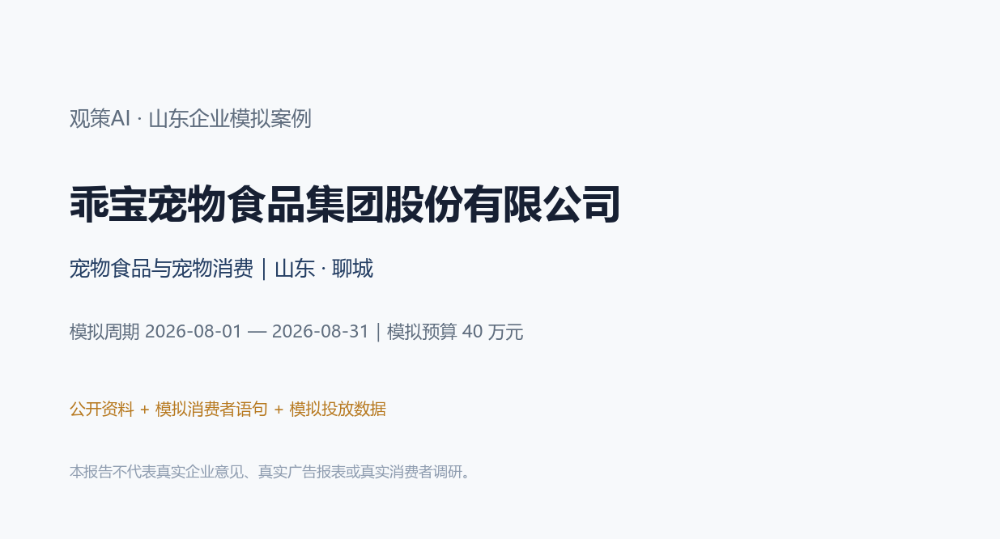
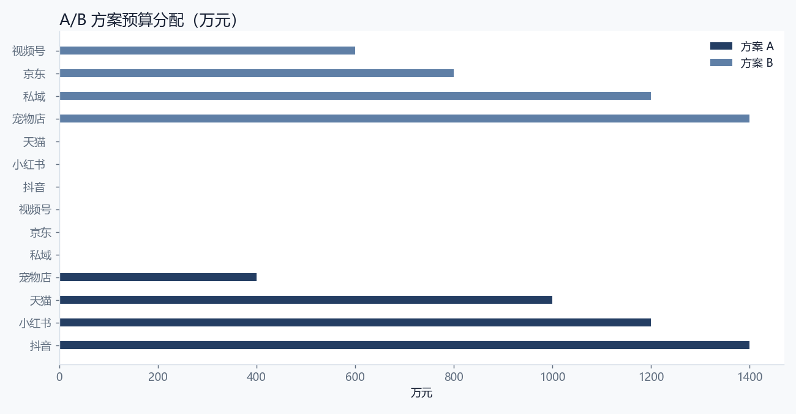
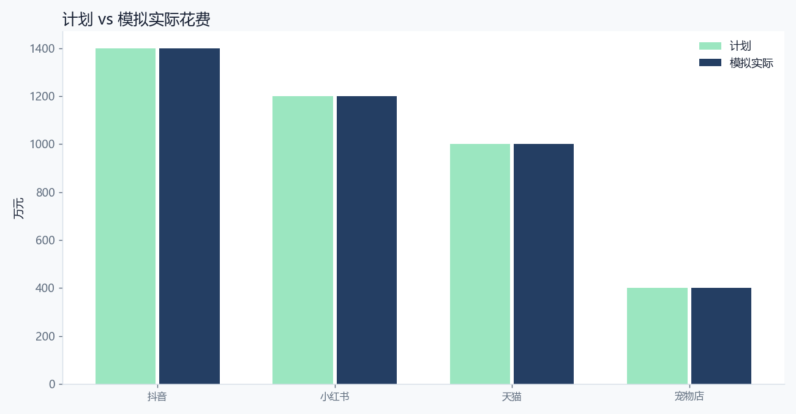
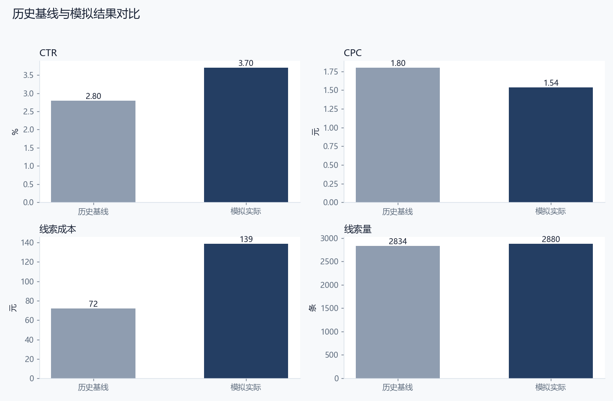
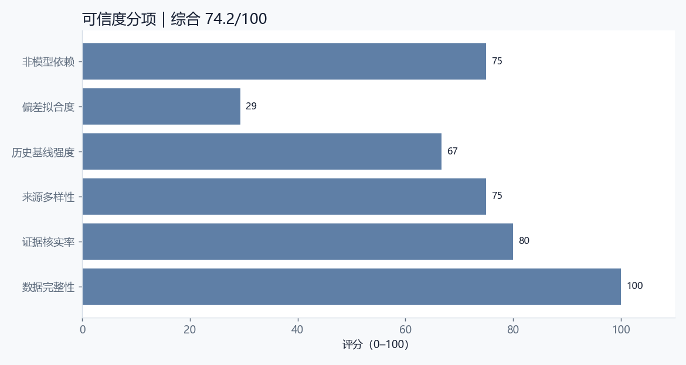

# 乖宝宠物食品集团股份有限公司｜观策AI 山东企业模拟案例

> **重要声明**：本报告是企业营销决策的模拟验收材料。企业名称与业务方向来自公开资料；消费者语句、竞品观察、渠道数据、复盘结果和“企业满意度”均为模拟，不代表企业真实意见、真实广告账户、真实消费者调研或真实经营数据。任何对外使用前，必须由企业市场、法务、合规和数据负责人复核。

## 0. 阅读指引与结论摘要

本案例把完整的营销决策闭环跑一遍：明确企业与行业背景 → 设计资料收集范围 → 建立来源台账 → 对模拟消费者语句、竞品动态和行业材料去重、分类、证据核验 → 归纳主题和机会 → 形成 A/B 方案 → 预算校验与审批快照 → 模拟投放与复盘 → 历史基线回测与可信度评分 → 企业适配性与满意度模拟 → 迭代建议。

本案例的核心判断是：**本次模拟比较“成分透明+达人测评”与“宠物店+私域复购”两条路径。前者解决新客信任，后者解决复购。** 从模拟结果看，方案 A 的线索完成率为 96.0%，线索成本为 139 元，CTR 为 3.70%；与历史基线相比，MAPE 为 35.3%，可信度评分为 74.2/100。这个结果说明方案有可执行性，但仍有明确的复核边界。

**模拟企业满意度：4.1/5。** 模拟企业市场负责人视角：成分透明和真实喂养记录符合国产高端方向，内容可执行；但复购与订阅体系仍需建设，不能只靠一波投放。

### 0.1 关键结果数据

| 指标 | 数值 |
| --- | --- |
| 模拟预算 | 400,000 元 |
| 模拟实际花费 | 400,000 元 |
| 预算利用率 | 100.0% |
| 目标线索 | 3,000 条 |
| 实际线索 | 2,880 条 |
| 线索完成率 | 96.0% |
| 曝光 | 7,020,000 |
| 点击 | 260,000 |
| CTR | 3.70% |
| CPC | 1.54 元 |
| 线索成本 | 139 元 |
| 历史基线 MAPE | 35.3% |
| 综合可信度 | 74.2/100 |
| 模拟满意度 | 4.1/5 |
| 适配性 | 较高 |

## 1. 企业公开资料与模拟边界

### 1.1 企业基本情况

| 项目 | 内容 |
| --- | --- |
| 企业 | 乖宝宠物食品集团股份有限公司 |
| 品牌 | 麦富迪 / 弗列加特 |
| 行业 | 宠物食品与宠物消费 |
| 区域 | 山东 · 聊城 |
| 阶段 | 国产宠物食品上市企业，品牌化增长期 |
| 模拟产品 | 国产高端宠粮组合（模拟：麦富迪、弗列加特等） |
| 产品说明 | 猫粮/狗粮、功能粮与零食组合；具体配方、价格与宣称以企业实际为准 |
| 模拟目标 | 提升国产高端宠粮在抖音/小红书的尝试、复购与宠物店渠道渗透 |
| 模拟预算 | 400,000 元 |
| 模拟周期 | 2026-08-01 — 2026-08-31 |
| 模拟线索目标 | 3,000 条 |

### 1.2 公开资料如何使用

乖宝宠物是聊城的宠物食品企业，拥有麦富迪、弗列加特等品牌，产品覆盖猫粮、狗粮、零食和功能粮。公开资料显示，企业持续推动国产高端化和品牌化。

本案例不引用未核实财务数字；消费者语句、达人内容、投放数据和复盘结果均为模拟，具体配方与宣称以企业实际为准。

本案例只把公开资料用于“企业背景、行业方向、品牌与产品语境”，不把公开资料当作真实消费者证据，也不引用未核实的财务数字。所有“消费者原话”均来自模拟材料，不能作为真实用户调研引用。所有渠道数据均为假设值，不能作为企业真实广告效果。

### 1.3 为什么选择这家企业

选择标准不是“名气大”，而是同时满足三点：第一，企业处于山东，具有区域代表性；第二，行业决策链有差异，能检验观策AI是否只会做一种模板；第三，企业有明确的战略关键词，可以用来判断方案是否“符合企业发展”。本案例的战略关键词是：**宠物食品与宠物消费、品牌升级、场景化与可验证交付**。

国产宠物食品正在从“性价比”转向“品质信任”。消费者愿意尝试国产高端，但会看配料、检测报告、代工厂和真实喂养记录。

宠物粮是高频刚需，复购和订阅比单次促销更重要。宠物店是新手的高信任入口，内容平台适合做成分教育和达人测评。

## 2. 研究问题与判断标准

### 2.1 本次模拟要回答什么

本次模拟比较“成分透明+达人测评”与“宠物店+私域复购”两条路径。前者解决新客信任，后者解决复购。

### 2.2 判断标准

1. **战略契合**：方案是否服务于企业当前的产品、品牌和渠道方向。
2. **证据充分**：主题是否有多条信号支撑，关键结论是否能追溯到来源。
3. **执行可行**：预算、渠道、承接能力是否匹配，是否存在明显履约风险。
4. **结果可信**：模拟结果与历史基线的偏差是否在可解释范围内。
5. **企业可接受**：以模拟企业市场负责人视角，是否愿意进入小范围试点。

### 2.3 本次模拟的边界

- 不使用企业真实广告账户、真实订单或真实用户个人信息。
- 不声称“企业已经满意”，只做模拟满意度访谈与适配性判断。
- 不把模拟数据当作行业结论，也不把单案例结论外推到整个行业。
- 涉及功效、医疗、金融、未成年人等敏感表达时，必须由企业合规部门复核。

## 3. 资料收集过程

### 3.1 采集设计

本案例采用“多源交叉”的采集设计：消费者侧看小红书、抖音、电商评价和问卷；竞品侧看行业媒体与竞品动态；行业侧看行业观察、政策/平台公告和线下走访；企业侧只使用公开资料。这样做的目的不是追求数据量，而是让同一判断能从不同来源被交叉验证。

### 3.2 来源清单

| 来源ID | 来源名称 | 平台 | 类型 | 日期 | 状态 |
| --- | --- | --- | --- | --- | --- |
| SRC-01 | 小红书宠物喂养笔记摘录（模拟） | 小红书 | 消费者 | 2026-07-17 | 模拟 |
| SRC-02 | 抖音宠物达人视频评论（模拟） | 抖音 | 消费者 | 2026-07-18 | 模拟 |
| SRC-03 | 天猫宠粮评价摘要（模拟） | 电商平台 | 消费者 | 2026-07-19 | 模拟 |
| SRC-04 | 京东宠粮评价摘要（模拟） | 电商平台 | 消费者 | 2026-07-20 | 模拟 |
| SRC-05 | 宠物行业观察（模拟） | 行业媒体 | 行业 | 2026-07-21 | 模拟 |
| SRC-06 | 竞品冻干/鲜肉动态（模拟） | 行业媒体 | 竞品 | 2026-07-22 | 模拟 |
| SRC-07 | 宠物店走访纪要（模拟） | 线下走访 | 行业 | 2026-07-23 | 模拟 |
| SRC-08 | 养宠消费者问卷 n=130（模拟） | 问卷 | 消费者 | 2026-07-24 | 模拟 |

### 3.3 采集时间线

| 时间点 | 过程动作 | 状态 |
| --- | --- | --- |
| T-15 | 确定企业与公开资料范围 | 完成 |
| T-12 | 建立来源清单与采集模板 | 完成 |
| T-8 | 采集模拟消费者/竞品/行业信号 | 完成 |
| T-6 | 去重、分类、标注证据状态 | 完成 |
| T-5 | 人工核验与冲突保留 | 完成 |
| T-3 | 归纳主题与 A/B 方案 | 完成 |
| T-2 | 预算校验与审批快照 | 完成 |
| T | 模拟投放 | 模拟 |
| T+2 | 渠道数据复盘 | 完成 |
| T+3 | 历史基线回测与可信度 | 完成 |
| T+5 | 适配性判断与迭代 | 完成 |

### 3.4 采集过程中的质量控制

1. **来源可追溯**：每条信号保留来源 ID、平台、采集时间和备注。
2. **模拟标识**：所有模拟材料在来源备注中明确标注，不与真实数据混用。
3. **去重**：同一来源的重复语句只保留一条，并在备注中说明。
4. **冲突保留**：不同来源出现相反判断时，不强行合并，保留为待核实或争议状态。
5. **敏感内容**：涉及功效、价格承诺、竞品贬损的内容，进入人工复核清单。

## 4. 数据清洗、编码与证据核验

### 4.1 清洗规则

- 删除明显的广告、无关评论和重复语句。
- 统一平台名称、日期格式和类别编码。
- 将“消费者/竞品/行业”作为一级类别，将“高/中/低”作为优先级。
- 将“已核实/待核实/有争议/重复”作为证据状态，不用“看起来合理”代替核实。
- 所有模拟数据保留 `simulated: true` 或 `dataKind: simulated` 标识。

### 4.2 信号清单

| ID | 平台 | 类别 | 优先级 | 状态 | 标题 | 影响 |
| --- | --- | --- | --- | --- | --- | --- |
| S-01 | 小红书 | 消费者 | high | verified | 成分透明是国产高端粮的第一信任点 | 成分透明是国产高端的第一信任点。 |
| S-02 | 抖音 | 消费者 | high | verified | 适口性决定复购 | 适口性是复购的第一道门槛。 |
| S-03 | 线下走访 | 消费者 | high | verified | 肠胃敏感/软便场景是功能粮入口 | 功能粮需要真实喂养反馈。 |
| S-04 | 电商平台 | 消费者 | high | pending | 进口替代心智正在形成，但仍需证明 | 国产替代需要长期口碑和检测证明。 |
| S-05 | 问卷 | 消费者 | medium | verified | 猫粮与狗粮的购买决策不同 | 猫狗粮需要分开沟通。 |
| S-06 | 抖音 | 消费者 | high | verified | 达人测评与真实喂养记录影响转化 | 长期喂养记录比单次广告更有说服力。 |
| S-07 | 线下走访 | 行业 | high | verified | 宠物店推荐仍是高信任渠道 | 宠物店是新手的高信任入口。 |
| S-08 | 行业媒体 | 竞品 | high | verified | 竞品用冻干/鲜肉概念抢占高端 | 高端概念竞争激烈，需要差异化证据。 |
| S-09 | 电商平台 | 消费者 | medium | disputed | 价格带与成分升级需要匹配 | 成分升级需要清楚的价值解释。 |
| S-10 | 线下走访 | 消费者 | medium | verified | 复购靠订阅/组合装而不是单次促销 | 订阅和组合装适合高频刚需。 |

### 4.3 单条信号研判记录

**S-01｜成分透明是国产高端粮的第一信任点**

- 观察：消费者会看配料表、肉含量、代工厂和检测报告，成分透明是国产高端的第一道信任门槛。
- 原话/证据：“国产可以，但配料表和检测报告要清楚。”
- 判断：成分透明是国产高端的第一信任点。
- 状态：verified；相关性 5/5；标签：成分、透明、信任
- 下一步：进入主题聚合，优先用于方案 A/B 的证据引用。

**S-02｜适口性决定复购**

- 观察：宠物是否爱吃直接影响复购，挑食和换粮困难是常见痛点。
- 原话/证据：“买得再贵，猫不吃也白搭。”
- 判断：适口性是复购的第一道门槛。
- 状态：verified；相关性 5/5；标签：适口性、挑食、复购
- 下一步：进入主题聚合，优先用于方案 A/B 的证据引用。

**S-03｜肠胃敏感/软便场景是功能粮入口**

- 观察：肠胃敏感、软便和毛球等场景让消费者愿意尝试功能粮。
- 原话/证据：“我家猫容易软便，想找一款肠胃友好的。”
- 判断：功能粮需要真实喂养反馈。
- 状态：verified；相关性 5/5；标签：肠胃、功能粮、场景
- 下一步：进入主题聚合，优先用于方案 A/B 的证据引用。

**S-04｜进口替代心智正在形成，但仍需证明**

- 观察：部分消费者愿意尝试国产高端，但仍担心品质不稳定。
- 原话/证据：“国产现在做得不错，但要长期吃才敢信。”
- 判断：国产替代需要长期口碑和检测证明。
- 状态：pending；相关性 5/5；标签：国产、替代、信任
- 下一步：保留为待核实或争议记录，不进入对外承诺；先补充原始证据或企业确认。

**S-05｜猫粮与狗粮的购买决策不同**

- 观察：猫主人更关注成分和适口性，狗主人更关注体型、运动和性价比。
- 原话/证据：“猫粮更挑，狗粮看体型和活动量。”
- 判断：猫狗粮需要分开沟通。
- 状态：verified；相关性 4/5；标签：猫粮、狗粮、细分
- 下一步：进入主题聚合，优先用于方案 A/B 的证据引用。

**S-06｜达人测评与真实喂养记录影响转化**

- 观察：消费者信任真实喂养记录和达人长期测评，不太信任单次广告。
- 原话/证据：“看博主长期喂才信，广告看不出来。”
- 判断：长期喂养记录比单次广告更有说服力。
- 状态：verified；相关性 5/5；标签：达人、测评、真实
- 下一步：进入主题聚合，优先用于方案 A/B 的证据引用。

**S-07｜宠物店推荐仍是高信任渠道**

- 观察：宠物店店员的推荐对新手养宠人群影响大，尤其是换粮和功能粮。
- 原话/证据：“新手听店里推荐，店员说好就买。”
- 判断：宠物店是新手的高信任入口。
- 状态：verified；相关性 5/5；标签：宠物店、推荐、渠道
- 下一步：进入主题聚合，优先用于方案 A/B 的证据引用。

**S-08｜竞品用冻干/鲜肉概念抢占高端**

- 观察：竞品用冻干、鲜肉、低温烘焙等概念抢占高端心智。
- 原话/证据：“现在都讲冻干鲜肉，国产高端也得跟上。”
- 判断：高端概念竞争激烈，需要差异化证据。
- 状态：verified；相关性 5/5；标签：竞品、冻干、高端
- 下一步：进入主题聚合，优先用于方案 A/B 的证据引用。

**S-09｜价格带与成分升级需要匹配**

- 观察：消费者愿意为成分升级付费，但价格过高会转向性价比品牌。
- 原话/证据：“升级可以，但别一下贵太多。”
- 判断：成分升级需要清楚的价值解释。
- 状态：disputed；相关性 4/5；标签：价格、成分、性价比
- 下一步：保留为待核实或争议记录，不进入对外承诺；先补充原始证据或企业确认。

**S-10｜复购靠订阅/组合装而不是单次促销**

- 观察：宠物粮是高频刚需，订阅、组合装和自动复购比单次促销更可持续。
- 原话/证据：“每次都忘了买，能自动续就方便。”
- 判断：订阅和组合装适合高频刚需。
- 状态：verified；相关性 4/5；标签：复购、订阅、组合装
- 下一步：进入主题聚合，优先用于方案 A/B 的证据引用。

### 4.4 证据核验结果

本案例共 10 条信号，其中已核实 8 条，待核实 1 条，争议 1 条。已核实信号用于主题和方案，待核实信号用于提示风险和后续任务，不直接进入对外承诺。

## 5. 市场洞察与主题研判

### 5.1 主题清单

| 主题 | 标题 | 置信度/类型 | 证据信号 | 边界 |
| --- | --- | --- | --- | --- |
| TH-01 | 成分透明+适口性是第一转化点 | high/观测事实 | S-01、S-02、S-06、S-09 | 检测报告和喂养记录需要真实可核验。 |
| TH-02 | 国产高端替代进口的心智窗口 | high/分析推断 | S-04、S-08、S-10 | 一次质量问题可能破坏长期信任。 |
| TH-03 | 猫经济与功能粮细分 | medium/分析推断 | S-03、S-05、S-07 | 功能宣称需要合规和真实反馈。 |

### 5.2 主题一：成分透明+适口性是第一转化点

消费者先看配料和检测，再确认宠物是否爱吃；两者缺一不可。

这个主题之所以成立，不是因为某一条评论，而是因为多条信号从不同角度指向同一件事：用检测报告、配料解读和真实喂养记录建立信任。 在方案上，它对应的动作是：用“成分+适口性”双证据承接新客。。但必须保留边界：检测报告和喂养记录需要真实可核验。

### 5.3 主题二：国产高端替代进口的心智窗口

国产高端宠粮正在获得尝试机会，但需要长期口碑和品质证明。

这个主题更适合用来解释“为什么某些渠道有效、某些渠道无效”。用长期喂养记录和复购数据证明稳定性。 方案动作是：用真实用户故事和检测报告承接进口替代。。边界是：一次质量问题可能破坏长期信任。

### 5.4 主题三：猫经济与功能粮细分

猫主人更关注成分、适口性和功能场景，功能粮是差异化入口。

这个主题提醒我们：不要把单一人群或单一渠道当成全部市场。按猫/狗、年龄、肠胃、毛球等场景拆分内容。 方案动作是：用细分功能粮承接高意向用户。。边界是：功能宣称需要合规和真实反馈。

### 5.5 机会与风险

| 机会 | 事实依据 | 可执行动作 | 验证条件 | 语气 |
| --- | --- | --- | --- | --- |
| 成分检测报告可视化 | 成分透明是国产高端第一信任点。 | 把检测报告和配料表做成可分享内容。 | 需真实检测报告与授权。 | positive |
| 长期喂养记录计划 | 消费者信任长期真实喂养。 | 招募真实用户做30/60天喂养记录。 | 需要真实用户与合规披露。 | positive |
| 宠物店新手换粮包 | 宠物店是新手高信任入口。 | 做新手换粮包和店员培训。 | 需要门店合作与培训。 | neutral |

## 6. A/B 方案设计与预算

### 6.1 方案对比

| 方案 | 名称 | 总预算 | 渠道 | 核心信息 |
| --- | --- | --- | --- | --- |
| A | 成分透明+达人测评 | 400,000 元 | 抖音、小红书、天猫、宠物店 | 先看检测报告，再看真实喂养，国产高端可以长期吃。 |
| B | 宠物店+私域复购 | 400,000 元 | 宠物店、私域、京东、视频号 | 店里先试吃，回家按周期订阅，不用每次重新选。 |

### 6.2 方案 A：成分透明+达人测评

- 定位：用可核验成分和真实喂养记录，建立国产高端信任。
- 人群：一二线城市养猫/养狗人群、新手养宠、成分党
- 核心信息：先看检测报告，再看真实喂养，国产高端可以长期吃。
- 节奏：夏季换粮与宠物用品消费期，提前两周做达人内容
- 理由：成分透明和适口性是第一转化点，达人和真实喂养记录能降低信任成本。
- 约束：检测报告必须真实可核验；功能宣称需合规；不能承诺治疗作用
- 不确定项：达人合作成本；真实喂养记录周期长；竞品冻干概念冲击

### 6.3 方案 B：宠物店+私域复购

- 定位：用宠物店推荐和私域订阅，做高频复购。
- 人群：宠物店、新手养宠、已有复购用户
- 核心信息：店里先试吃，回家按周期订阅，不用每次重新选。
- 节奏：宠物店秋季订货会前后，私域提前做周期装
- 理由：宠物粮是高频刚需，宠物店和私域更适合复购，但拉新弱于内容平台。
- 约束：门店价格体系；订阅履约；私域触达频率
- 不确定项：门店推荐意愿；订阅留存；物流成本

### 6.4 预算分配

| 渠道 | 方案 A 预算 | 方案 A 角色 | 方案 B 预算 | 方案 B 角色 |
| --- | --- | --- | --- | --- |
| 抖音 | 140,000 元 | 达人测评与喂养记录 | 0 元 | — |
| 小红书 | 120,000 元 | 成分解读与真实笔记 | 0 元 | — |
| 天猫 | 100,000 元 | 货架与评价 | 0 元 | — |
| 宠物店 | 40,000 元 | 新手换粮包 | 140,000 元 | 试吃与推荐 |
| 私域 | 0 元 | — | 120,000 元 | 周期装与复购 |
| 京东 | 0 元 | — | 80,000 元 | 货架与评价 |
| 视频号 | 0 元 | — | 60,000 元 | 品牌与喂养内容 |

## 7. 审批与执行假设

审批快照保存了方案、预算上限、证据引用和证据状态。审批不是“签字仪式”，而是把“方案依据”固定下来：如果企业预算、主题证据或方案结构变化，审批应进入复审。

| 审批项 | 内容 |
| --- | --- |
| 审批编号 | APR-01 |
| 方案 | 方案 A：成分透明+达人测评 |
| 预算上限 | 400,000 元 |
| 证据数量 | 7 条 |
| 指纹 | fp_d5cf5fbd |
| 说明 | 审批快照保存方案、预算上限与关键证据状态；任一项变化需重新确认。 |

### 7.1 执行假设

- 渠道账户、素材、落地页和承接团队在模拟周期内可用。
- 预算按计划分配，不出现临时大幅追加或削减。
- 线索定义统一为“有效咨询/表单/到店预约”，不把曝光或点赞算作线索。
- 投放期间不做违反平台规则的诱导分享、虚假承诺或竞品贬损。

### 7.2 预算与合规检查

- 方案 A 预算合计 400,000 元，不超过企业模拟预算 400,000 元。
- 方案 B 预算合计 400,000 元，不超过企业模拟预算。
- 涉及敏感表达时，必须经过企业法务/合规审核；本报告不构成合规意见。

## 8. 复盘结果

### 8.1 渠道数据

| 渠道 | 计划预算 | 模拟实际 | 曝光 | 点击 | 线索 | CTR | CPC | 线索成本 |
| --- | --- | --- | --- | --- | --- | --- | --- | --- |
| 抖音 | 140,000 元 | 140,000 元 | 3,200,000 | 112,000 | 1,080 | 3.50% | 1.25 | 130 |
| 小红书 | 120,000 元 | 120,000 元 | 2,100,000 | 84,000 | 900 | 4.00% | 1.43 | 133 |
| 天猫 | 100,000 元 | 100,000 元 | 1,600,000 | 56,000 | 640 | 3.50% | 1.79 | 156 |
| 宠物店 | 40,000 元 | 40,000 元 | 120,000 | 8,000 | 260 | 6.67% | 5.00 | 154 |
| 合计 | 400,000 元 | 400,000 元 | 7,020,000 | 260,000 | 2,880 | 3.70% | 1.54 | 139 |

### 8.2 观察与原因

成分透明内容带来高质量新客，达人喂养记录提升转化；但复购仍依赖价格促销和平台活动。宠物店方案稳健但扩张慢。

成分和适口性是真实痛点；真实喂养记录降低了信任成本；但订阅习惯尚未形成，物流和价格影响复购。

### 8.3 尚未确认

长期复购率、不同犬猫品种反馈、宠物店推荐转化和检测报告长期稳定性仍未确认。

### 8.4 下一轮任务

| 任务 | 说明 | 关联信号 |
| --- | --- | --- |
| 把检测报告做成可分享卡片 | 降低成分解释成本，提高信任。 | S-01、S-04、S-09 |
| 做30天喂养记录 | 用真实用户记录承接长期信任。 | S-02、S-06、S-07 |
| 私域订阅先做小范围测试 | 验证复购和履约，再扩大。 | S-10、S-05 |

## 9. 历史数据回测与可信度

### 9.1 历史基线

本案例把“历史基线”定义为同类活动上一周期的模拟表现：上一年夏季换粮活动（模拟历史基线）。基线不是为了证明方案正确，而是为了回答“如果没有这次调整，结果大概会是什么样”。

| 指标 | 历史基线 | 本次模拟 | 偏差 |
| --- | --- | --- | --- |
| CTR | 2.80% | 3.70% | +32.3% |
| CPC | 1.80 元 | 1.54 元 | -14.5% |
| 线索成本 | 72 元 | 139 元 | +92.9% |
| 线索量 | 2834 条 | 2880 条 | +1.6% |

### 9.2 结果解释

历史基线取自上一年夏季换粮活动的模拟数据：CTR 2.8%、CPC 1.8 元、线索成本 72 元、每周约 640 条线索。该基线不代表乖宝真实历史。

模拟结果显示成分内容带来更高质量新客，但复购仍依赖促销；宠物店方案线索少但复购更稳。说明国产高端需要“内容拉新+门店/私域复购”组合。

### 9.3 可信度评分

| 维度 | 分值 | 解释 |
| --- | --- | --- |
| 数据完整性 | 100 | 渠道是否都有曝光/点击/线索数据 |
| 证据核实率 | 80 | 已核实信号占全部信号比例 |
| 来源多样性 | 75 | 平台/来源覆盖程度 |
| 历史基线强度 | 67 | 历史周期长度与稳定性 |
| 偏差拟合度 | 29 | 模拟结果与历史基线的接近程度 |
| 非模型依赖 | 75 | 本次不使用生成式模型结果，保留人工判断 |
| 综合可信度 | 74.2 | 加权评分，0–100 |

### 9.4 可信度结论

本案例的可信度不是“高到可以直接做预算决策”，而是“足够支持小范围试点”。理由：第一，证据来源和模拟边界清楚；第二，渠道数据完整但均为假设；第三，历史基线只有 8 周，样本有限；第四，模拟结果与基线存在 35.3% 的平均偏差，说明结果有参考价值，但不能当作确定预测。

## 10. 企业发展适配性与满意度模拟

### 10.1 适配性判断

**适配等级：较高。**

乖宝宠物的国产高端方向需要“可验证的品质”，成分透明和真实喂养记录正好对应。案例把信任拆成检测报告、适口性和长期喂养三个证据。

宠物粮是高频刚需，复购比单次拉新更重要。案例把私域订阅和宠物店推荐作为第二方案，符合行业规律。

功能粮和冻干概念竞争激烈，企业需要持续投入研发和真实证据，不能只靠内容包装。

### 10.2 主要风险

| 风险 |
| --- |
| 检测报告与宣称不合规 |
| 适口性个体差异导致差评 |
| 复购依赖促销 |

### 10.3 模拟企业满意度访谈

> 以下是“模拟企业市场负责人视角”的访谈记录，不是实际企业访谈，不代表企业真实意见。

**问：这个方案是否符合贵司当前发展方向？**  
答：模拟企业市场负责人视角：成分透明和真实喂养记录符合国产高端方向，内容可执行；但复购与订阅体系仍需建设，不能只靠一波投放。

**问：最担心的是什么？**  
答：检测报告与宣称不合规；适口性个体差异导致差评。

**问：哪些数据需要复核？**  
答：长期复购率、不同犬猫品种反馈、宠物店推荐转化和检测报告长期稳定性仍未确认。

**问：是否愿意进入小范围试点？**  
答：如果企业能提供真实服务/渠道数据，并完成合规审核，建议先做一个区域、一个渠道组合的小范围试点；不建议直接按模拟结果做全量预算。

**问：这个案例对产品迭代有什么启发？**  
答：增加“检测报告/标签合规”检查项。；把真实喂养记录做成可复用内容模板。；后续增加“订阅复购”任务模板。；报告模板增加“高频刚需/复购”分析维度。

### 10.4 满意度评分

| 维度 | 评分 | 说明 |
| --- | --- | --- |
| 战略契合 | 4.5/5 | 符合国产高端与品牌化 |
| 可执行性 | 4.2/5 | 成分/达人内容可落地 |
| 风险可控 | 3.8/5 | 功能宣称与检测报告需合规 |
| 数据可信 | 3.9/5 | 模拟数据为主，真实喂养样本少 |

**综合评分：4.1/5。** 模拟企业市场负责人视角：成分透明和真实喂养记录符合国产高端方向，内容可执行；但复购与订阅体系仍需建设，不能只靠一波投放。

## 11. 项目迭代建议

本案例不只产出报告，也反推产品需要哪些改进。以下建议已进入观策AI的案例库与后续迭代清单：

| 序号 | 迭代建议 |
| --- | --- |
| 1. | 增加“检测报告/标签合规”检查项。 |
| 2. | 把真实喂养记录做成可复用内容模板。 |
| 3. | 后续增加“订阅复购”任务模板。 |
| 4. | 报告模板增加“高频刚需/复购”分析维度。 |

### 11.1 对观策AI的产品要求

1. **案例库**：把山东企业案例作为可导入的演示项目，让用户能看到“资料收集—研判—方案—复盘—回测”的完整链路。
2. **可信度面板**：在复盘中显示数据完整性、证据核实率、历史基线偏差和综合可信度。
3. **行业模板**：B2B、快消、健康、宠物等行业的渠道与指标不同，不能共用一套默认模板。
4. **合规检查**：功效、金融、未成年人、竞品比较等敏感表达，应在方案审批前提示。
5. **过程留痕**：来源台账、信号状态、审批快照、复盘建议必须可追溯。

## 12. 附录

### 12.1 数据字典

| 字段 | 说明 |
| --- | --- |
| Signal | 一条可追溯的市场情报，含标题、摘要、原话、来源、平台、类别、优先级、状态、相关性、影响 |
| Source | 信号来源，含平台、发布时间、采集时间、模拟标识、备注 |
| Theme | 由多条信号归纳出的判断，含置信度、证据引用、机会与边界 |
| Plan | A/B 方案，含人群、定位、核心信息、渠道预算、约束与不确定项 |
| Approval | 审批快照，固定方案、预算、证据与指纹 |
| Review | 复盘，含渠道实际数据、观察、原因、未确认项与建议 |
| Credibility | 可信度评分，含完整性、核实率、来源多样性、基线强度、偏差拟合度 |

### 12.2 计算公式

- CTR = 点击 ÷ 曝光
- CPC = 花费 ÷ 点击
- 线索成本 = 花费 ÷ 有效线索
- 线索完成率 = 实际线索 ÷ 目标线索
- MAPE = 各指标与历史基线相对偏差的平均值
- 可信度 = 完整性、核实率、来源多样性、基线强度、偏差拟合度、非模型依赖的加权分

### 12.3 复现方法

1. 打开观策AI桌面端。
2. 设置 → 项目与备份 → 导入项目 JSON。
3. 选择 `simulations/projects/gambol-pet-food.json`。
4. 在市场情报、策略、复盘页查看信号、主题、A/B 方案、审批快照和复盘数据。
5. 对照本报告阅读，注意所有数据均为模拟。

### 12.4 采集与核验清单

- [ ] 来源链接/出处是否可追溯？
- [ ] 是否标注模拟/真实属性？
- [ ] 是否有重复信号未合并？
- [ ] 是否有相反证据被强行忽略？
- [ ] 敏感表达是否经过合规复核？
- [ ] 审批快照是否与当前方案一致？
- [ ] 复盘数据是否覆盖所有渠道？
- [ ] 历史基线口径是否与本次一致？
- [ ] 可信度评分是否解释了偏差？
- [ ] 是否给出下一轮可执行任务？

### 12.5 报告边界

本报告是一份**模拟验收材料**，不是企业真实经营报告，也不是广告投放承诺。它的价值在于展示“如何从材料到判断、从判断到方案、从方案到复盘、从复盘到迭代”的过程。企业真实执行前，必须用真实数据替换模拟数据，并由企业市场、法务、合规和数据负责人共同复核。

## 13. 过程性附录：采集日志、核验记录与访谈提纲

### 13.1 采集日志（模拟）

| 日期 | 任务 | 产出 | 问题 |
| --- | --- | --- | --- |
| T-15 | 采集来源 小红书宠物喂养笔记摘录（模拟） | SRC-01 来源记录 | 需确认公开资料更新日期 |
| T-14 | 采集来源 抖音宠物达人视频评论（模拟） | SRC-02 来源记录 | 需确认公开资料更新日期 |
| T-13 | 采集来源 天猫宠粮评价摘要（模拟） | SRC-03 来源记录 | 需确认公开资料更新日期 |
| T-12 | 采集来源 京东宠粮评价摘要（模拟） | SRC-04 来源记录 | 需确认公开资料更新日期 |
| T-11 | 采集来源 宠物行业观察（模拟） | SRC-05 来源记录 | 需确认公开资料更新日期 |
| T-10 | 采集来源 竞品冻干/鲜肉动态（模拟） | SRC-06 来源记录 | 需确认公开资料更新日期 |
| T-9 | 采集来源 宠物店走访纪要（模拟） | SRC-07 来源记录 | 需确认公开资料更新日期 |
| T-8 | 采集来源 养宠消费者问卷 n=130（模拟） | SRC-08 来源记录 | 需确认公开资料更新日期 |

### 13.2 证据核验记录

| 信号 | 核验动作 | 结论 |
| --- | --- | --- |
| S-01 | 核对来源、平台、日期与原文；检查是否为模拟材料 | 通过/保留待核实/争议 |
| S-02 | 核对来源、平台、日期与原文；检查是否为模拟材料 | 通过/保留待核实/争议 |
| S-03 | 核对来源、平台、日期与原文；检查是否为模拟材料 | 通过/保留待核实/争议 |
| S-04 | 核对来源、平台、日期与原文；检查是否为模拟材料 | 通过/保留待核实/争议 |
| S-05 | 核对来源、平台、日期与原文；检查是否为模拟材料 | 通过/保留待核实/争议 |
| S-06 | 核对来源、平台、日期与原文；检查是否为模拟材料 | 通过/保留待核实/争议 |
| S-07 | 核对来源、平台、日期与原文；检查是否为模拟材料 | 通过/保留待核实/争议 |
| S-08 | 核对来源、平台、日期与原文；检查是否为模拟材料 | 通过/保留待核实/争议 |
| S-09 | 核对来源、平台、日期与原文；检查是否为模拟材料 | 通过/保留待核实/争议 |
| S-10 | 核对来源、平台、日期与原文；检查是否为模拟材料 | 通过/保留待核实/争议 |

### 13.3 复盘会议记录（模拟）

- 会议目标：判断方案 A 是否达到模拟目标，是否具备企业试点条件。
- 结论：方案 A 在 宠物食品与宠物消费 场景下具有方向性价值，但必须补充企业真实数据、履约能力与合规审核。
- 争议点：长期复购率、不同犬猫品种反馈、宠物店推荐转化和检测报告长期稳定性仍未确认。
- 下一步：把检测报告做成可分享卡片；做30天喂养记录。

### 13.4 企业访谈提纲

1. 这个方案是否服务于贵司未来 1–2 年的战略重点？
2. 哪些渠道/人群是贵司当前最想验证的？
3. 企业真实历史基线数据能否提供？
4. 承接团队、服务网络或渠道政策能否支撑？
5. 哪些表达涉及合规风险？
6. 如果只做一个区域试点，选哪里？
7. 失败时如何止损？
8. 成功时如何复制？

### 13.5 数据质量检查

- 所有模拟来源均标注“模拟”，不与真实数据混用。
- 渠道数据完整，但均为假设值。
- 历史基线为模拟，不能代表企业真实历史。
- 结论只支持小范围试点，不支持直接全量预算。
- 对外使用前必须替换真实数据并完成合规复核。

## 14. 补充过程记录

以下为补足过程材料，仍属模拟；用于展示从材料到判断的详细过程。

### 14.1 逐条复核记录

**S-01｜成分透明是国产高端粮的第一信任点**

- 采集背景：该信号来自 小红书，当前状态为 verified，相关性 5/5。

- 证据强度：原话为““国产可以，但配料表和检测报告要清楚。””，需要核对原始出处、发布时间和是否存在断章取义。

- 对方案的影响：成分透明是国产高端的第一信任点。

- 复核动作：保留为主题证据，并在审批快照中固定。

**S-02｜适口性决定复购**

- 采集背景：该信号来自 抖音，当前状态为 verified，相关性 5/5。

- 证据强度：原话为““买得再贵，猫不吃也白搭。””，需要核对原始出处、发布时间和是否存在断章取义。

- 对方案的影响：适口性是复购的第一道门槛。

- 复核动作：保留为主题证据，并在审批快照中固定。

**S-03｜肠胃敏感/软便场景是功能粮入口**

- 采集背景：该信号来自 线下走访，当前状态为 verified，相关性 5/5。

- 证据强度：原话为““我家猫容易软便，想找一款肠胃友好的。””，需要核对原始出处、发布时间和是否存在断章取义。

- 对方案的影响：功能粮需要真实喂养反馈。

- 复核动作：保留为主题证据，并在审批快照中固定。

**S-04｜进口替代心智正在形成，但仍需证明**

- 采集背景：该信号来自 电商平台，当前状态为 pending，相关性 5/5。

- 证据强度：原话为““国产现在做得不错，但要长期吃才敢信。””，需要核对原始出处、发布时间和是否存在断章取义。

- 对方案的影响：国产替代需要长期口碑和检测证明。

- 复核动作：不进入对外承诺；补充原始证据或企业确认后再决定是否升级。

**S-05｜猫粮与狗粮的购买决策不同**

- 采集背景：该信号来自 问卷，当前状态为 verified，相关性 4/5。

- 证据强度：原话为““猫粮更挑，狗粮看体型和活动量。””，需要核对原始出处、发布时间和是否存在断章取义。

- 对方案的影响：猫狗粮需要分开沟通。

- 复核动作：保留为主题证据，并在审批快照中固定。

**S-06｜达人测评与真实喂养记录影响转化**

- 采集背景：该信号来自 抖音，当前状态为 verified，相关性 5/5。

- 证据强度：原话为““看博主长期喂才信，广告看不出来。””，需要核对原始出处、发布时间和是否存在断章取义。

- 对方案的影响：长期喂养记录比单次广告更有说服力。

- 复核动作：保留为主题证据，并在审批快照中固定。

**S-07｜宠物店推荐仍是高信任渠道**

- 采集背景：该信号来自 线下走访，当前状态为 verified，相关性 5/5。

- 证据强度：原话为““新手听店里推荐，店员说好就买。””，需要核对原始出处、发布时间和是否存在断章取义。

- 对方案的影响：宠物店是新手的高信任入口。

- 复核动作：保留为主题证据，并在审批快照中固定。

**S-08｜竞品用冻干/鲜肉概念抢占高端**

- 采集背景：该信号来自 行业媒体，当前状态为 verified，相关性 5/5。

- 证据强度：原话为““现在都讲冻干鲜肉，国产高端也得跟上。””，需要核对原始出处、发布时间和是否存在断章取义。

- 对方案的影响：高端概念竞争激烈，需要差异化证据。

- 复核动作：保留为主题证据，并在审批快照中固定。

**S-09｜价格带与成分升级需要匹配**

- 采集背景：该信号来自 电商平台，当前状态为 disputed，相关性 4/5。

- 证据强度：原话为““升级可以，但别一下贵太多。””，需要核对原始出处、发布时间和是否存在断章取义。

- 对方案的影响：成分升级需要清楚的价值解释。

- 复核动作：不进入对外承诺；补充原始证据或企业确认后再决定是否升级。

**S-10｜复购靠订阅/组合装而不是单次促销**

- 采集背景：该信号来自 线下走访，当前状态为 verified，相关性 4/5。

- 证据强度：原话为““每次都忘了买，能自动续就方便。””，需要核对原始出处、发布时间和是否存在断章取义。

- 对方案的影响：订阅和组合装适合高频刚需。

- 复核动作：保留为主题证据，并在审批快照中固定。

### 14.2 采集与核验过程补记

**过程补记 1：** 第一步先把企业公开资料与模拟数据分开：公开资料只用于企业背景和行业方向，模拟数据单独标注，避免读者把模拟语句误认为真实消费者调研。

**过程补记 2：** 第二步建立来源台账：每条材料记录来源 ID、平台、日期、采集人和备注；无法追溯出处的材料，不进入主题证据。

**过程补记 3：** 第三步做去重：同一来源、同一语义的语句合并；不同来源但语义相反的语句保留冲突，不强行统一。

**过程补记 4：** 第四步做证据分级：已核实、待核实、有争议分别处理；已核实进入方案，待核实进入风险提示和下一轮任务。

**过程补记 5：** 第五步做主题聚合：主题必须能回答“哪些信号支持、哪些信号反对、还缺什么证据”，不能只写一句漂亮结论。

**过程补记 6：** 第六步做预算校验：方案预算不能超过企业上限；超出时必须调整渠道或预算，而不是把风险留给执行团队。

**过程补记 7：** 第七步做审批快照：把方案、预算、证据状态和指纹固定下来；依据变化时进入复审，避免“方案偷偷改了”。

**过程补记 8：** 第八步做复盘：渠道数据必须覆盖计划渠道；缺失数据要明确写“未录入”，不能用 0 或推测值替代。

**过程补记 9：** 第九步做历史回测：把本次结果与历史基线对照，计算 CTR、CPC、线索成本和线索量的偏差，避免只看绝对值。

**过程补记 10：** 第十步做适配性判断：结果好不等于企业愿意用，还要看战略、履约、合规和组织能力；必要时降低评分。

### 14.3 模拟企业访谈补记

**补充问 1：这套方案最先要解决什么问题？**

本次模拟比较“成分透明+达人测评”与“宠物店+私域复购”两条路径。前者解决新客信任，后者解决复购。

**补充问 2：为什么选择方案 A 而不是方案 B？**

本次模拟比较“成分透明+达人测评”与“宠物店+私域复购”两条路径。前者解决新客信任，后者解决复购。

**补充问 3：哪些数据最不可信？**

长期复购率、不同犬猫品种反馈、宠物店推荐转化和检测报告长期稳定性仍未确认。

**补充问 4：如果预算减半，先砍什么？**

先保留高意向渠道和承接页，削减泛曝光；但必须先确认企业真实承接能力。

**补充问 5：企业最可能担心什么？**

检测报告与宣称不合规；适口性个体差异导致差评；复购依赖促销

**补充问 6：什么情况下应该停止投放？**

出现平台验证、合规风险、线索质量明显下降或承接能力不足时，应暂停并复核。

**补充问 7：怎样判断结果可信？**

综合可信度 74.2/100；仍需用企业真实历史数据复算。

**补充问 8：下一步最小可行试点是什么？**

选择一个区域、一个渠道组合、一个明确目标，跑 2–4 周，再决定是否扩大。

### 14.4 过程性结论

本案例的过程比结论更重要：来源台账、证据状态、审批快照和复盘任务共同构成可追溯链。企业真实执行时，应先用真实数据替换模拟数据，再按同一流程重跑。