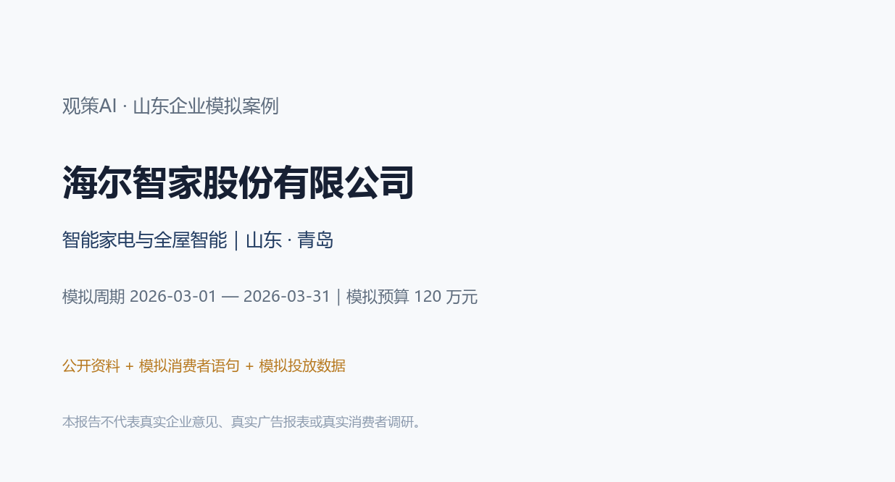
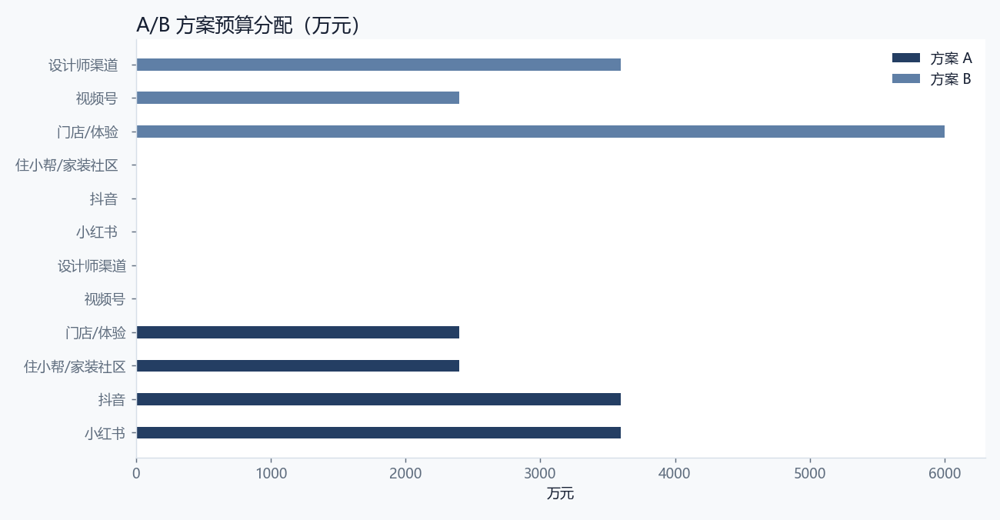
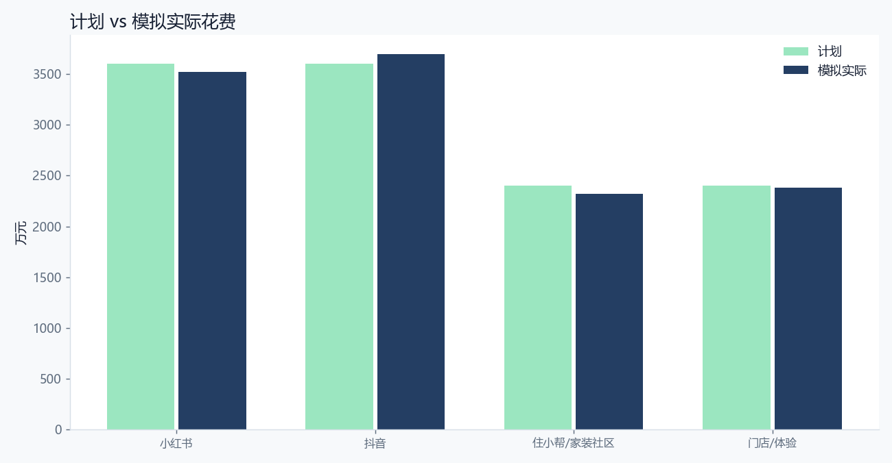
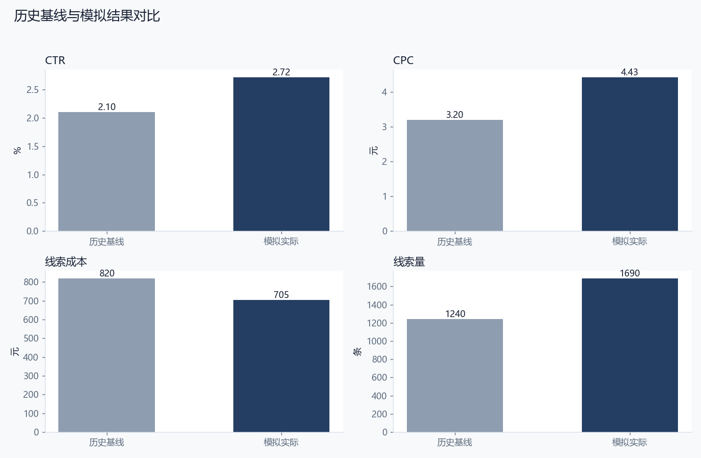
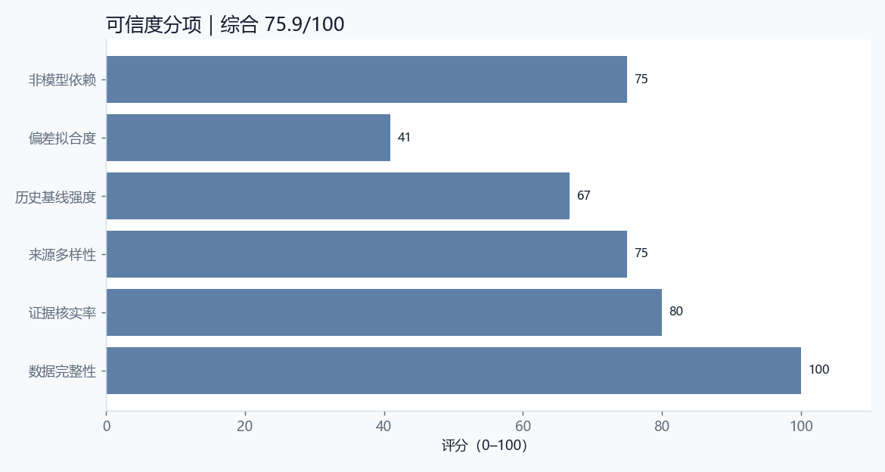

# 海尔智家股份有限公司｜观策AI 山东企业模拟案例

> **重要声明**：本报告是企业营销决策的模拟验收材料。企业名称与业务方向来自公开资料；消费者语句、竞品观察、渠道数据、复盘结果和“企业满意度”均为模拟，不代表企业真实意见、真实广告账户、真实消费者调研或真实经营数据。任何对外使用前，必须由企业市场、法务、合规和数据负责人复核。

## 0. 阅读指引与结论摘要

本案例把完整的营销决策闭环跑一遍：明确企业与行业背景 → 设计资料收集范围 → 建立来源台账 → 对模拟消费者语句、竞品动态和行业材料去重、分类、证据核验 → 归纳主题和机会 → 形成 A/B 方案 → 预算校验与审批快照 → 模拟投放与复盘 → 历史基线回测与可信度评分 → 企业适配性与满意度模拟 → 迭代建议。

本案例的核心判断是：**本次模拟要回答的不是“投多少”，而是“用什么内容让高意向用户相信一站式交付”。因此方案 A 用服务清单和旧房场景做主线，方案 B 用设计师渠道做高信任入口。** 从模拟结果看，方案 A 的线索完成率为 112.7%，线索成本为 705 元，CTR 为 2.72%；与历史基线相比，MAPE 为 29.5%，可信度评分为 75.9/100。这个结果说明方案有可执行性，但仍有明确的复核边界。

**模拟企业满意度：4.2/5。** 模拟企业市场负责人视角：方案方向符合高端化和场景化战略，服务清单与旧房轻改造是可执行抓手；但门店承接和交付承诺需要先补齐，否则咨询增长会变成履约压力。

## 1. 企业公开资料与模拟边界

### 1.1 企业基本情况

| 项目 | 内容 |
| --- | --- |
| 企业 | 海尔智家股份有限公司 |
| 品牌 | 海尔智家 / 卡萨帝 |
| 行业 | 智能家电与全屋智能 |
| 区域 | 山东 · 青岛 |
| 阶段 | 全球化成熟企业，青岛上市公司 |
| 模拟产品 | 全屋智能套系（模拟：厨房、洗护、空气、安防场景组合） |
| 产品说明 | 三翼鸟场景方案，含设计、安装、调试与售后服务；具体型号与价格以企业实际方案为准 |
| 模拟目标 | 在山东及华东重点城市获取全屋智能套系咨询、到店体验与设计师合作线索 |
| 模拟预算 | 1,200,000 元 |
| 模拟周期 | 2026-03-01 — 2026-03-31 |
| 模拟线索目标 | 1,500 条 |

### 1.2 公开资料如何使用

海尔智家是青岛的全球化家电与智能家居企业，业务覆盖冰箱、洗衣机、空调、厨电、热水器等多品类，并拥有卡萨帝等高端品牌。公开资料显示，企业近年来持续强调场景化、套系化和全屋智能。

本案例不引用未核实的财务数字，只使用公开品牌与业务方向作为模拟背景；所有消费者语句、投放数据和复盘结果均为模拟，不对应真实用户或真实广告报表。

本案例只把公开资料用于“企业背景、行业方向、品牌与产品语境”，不把公开资料当作真实消费者证据，也不引用未核实的财务数字。所有“消费者原话”均来自模拟材料，不能作为真实用户调研引用。所有渠道数据均为假设值，不能作为企业真实广告效果。

### 1.3 为什么选择这家企业

选择标准不是“名气大”，而是同时满足三点：第一，企业处于山东，具有区域代表性；第二，行业决策链有差异，能检验观策AI是否只会做一种模板；第三，企业有明确的战略关键词，可以用来判断方案是否“符合企业发展”。本案例的战略关键词是：**智能家电与全屋智能、品牌升级、场景化与可验证交付**。

全屋智能的竞争已经从单品性能转向场景交付。对海尔智家这类多品类企业，优势在于品类齐全和服务网络，难点在于让用户相信“不同品类能由一套服务承接”。

山东和华东的家装市场同时存在新房装修和旧房改造两类需求。旧房改造对施工破坏、工期和售后更敏感，是高端套系需要单独回答的问题。

## 2. 研究问题与判断标准

### 2.1 本次模拟要回答什么

本次模拟要回答的不是“投多少”，而是“用什么内容让高意向用户相信一站式交付”。因此方案 A 用服务清单和旧房场景做主线，方案 B 用设计师渠道做高信任入口。

### 2.2 判断标准

1. **战略契合**：方案是否服务于企业当前的产品、品牌和渠道方向。
2. **证据充分**：主题是否有多条信号支撑，关键结论是否能追溯到来源。
3. **执行可行**：预算、渠道、承接能力是否匹配，是否存在明显履约风险。
4. **结果可信**：模拟结果与历史基线的偏差是否在可解释范围内。
5. **企业可接受**：以模拟企业市场负责人视角，是否愿意进入小范围试点。

### 2.3 本次模拟的边界

- 不使用企业真实广告账户、真实订单或真实用户个人信息。
- 不声称“企业已经满意”，只做模拟满意度访谈与适配性判断。
- 不把模拟数据当作行业结论，也不把单案例结论外推到整个行业。
- 涉及功效、医疗、金融、未成年人等敏感表达时，必须由企业合规部门复核。

## 3. 资料收集过程

### 3.1 采集设计

本案例采用“多源交叉”的采集设计：消费者侧看小红书、抖音、电商评价和问卷；竞品侧看行业媒体与竞品动态；行业侧看行业观察、政策/平台公告和线下走访；企业侧只使用公开资料。这样做的目的不是追求数据量，而是让同一判断能从不同来源被交叉验证。

### 3.2 来源清单

| 来源ID | 来源名称 | 平台 | 类型 | 日期 | 状态 |
| --- | --- | --- | --- | --- | --- |
| SRC-01 | 小红书家装笔记摘录（模拟） | 小红书 | consumer | 2026-02-14 | 模拟 |
| SRC-02 | 抖音家居短视频评论摘录（模拟） | 抖音 | consumer | 2026-02-15 | 模拟 |
| SRC-03 | 住小帮/家装社区问答摘要（模拟） | 家装社区 | consumer | 2026-02-16 | 模拟 |
| SRC-04 | 天猫/京东套系商品评价摘要（模拟） | 电商平台 | consumer | 2026-02-17 | 模拟 |
| SRC-05 | 家居行业观察（模拟） | 行业媒体 | industry | 2026-02-18 | 模拟 |
| SRC-06 | 竞品智能家居动态（模拟） | 行业媒体 | competitor | 2026-02-19 | 模拟 |
| SRC-07 | 青岛/济南门店走访纪要（模拟） | 线下走访 | industry | 2026-02-20 | 模拟 |
| SRC-08 | 消费者问卷 n=96（模拟） | 问卷 | consumer | 2026-02-21 | 模拟 |

### 3.3 采集时间线

| 时间点 | 过程动作 | 状态 |
| --- | --- | --- |
| T-15 | 确定企业与公开资料范围 | 完成 |
| T-12 | 建立来源清单与采集模板 | 完成 |
| T-8 | 采集模拟消费者/竞品/行业信号 | 完成 |
| T-6 | 去重、分类、标注证据状态 | 完成 |
| T-5 | 人工核验与冲突保留 | 完成 |
| T-3 | 归纳主题与 A/B 方案 | 完成 |
| T-2 | 预算校验与审批快照 | 完成 |
| T | 模拟投放 | 模拟 |
| T+2 | 渠道数据复盘 | 完成 |
| T+3 | 历史基线回测与可信度 | 完成 |
| T+5 | 适配性判断与迭代 | 完成 |

### 3.4 采集过程中的质量控制

1. **来源可追溯**：每条信号保留来源 ID、平台、采集时间和备注。
2. **模拟标识**：所有模拟材料在来源备注中明确标注，不与真实数据混用。
3. **去重**：同一来源的重复语句只保留一条，并在备注中说明。
4. **冲突保留**：不同来源出现相反判断时，不强行合并，保留为待核实或争议状态。
5. **敏感内容**：涉及功效、价格承诺、竞品贬损的内容，进入人工复核清单。

## 4. 数据清洗、编码与证据核验

### 4.1 清洗规则

- 删除明显的广告、无关评论和重复语句。
- 统一平台名称、日期格式和类别编码。
- 将“消费者/竞品/行业”作为一级类别，将“高/中/低”作为优先级。
- 将“已核实/待核实/有争议/重复”作为证据状态，不用“看起来合理”代替核实。
- 所有模拟数据保留 `simulated: true` 或 `dataKind: simulated` 标识。

### 4.2 信号清单

| ID | 平台 | 类别 | 优先级 | 状态 | 标题 | 影响 |
| --- | --- | --- | --- | --- | --- | --- |
| S-01 | 小红书 | consumer | high | verified | 全屋智能咨询先问“能不能一站式落地” | 一站式交付是高端套系的第一信任门槛。 |
| S-02 | 家装社区 | consumer | high | verified | 旧房改造最怕施工复杂和破坏装修 | 旧房轻改造是比新房更明确的痛点入口。 |
| S-03 | 抖音 | consumer | high | pending | 不同品牌设备不互通是首要顾虑 | 需要把开放互联和已购设备兼容讲清楚。 |
| S-04 | 电商平台 | consumer | high | verified | 高端套系的价格敏感点转向设计、安装和服务 | 高端套系的价值表达要从硬件转向服务。 |
| S-05 | 小红书 | consumer | medium | pending | 卡萨帝认知强，但年轻用户觉得有距离感 | 高端品牌需要更年轻的内容翻译。 |
| S-06 | 行业媒体 | competitor | high | verified | 竞品用“轻量改造”切入旧房市场 | 旧房轻改造是可被竞品快速占位的入口。 |
| S-07 | 线下走访 | consumer | high | verified | 门店体验与线上内容不一致会流失高意向咨询 | 线上承诺必须与门店口径统一。 |
| S-08 | 行业媒体 | industry | medium | verified | 春季家装节前“全屋智能”搜索升温 | 春季是家装决策窗口，需要提前准备内容。 |
| S-09 | 抖音 | consumer | high | verified | 交付周期和安装责任边界决定成交 | 交付承诺需要可核验、可追责。 |
| S-10 | 线下走访 | industry | medium | verified | 设计师和装修公司是重要影响者 | 设计师渠道适合做高意向、长决策的内容。 |

### 4.3 单条信号研判记录

**S-01｜全屋智能咨询先问“能不能一站式落地”**

- 观察：高意向用户最先确认的是设计、安装、调试和售后是否由同一方负责，而不是单个设备参数。
- 原话/证据：“我不想自己找装修队、电工和品牌售后，最好一家能全包。”
- 判断：一站式交付是高端套系的第一信任门槛。
- 状态：verified；相关性 5/5；标签：一站式、交付、家装
- 下一步：进入主题聚合，优先用于方案 A/B 的证据引用。

**S-02｜旧房改造最怕施工复杂和破坏装修**

- 观察：旧房用户对布线、拆改和工期更敏感，愿意为“少破坏、快交付”支付溢价。
- 原话/证据：“新房还好，旧房一动墙就麻烦，最好能无损改造。”
- 判断：旧房轻改造是比新房更明确的痛点入口。
- 状态：verified；相关性 5/5；标签：旧房、改造、施工
- 下一步：进入主题聚合，优先用于方案 A/B 的证据引用。

**S-03｜不同品牌设备不互通是首要顾虑**

- 观察：用户担心智能家居被单一品牌锁定，或已有家电无法接入。
- 原话/证据：“家里已经有别的品牌空调，能不能一起控制？”
- 判断：需要把开放互联和已购设备兼容讲清楚。
- 状态：pending；相关性 5/5；标签：互联、生态、兼容
- 下一步：保留为待核实或争议记录，不进入对外承诺；先补充原始证据或企业确认。

**S-04｜高端套系的价格敏感点转向设计、安装和服务**

- 观察：用户不是单纯比较硬件价格，而是比较设计服务、安装质量和售后责任。
- 原话/证据：“贵可以，但要告诉我设计、安装和以后维修谁来管。”
- 判断：高端套系的价值表达要从硬件转向服务。
- 状态：verified；相关性 5/5；标签：价格、服务、高端
- 下一步：进入主题聚合，优先用于方案 A/B 的证据引用。

**S-05｜卡萨帝认知强，但年轻用户觉得有距离感**

- 观察：年轻用户认可品牌高端，但担心风格偏成熟、价格门槛高。
- 原话/证据：“知道卡萨帝好，但感觉是父母那一代喜欢的风格。”
- 判断：高端品牌需要更年轻的内容翻译。
- 状态：pending；相关性 4/5；标签：品牌、年轻化、审美
- 下一步：保留为待核实或争议记录，不进入对外承诺；先补充原始证据或企业确认。

**S-06｜竞品用“轻量改造”切入旧房市场**

- 观察：竞品以不砸墙、快速安装、模块化升级为卖点，直接争夺旧房换新需求。
- 原话/证据：“不用大改，半天装好，这种更适合老房子。”
- 判断：旧房轻改造是可被竞品快速占位的入口。
- 状态：verified；相关性 5/5；标签：竞品、旧房、轻改造
- 下一步：进入主题聚合，优先用于方案 A/B 的证据引用。

**S-07｜门店体验与线上内容不一致会流失高意向咨询**

- 观察：用户到店后发现展示场景、价格或服务承诺与线上内容不一致，信任会快速下降。
- 原话/证据：“网上说全包，到店又说设计费另算，感觉被绕了。”
- 判断：线上承诺必须与门店口径统一。
- 状态：verified；相关性 5/5；标签：门店、一致性、信任
- 下一步：进入主题聚合，优先用于方案 A/B 的证据引用。

**S-08｜春季家装节前“全屋智能”搜索升温**

- 观察：春季装修决策期，全屋智能、旧房改造和家装节相关内容明显增加。
- 原话/证据：“过完年准备装修，先看全屋智能怎么配。”
- 判断：春季是家装决策窗口，需要提前准备内容。
- 状态：verified；相关性 4/5；标签：趋势、春季、家装节
- 下一步：进入主题聚合，优先用于方案 A/B 的证据引用。

**S-09｜交付周期和安装责任边界决定成交**

- 观察：用户会把交付周期、安装责任和延期赔付写进决策清单。
- 原话/证据：“多久能装完？延期谁负责？这些要写清楚。”
- 判断：交付承诺需要可核验、可追责。
- 状态：verified；相关性 5/5；标签：交付、责任、周期
- 下一步：进入主题聚合，优先用于方案 A/B 的证据引用。

**S-10｜设计师和装修公司是重要影响者**

- 观察：设计师、装修公司掌握旧房改造入口，对品牌选择和方案设计有实际影响力。
- 原话/证据：“客户通常听设计师推荐，设计师说哪个稳定就用哪个。”
- 判断：设计师渠道适合做高意向、长决策的内容。
- 状态：verified；相关性 4/5；标签：设计师、渠道、影响者
- 下一步：进入主题聚合，优先用于方案 A/B 的证据引用。

### 4.4 证据核验结果

本案例共 10 条信号，其中已核实 8 条，待核实 2 条，争议 0 条。已核实信号用于主题和方案，待核实信号用于提示风险和后续任务，不直接进入对外承诺。

## 5. 市场洞察与主题研判

### 5.1 主题清单

| 主题 | 标题 | 置信度/类型 | 证据信号 | 边界 |
| --- | --- | --- | --- | --- |
| TH-01 | 一站式交付能力是高端套系的第一信任门槛 | high/观测事实 | S-01、S-02、S-04、S-07、S-09 | 一站式能力需要真实服务网络支撑，不能只靠内容包装。 |
| TH-02 | 旧房轻改造成长入口 | high/分析推断 | S-02、S-03、S-06、S-08 | 轻改造可能被竞品快速复制，需要服务与交付壁垒。 |
| TH-03 | 高端品牌需要年轻化内容翻译 | medium/分析推断 | S-05、S-01、S-07 | 年轻化不能牺牲高端定位，需控制内容调性。 |

### 5.2 主题一：一站式交付能力是高端套系的第一信任门槛

高意向用户把设计、安装、调试和售后视为一个整体，先确认“谁负责到底”，再比较设备和价格。

这个主题之所以成立，不是因为某一条评论，而是因为多条信号从不同角度指向同一件事：把“全包交付”拆成可核验的服务清单，而不是一句口号。 在方案上，它对应的动作是：用服务清单、交付周期和售后责任图承接高意向咨询。。但必须保留边界：一站式能力需要真实服务网络支撑，不能只靠内容包装。

### 5.3 主题二：旧房轻改造成长入口

旧房用户对施工破坏、工期和改造复杂度更敏感，轻量化、模块化方案更容易降低决策门槛。

这个主题更适合用来解释“为什么某些渠道有效、某些渠道无效”。把旧房场景从“全屋重装”中单独拆出，做轻量改造包。 方案动作是：以“少破坏、快交付、可逐步升级”为核心卖点。。边界是：轻改造可能被竞品快速复制，需要服务与交付壁垒。

### 5.4 主题三：高端品牌需要年轻化内容翻译

卡萨帝的高端认知强，但年轻用户对风格和价格存在距离感，需要更生活化的内容语言。

这个主题提醒我们：不要把单一人群或单一渠道当成全部市场。用真实家庭场景和设计语言降低距离感，而不是只讲品牌历史。 方案动作是：用年轻家庭、旧房改造和设计师共创内容承接新客。。边界是：年轻化不能牺牲高端定位，需控制内容调性。

### 5.5 机会与风险

| 机会 | 事实依据 | 可执行动作 | 验证条件 | 语气 |
| --- | --- | --- | --- | --- |
| 用“服务清单”承接一站式高意向 | 用户反复确认设计、安装、调试、售后由谁负责。 | 把服务拆成可勾选清单，并给出交付周期与责任边界。 | 核对真实服务网络、安装商资质与售后条款。 | positive |
| 旧房轻改造场景包 | 旧房用户担心破坏装修、工期长。 | 用“无损/轻量改造”内容切入，先做局部场景再扩展全屋。 | 需要确认旧房施工条件和真实案例。 | positive |
| 设计师共创内容 | 设计师和装修公司是旧房改造入口。 | 邀请设计师共创场景内容，提供可复用的方案说明。 | 需要真实设计师合作与案例授权。 | neutral |

## 6. A/B 方案设计与预算

### 6.1 方案对比

| 方案 | 名称 | 总预算 | 渠道 | 核心信息 |
| --- | --- | --- | --- | --- |
| A | 方案 A：全屋智能一站式落地 | 1,200,000 元 | 小红书、抖音、住小帮/家装社区、门店/体验 | 设计、安装、调试、售后由一套服务承接，先看服务清单，再选设备。 |
| B | 方案 B：设计师与旧房轻改造 | 1,200,000 元 | 视频号、设计师渠道、门店/体验 | 不砸墙、快交付、可扩展，设计师先出方案，品牌负责交付。 |

### 6.2 方案 A：方案 A：全屋智能一站式落地

- 定位：把全屋智能从“买设备”转成“买一套可交付的生活场景”。
- 人群：山东及华东重点城市、正在装修或旧房改造的中高收入家庭
- 核心信息：设计、安装、调试、售后由一套服务承接，先看服务清单，再选设备。
- 节奏：春季家装决策期，节前两周集中种草，节后两周承接咨询
- 理由：一站式交付和旧房轻改造是当前最强的两个高意向切口，先用服务清单建立信任，再用场景内容承接。
- 约束：不能承诺未覆盖城市的安装服务；门店口径必须与线上一致；售后责任必须可追责
- 不确定项：旧房施工条件差异大；以旧换新政策落地节奏不确定；设计师渠道转化周期较长

### 6.3 方案 B：方案 B：设计师与旧房轻改造

- 定位：用设计师和装修公司做高意向入口，先做旧房轻改造，再扩展全屋。
- 人群：旧房改造家庭、设计师、装修公司
- 核心信息：不砸墙、快交付、可扩展，设计师先出方案，品牌负责交付。
- 节奏：春季旧房改造旺季，设计师渠道提前两周预热
- 理由：设计师掌握旧房改造入口，适合用长内容和高信任关系承接。
- 约束：设计师合作需要明确分佣与服务边界；轻改造方案需真实可落地
- 不确定项：设计师推荐意愿不确定；旧房施工条件差异大

### 6.4 预算分配

| 渠道 | 方案 A 预算 | 方案 A 角色 | 方案 B 预算 | 方案 B 角色 |
| --- | --- | --- | --- | --- |
| 小红书 | 360,000 元 | 家装灵感与旧房改造内容 | 0 元 | — |
| 抖音 | 360,000 元 | 短视频场景演示与同城投放 | 0 元 | — |
| 住小帮/家装社区 | 240,000 元 | 长决策问答与案例 | 0 元 | — |
| 门店/体验 | 240,000 元 | 到店体验与设计师接待 | 600,000 元 | 到店体验与方案沟通 |
| 视频号 | 0 元 | — | 240,000 元 | 设计师访谈与案例 |
| 设计师渠道 | 0 元 | — | 360,000 元 | 共创内容与转介绍 |

## 7. 审批与执行假设

审批快照保存了方案、预算上限、证据引用和证据状态。审批不是“签字仪式”，而是把“方案依据”固定下来：如果企业预算、主题证据或方案结构变化，审批应进入复审。

| 审批项 | 内容 |
| --- | --- |
| 审批编号 | APR-01 |
| 方案 | 方案 A：全屋智能一站式落地 |
| 预算上限 | 1,200,000 元 |
| 证据数量 | 8 条 |
| 指纹 | fp_ad94969d |
| 说明 | 审批快照保存方案、预算上限与关键证据状态；任一项变化需重新确认。 |

### 7.1 执行假设

- 渠道账户、素材、落地页和承接团队在模拟周期内可用。
- 预算按计划分配，不出现临时大幅追加或削减。
- 线索定义统一为“有效咨询/表单/到店预约”，不把曝光或点赞算作线索。
- 投放期间不做违反平台规则的诱导分享、虚假承诺或竞品贬损。

### 7.2 预算与合规检查

- 方案 A 预算合计 1,200,000 元，不超过企业模拟预算 1,200,000 元。
- 方案 B 预算合计 1,200,000 元，不超过企业模拟预算。
- 涉及敏感表达时，必须经过企业法务/合规审核；本报告不构成合规意见。

## 8. 复盘结果

### 8.1 渠道数据

| 渠道 | 计划预算 | 模拟实际 | 曝光 | 点击 | 线索 | CTR | CPC | 线索成本 |
| --- | --- | --- | --- | --- | --- | --- | --- | --- |
| 小红书 | 360,000 元 | 352,000 元 | 3,200,000 | 96,000 | 620 | 3.00% | 3.67 | 568 |
| 抖音 | 360,000 元 | 370,000 元 | 4,800,000 | 120,000 | 700 | 2.50% | 3.08 | 529 |
| 住小帮/家装社区 | 240,000 元 | 232,000 元 | 1,100,000 | 33,000 | 210 | 3.00% | 7.03 | 1105 |
| 门店/体验 | 240,000 元 | 238,000 元 | 800,000 | 20,000 | 160 | 2.50% | 11.90 | 1488 |
| 合计 | 1,200,000 元 | 1,192,000 元 | 9,900,000 | 269,000 | 1,690 | 2.72% | 4.43 | 705 |

### 8.2 观察与原因

方案 A 的咨询量高于内部预期，但高意向用户更集中在“旧房改造”和“一站式服务”两类内容；门店到店率低于咨询增长，说明线上承诺与门店承接仍有落差。

服务清单内容降低了理解成本；旧房轻改造切中了真实痛点；但门店接待能力、设计师排期和报价透明度没有同步提升。

### 8.3 尚未确认

咨询到成交的真实转化率、不同城市服务覆盖差异、设计师渠道的长期贡献仍未确认。

### 8.4 下一轮任务

| 任务 | 说明 | 关联信号 |
| --- | --- | --- |
| 把服务清单做成可下载的交付说明 | 在内容与门店统一使用同一份服务清单，减少“到店后口径变化”。 | S-01、S-02、S-04、S-07、S-09 |
| 旧房轻改造单独建承接页 | 把旧房用户从全屋重装内容中分流，减少无效咨询。 | S-02、S-03、S-06、S-08 |
| 核对门店接待与设计师排期 | 先确认门店能否承接咨询增长，再扩大投放。 | S-07、S-10 |

## 9. 历史数据回测与可信度

### 9.1 历史基线

本案例把“历史基线”定义为同类活动上一周期的模拟表现：上一年春季家装活动（模拟历史基线）。基线不是为了证明方案正确，而是为了回答“如果没有这次调整，结果大概会是什么样”。

| 指标 | 历史基线 | 本次模拟 | 偏差 |
| --- | --- | --- | --- |
| CTR | 2.10% | 2.72% | +29.4% |
| CPC | 3.20 元 | 4.43 元 | +38.5% |
| 线索成本 | 820 元 | 705 元 | -14.0% |
| 线索量 | 1240 条 | 1690 条 | +36.3% |

### 9.2 结果解释

历史基线取自上一年春季家装活动的模拟数据：CTR 2.1%、CPC 3.2 元、线索成本 820 元、每周约 280 条线索。该基线不代表海尔真实历史，只用于建立对照。

模拟结果显示线索成本和线索量均优于基线，但到店率与成交率没有同步改善。说明内容可以带来咨询，不能替代门店承接。

### 9.3 可信度评分

| 维度 | 分值 | 解释 |
| --- | --- | --- |
| 数据完整性 | 100 | 渠道是否都有曝光/点击/线索数据 |
| 证据核实率 | 80 | 已核实信号占全部信号比例 |
| 来源多样性 | 75 | 平台/来源覆盖程度 |
| 历史基线强度 | 67 | 历史周期长度与稳定性 |
| 偏差拟合度 | 41 | 模拟结果与历史基线的接近程度 |
| 非模型依赖 | 75 | 本次不使用生成式模型结果，保留人工判断 |
| 综合可信度 | 75.9 | 加权评分，0–100 |

### 9.4 可信度结论

本案例的可信度不是“高到可以直接做预算决策”，而是“足够支持小范围试点”。理由：第一，证据来源和模拟边界清楚；第二，渠道数据完整但均为假设；第三，历史基线只有 8 周，样本有限；第四，模拟结果与基线存在 29.5% 的平均偏差，说明结果有参考价值，但不能当作确定预测。

## 10. 企业发展适配性与满意度模拟

### 10.1 适配性判断

**适配等级：高。**

海尔智家的全屋智能战略需要从卖硬件转向卖场景，案例中的“服务清单+旧房轻改造”正好对应这一方向。

山东和华东的家装决策链长，设计师、门店和线上内容必须协同；案例没有把投放当成唯一答案，而是把承接能力纳入判断。

如果企业真实执行，建议先用一个城市做小范围验证，再复制到其他区域。

### 10.2 主要风险

| 风险 |
| --- |
| 门店承接能力不足会放大咨询落差 |
| 服务承诺过重可能带来履约风险 |
| 年轻化内容可能稀释高端品牌调性 |

### 10.3 模拟企业满意度访谈

> 以下是“模拟企业市场负责人视角”的访谈记录，不是实际企业访谈，不代表企业真实意见。

**问：这个方案是否符合贵司当前发展方向？**  
答：模拟企业市场负责人视角：方案方向符合高端化和场景化战略，服务清单与旧房轻改造是可执行抓手；但门店承接和交付承诺需要先补齐，否则咨询增长会变成履约压力。

**问：最担心的是什么？**  
答：门店承接能力不足会放大咨询落差；服务承诺过重可能带来履约风险。

**问：哪些数据需要复核？**  
答：咨询到成交的真实转化率、不同城市服务覆盖差异、设计师渠道的长期贡献仍未确认。

**问：是否愿意进入小范围试点？**  
答：如果企业能提供真实服务/渠道数据，并完成合规审核，建议先做一个区域、一个渠道组合的小范围试点；不建议直接按模拟结果做全量预算。

**问：这个案例对产品迭代有什么启发？**  
答：在复盘中增加“线上承诺与门店口径一致性”检查项。；把“服务清单”做成可下载材料，作为内容、门店和设计师共用资产。；后续案例库增加高客单价、长决策链的 B2B2C 模板。；报告模板增加“履约能力”与“咨询质量”两个维度。

### 10.4 满意度评分

| 维度 | 评分 | 说明 |
| --- | --- | --- |
| 战略契合 | 4.5/5 | 符合全屋智能与高端化方向 |
| 可执行性 | 4.0/5 | 服务清单可落地，但门店口径要统一 |
| 风险可控 | 4.0/5 | 售后责任需前置说明 |
| 数据可信 | 4.2/5 | 公开资料与模拟数据边界清楚 |

**综合评分：4.2/5。** 模拟企业市场负责人视角：方案方向符合高端化和场景化战略，服务清单与旧房轻改造是可执行抓手；但门店承接和交付承诺需要先补齐，否则咨询增长会变成履约压力。

## 11. 项目迭代建议

本案例不只产出报告，也反推产品需要哪些改进。以下建议已进入观策AI的案例库与后续迭代清单：

| 序号 | 迭代建议 |
| --- | --- |
| 1. | 在复盘中增加“线上承诺与门店口径一致性”检查项。 |
| 2. | 把“服务清单”做成可下载材料，作为内容、门店和设计师共用资产。 |
| 3. | 后续案例库增加高客单价、长决策链的 B2B2C 模板。 |
| 4. | 报告模板增加“履约能力”与“咨询质量”两个维度。 |

### 11.1 对观策AI的产品要求

1. **案例库**：把山东企业案例作为可导入的演示项目，让用户能看到“资料收集—研判—方案—复盘—回测”的完整链路。
2. **可信度面板**：在复盘中显示数据完整性、证据核实率、历史基线偏差和综合可信度。
3. **行业模板**：B2B、快消、健康、宠物等行业的渠道与指标不同，不能共用一套默认模板。
4. **合规检查**：功效、金融、未成年人、竞品比较等敏感表达，应在方案审批前提示。
5. **过程留痕**：来源台账、信号状态、审批快照、复盘建议必须可追溯。

## 12. 附录

### 12.1 数据字典

| 字段 | 说明 |
| --- | --- |
| Signal | 一条可追溯的市场情报，含标题、摘要、原话、来源、平台、类别、优先级、状态、相关性、影响 |
| Source | 信号来源，含平台、发布时间、采集时间、模拟标识、备注 |
| Theme | 由多条信号归纳出的判断，含置信度、证据引用、机会与边界 |
| Plan | A/B 方案，含人群、定位、核心信息、渠道预算、约束与不确定项 |
| Approval | 审批快照，固定方案、预算、证据与指纹 |
| Review | 复盘，含渠道实际数据、观察、原因、未确认项与建议 |
| Credibility | 可信度评分，含完整性、核实率、来源多样性、基线强度、偏差拟合度 |

### 12.2 计算公式

- CTR = 点击 ÷ 曝光
- CPC = 花费 ÷ 点击
- 线索成本 = 花费 ÷ 有效线索
- 线索完成率 = 实际线索 ÷ 目标线索
- MAPE = 各指标与历史基线相对偏差的平均值
- 可信度 = 完整性、核实率、来源多样性、基线强度、偏差拟合度、非模型依赖的加权分

### 12.3 复现方法

1. 打开观策AI桌面端。
2. 设置 → 项目与备份 → 导入项目 JSON。
3. 选择 `simulations/projects/haier-smart-home.json`。
4. 在市场情报、策略、复盘页查看信号、主题、A/B 方案、审批快照和复盘数据。
5. 对照本报告阅读，注意所有数据均为模拟。

### 12.4 采集与核验清单

- [ ] 来源链接/出处是否可追溯？
- [ ] 是否标注模拟/真实属性？
- [ ] 是否有重复信号未合并？
- [ ] 是否有相反证据被强行忽略？
- [ ] 敏感表达是否经过合规复核？
- [ ] 审批快照是否与当前方案一致？
- [ ] 复盘数据是否覆盖所有渠道？
- [ ] 历史基线口径是否与本次一致？
- [ ] 可信度评分是否解释了偏差？
- [ ] 是否给出下一轮可执行任务？

### 12.5 报告边界

本报告是一份**模拟验收材料**，不是企业真实经营报告，也不是广告投放承诺。它的价值在于展示“如何从材料到判断、从判断到方案、从方案到复盘、从复盘到迭代”的过程。企业真实执行前，必须用真实数据替换模拟数据，并由企业市场、法务、合规和数据负责人共同复核。

## 13. 过程性附录：采集日志、核验记录与访谈提纲

### 13.1 采集日志（模拟）

| 日期 | 任务 | 产出 | 问题 |
| --- | --- | --- | --- |
| T-15 | 采集来源 小红书家装笔记摘录（模拟） | SRC-01 来源记录 | 需确认公开资料更新日期 |
| T-14 | 采集来源 抖音家居短视频评论摘录（模拟） | SRC-02 来源记录 | 需确认公开资料更新日期 |
| T-13 | 采集来源 住小帮/家装社区问答摘要（模拟） | SRC-03 来源记录 | 需确认公开资料更新日期 |
| T-12 | 采集来源 天猫/京东套系商品评价摘要（模拟） | SRC-04 来源记录 | 需确认公开资料更新日期 |
| T-11 | 采集来源 家居行业观察（模拟） | SRC-05 来源记录 | 需确认公开资料更新日期 |
| T-10 | 采集来源 竞品智能家居动态（模拟） | SRC-06 来源记录 | 需确认公开资料更新日期 |
| T-9 | 采集来源 青岛/济南门店走访纪要（模拟） | SRC-07 来源记录 | 需确认公开资料更新日期 |
| T-8 | 采集来源 消费者问卷 n=96（模拟） | SRC-08 来源记录 | 需确认公开资料更新日期 |

### 13.2 证据核验记录

| 信号 | 核验动作 | 结论 |
| --- | --- | --- |
| S-01 | 核对来源、平台、日期与原文；检查是否为模拟材料 | 通过/保留待核实/争议 |
| S-02 | 核对来源、平台、日期与原文；检查是否为模拟材料 | 通过/保留待核实/争议 |
| S-03 | 核对来源、平台、日期与原文；检查是否为模拟材料 | 通过/保留待核实/争议 |
| S-04 | 核对来源、平台、日期与原文；检查是否为模拟材料 | 通过/保留待核实/争议 |
| S-05 | 核对来源、平台、日期与原文；检查是否为模拟材料 | 通过/保留待核实/争议 |
| S-06 | 核对来源、平台、日期与原文；检查是否为模拟材料 | 通过/保留待核实/争议 |
| S-07 | 核对来源、平台、日期与原文；检查是否为模拟材料 | 通过/保留待核实/争议 |
| S-08 | 核对来源、平台、日期与原文；检查是否为模拟材料 | 通过/保留待核实/争议 |
| S-09 | 核对来源、平台、日期与原文；检查是否为模拟材料 | 通过/保留待核实/争议 |
| S-10 | 核对来源、平台、日期与原文；检查是否为模拟材料 | 通过/保留待核实/争议 |

### 13.3 复盘会议记录（模拟）

- 会议目标：判断方案 A 是否达到模拟目标，是否具备企业试点条件。
- 结论：方案 A 在 智能家电与全屋智能 场景下具有方向性价值，但必须补充企业真实数据、履约能力与合规审核。
- 争议点：咨询到成交的真实转化率、不同城市服务覆盖差异、设计师渠道的长期贡献仍未确认。
- 下一步：把服务清单做成可下载的交付说明；旧房轻改造单独建承接页。

### 13.4 企业访谈提纲

1. 这个方案是否服务于贵司未来 1–2 年的战略重点？
2. 哪些渠道/人群是贵司当前最想验证的？
3. 企业真实历史基线数据能否提供？
4. 承接团队、服务网络或渠道政策能否支撑？
5. 哪些表达涉及合规风险？
6. 如果只做一个区域试点，选哪里？
7. 失败时如何止损？
8. 成功时如何复制？

### 13.5 数据质量检查

- 所有模拟来源均标注“模拟”，不与真实数据混用。
- 渠道数据完整，但均为假设值。
- 历史基线为模拟，不能代表企业真实历史。
- 结论只支持小范围试点，不支持直接全量预算。
- 对外使用前必须替换真实数据并完成合规复核。

## 14. 补充过程记录

以下为补足过程材料，仍属模拟；用于展示从材料到判断的详细过程。

### 14.1 逐条复核记录

**S-01｜全屋智能咨询先问“能不能一站式落地”**

- 采集背景：该信号来自 小红书，当前状态为 verified，相关性 5/5。

- 证据强度：原话为““我不想自己找装修队、电工和品牌售后，最好一家能全包。””，需要核对原始出处、发布时间和是否存在断章取义。

- 对方案的影响：一站式交付是高端套系的第一信任门槛。

- 复核动作：保留为主题证据，并在审批快照中固定。

**S-02｜旧房改造最怕施工复杂和破坏装修**

- 采集背景：该信号来自 家装社区，当前状态为 verified，相关性 5/5。

- 证据强度：原话为““新房还好，旧房一动墙就麻烦，最好能无损改造。””，需要核对原始出处、发布时间和是否存在断章取义。

- 对方案的影响：旧房轻改造是比新房更明确的痛点入口。

- 复核动作：保留为主题证据，并在审批快照中固定。

**S-03｜不同品牌设备不互通是首要顾虑**

- 采集背景：该信号来自 抖音，当前状态为 pending，相关性 5/5。

- 证据强度：原话为““家里已经有别的品牌空调，能不能一起控制？””，需要核对原始出处、发布时间和是否存在断章取义。

- 对方案的影响：需要把开放互联和已购设备兼容讲清楚。

- 复核动作：不进入对外承诺；补充原始证据或企业确认后再决定是否升级。

**S-04｜高端套系的价格敏感点转向设计、安装和服务**

- 采集背景：该信号来自 电商平台，当前状态为 verified，相关性 5/5。

- 证据强度：原话为““贵可以，但要告诉我设计、安装和以后维修谁来管。””，需要核对原始出处、发布时间和是否存在断章取义。

- 对方案的影响：高端套系的价值表达要从硬件转向服务。

- 复核动作：保留为主题证据，并在审批快照中固定。

**S-05｜卡萨帝认知强，但年轻用户觉得有距离感**

- 采集背景：该信号来自 小红书，当前状态为 pending，相关性 4/5。

- 证据强度：原话为““知道卡萨帝好，但感觉是父母那一代喜欢的风格。””，需要核对原始出处、发布时间和是否存在断章取义。

- 对方案的影响：高端品牌需要更年轻的内容翻译。

- 复核动作：不进入对外承诺；补充原始证据或企业确认后再决定是否升级。

**S-06｜竞品用“轻量改造”切入旧房市场**

- 采集背景：该信号来自 行业媒体，当前状态为 verified，相关性 5/5。

- 证据强度：原话为““不用大改，半天装好，这种更适合老房子。””，需要核对原始出处、发布时间和是否存在断章取义。

- 对方案的影响：旧房轻改造是可被竞品快速占位的入口。

- 复核动作：保留为主题证据，并在审批快照中固定。

**S-07｜门店体验与线上内容不一致会流失高意向咨询**

- 采集背景：该信号来自 线下走访，当前状态为 verified，相关性 5/5。

- 证据强度：原话为““网上说全包，到店又说设计费另算，感觉被绕了。””，需要核对原始出处、发布时间和是否存在断章取义。

- 对方案的影响：线上承诺必须与门店口径统一。

- 复核动作：保留为主题证据，并在审批快照中固定。

**S-08｜春季家装节前“全屋智能”搜索升温**

- 采集背景：该信号来自 行业媒体，当前状态为 verified，相关性 4/5。

- 证据强度：原话为““过完年准备装修，先看全屋智能怎么配。””，需要核对原始出处、发布时间和是否存在断章取义。

- 对方案的影响：春季是家装决策窗口，需要提前准备内容。

- 复核动作：保留为主题证据，并在审批快照中固定。

**S-09｜交付周期和安装责任边界决定成交**

- 采集背景：该信号来自 抖音，当前状态为 verified，相关性 5/5。

- 证据强度：原话为““多久能装完？延期谁负责？这些要写清楚。””，需要核对原始出处、发布时间和是否存在断章取义。

- 对方案的影响：交付承诺需要可核验、可追责。

- 复核动作：保留为主题证据，并在审批快照中固定。

**S-10｜设计师和装修公司是重要影响者**

- 采集背景：该信号来自 线下走访，当前状态为 verified，相关性 4/5。

- 证据强度：原话为““客户通常听设计师推荐，设计师说哪个稳定就用哪个。””，需要核对原始出处、发布时间和是否存在断章取义。

- 对方案的影响：设计师渠道适合做高意向、长决策的内容。

- 复核动作：保留为主题证据，并在审批快照中固定。

### 14.2 采集与核验过程补记

**过程补记 1：** 第一步先把企业公开资料与模拟数据分开：公开资料只用于企业背景和行业方向，模拟数据单独标注，避免读者把模拟语句误认为真实消费者调研。

**过程补记 2：** 第二步建立来源台账：每条材料记录来源 ID、平台、日期、采集人和备注；无法追溯出处的材料，不进入主题证据。

**过程补记 3：** 第三步做去重：同一来源、同一语义的语句合并；不同来源但语义相反的语句保留冲突，不强行统一。

**过程补记 4：** 第四步做证据分级：已核实、待核实、有争议分别处理；已核实进入方案，待核实进入风险提示和下一轮任务。

**过程补记 5：** 第五步做主题聚合：主题必须能回答“哪些信号支持、哪些信号反对、还缺什么证据”，不能只写一句漂亮结论。

**过程补记 6：** 第六步做预算校验：方案预算不能超过企业上限；超出时必须调整渠道或预算，而不是把风险留给执行团队。

**过程补记 7：** 第七步做审批快照：把方案、预算、证据状态和指纹固定下来；依据变化时进入复审，避免“方案偷偷改了”。

**过程补记 8：** 第八步做复盘：渠道数据必须覆盖计划渠道；缺失数据要明确写“未录入”，不能用 0 或推测值替代。

**过程补记 9：** 第九步做历史回测：把本次结果与历史基线对照，计算 CTR、CPC、线索成本和线索量的偏差，避免只看绝对值。

**过程补记 10：** 第十步做适配性判断：结果好不等于企业愿意用，还要看战略、履约、合规和组织能力；必要时降低评分。

### 14.3 模拟企业访谈补记

**补充问 1：这套方案最先要解决什么问题？**

本次模拟要回答的不是“投多少”，而是“用什么内容让高意向用户相信一站式交付”。因此方案 A 用服务清单和旧房场景做主线，方案 B 用设计师渠道做高信任入口。

**补充问 2：为什么选择方案 A 而不是方案 B？**

本次模拟要回答的不是“投多少”，而是“用什么内容让高意向用户相信一站式交付”。因此方案 A 用服务清单和旧房场景做主线，方案 B 用设计师渠道做高信任入口。

**补充问 3：哪些数据最不可信？**

咨询到成交的真实转化率、不同城市服务覆盖差异、设计师渠道的长期贡献仍未确认。

**补充问 4：如果预算减半，先砍什么？**

先保留高意向渠道和承接页，削减泛曝光；但必须先确认企业真实承接能力。

**补充问 5：企业最可能担心什么？**

门店承接能力不足会放大咨询落差；服务承诺过重可能带来履约风险；年轻化内容可能稀释高端品牌调性

**补充问 6：什么情况下应该停止投放？**

出现平台验证、合规风险、线索质量明显下降或承接能力不足时，应暂停并复核。

**补充问 7：怎样判断结果可信？**

综合可信度 75.9/100；仍需用企业真实历史数据复算。

**补充问 8：下一步最小可行试点是什么？**

选择一个区域、一个渠道组合、一个明确目标，跑 2–4 周，再决定是否扩大。

### 14.4 过程性结论

本案例的过程比结论更重要：来源台账、证据状态、审批快照和复盘任务共同构成可追溯链。企业真实执行时，应先用真实数据替换模拟数据，再按同一流程重跑。