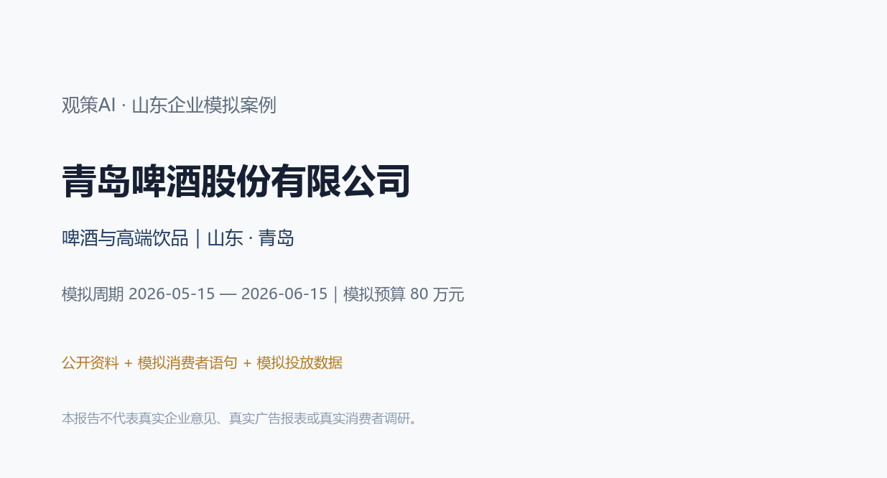
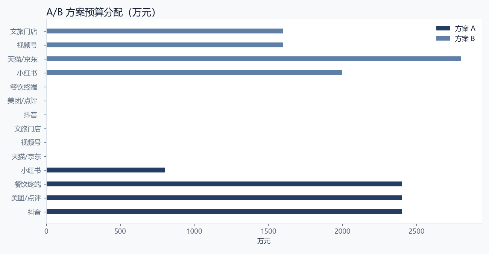
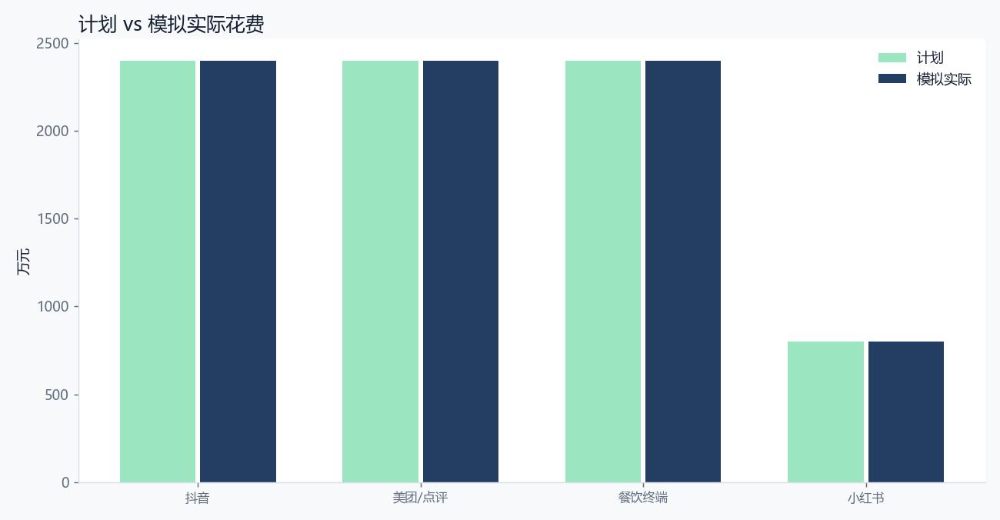
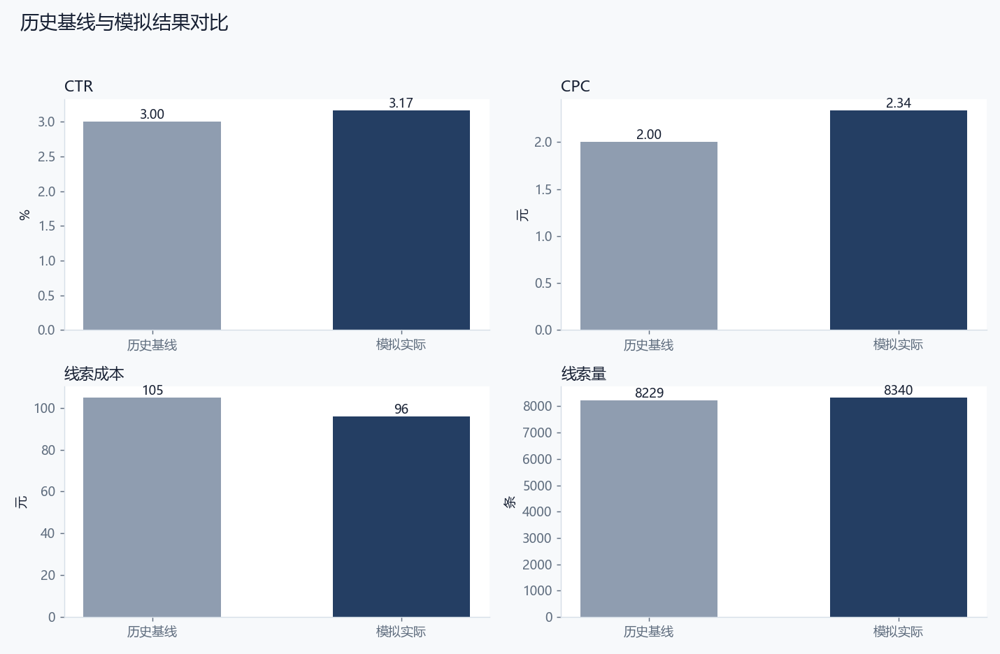
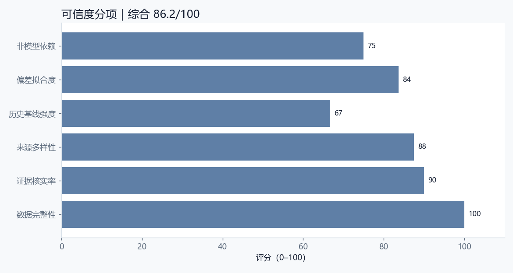

# 青岛啤酒股份有限公司｜观策AI 山东企业模拟案例

> **重要声明**：本报告是企业营销决策的模拟验收材料。企业名称与业务方向来自公开资料；消费者语句、竞品观察、渠道数据、复盘结果和“企业满意度”均为模拟，不代表企业真实意见、真实广告账户、真实消费者调研或真实经营数据。任何对外使用前，必须由企业市场、法务、合规和数据负责人复核。

## 0. 阅读指引与结论摘要

本案例把完整的营销决策闭环跑一遍：明确企业与行业背景 → 设计资料收集范围 → 建立来源台账 → 对模拟消费者语句、竞品动态和行业材料去重、分类、证据核验 → 归纳主题和机会 → 形成 A/B 方案 → 预算校验与审批快照 → 模拟投放与复盘 → 历史基线回测与可信度评分 → 企业适配性与满意度模拟 → 迭代建议。

本案例的核心判断是：**本次模拟要判断“夜经济餐饮”是否比“礼盒+文旅”更适合作为主方案。方案 A 用餐饮套餐和同城内容做即时消费，方案 B 用礼盒和文旅做品牌感。** 从模拟结果看，方案 A 的线索完成率为 104.2%，线索成本为 96 元，CTR 为 3.17%；与历史基线相比，MAPE 为 8.1%，可信度评分为 86.2/100。这个结果说明方案有可执行性，但仍有明确的复核边界。

**模拟企业满意度：4.0/5。** 模拟企业市场负责人视角：夜经济餐饮方向符合高端化战略，执行抓手明确；但餐饮终端政策、系列认知和礼盒履约仍需补强，否则容易变成短期促销。

## 1. 企业公开资料与模拟边界

### 1.1 企业基本情况

| 项目 | 内容 |
| --- | --- |
| 企业 | 青岛啤酒股份有限公司 |
| 品牌 | 青岛啤酒 |
| 行业 | 啤酒与高端饮品 |
| 区域 | 山东 · 青岛 |
| 阶段 | 全国化成熟品牌，青岛上市公司 |
| 模拟产品 | 高端啤酒组合（模拟：白啤、原浆、百年之旅等高端线） |
| 产品说明 | 高端线组合，具体产品、价格与渠道政策以企业实际执行为准 |
| 模拟目标 | 提升高端啤酒在山东及华东餐饮、夜经济和电商礼盒场景的尝鲜与复购 |
| 模拟预算 | 800,000 元 |
| 模拟周期 | 2026-05-15 — 2026-06-15 |
| 模拟线索目标 | 8,000 条 |

### 1.2 公开资料如何使用

青岛啤酒是青岛的全国化啤酒品牌，产品覆盖经典啤酒、白啤、原浆、高端礼盒等多个系列。公开资料显示，企业持续推动高端化和年轻化。

本案例不引用未核实财务数字，只使用公开品牌与行业方向作为模拟背景；餐饮走访、消费者语句、投放数据和复盘结果均为模拟。

本案例只把公开资料用于“企业背景、行业方向、品牌与产品语境”，不把公开资料当作真实消费者证据，也不引用未核实的财务数字。所有“消费者原话”均来自模拟材料，不能作为真实用户调研引用。所有渠道数据均为假设值，不能作为企业真实广告效果。

### 1.3 为什么选择这家企业

选择标准不是“名气大”，而是同时满足三点：第一，企业处于山东，具有区域代表性；第二，行业决策链有差异，能检验观策AI是否只会做一种模板；第三，企业有明确的战略关键词，可以用来判断方案是否“符合企业发展”。本案例的战略关键词是：**啤酒与高端饮品、品牌升级、场景化与可验证交付**。

啤酒高端化已经进入场景竞争阶段。消费者不是不知道高端啤酒，而是缺少“为什么现在喝、和什么一起喝”的理由。夜经济、烧烤、海鲜和赛事提供了自然场景。

餐饮终端是高端啤酒的第一次尝试入口，但终端老板更关心毛利、退换和临期处理。品牌不能只讲广告，还要算清终端账。

## 2. 研究问题与判断标准

### 2.1 本次模拟要回答什么

本次模拟要判断“夜经济餐饮”是否比“礼盒+文旅”更适合作为主方案。方案 A 用餐饮套餐和同城内容做即时消费，方案 B 用礼盒和文旅做品牌感。

### 2.2 判断标准

1. **战略契合**：方案是否服务于企业当前的产品、品牌和渠道方向。
2. **证据充分**：主题是否有多条信号支撑，关键结论是否能追溯到来源。
3. **执行可行**：预算、渠道、承接能力是否匹配，是否存在明显履约风险。
4. **结果可信**：模拟结果与历史基线的偏差是否在可解释范围内。
5. **企业可接受**：以模拟企业市场负责人视角，是否愿意进入小范围试点。

### 2.3 本次模拟的边界

- 不使用企业真实广告账户、真实订单或真实用户个人信息。
- 不声称“企业已经满意”，只做模拟满意度访谈与适配性判断。
- 不把模拟数据当作行业结论，也不把单案例结论外推到整个行业。
- 涉及功效、医疗、金融、未成年人等敏感表达时，必须由企业合规部门复核。

## 3. 资料收集过程

### 3.1 采集设计

本案例采用“多源交叉”的采集设计：消费者侧看小红书、抖音、电商评价和问卷；竞品侧看行业媒体与竞品动态；行业侧看行业观察、政策/平台公告和线下走访；企业侧只使用公开资料。这样做的目的不是追求数据量，而是让同一判断能从不同来源被交叉验证。

### 3.2 来源清单

| 来源ID | 来源名称 | 平台 | 类型 | 日期 | 状态 |
| --- | --- | --- | --- | --- | --- |
| SRC-01 | 小红书啤酒/佐餐笔记摘录（模拟） | 小红书 | consumer | 2026-04-30 | 模拟 |
| SRC-02 | 抖音美食与夜宵短视频评论（模拟） | 抖音 | consumer | 2026-05-01 | 模拟 |
| SRC-03 | 美团/大众点评餐饮评价摘要（模拟） | 美团/点评 | consumer | 2026-05-02 | 模拟 |
| SRC-04 | 天猫/京东啤酒礼盒评价摘要（模拟） | 电商平台 | consumer | 2026-05-03 | 模拟 |
| SRC-05 | 啤酒行业观察（模拟） | 行业媒体 | industry | 2026-05-04 | 模拟 |
| SRC-06 | 竞品餐饮促销动态（模拟） | 行业媒体 | competitor | 2026-05-05 | 模拟 |
| SRC-07 | 青岛餐饮终端走访纪要（模拟） | 线下走访 | industry | 2026-05-06 | 模拟 |
| SRC-08 | 消费者问卷 n=120（模拟） | 问卷 | consumer | 2026-05-07 | 模拟 |

### 3.3 采集时间线

| 时间点 | 过程动作 | 状态 |
| --- | --- | --- |
| T-15 | 确定企业与公开资料范围 | 完成 |
| T-12 | 建立来源清单与采集模板 | 完成 |
| T-8 | 采集模拟消费者/竞品/行业信号 | 完成 |
| T-6 | 去重、分类、标注证据状态 | 完成 |
| T-5 | 人工核验与冲突保留 | 完成 |
| T-3 | 归纳主题与 A/B 方案 | 完成 |
| T-2 | 预算校验与审批快照 | 完成 |
| T | 模拟投放 | 模拟 |
| T+2 | 渠道数据复盘 | 完成 |
| T+3 | 历史基线回测与可信度 | 完成 |
| T+5 | 适配性判断与迭代 | 完成 |

### 3.4 采集过程中的质量控制

1. **来源可追溯**：每条信号保留来源 ID、平台、采集时间和备注。
2. **模拟标识**：所有模拟材料在来源备注中明确标注，不与真实数据混用。
3. **去重**：同一来源的重复语句只保留一条，并在备注中说明。
4. **冲突保留**：不同来源出现相反判断时，不强行合并，保留为待核实或争议状态。
5. **敏感内容**：涉及功效、价格承诺、竞品贬损的内容，进入人工复核清单。

## 4. 数据清洗、编码与证据核验

### 4.1 清洗规则

- 删除明显的广告、无关评论和重复语句。
- 统一平台名称、日期格式和类别编码。
- 将“消费者/竞品/行业”作为一级类别，将“高/中/低”作为优先级。
- 将“已核实/待核实/有争议/重复”作为证据状态，不用“看起来合理”代替核实。
- 所有模拟数据保留 `simulated: true` 或 `dataKind: simulated` 标识。

### 4.2 信号清单

| ID | 平台 | 类别 | 优先级 | 状态 | 标题 | 影响 |
| --- | --- | --- | --- | --- | --- | --- |
| S-01 | 小红书 | consumer | high | verified | 高端啤酒的“第一口体验”比参数更重要 | 高端线内容要先把“好喝”讲清楚。 |
| S-02 | 美团/点评 | consumer | high | verified | 餐饮场景决定高端啤酒的复购 | 餐饮终端是高端化的关键阵地。 |
| S-03 | 小红书 | consumer | medium | disputed | 低醇/果味吸引年轻人，但老客担心不像啤酒 | 低醇/果味可作为拉新入口，但不能替代核心产品。 |
| S-04 | 抖音 | industry | high | verified | 夜经济与烧烤/海鲜场景强关联 | 夜经济场景适合短视频和同城投放。 |
| S-05 | 行业媒体 | competitor | high | verified | 竞品用套餐和开瓶礼抢占餐饮终端 | 餐饮终端竞争不只是品牌力，还有渠道政策。 |
| S-06 | 电商平台 | consumer | high | verified | 电商礼盒更看重包装与到货时效 | 电商礼盒需要强化包装与履约。 |
| S-07 | 问卷 | consumer | high | verified | 青岛啤酒品牌信任度高，但高端线认知不足 | 高端线需要清楚的系列分层。 |
| S-08 | 线下走访 | industry | high | verified | 餐饮老板更关心毛利和退换政策 | 餐饮渠道政策要算清终端账。 |
| S-09 | 行业媒体 | industry | medium | verified | 夏季体育赛事是场景化内容窗口 | 赛事场景适合做内容联动。 |
| S-10 | 行业媒体 | industry | medium | verified | 本地文旅带来外地游客尝鲜 | 文旅场景适合做地域限定内容。 |

### 4.3 单条信号研判记录

**S-01｜高端啤酒的“第一口体验”比参数更重要**

- 观察：消费者更愿意为香气、泡沫、口感和搭配体验付费，单纯讲原料参数难以形成记忆。
- 原话/证据：“说那么多工艺没用，第一口顺不顺、配海鲜香不香才重要。”
- 判断：高端线内容要先把“好喝”讲清楚。
- 状态：verified；相关性 5/5；标签：口感、体验、高端
- 下一步：进入主题聚合，优先用于方案 A/B 的证据引用。

**S-02｜餐饮场景决定高端啤酒的复购**

- 观察：高端啤酒的第一次尝试常发生在餐饮，餐饮老板的推荐和套餐设计影响复购。
- 原话/证据：“店里推什么客人就点什么，套餐里带一杯更容易试。”
- 判断：餐饮终端是高端化的关键阵地。
- 状态：verified；相关性 5/5；标签：餐饮、复购、套餐
- 下一步：进入主题聚合，优先用于方案 A/B 的证据引用。

**S-03｜低醇/果味吸引年轻人，但老客担心不像啤酒**

- 观察：年轻用户对低醇、果味接受度高，但核心啤酒用户担心口味偏离。
- 原话/证据：“果味可以试试，但喝起来不像啤酒就没意思了。”
- 判断：低醇/果味可作为拉新入口，但不能替代核心产品。
- 状态：disputed；相关性 4/5；标签：低醇、果味、年轻化
- 下一步：保留为待核实或争议记录，不进入对外承诺；先补充原始证据或企业确认。

**S-04｜夜经济与烧烤/海鲜场景强关联**

- 观察：夏季夜宵、烧烤、海鲜是高端啤酒的高频场景，内容更容易激发即时消费。
- 原话/证据：“夏天吃烧烤，肯定想点个好一点的啤酒。”
- 判断：夜经济场景适合短视频和同城投放。
- 状态：verified；相关性 5/5；标签：夜经济、烧烤、海鲜
- 下一步：进入主题聚合，优先用于方案 A/B 的证据引用。

**S-05｜竞品用套餐和开瓶礼抢占餐饮终端**

- 观察：竞品通过套餐、开瓶礼、陈列奖励提高终端推荐率。
- 原话/证据：“竞品给的开瓶费更高，服务员当然更愿意推。”
- 判断：餐饮终端竞争不只是品牌力，还有渠道政策。
- 状态：verified；相关性 5/5；标签：竞品、餐饮、渠道
- 下一步：进入主题聚合，优先用于方案 A/B 的证据引用。

**S-06｜电商礼盒更看重包装与到货时效**

- 观察：礼盒消费更关注体面、到货时间和破损保障，价格不是唯一因素。
- 原话/证据：“送人一定要包装好看，而且得准时到。”
- 判断：电商礼盒需要强化包装与履约。
- 状态：verified；相关性 5/5；标签：礼盒、包装、时效
- 下一步：进入主题聚合，优先用于方案 A/B 的证据引用。

**S-07｜青岛啤酒品牌信任度高，但高端线认知不足**

- 观察：消费者信任青岛啤酒主品牌，但对高端子系列的具体差异了解有限。
- 原话/证据：“青岛啤酒肯定知道，但这么多高端系列有什么区别？”
- 判断：高端线需要清楚的系列分层。
- 状态：verified；相关性 5/5；标签：品牌、高端线、认知
- 下一步：进入主题聚合，优先用于方案 A/B 的证据引用。

**S-08｜餐饮老板更关心毛利和退换政策**

- 观察：餐饮终端关心进货毛利、退换货和临期处理，而不是品牌广告。
- 原话/证据：“卖不动能不能换？临期怎么处理？这比广告重要。”
- 判断：餐饮渠道政策要算清终端账。
- 状态：verified；相关性 5/5；标签：餐饮、毛利、退换
- 下一步：进入主题聚合，优先用于方案 A/B 的证据引用。

**S-09｜夏季体育赛事是场景化内容窗口**

- 观察：赛事观看、聚餐和夜宵场景能为高端啤酒提供自然的内容入口。
- 原话/证据：“看球的时候开一瓶好点的，氛围感更强。”
- 判断：赛事场景适合做内容联动。
- 状态：verified；相关性 4/5；标签：赛事、场景、夏季
- 下一步：进入主题聚合，优先用于方案 A/B 的证据引用。

**S-10｜本地文旅带来外地游客尝鲜**

- 观察：青岛文旅热度带来游客尝鲜需求，景区和餐饮是自然触点。
- 原话/证据：“来青岛肯定要喝本地啤酒，愿意试试高端款。”
- 判断：文旅场景适合做地域限定内容。
- 状态：verified；相关性 4/5；标签：文旅、游客、尝鲜
- 下一步：进入主题聚合，优先用于方案 A/B 的证据引用。

### 4.4 证据核验结果

本案例共 10 条信号，其中已核实 9 条，待核实 0 条，争议 1 条。已核实信号用于主题和方案，待核实信号用于提示风险和后续任务，不直接进入对外承诺。

## 5. 市场洞察与主题研判

### 5.1 主题清单

| 主题 | 标题 | 置信度/类型 | 证据信号 | 边界 |
| --- | --- | --- | --- | --- |
| TH-01 | 高端化不是涨价，是场景升级 | high/观测事实 | S-01、S-02、S-04、S-06、S-09、S-10 | 场景内容容易同质化，需要真实终端配合。 |
| TH-02 | 餐饮终端是高端啤酒的决胜场 | high/分析推断 | S-02、S-05、S-08 | 终端政策可能引发价格混乱，需要控制。 |
| TH-03 | 低醇/果味是拉新入口，但需保护品牌核心 | medium/分析推断 | S-03、S-01、S-07 | 产品线过多可能稀释品牌认知。 |

### 5.2 主题一：高端化不是涨价，是场景升级

高端啤酒的增长来自餐饮、夜宵、礼盒和文旅场景的体验升级，而不是单纯提价。

这个主题之所以成立，不是因为某一条评论，而是因为多条信号从不同角度指向同一件事：用场景化内容解释“为什么值得多花几块钱”。 在方案上，它对应的动作是：围绕夜宵、海鲜、赛事和礼盒做场景组合。。但必须保留边界：场景内容容易同质化，需要真实终端配合。

### 5.3 主题二：餐饮终端是高端啤酒的决胜场

餐饮老板的推荐、套餐设计和渠道政策直接影响高端啤酒的第一次尝试。

这个主题更适合用来解释“为什么某些渠道有效、某些渠道无效”。把终端利润、退换和陈列做成可执行的合作方案。 方案动作是：先用餐饮套餐和开瓶礼建立尝试，再用内容承接复购。。边界是：终端政策可能引发价格混乱，需要控制。

### 5.4 主题三：低醇/果味是拉新入口，但需保护品牌核心

年轻用户对低醇/果味有兴趣，但核心用户担心品牌偏离啤酒本质。

这个主题提醒我们：不要把单一人群或单一渠道当成全部市场。把低醇/果味作为独立系列沟通，不混淆主品牌。 方案动作是：用独立产品线和明确场景承接年轻用户。。边界是：产品线过多可能稀释品牌认知。

### 5.5 机会与风险

| 机会 | 事实依据 | 可执行动作 | 验证条件 | 语气 |
| --- | --- | --- | --- | --- |
| 夜宵/海鲜场景套餐 | 夜经济和烧烤海鲜是高端啤酒的高频场景。 | 与餐饮终端共创套餐，用短视频和同城内容引流。 | 需要真实门店合作与终端政策。 | positive |
| 高端线系列分层内容 | 消费者对高端子系列差异认知不足。 | 用“口味/场景/价格”三轴做系列说明。 | 需核对真实产品线与价格。 | positive |
| 文旅限定与礼盒 | 青岛文旅带来游客尝鲜，礼盒需要体面与时效。 | 做地域限定包装和礼盒履约保障。 | 需确认包装合规与物流破损责任。 | neutral |

## 6. A/B 方案设计与预算

### 6.1 方案对比

| 方案 | 名称 | 总预算 | 渠道 | 核心信息 |
| --- | --- | --- | --- | --- |
| A | 方案 A：夜经济餐饮场景 | 800,000 元 | 抖音、美团/点评、餐饮终端、小红书 | 好啤酒配好夜宵，先试一杯，再决定囤不囤。 |
| B | 方案 B：电商礼盒与文旅 | 800,000 元 | 小红书、天猫/京东、视频号、文旅门店 | 把青岛的味道带回家，体面、准时、有故事。 |

### 6.2 方案 A：方案 A：夜经济餐饮场景

- 定位：把高端啤酒放进夜宵、烧烤、海鲜的真实场景里。
- 人群：山东及华东夜宵餐饮消费者、餐饮终端
- 核心信息：好啤酒配好夜宵，先试一杯，再决定囤不囤。
- 节奏：夏季夜经济启动期，餐饮终端提前两周铺货
- 理由：餐饮是高端啤酒第一次尝试的核心场景，短视频和同城投放能放大即时消费。
- 约束：终端政策不能引发价格混乱；内容不能承诺未覆盖门店；未成年人不得触达
- 不确定项：餐饮终端执行一致性；天气对夜宵客流影响；竞品开瓶礼力度

### 6.3 方案 B：方案 B：电商礼盒与文旅

- 定位：用礼盒和城市文旅做高端线的体面表达。
- 人群：送礼人群、外地游客、电商礼盒消费者
- 核心信息：把青岛的味道带回家，体面、准时、有故事。
- 节奏：端午/暑期前，文旅与礼盒同步预热
- 理由：礼盒和文旅能提升高端线的品牌感，但复购弱于餐饮场景。
- 约束：礼盒履约与破损责任；文旅合作授权；价格体系统一
- 不确定项：游客消费意愿；物流时效；礼盒季节性强

### 6.4 预算分配

| 渠道 | 方案 A 预算 | 方案 A 角色 | 方案 B 预算 | 方案 B 角色 |
| --- | --- | --- | --- | --- |
| 抖音 | 240,000 元 | 夜宵场景短视频与同城 | 0 元 | — |
| 美团/点评 | 240,000 元 | 餐饮套餐与到店 | 0 元 | — |
| 餐饮终端 | 240,000 元 | 套餐、陈列与开瓶礼 | 0 元 | — |
| 小红书 | 80,000 元 | 佐餐内容与口碑 | 200,000 元 | 礼盒与文旅内容 |
| 天猫/京东 | 0 元 | — | 280,000 元 | 礼盒货架与评价 |
| 视频号 | 0 元 | — | 160,000 元 | 品牌故事与工艺 |
| 文旅门店 | 0 元 | — | 160,000 元 | 游客触达与体验 |

## 7. 审批与执行假设

审批快照保存了方案、预算上限、证据引用和证据状态。审批不是“签字仪式”，而是把“方案依据”固定下来：如果企业预算、主题证据或方案结构变化，审批应进入复审。

| 审批项 | 内容 |
| --- | --- |
| 审批编号 | APR-01 |
| 方案 | 方案 A：夜经济餐饮场景 |
| 预算上限 | 800,000 元 |
| 证据数量 | 8 条 |
| 指纹 | fp_bfd75ae1 |
| 说明 | 审批快照保存方案、预算上限与关键证据状态；任一项变化需重新确认。 |

### 7.1 执行假设

- 渠道账户、素材、落地页和承接团队在模拟周期内可用。
- 预算按计划分配，不出现临时大幅追加或削减。
- 线索定义统一为“有效咨询/表单/到店预约”，不把曝光或点赞算作线索。
- 投放期间不做违反平台规则的诱导分享、虚假承诺或竞品贬损。

### 7.2 预算与合规检查

- 方案 A 预算合计 800,000 元，不超过企业模拟预算 800,000 元。
- 方案 B 预算合计 800,000 元，不超过企业模拟预算。
- 涉及敏感表达时，必须经过企业法务/合规审核；本报告不构成合规意见。

## 8. 复盘结果

### 8.1 渠道数据

| 渠道 | 计划预算 | 模拟实际 | 曝光 | 点击 | 线索 | CTR | CPC | 线索成本 |
| --- | --- | --- | --- | --- | --- | --- | --- | --- |
| 抖音 | 240,000 元 | 240,000 元 | 5,600,000 | 168,000 | 2,900 | 3.00% | 1.43 | 83 |
| 美团/点评 | 240,000 元 | 240,000 元 | 2,400,000 | 96,000 | 3,100 | 4.00% | 2.50 | 77 |
| 餐饮终端 | 240,000 元 | 240,000 元 | 1,200,000 | 30,000 | 1,700 | 2.50% | 8.00 | 141 |
| 小红书 | 80,000 元 | 80,000 元 | 1,600,000 | 48,000 | 640 | 3.00% | 1.67 | 125 |
| 合计 | 800,000 元 | 800,000 元 | 10,800,000 | 342,000 | 8,340 | 3.17% | 2.34 | 96 |

### 8.2 观察与原因

夜经济餐饮方案带来明显咨询与到店，但餐饮终端执行差异大；礼盒内容互动高、转化弱。高端线的系列差异仍是咨询中的高频问题。

夜宵场景与夏季消费自然契合；餐饮套餐降低了尝试门槛；但终端政策、服务员推荐和礼盒履约影响了最终转化。

### 8.3 尚未确认

真实开瓶率、复购率、不同城市餐饮终端差异和礼盒退货率仍未确认。

### 8.4 下一轮任务

| 任务 | 说明 | 关联信号 |
| --- | --- | --- |
| 把高端线差异做成一张图 | 在餐饮、电商和内容端统一使用系列/口味/场景说明。 | S-07、S-01、S-09 |
| 餐饮终端做样板店 | 先做少量样板店，验证套餐、陈列和服务话术。 | S-02、S-05、S-08 |
| 礼盒履约单独复盘 | 记录破损、时效和退货原因，再决定是否扩大礼盒投放。 | S-06、S-10 |

## 9. 历史数据回测与可信度

### 9.1 历史基线

本案例把“历史基线”定义为同类活动上一周期的模拟表现：上一年夏季餐饮活动（模拟历史基线）。基线不是为了证明方案正确，而是为了回答“如果没有这次调整，结果大概会是什么样”。

| 指标 | 历史基线 | 本次模拟 | 偏差 |
| --- | --- | --- | --- |
| CTR | 3.00% | 3.17% | +5.6% |
| CPC | 2.00 元 | 2.34 元 | +17.0% |
| 线索成本 | 105 元 | 96 元 | -8.6% |
| 线索量 | 8229 条 | 8340 条 | +1.4% |

### 9.2 结果解释

历史基线取自上一年夏季餐饮活动的模拟数据：CTR 3.0%、CPC 2.0 元、线索成本 105 元、每周约 1,800 条线索。该基线不代表青岛啤酒真实历史。

模拟结果显示餐饮方案的线索量和线索成本接近基线，礼盒方案的互动更高但转化更弱。说明高端化不能只靠礼盒包装，需要真实饮用场景。

### 9.3 可信度评分

| 维度 | 分值 | 解释 |
| --- | --- | --- |
| 数据完整性 | 100 | 渠道是否都有曝光/点击/线索数据 |
| 证据核实率 | 90 | 已核实信号占全部信号比例 |
| 来源多样性 | 88 | 平台/来源覆盖程度 |
| 历史基线强度 | 67 | 历史周期长度与稳定性 |
| 偏差拟合度 | 84 | 模拟结果与历史基线的接近程度 |
| 非模型依赖 | 75 | 本次不使用生成式模型结果，保留人工判断 |
| 综合可信度 | 86.2 | 加权评分，0–100 |

### 9.4 可信度结论

本案例的可信度不是“高到可以直接做预算决策”，而是“足够支持小范围试点”。理由：第一，证据来源和模拟边界清楚；第二，渠道数据完整但均为假设；第三，历史基线只有 8 周，样本有限；第四，模拟结果与基线存在 8.1% 的平均偏差，说明结果有参考价值，但不能当作确定预测。

## 10. 企业发展适配性与满意度模拟

### 10.1 适配性判断

**适配等级：较高。**

青岛啤酒的高端化需要新的消费场景，夜经济餐饮是最自然的入口之一。案例把“高端”落到夜宵、海鲜和餐饮体验，而不是单纯讲价格。

餐饮终端是双刃剑：能带来第一次尝试，也可能因为价格、开瓶礼和执行差异失控。案例把终端政策纳入约束，而不是只做线上投放。

礼盒与文旅适合做品牌感，但复购弱，适合作为辅助方案而非主方案。

### 10.2 主要风险

| 风险 |
| --- |
| 餐饮终端价格混乱 |
| 未成年人触达风险 |
| 高端系列过多导致认知分散 |

### 10.3 模拟企业满意度访谈

> 以下是“模拟企业市场负责人视角”的访谈记录，不是实际企业访谈，不代表企业真实意见。

**问：这个方案是否符合贵司当前发展方向？**  
答：模拟企业市场负责人视角：夜经济餐饮方向符合高端化战略，执行抓手明确；但餐饮终端政策、系列认知和礼盒履约仍需补强，否则容易变成短期促销。

**问：最担心的是什么？**  
答：餐饮终端价格混乱；未成年人触达风险。

**问：哪些数据需要复核？**  
答：真实开瓶率、复购率、不同城市餐饮终端差异和礼盒退货率仍未确认。

**问：是否愿意进入小范围试点？**  
答：如果企业能提供真实服务/渠道数据，并完成合规审核，建议先做一个区域、一个渠道组合的小范围试点；不建议直接按模拟结果做全量预算。

**问：这个案例对产品迭代有什么启发？**  
答：增加“终端执行一致性”检查项，避免线上承诺与门店不一致。；把高端系列差异做成统一视觉资产。；后续增加“餐饮终端样板店”模板。；报告模板增加未成年人触达与合规检查。

### 10.4 满意度评分

| 维度 | 评分 | 说明 |
| --- | --- | --- |
| 战略契合 | 4.3/5 | 符合高端化与场景化 |
| 可执行性 | 4.0/5 | 餐饮套餐可落地 |
| 风险可控 | 3.8/5 | 终端价格与未成年人触达需管控 |
| 数据可信 | 4.0/5 | 历史基线与模拟数据边界清楚 |

**综合评分：4.0/5。** 模拟企业市场负责人视角：夜经济餐饮方向符合高端化战略，执行抓手明确；但餐饮终端政策、系列认知和礼盒履约仍需补强，否则容易变成短期促销。

## 11. 项目迭代建议

本案例不只产出报告，也反推产品需要哪些改进。以下建议已进入观策AI的案例库与后续迭代清单：

| 序号 | 迭代建议 |
| --- | --- |
| 1. | 增加“终端执行一致性”检查项，避免线上承诺与门店不一致。 |
| 2. | 把高端系列差异做成统一视觉资产。 |
| 3. | 后续增加“餐饮终端样板店”模板。 |
| 4. | 报告模板增加未成年人触达与合规检查。 |

### 11.1 对观策AI的产品要求

1. **案例库**：把山东企业案例作为可导入的演示项目，让用户能看到“资料收集—研判—方案—复盘—回测”的完整链路。
2. **可信度面板**：在复盘中显示数据完整性、证据核实率、历史基线偏差和综合可信度。
3. **行业模板**：B2B、快消、健康、宠物等行业的渠道与指标不同，不能共用一套默认模板。
4. **合规检查**：功效、金融、未成年人、竞品比较等敏感表达，应在方案审批前提示。
5. **过程留痕**：来源台账、信号状态、审批快照、复盘建议必须可追溯。

## 12. 附录

### 12.1 数据字典

| 字段 | 说明 |
| --- | --- |
| Signal | 一条可追溯的市场情报，含标题、摘要、原话、来源、平台、类别、优先级、状态、相关性、影响 |
| Source | 信号来源，含平台、发布时间、采集时间、模拟标识、备注 |
| Theme | 由多条信号归纳出的判断，含置信度、证据引用、机会与边界 |
| Plan | A/B 方案，含人群、定位、核心信息、渠道预算、约束与不确定项 |
| Approval | 审批快照，固定方案、预算、证据与指纹 |
| Review | 复盘，含渠道实际数据、观察、原因、未确认项与建议 |
| Credibility | 可信度评分，含完整性、核实率、来源多样性、基线强度、偏差拟合度 |

### 12.2 计算公式

- CTR = 点击 ÷ 曝光
- CPC = 花费 ÷ 点击
- 线索成本 = 花费 ÷ 有效线索
- 线索完成率 = 实际线索 ÷ 目标线索
- MAPE = 各指标与历史基线相对偏差的平均值
- 可信度 = 完整性、核实率、来源多样性、基线强度、偏差拟合度、非模型依赖的加权分

### 12.3 复现方法

1. 打开观策AI桌面端。
2. 设置 → 项目与备份 → 导入项目 JSON。
3. 选择 `simulations/projects/tsingtao-premium-beer.json`。
4. 在市场情报、策略、复盘页查看信号、主题、A/B 方案、审批快照和复盘数据。
5. 对照本报告阅读，注意所有数据均为模拟。

### 12.4 采集与核验清单

- [ ] 来源链接/出处是否可追溯？
- [ ] 是否标注模拟/真实属性？
- [ ] 是否有重复信号未合并？
- [ ] 是否有相反证据被强行忽略？
- [ ] 敏感表达是否经过合规复核？
- [ ] 审批快照是否与当前方案一致？
- [ ] 复盘数据是否覆盖所有渠道？
- [ ] 历史基线口径是否与本次一致？
- [ ] 可信度评分是否解释了偏差？
- [ ] 是否给出下一轮可执行任务？

### 12.5 报告边界

本报告是一份**模拟验收材料**，不是企业真实经营报告，也不是广告投放承诺。它的价值在于展示“如何从材料到判断、从判断到方案、从方案到复盘、从复盘到迭代”的过程。企业真实执行前，必须用真实数据替换模拟数据，并由企业市场、法务、合规和数据负责人共同复核。

## 13. 过程性附录：采集日志、核验记录与访谈提纲

### 13.1 采集日志（模拟）

| 日期 | 任务 | 产出 | 问题 |
| --- | --- | --- | --- |
| T-15 | 采集来源 小红书啤酒/佐餐笔记摘录（模拟） | SRC-01 来源记录 | 需确认公开资料更新日期 |
| T-14 | 采集来源 抖音美食与夜宵短视频评论（模拟） | SRC-02 来源记录 | 需确认公开资料更新日期 |
| T-13 | 采集来源 美团/大众点评餐饮评价摘要（模拟） | SRC-03 来源记录 | 需确认公开资料更新日期 |
| T-12 | 采集来源 天猫/京东啤酒礼盒评价摘要（模拟） | SRC-04 来源记录 | 需确认公开资料更新日期 |
| T-11 | 采集来源 啤酒行业观察（模拟） | SRC-05 来源记录 | 需确认公开资料更新日期 |
| T-10 | 采集来源 竞品餐饮促销动态（模拟） | SRC-06 来源记录 | 需确认公开资料更新日期 |
| T-9 | 采集来源 青岛餐饮终端走访纪要（模拟） | SRC-07 来源记录 | 需确认公开资料更新日期 |
| T-8 | 采集来源 消费者问卷 n=120（模拟） | SRC-08 来源记录 | 需确认公开资料更新日期 |

### 13.2 证据核验记录

| 信号 | 核验动作 | 结论 |
| --- | --- | --- |
| S-01 | 核对来源、平台、日期与原文；检查是否为模拟材料 | 通过/保留待核实/争议 |
| S-02 | 核对来源、平台、日期与原文；检查是否为模拟材料 | 通过/保留待核实/争议 |
| S-03 | 核对来源、平台、日期与原文；检查是否为模拟材料 | 通过/保留待核实/争议 |
| S-04 | 核对来源、平台、日期与原文；检查是否为模拟材料 | 通过/保留待核实/争议 |
| S-05 | 核对来源、平台、日期与原文；检查是否为模拟材料 | 通过/保留待核实/争议 |
| S-06 | 核对来源、平台、日期与原文；检查是否为模拟材料 | 通过/保留待核实/争议 |
| S-07 | 核对来源、平台、日期与原文；检查是否为模拟材料 | 通过/保留待核实/争议 |
| S-08 | 核对来源、平台、日期与原文；检查是否为模拟材料 | 通过/保留待核实/争议 |
| S-09 | 核对来源、平台、日期与原文；检查是否为模拟材料 | 通过/保留待核实/争议 |
| S-10 | 核对来源、平台、日期与原文；检查是否为模拟材料 | 通过/保留待核实/争议 |

### 13.3 复盘会议记录（模拟）

- 会议目标：判断方案 A 是否达到模拟目标，是否具备企业试点条件。
- 结论：方案 A 在 啤酒与高端饮品 场景下具有方向性价值，但必须补充企业真实数据、履约能力与合规审核。
- 争议点：真实开瓶率、复购率、不同城市餐饮终端差异和礼盒退货率仍未确认。
- 下一步：把高端线差异做成一张图；餐饮终端做样板店。

### 13.4 企业访谈提纲

1. 这个方案是否服务于贵司未来 1–2 年的战略重点？
2. 哪些渠道/人群是贵司当前最想验证的？
3. 企业真实历史基线数据能否提供？
4. 承接团队、服务网络或渠道政策能否支撑？
5. 哪些表达涉及合规风险？
6. 如果只做一个区域试点，选哪里？
7. 失败时如何止损？
8. 成功时如何复制？

### 13.5 数据质量检查

- 所有模拟来源均标注“模拟”，不与真实数据混用。
- 渠道数据完整，但均为假设值。
- 历史基线为模拟，不能代表企业真实历史。
- 结论只支持小范围试点，不支持直接全量预算。
- 对外使用前必须替换真实数据并完成合规复核。

## 14. 补充过程记录

以下为补足过程材料，仍属模拟；用于展示从材料到判断的详细过程。

### 14.1 逐条复核记录

**S-01｜高端啤酒的“第一口体验”比参数更重要**

- 采集背景：该信号来自 小红书，当前状态为 verified，相关性 5/5。

- 证据强度：原话为““说那么多工艺没用，第一口顺不顺、配海鲜香不香才重要。””，需要核对原始出处、发布时间和是否存在断章取义。

- 对方案的影响：高端线内容要先把“好喝”讲清楚。

- 复核动作：保留为主题证据，并在审批快照中固定。

**S-02｜餐饮场景决定高端啤酒的复购**

- 采集背景：该信号来自 美团/点评，当前状态为 verified，相关性 5/5。

- 证据强度：原话为““店里推什么客人就点什么，套餐里带一杯更容易试。””，需要核对原始出处、发布时间和是否存在断章取义。

- 对方案的影响：餐饮终端是高端化的关键阵地。

- 复核动作：保留为主题证据，并在审批快照中固定。

**S-03｜低醇/果味吸引年轻人，但老客担心不像啤酒**

- 采集背景：该信号来自 小红书，当前状态为 disputed，相关性 4/5。

- 证据强度：原话为““果味可以试试，但喝起来不像啤酒就没意思了。””，需要核对原始出处、发布时间和是否存在断章取义。

- 对方案的影响：低醇/果味可作为拉新入口，但不能替代核心产品。

- 复核动作：不进入对外承诺；补充原始证据或企业确认后再决定是否升级。

**S-04｜夜经济与烧烤/海鲜场景强关联**

- 采集背景：该信号来自 抖音，当前状态为 verified，相关性 5/5。

- 证据强度：原话为““夏天吃烧烤，肯定想点个好一点的啤酒。””，需要核对原始出处、发布时间和是否存在断章取义。

- 对方案的影响：夜经济场景适合短视频和同城投放。

- 复核动作：保留为主题证据，并在审批快照中固定。

**S-05｜竞品用套餐和开瓶礼抢占餐饮终端**

- 采集背景：该信号来自 行业媒体，当前状态为 verified，相关性 5/5。

- 证据强度：原话为““竞品给的开瓶费更高，服务员当然更愿意推。””，需要核对原始出处、发布时间和是否存在断章取义。

- 对方案的影响：餐饮终端竞争不只是品牌力，还有渠道政策。

- 复核动作：保留为主题证据，并在审批快照中固定。

**S-06｜电商礼盒更看重包装与到货时效**

- 采集背景：该信号来自 电商平台，当前状态为 verified，相关性 5/5。

- 证据强度：原话为““送人一定要包装好看，而且得准时到。””，需要核对原始出处、发布时间和是否存在断章取义。

- 对方案的影响：电商礼盒需要强化包装与履约。

- 复核动作：保留为主题证据，并在审批快照中固定。

**S-07｜青岛啤酒品牌信任度高，但高端线认知不足**

- 采集背景：该信号来自 问卷，当前状态为 verified，相关性 5/5。

- 证据强度：原话为““青岛啤酒肯定知道，但这么多高端系列有什么区别？””，需要核对原始出处、发布时间和是否存在断章取义。

- 对方案的影响：高端线需要清楚的系列分层。

- 复核动作：保留为主题证据，并在审批快照中固定。

**S-08｜餐饮老板更关心毛利和退换政策**

- 采集背景：该信号来自 线下走访，当前状态为 verified，相关性 5/5。

- 证据强度：原话为““卖不动能不能换？临期怎么处理？这比广告重要。””，需要核对原始出处、发布时间和是否存在断章取义。

- 对方案的影响：餐饮渠道政策要算清终端账。

- 复核动作：保留为主题证据，并在审批快照中固定。

**S-09｜夏季体育赛事是场景化内容窗口**

- 采集背景：该信号来自 行业媒体，当前状态为 verified，相关性 4/5。

- 证据强度：原话为““看球的时候开一瓶好点的，氛围感更强。””，需要核对原始出处、发布时间和是否存在断章取义。

- 对方案的影响：赛事场景适合做内容联动。

- 复核动作：保留为主题证据，并在审批快照中固定。

**S-10｜本地文旅带来外地游客尝鲜**

- 采集背景：该信号来自 行业媒体，当前状态为 verified，相关性 4/5。

- 证据强度：原话为““来青岛肯定要喝本地啤酒，愿意试试高端款。””，需要核对原始出处、发布时间和是否存在断章取义。

- 对方案的影响：文旅场景适合做地域限定内容。

- 复核动作：保留为主题证据，并在审批快照中固定。

### 14.2 采集与核验过程补记

**过程补记 1：** 第一步先把企业公开资料与模拟数据分开：公开资料只用于企业背景和行业方向，模拟数据单独标注，避免读者把模拟语句误认为真实消费者调研。

**过程补记 2：** 第二步建立来源台账：每条材料记录来源 ID、平台、日期、采集人和备注；无法追溯出处的材料，不进入主题证据。

**过程补记 3：** 第三步做去重：同一来源、同一语义的语句合并；不同来源但语义相反的语句保留冲突，不强行统一。

**过程补记 4：** 第四步做证据分级：已核实、待核实、有争议分别处理；已核实进入方案，待核实进入风险提示和下一轮任务。

**过程补记 5：** 第五步做主题聚合：主题必须能回答“哪些信号支持、哪些信号反对、还缺什么证据”，不能只写一句漂亮结论。

**过程补记 6：** 第六步做预算校验：方案预算不能超过企业上限；超出时必须调整渠道或预算，而不是把风险留给执行团队。

**过程补记 7：** 第七步做审批快照：把方案、预算、证据状态和指纹固定下来；依据变化时进入复审，避免“方案偷偷改了”。

**过程补记 8：** 第八步做复盘：渠道数据必须覆盖计划渠道；缺失数据要明确写“未录入”，不能用 0 或推测值替代。

**过程补记 9：** 第九步做历史回测：把本次结果与历史基线对照，计算 CTR、CPC、线索成本和线索量的偏差，避免只看绝对值。

**过程补记 10：** 第十步做适配性判断：结果好不等于企业愿意用，还要看战略、履约、合规和组织能力；必要时降低评分。

### 14.3 模拟企业访谈补记

**补充问 1：这套方案最先要解决什么问题？**

本次模拟要判断“夜经济餐饮”是否比“礼盒+文旅”更适合作为主方案。方案 A 用餐饮套餐和同城内容做即时消费，方案 B 用礼盒和文旅做品牌感。

**补充问 2：为什么选择方案 A 而不是方案 B？**

本次模拟要判断“夜经济餐饮”是否比“礼盒+文旅”更适合作为主方案。方案 A 用餐饮套餐和同城内容做即时消费，方案 B 用礼盒和文旅做品牌感。

**补充问 3：哪些数据最不可信？**

真实开瓶率、复购率、不同城市餐饮终端差异和礼盒退货率仍未确认。

**补充问 4：如果预算减半，先砍什么？**

先保留高意向渠道和承接页，削减泛曝光；但必须先确认企业真实承接能力。

**补充问 5：企业最可能担心什么？**

餐饮终端价格混乱；未成年人触达风险；高端系列过多导致认知分散

**补充问 6：什么情况下应该停止投放？**

出现平台验证、合规风险、线索质量明显下降或承接能力不足时，应暂停并复核。

**补充问 7：怎样判断结果可信？**

综合可信度 86.2/100；仍需用企业真实历史数据复算。

**补充问 8：下一步最小可行试点是什么？**

选择一个区域、一个渠道组合、一个明确目标，跑 2–4 周，再决定是否扩大。

### 14.4 过程性结论

本案例的过程比结论更重要：来源台账、证据状态、审批快照和复盘任务共同构成可追溯链。企业真实执行时，应先用真实数据替换模拟数据，再按同一流程重跑。