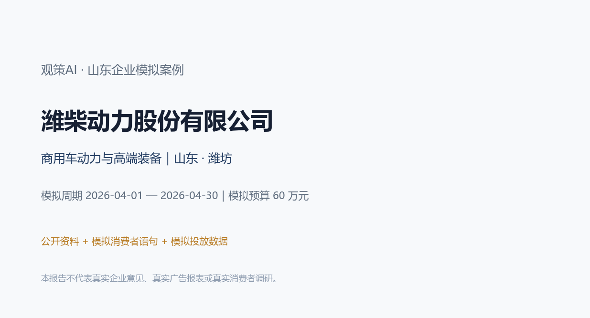
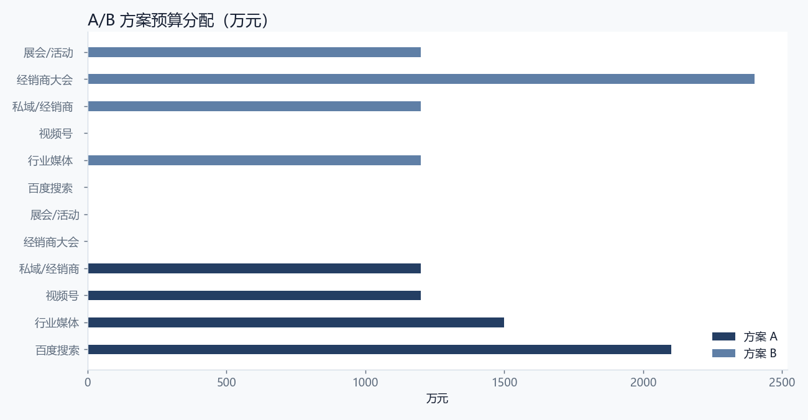
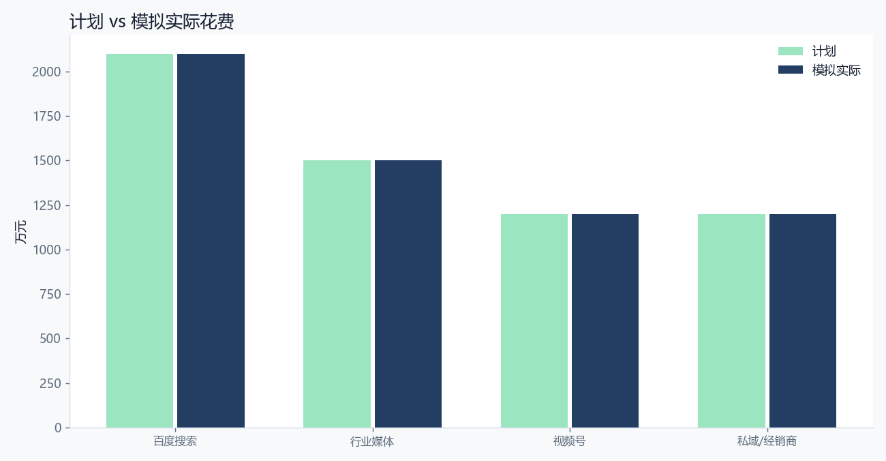
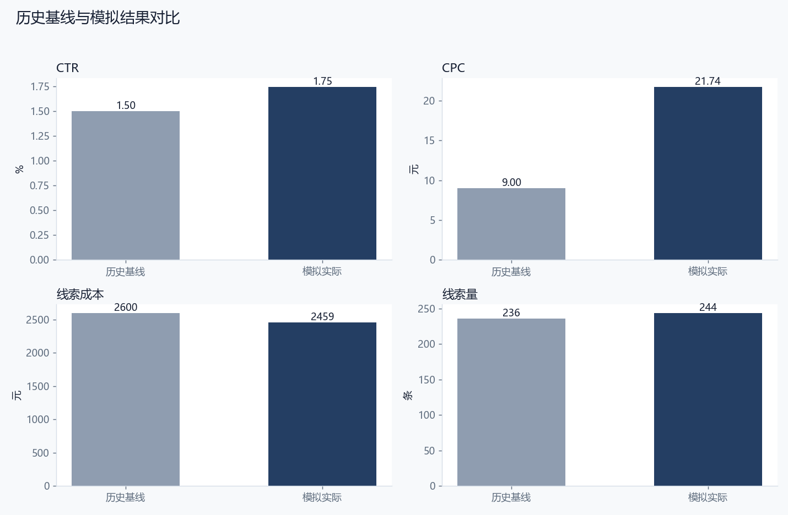
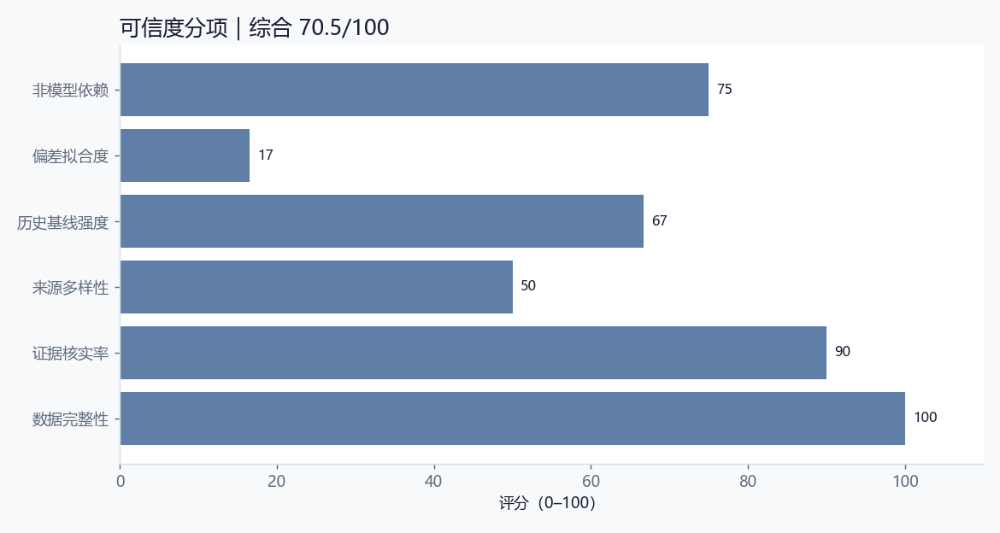

# 潍柴动力股份有限公司｜观策AI 山东企业模拟案例

> **重要声明**：本报告是企业营销决策的模拟验收材料。企业名称与业务方向来自公开资料；消费者语句、竞品观察、渠道数据、复盘结果和“企业满意度”均为模拟，不代表企业真实意见、真实广告账户、真实消费者调研或真实经营数据。任何对外使用前，必须由企业市场、法务、合规和数据负责人复核。

## 0. 阅读指引与结论摘要

本案例把完整的营销决策闭环跑一遍：明确企业与行业背景 → 设计资料收集范围 → 建立来源台账 → 对模拟消费者语句、竞品动态和行业材料去重、分类、证据核验 → 归纳主题和机会 → 形成 A/B 方案 → 预算校验与审批快照 → 模拟投放与复盘 → 历史基线回测与可信度评分 → 企业适配性与满意度模拟 → 迭代建议。

本案例的核心判断是：**本次模拟比较“TCO+服务网络”与“经销商赋能+区域物流”两条路径。前者适合搜索和行业媒体，后者适合经销商和区域活动。** 从模拟结果看，方案 A 的线索完成率为 93.8%，线索成本为 2459 元，CTR 为 1.75%；与历史基线相比，MAPE 为 41.7%，可信度评分为 70.5/100。这个结果说明方案有可执行性，但仍有明确的复核边界。

**模拟企业满意度：3.8/5。** 模拟企业市场负责人视角：TCO和服务网络方向正确，但内容承诺必须与真实服务能力匹配；新能源内容有吸引力，但证据不足，不宜作为主承诺。

### 0.1 关键结果数据

| 指标 | 数值 |
| --- | --- |
| 模拟预算 | 600,000 元 |
| 模拟实际花费 | 600,000 元 |
| 预算利用率 | 100.0% |
| 目标线索 | 260 条 |
| 实际线索 | 244 条 |
| 线索完成率 | 93.8% |
| 曝光 | 1,580,000 |
| 点击 | 27,600 |
| CTR | 1.75% |
| CPC | 21.74 元 |
| 线索成本 | 2459 元 |
| 历史基线 MAPE | 41.7% |
| 综合可信度 | 70.5/100 |
| 模拟满意度 | 3.8/5 |
| 适配性 | 中高 |

## 1. 企业公开资料与模拟边界

### 1.1 企业基本情况

| 项目 | 内容 |
| --- | --- |
| 企业 | 潍柴动力股份有限公司 |
| 品牌 | 潍柴动力 |
| 行业 | 商用车动力与高端装备 |
| 区域 | 山东 · 潍坊 |
| 阶段 | 全国化装备制造企业，A+H 上市公司 |
| 模拟产品 | 商用车动力总成与服务品牌（模拟：国六/新能源动力、服务网络） |
| 产品说明 | 面向车队、经销商与终端客户的动力总成、配件与服务方案；具体产品以企业实际为准 |
| 模拟目标 | 获取车队与经销商的高意向线索，验证TCO内容和服务网络内容的B2B获客效果 |
| 模拟预算 | 600,000 元 |
| 模拟周期 | 2026-04-01 — 2026-04-30 |
| 模拟线索目标 | 260 条 |

### 1.2 公开资料如何使用

潍柴动力是潍坊的装备制造企业，业务覆盖商用车动力总成、工程机械、农业装备和智能物流等领域。公开资料显示，企业强调动力总成、服务网络和全球化布局。

本案例不引用未核实财务数字，只使用公开业务方向作为模拟背景；车队、经销商、竞品和投放数据均为模拟。

本案例只把公开资料用于“企业背景、行业方向、品牌与产品语境”，不把公开资料当作真实消费者证据，也不引用未核实的财务数字。所有“消费者原话”均来自模拟材料，不能作为真实用户调研引用。所有渠道数据均为假设值，不能作为企业真实广告效果。

### 1.3 为什么选择这家企业

选择标准不是“名气大”，而是同时满足三点：第一，企业处于山东，具有区域代表性；第二，行业决策链有差异，能检验观策AI是否只会做一种模板；第三，企业有明确的战略关键词，可以用来判断方案是否“符合企业发展”。本案例的战略关键词是：**商用车动力与高端装备、品牌升级、场景化与可验证交付**。

B2B动力设备的营销难点不是知名度，而是让客户相信“全生命周期成本更低”。车队客户会计算油耗、维修、停运和残值，服务网络和配件供应直接影响决策。

新能源动力带来新叙事，但客户需要真实场景数据。短倒、港口、矿区等固定线路更容易算清经济账，适合先做样板。

## 2. 研究问题与判断标准

### 2.1 本次模拟要回答什么

本次模拟比较“TCO+服务网络”与“经销商赋能+区域物流”两条路径。前者适合搜索和行业媒体，后者适合经销商和区域活动。

### 2.2 判断标准

1. **战略契合**：方案是否服务于企业当前的产品、品牌和渠道方向。
2. **证据充分**：主题是否有多条信号支撑，关键结论是否能追溯到来源。
3. **执行可行**：预算、渠道、承接能力是否匹配，是否存在明显履约风险。
4. **结果可信**：模拟结果与历史基线的偏差是否在可解释范围内。
5. **企业可接受**：以模拟企业市场负责人视角，是否愿意进入小范围试点。

### 2.3 本次模拟的边界

- 不使用企业真实广告账户、真实订单或真实用户个人信息。
- 不声称“企业已经满意”，只做模拟满意度访谈与适配性判断。
- 不把模拟数据当作行业结论，也不把单案例结论外推到整个行业。
- 涉及功效、医疗、金融、未成年人等敏感表达时，必须由企业合规部门复核。

## 3. 资料收集过程

### 3.1 采集设计

本案例采用“多源交叉”的采集设计：消费者侧看小红书、抖音、电商评价和问卷；竞品侧看行业媒体与竞品动态；行业侧看行业观察、政策/平台公告和线下走访；企业侧只使用公开资料。这样做的目的不是追求数据量，而是让同一判断能从不同来源被交叉验证。

### 3.2 来源清单

| 来源ID | 来源名称 | 平台 | 类型 | 日期 | 状态 |
| --- | --- | --- | --- | --- | --- |
| SRC-01 | 商用车行业媒体摘录（模拟） | 行业媒体 | 行业 | 2026-03-17 | 模拟 |
| SRC-02 | 百度搜索词与落地页观察（模拟） | 搜索 | 行业 | 2026-03-18 | 模拟 |
| SRC-03 | 微信公众号内容观察（模拟） | 微信公众号 | 行业 | 2026-03-19 | 模拟 |
| SRC-04 | 视频号服务案例观察（模拟） | 视频号 | 行业 | 2026-03-20 | 模拟 |
| SRC-05 | 展会/行业活动走访（模拟） | 展会 | 行业 | 2026-03-21 | 模拟 |
| SRC-06 | 经销商访谈纪要（模拟） | 经销商 | 行业 | 2026-03-22 | 模拟 |
| SRC-07 | 竞品服务政策动态（模拟） | 行业媒体 | 竞品 | 2026-03-23 | 模拟 |
| SRC-08 | 商用车政策公告摘要（模拟） | 政策公告 | 行业 | 2026-03-24 | 模拟 |

### 3.3 采集时间线

| 时间点 | 过程动作 | 状态 |
| --- | --- | --- |
| T-15 | 确定企业与公开资料范围 | 完成 |
| T-12 | 建立来源清单与采集模板 | 完成 |
| T-8 | 采集模拟消费者/竞品/行业信号 | 完成 |
| T-6 | 去重、分类、标注证据状态 | 完成 |
| T-5 | 人工核验与冲突保留 | 完成 |
| T-3 | 归纳主题与 A/B 方案 | 完成 |
| T-2 | 预算校验与审批快照 | 完成 |
| T | 模拟投放 | 模拟 |
| T+2 | 渠道数据复盘 | 完成 |
| T+3 | 历史基线回测与可信度 | 完成 |
| T+5 | 适配性判断与迭代 | 完成 |

### 3.4 采集过程中的质量控制

1. **来源可追溯**：每条信号保留来源 ID、平台、采集时间和备注。
2. **模拟标识**：所有模拟材料在来源备注中明确标注，不与真实数据混用。
3. **去重**：同一来源的重复语句只保留一条，并在备注中说明。
4. **冲突保留**：不同来源出现相反判断时，不强行合并，保留为待核实或争议状态。
5. **敏感内容**：涉及功效、价格承诺、竞品贬损的内容，进入人工复核清单。

## 4. 数据清洗、编码与证据核验

### 4.1 清洗规则

- 删除明显的广告、无关评论和重复语句。
- 统一平台名称、日期格式和类别编码。
- 将“消费者/竞品/行业”作为一级类别，将“高/中/低”作为优先级。
- 将“已核实/待核实/有争议/重复”作为证据状态，不用“看起来合理”代替核实。
- 所有模拟数据保留 `simulated: true` 或 `dataKind: simulated` 标识。

### 4.2 信号清单

| ID | 平台 | 类别 | 优先级 | 状态 | 标题 | 影响 |
| --- | --- | --- | --- | --- | --- | --- |
| S-01 | 经销商 | 行业 | high | verified | TCO 是车队客户决策核心 | TCO 是B2B内容的核心语言。 |
| S-02 | 展会 | 行业 | high | verified | 服务网络响应速度比单次报价更重要 | 服务网络是差异化关键。 |
| S-03 | 行业媒体 | 行业 | high | pending | 国六/新能源动力需要场景化证据 | 新技术内容必须用场景数据说话。 |
| S-04 | 搜索 | 行业 | high | verified | 油耗与可靠性仍是第一比较项 | 内容要优先回答油耗和可靠性。 |
| S-05 | 经销商 | 行业 | high | verified | 经销商需要培训、金融和配件支持 | 经销商赋能是增长杠杆。 |
| S-06 | 行业媒体 | 竞品 | high | verified | 竞品用延保和免费检测锁定车队 | 服务政策是B2B竞争焦点。 |
| S-07 | 行业媒体 | 行业 | medium | verified | 二手商用车残值影响换购 | 残值可作为TCO的一部分沟通。 |
| S-08 | 经销商 | 行业 | high | verified | 配件真伪和供应及时性影响口碑 | 配件供应链是服务承诺的基础。 |
| S-09 | 行业媒体 | 行业 | medium | verified | 区域物流集群是集中突破口 | 区域物流集群适合做集中运营。 |
| S-10 | 经销商 | 行业 | medium | verified | 金融方案能降低首付门槛 | 金融方案是B2B转化的重要工具。 |

### 4.3 单条信号研判记录

**S-01｜TCO 是车队客户决策核心**

- 观察：车队客户关注购车、油耗、维修、停运和残值构成的总拥有成本，而不是单一购车价。
- 原话/证据：“车价是一部分，油耗、维修和停运损失才是大头。”
- 判断：TCO 是B2B内容的核心语言。
- 状态：verified；相关性 5/5；标签：TCO、车队、成本
- 下一步：进入主题聚合，优先用于方案 A/B 的证据引用。

**S-02｜服务网络响应速度比单次报价更重要**

- 观察：车队客户更怕停运，服务响应速度和备件供应直接影响复购。
- 原话/证据：“价格差不多的话，我肯定选服务网点近、响应快的。”
- 判断：服务网络是差异化关键。
- 状态：verified；相关性 5/5；标签：服务、响应、网络
- 下一步：进入主题聚合，优先用于方案 A/B 的证据引用。

**S-03｜国六/新能源动力需要场景化证据**

- 观察：客户对新技术有顾虑，需要真实运营数据、油耗和故障率证明。
- 原话/证据：“你说省油，得给我看同线路的真实数据。”
- 判断：新技术内容必须用场景数据说话。
- 状态：pending；相关性 5/5；标签：国六、新能源、证据
- 下一步：保留为待核实或争议记录，不进入对外承诺；先补充原始证据或企业确认。

**S-04｜油耗与可靠性仍是第一比较项**

- 观察：无论燃油还是新能源，客户首先比较油耗/能耗、可靠性和维修便利性。
- 原话/证据：“先看省不省、坏不坏，其他都是后面的事。”
- 判断：内容要优先回答油耗和可靠性。
- 状态：verified；相关性 5/5；标签：油耗、可靠性、比较
- 下一步：进入主题聚合，优先用于方案 A/B 的证据引用。

**S-05｜经销商需要培训、金融和配件支持**

- 观察：经销商希望厂家提供产品培训、金融方案、配件供应和售后支持。
- 原话/证据：“车好不好卖，要看厂家给不给培训和金融支持。”
- 判断：经销商赋能是增长杠杆。
- 状态：verified；相关性 5/5；标签：经销商、培训、金融
- 下一步：进入主题聚合，优先用于方案 A/B 的证据引用。

**S-06｜竞品用延保和免费检测锁定车队**

- 观察：竞品通过延保、免费检测和驻点服务提高车队粘性。
- 原话/证据：“竞品送延保和免费检测，客户续约就更愿意。”
- 判断：服务政策是B2B竞争焦点。
- 状态：verified；相关性 5/5；标签：竞品、延保、服务
- 下一步：进入主题聚合，优先用于方案 A/B 的证据引用。

**S-07｜二手商用车残值影响换购**

- 观察：残值影响车队换购决策，品牌保值率是隐性卖点。
- 原话/证据：“卖二手车时保值率差，换车成本就高。”
- 判断：残值可作为TCO的一部分沟通。
- 状态：verified；相关性 4/5；标签：残值、换购、保值
- 下一步：进入主题聚合，优先用于方案 A/B 的证据引用。

**S-08｜配件真伪和供应及时性影响口碑**

- 观察：配件真假、价格和到货速度影响维修体验和品牌口碑。
- 原话/证据：“配件等一周，车就停一周，谁受得了。”
- 判断：配件供应链是服务承诺的基础。
- 状态：verified；相关性 5/5；标签：配件、供应、口碑
- 下一步：进入主题聚合，优先用于方案 A/B 的证据引用。

**S-09｜区域物流集群是集中突破口**

- 观察：物流园区、港口和矿区形成集中客户群，适合做定向内容和服务。
- 原话/证据：“一个园区几十家车队，服务好一家就能带来一串。”
- 判断：区域物流集群适合做集中运营。
- 状态：verified；相关性 4/5；标签：物流、园区、集群
- 下一步：进入主题聚合，优先用于方案 A/B 的证据引用。

**S-10｜金融方案能降低首付门槛**

- 观察：金融方案影响车队现金流和换购节奏。
- 原话/证据：“首付低一点，车队压力小，换车就快。”
- 判断：金融方案是B2B转化的重要工具。
- 状态：verified；相关性 4/5；标签：金融、首付、换购
- 下一步：进入主题聚合，优先用于方案 A/B 的证据引用。

### 4.4 证据核验结果

本案例共 10 条信号，其中已核实 9 条，待核实 1 条，争议 0 条。已核实信号用于主题和方案，待核实信号用于提示风险和后续任务，不直接进入对外承诺。

## 5. 市场洞察与主题研判

### 5.1 主题清单

| 主题 | 标题 | 置信度/类型 | 证据信号 | 边界 |
| --- | --- | --- | --- | --- |
| TH-01 | TCO 与服务网络是 B2B 决策双核心 | high/观测事实 | S-01、S-02、S-04、S-07、S-08 | TCO数据需要真实线路与运营样本支撑。 |
| TH-02 | 新能源动力需要场景化证据 | high/分析推断 | S-03、S-09、S-10 | 电池、补能和残值数据仍不充分。 |
| TH-03 | 经销商赋能是增长杠杆 | medium/分析推断 | S-05、S-06、S-08、S-10 | 经销商执行差异大，需要样板市场。 |

### 5.2 主题一：TCO 与服务网络是 B2B 决策双核心

车队客户同时计算总拥有成本和服务停运风险，单次报价难以打动。

这个主题之所以成立，不是因为某一条评论，而是因为多条信号从不同角度指向同一件事：用TCO计算器和服务网络地图承接高意向。 在方案上，它对应的动作是：把油耗、维修、停运和残值放进同一个可计算模型。。但必须保留边界：TCO数据需要真实线路与运营样本支撑。

### 5.3 主题二：新能源动力需要场景化证据

新能源重卡在短倒、固定线路和封闭场景更容易算清经济账。

这个主题更适合用来解释“为什么某些渠道有效、某些渠道无效”。按场景拆分新能源内容，而不是泛泛讲环保。 方案动作是：用短倒、港口、矿区等场景案例承接。。边界是：电池、补能和残值数据仍不充分。

### 5.4 主题三：经销商赋能是增长杠杆

经销商需要培训、金融、配件和服务支持，厂家赋能直接影响终端推荐。

这个主题提醒我们：不要把单一人群或单一渠道当成全部市场。把经销商赋能做成可复制的季度计划。 方案动作是：用培训、金融和配件政策提升终端意愿。。边界是：经销商执行差异大，需要样板市场。

### 5.5 机会与风险

| 机会 | 事实依据 | 可执行动作 | 验证条件 | 语气 |
| --- | --- | --- | --- | --- |
| TCO 计算器 | 车队客户关注总拥有成本。 | 做一个可交互的TCO估算工具，承接搜索和行业媒体流量。 | 需要真实油耗、维修和残值数据。 | positive |
| 短倒新能源场景包 | 新能源在短倒场景更容易算清账。 | 按港口、矿区、园区做场景化内容。 | 需确认补能条件和政策。 | positive |
| 经销商样板市场 | 经销商需要培训和金融支持。 | 选一个区域做样板，复制到其他区域。 | 需要经销商真实配合。 | neutral |

## 6. A/B 方案设计与预算

### 6.1 方案对比

| 方案 | 名称 | 总预算 | 渠道 | 核心信息 |
| --- | --- | --- | --- | --- |
| A | TCO 与服务网络 | 600,000 元 | 百度搜索、行业媒体、视频号、私域/经销商 | 不算总账，不比服务，不要急着换车。 |
| B | 经销商赋能与区域物流 | 600,000 元 | 经销商大会、行业媒体、私域/经销商、展会/活动 | 厂家给培训、金融、配件和服务，经销商放心卖。 |

### 6.2 方案 A：TCO 与服务网络

- 定位：用可计算的TCO和可核验的服务网络，打动车队客户。
- 人群：山东及周边车队、物流园区、经销商
- 核心信息：不算总账，不比服务，不要急着换车。
- 节奏：春季换购与车队预算期，提前两周布局搜索和行业媒体
- 理由：TCO和服务响应是B2B客户最关心的两个问题，适合用长内容和搜索承接。
- 约束：TCO数据必须可核验；不能承诺未覆盖的服务网络；金融方案需合规
- 不确定项：真实油耗数据差异；新能源政策变化；经销商执行意愿

### 6.3 方案 B：经销商赋能与区域物流

- 定位：用经销商培训和区域物流集群，做集中获客。
- 人群：经销商、物流园区、港口/矿区车队
- 核心信息：厂家给培训、金融、配件和服务，经销商放心卖。
- 节奏：经销商季度会议前后，集中做区域活动
- 理由：经销商是B2B渠道的关键节点，区域物流集群适合集中运营。
- 约束：经销商政策需统一；区域活动需要真实客户资源
- 不确定项：经销商参与度；区域物流景气度

### 6.4 预算分配

| 渠道 | 方案 A 预算 | 方案 A 角色 | 方案 B 预算 | 方案 B 角色 |
| --- | --- | --- | --- | --- |
| 百度搜索 | 210,000 元 | TCO/服务关键词承接 | 0 元 | — |
| 行业媒体 | 150,000 元 | TCO与场景内容 | 120,000 元 | 区域物流内容 |
| 视频号 | 120,000 元 | 服务案例与访谈 | 0 元 | — |
| 私域/经销商 | 120,000 元 | 经销商转发与线索跟进 | 120,000 元 | 线索跟进 |
| 经销商大会 | 0 元 | — | 240,000 元 | 培训、政策与动员 |
| 展会/活动 | 0 元 | — | 120,000 元 | 区域客户面对面 |

## 7. 审批与执行假设

审批快照保存了方案、预算上限、证据引用和证据状态。审批不是“签字仪式”，而是把“方案依据”固定下来：如果企业预算、主题证据或方案结构变化，审批应进入复审。

| 审批项 | 内容 |
| --- | --- |
| 审批编号 | APR-01 |
| 方案 | 方案 A：TCO 与服务网络 |
| 预算上限 | 600,000 元 |
| 证据数量 | 8 条 |
| 指纹 | fp_3b4cc6dd |
| 说明 | 审批快照保存方案、预算上限与关键证据状态；任一项变化需重新确认。 |

### 7.1 执行假设

- 渠道账户、素材、落地页和承接团队在模拟周期内可用。
- 预算按计划分配，不出现临时大幅追加或削减。
- 线索定义统一为“有效咨询/表单/到店预约”，不把曝光或点赞算作线索。
- 投放期间不做违反平台规则的诱导分享、虚假承诺或竞品贬损。

### 7.2 预算与合规检查

- 方案 A 预算合计 600,000 元，不超过企业模拟预算 600,000 元。
- 方案 B 预算合计 600,000 元，不超过企业模拟预算。
- 涉及敏感表达时，必须经过企业法务/合规审核；本报告不构成合规意见。

## 8. 复盘结果

### 8.1 渠道数据

| 渠道 | 计划预算 | 模拟实际 | 曝光 | 点击 | 线索 | CTR | CPC | 线索成本 |
| --- | --- | --- | --- | --- | --- | --- | --- | --- |
| 百度搜索 | 210,000 元 | 210,000 元 | 480,000 | 9,600 | 90 | 2.00% | 21.88 | 2333 |
| 行业媒体 | 150,000 元 | 150,000 元 | 320,000 | 4,800 | 62 | 1.50% | 31.25 | 2419 |
| 视频号 | 120,000 元 | 120,000 元 | 600,000 | 9,000 | 44 | 1.50% | 13.33 | 2727 |
| 私域/经销商 | 120,000 元 | 120,000 元 | 180,000 | 4,200 | 48 | 2.33% | 28.57 | 2500 |
| 合计 | 600,000 元 | 600,000 元 | 1,580,000 | 27,600 | 244 | 1.75% | 21.74 | 2459 |

### 8.2 观察与原因

TCO内容带来的线索质量高于泛品牌内容，但线索量低于预期；服务网络和配件供应的具体问题成为跟进中的主要障碍。新能源内容互动高，但真实转化尚未验证。

TCO是车队客户真实语言；搜索和行业媒体能带来高意向；但服务网络覆盖、配件供应和金融方案没有形成闭环。

### 8.3 尚未确认

真实TCO节省金额、不同区域服务覆盖、新能源客户真实运营数据仍未确认。

### 8.4 下一轮任务

| 任务 | 说明 | 关联信号 |
| --- | --- | --- |
| TCO计算器补上真实线路样本 | 没有真实油耗和停运数据，TCO只是概念。 | S-01、S-02、S-04、S-07 |
| 服务网络按区域做覆盖图 | 让客户能查到服务网点、备件和响应时间。 | S-02、S-05、S-08 |
| 新能源内容先做短倒样板 | 用港口/矿区真实运营数据验证，再做大规模内容。 | S-03、S-09、S-10 |

## 9. 历史数据回测与可信度

### 9.1 历史基线

本案例把“历史基线”定义为同类活动上一周期的模拟表现：上一年春季车队活动（模拟历史基线）。基线不是为了证明方案正确，而是为了回答“如果没有这次调整，结果大概会是什么样”。

| 指标 | 历史基线 | 本次模拟 | 偏差 |
| --- | --- | --- | --- |
| CTR | 1.50% | 1.75% | +16.5% |
| CPC | 9.00 元 | 21.74 元 | +141.5% |
| 线索成本 | 2600 元 | 2459 元 | -5.4% |
| 线索量 | 236 条 | 244 条 | +3.5% |

### 9.2 结果解释

历史基线取自上一年春季车队活动的模拟数据：CTR 1.5%、CPC 9.0 元、线索成本 2,600 元、每周约 55 条线索。该基线不代表潍柴真实历史。

模拟结果显示TCO内容带来更高质量的线索，但数量低于目标；服务网络和配件问题成为转化障碍。说明B2B内容必须与服务体系同步。

### 9.3 可信度评分

| 维度 | 分值 | 解释 |
| --- | --- | --- |
| 数据完整性 | 100 | 渠道是否都有曝光/点击/线索数据 |
| 证据核实率 | 90 | 已核实信号占全部信号比例 |
| 来源多样性 | 50 | 平台/来源覆盖程度 |
| 历史基线强度 | 67 | 历史周期长度与稳定性 |
| 偏差拟合度 | 17 | 模拟结果与历史基线的接近程度 |
| 非模型依赖 | 75 | 本次不使用生成式模型结果，保留人工判断 |
| 综合可信度 | 70.5 | 加权评分，0–100 |

### 9.4 可信度结论

本案例的可信度不是“高到可以直接做预算决策”，而是“足够支持小范围试点”。理由：第一，证据来源和模拟边界清楚；第二，渠道数据完整但均为假设；第三，历史基线只有 8 周，样本有限；第四，模拟结果与基线存在 41.7% 的平均偏差，说明结果有参考价值，但不能当作确定预测。

## 10. 企业发展适配性与满意度模拟

### 10.1 适配性判断

**适配等级：中高。**

潍柴动力的B2B客户更理性，TCO和服务网络比品牌广告更有说服力。案例把营销问题转成“算账”问题，符合装备制造企业的决策逻辑。

但B2B内容不能脱离服务能力。TCO计算、服务网络和配件供应必须由业务部门提供真实数据，否则内容会变成空承诺。

区域物流集群和经销商赋能是更接近成交的路径，适合做小范围样板市场。

### 10.2 主要风险

| 风险 |
| --- |
| TCO数据不真实会损害信任 |
| 新能源场景承诺过早 |
| 经销商执行差异导致体验不一致 |

### 10.3 模拟企业满意度访谈

> 以下是“模拟企业市场负责人视角”的访谈记录，不是实际企业访谈，不代表企业真实意见。

**问：这个方案是否符合贵司当前发展方向？**  
答：模拟企业市场负责人视角：TCO和服务网络方向正确，但内容承诺必须与真实服务能力匹配；新能源内容有吸引力，但证据不足，不宜作为主承诺。

**问：最担心的是什么？**  
答：TCO数据不真实会损害信任；新能源场景承诺过早。

**问：哪些数据需要复核？**  
答：真实TCO节省金额、不同区域服务覆盖、新能源客户真实运营数据仍未确认。

**问：是否愿意进入小范围试点？**  
答：如果企业能提供真实服务/渠道数据，并完成合规审核，建议先做一个区域、一个渠道组合的小范围试点；不建议直接按模拟结果做全量预算。

**问：这个案例对产品迭代有什么启发？**  
答：增加“服务网络覆盖”作为方案必填约束。；把TCO计算器列为后续产品功能。；新能源内容增加“场景证据等级”标签。；报告模板增加B2B长决策链的跟进阶段。

### 10.4 满意度评分

| 维度 | 评分 | 说明 |
| --- | --- | --- |
| 战略契合 | 4.2/5 | TCO与服务化符合业务方向 |
| 可执行性 | 3.6/5 | TCO数据与服务网络仍需补齐 |
| 风险可控 | 3.8/5 | 新能源承诺需谨慎 |
| 数据可信 | 3.6/5 | 模拟数据多、真实样本少 |

**综合评分：3.8/5。** 模拟企业市场负责人视角：TCO和服务网络方向正确，但内容承诺必须与真实服务能力匹配；新能源内容有吸引力，但证据不足，不宜作为主承诺。

## 11. 项目迭代建议

本案例不只产出报告，也反推产品需要哪些改进。以下建议已进入观策AI的案例库与后续迭代清单：

| 序号 | 迭代建议 |
| --- | --- |
| 1. | 增加“服务网络覆盖”作为方案必填约束。 |
| 2. | 把TCO计算器列为后续产品功能。 |
| 3. | 新能源内容增加“场景证据等级”标签。 |
| 4. | 报告模板增加B2B长决策链的跟进阶段。 |

### 11.1 对观策AI的产品要求

1. **案例库**：把山东企业案例作为可导入的演示项目，让用户能看到“资料收集—研判—方案—复盘—回测”的完整链路。
2. **可信度面板**：在复盘中显示数据完整性、证据核实率、历史基线偏差和综合可信度。
3. **行业模板**：B2B、快消、健康、宠物等行业的渠道与指标不同，不能共用一套默认模板。
4. **合规检查**：功效、金融、未成年人、竞品比较等敏感表达，应在方案审批前提示。
5. **过程留痕**：来源台账、信号状态、审批快照、复盘建议必须可追溯。

## 12. 附录

### 12.1 数据字典

| 字段 | 说明 |
| --- | --- |
| Signal | 一条可追溯的市场情报，含标题、摘要、原话、来源、平台、类别、优先级、状态、相关性、影响 |
| Source | 信号来源，含平台、发布时间、采集时间、模拟标识、备注 |
| Theme | 由多条信号归纳出的判断，含置信度、证据引用、机会与边界 |
| Plan | A/B 方案，含人群、定位、核心信息、渠道预算、约束与不确定项 |
| Approval | 审批快照，固定方案、预算、证据与指纹 |
| Review | 复盘，含渠道实际数据、观察、原因、未确认项与建议 |
| Credibility | 可信度评分，含完整性、核实率、来源多样性、基线强度、偏差拟合度 |

### 12.2 计算公式

- CTR = 点击 ÷ 曝光
- CPC = 花费 ÷ 点击
- 线索成本 = 花费 ÷ 有效线索
- 线索完成率 = 实际线索 ÷ 目标线索
- MAPE = 各指标与历史基线相对偏差的平均值
- 可信度 = 完整性、核实率、来源多样性、基线强度、偏差拟合度、非模型依赖的加权分

### 12.3 复现方法

1. 打开观策AI桌面端。
2. 设置 → 项目与备份 → 导入项目 JSON。
3. 选择 `simulations/projects/weichai-powertrain.json`。
4. 在市场情报、策略、复盘页查看信号、主题、A/B 方案、审批快照和复盘数据。
5. 对照本报告阅读，注意所有数据均为模拟。

### 12.4 采集与核验清单

- [ ] 来源链接/出处是否可追溯？
- [ ] 是否标注模拟/真实属性？
- [ ] 是否有重复信号未合并？
- [ ] 是否有相反证据被强行忽略？
- [ ] 敏感表达是否经过合规复核？
- [ ] 审批快照是否与当前方案一致？
- [ ] 复盘数据是否覆盖所有渠道？
- [ ] 历史基线口径是否与本次一致？
- [ ] 可信度评分是否解释了偏差？
- [ ] 是否给出下一轮可执行任务？

### 12.5 报告边界

本报告是一份**模拟验收材料**，不是企业真实经营报告，也不是广告投放承诺。它的价值在于展示“如何从材料到判断、从判断到方案、从方案到复盘、从复盘到迭代”的过程。企业真实执行前，必须用真实数据替换模拟数据，并由企业市场、法务、合规和数据负责人共同复核。

## 13. 过程性附录：采集日志、核验记录与访谈提纲

### 13.1 采集日志（模拟）

| 日期 | 任务 | 产出 | 问题 |
| --- | --- | --- | --- |
| T-15 | 采集来源 商用车行业媒体摘录（模拟） | SRC-01 来源记录 | 需确认公开资料更新日期 |
| T-14 | 采集来源 百度搜索词与落地页观察（模拟） | SRC-02 来源记录 | 需确认公开资料更新日期 |
| T-13 | 采集来源 微信公众号内容观察（模拟） | SRC-03 来源记录 | 需确认公开资料更新日期 |
| T-12 | 采集来源 视频号服务案例观察（模拟） | SRC-04 来源记录 | 需确认公开资料更新日期 |
| T-11 | 采集来源 展会/行业活动走访（模拟） | SRC-05 来源记录 | 需确认公开资料更新日期 |
| T-10 | 采集来源 经销商访谈纪要（模拟） | SRC-06 来源记录 | 需确认公开资料更新日期 |
| T-9 | 采集来源 竞品服务政策动态（模拟） | SRC-07 来源记录 | 需确认公开资料更新日期 |
| T-8 | 采集来源 商用车政策公告摘要（模拟） | SRC-08 来源记录 | 需确认公开资料更新日期 |

### 13.2 证据核验记录

| 信号 | 核验动作 | 结论 |
| --- | --- | --- |
| S-01 | 核对来源、平台、日期与原文；检查是否为模拟材料 | 通过/保留待核实/争议 |
| S-02 | 核对来源、平台、日期与原文；检查是否为模拟材料 | 通过/保留待核实/争议 |
| S-03 | 核对来源、平台、日期与原文；检查是否为模拟材料 | 通过/保留待核实/争议 |
| S-04 | 核对来源、平台、日期与原文；检查是否为模拟材料 | 通过/保留待核实/争议 |
| S-05 | 核对来源、平台、日期与原文；检查是否为模拟材料 | 通过/保留待核实/争议 |
| S-06 | 核对来源、平台、日期与原文；检查是否为模拟材料 | 通过/保留待核实/争议 |
| S-07 | 核对来源、平台、日期与原文；检查是否为模拟材料 | 通过/保留待核实/争议 |
| S-08 | 核对来源、平台、日期与原文；检查是否为模拟材料 | 通过/保留待核实/争议 |
| S-09 | 核对来源、平台、日期与原文；检查是否为模拟材料 | 通过/保留待核实/争议 |
| S-10 | 核对来源、平台、日期与原文；检查是否为模拟材料 | 通过/保留待核实/争议 |

### 13.3 复盘会议记录（模拟）

- 会议目标：判断方案 A 是否达到模拟目标，是否具备企业试点条件。
- 结论：方案 A 在 商用车动力与高端装备 场景下具有方向性价值，但必须补充企业真实数据、履约能力与合规审核。
- 争议点：真实TCO节省金额、不同区域服务覆盖、新能源客户真实运营数据仍未确认。
- 下一步：TCO计算器补上真实线路样本；服务网络按区域做覆盖图。

### 13.4 企业访谈提纲

1. 这个方案是否服务于贵司未来 1–2 年的战略重点？
2. 哪些渠道/人群是贵司当前最想验证的？
3. 企业真实历史基线数据能否提供？
4. 承接团队、服务网络或渠道政策能否支撑？
5. 哪些表达涉及合规风险？
6. 如果只做一个区域试点，选哪里？
7. 失败时如何止损？
8. 成功时如何复制？

### 13.5 数据质量检查

- 所有模拟来源均标注“模拟”，不与真实数据混用。
- 渠道数据完整，但均为假设值。
- 历史基线为模拟，不能代表企业真实历史。
- 结论只支持小范围试点，不支持直接全量预算。
- 对外使用前必须替换真实数据并完成合规复核。

## 14. 补充过程记录

以下为补足过程材料，仍属模拟；用于展示从材料到判断的详细过程。

### 14.1 逐条复核记录

**S-01｜TCO 是车队客户决策核心**

- 采集背景：该信号来自 经销商，当前状态为 verified，相关性 5/5。

- 证据强度：原话为““车价是一部分，油耗、维修和停运损失才是大头。””，需要核对原始出处、发布时间和是否存在断章取义。

- 对方案的影响：TCO 是B2B内容的核心语言。

- 复核动作：保留为主题证据，并在审批快照中固定。

**S-02｜服务网络响应速度比单次报价更重要**

- 采集背景：该信号来自 展会，当前状态为 verified，相关性 5/5。

- 证据强度：原话为““价格差不多的话，我肯定选服务网点近、响应快的。””，需要核对原始出处、发布时间和是否存在断章取义。

- 对方案的影响：服务网络是差异化关键。

- 复核动作：保留为主题证据，并在审批快照中固定。

**S-03｜国六/新能源动力需要场景化证据**

- 采集背景：该信号来自 行业媒体，当前状态为 pending，相关性 5/5。

- 证据强度：原话为““你说省油，得给我看同线路的真实数据。””，需要核对原始出处、发布时间和是否存在断章取义。

- 对方案的影响：新技术内容必须用场景数据说话。

- 复核动作：不进入对外承诺；补充原始证据或企业确认后再决定是否升级。

**S-04｜油耗与可靠性仍是第一比较项**

- 采集背景：该信号来自 搜索，当前状态为 verified，相关性 5/5。

- 证据强度：原话为““先看省不省、坏不坏，其他都是后面的事。””，需要核对原始出处、发布时间和是否存在断章取义。

- 对方案的影响：内容要优先回答油耗和可靠性。

- 复核动作：保留为主题证据，并在审批快照中固定。

**S-05｜经销商需要培训、金融和配件支持**

- 采集背景：该信号来自 经销商，当前状态为 verified，相关性 5/5。

- 证据强度：原话为““车好不好卖，要看厂家给不给培训和金融支持。””，需要核对原始出处、发布时间和是否存在断章取义。

- 对方案的影响：经销商赋能是增长杠杆。

- 复核动作：保留为主题证据，并在审批快照中固定。

**S-06｜竞品用延保和免费检测锁定车队**

- 采集背景：该信号来自 行业媒体，当前状态为 verified，相关性 5/5。

- 证据强度：原话为““竞品送延保和免费检测，客户续约就更愿意。””，需要核对原始出处、发布时间和是否存在断章取义。

- 对方案的影响：服务政策是B2B竞争焦点。

- 复核动作：保留为主题证据，并在审批快照中固定。

**S-07｜二手商用车残值影响换购**

- 采集背景：该信号来自 行业媒体，当前状态为 verified，相关性 4/5。

- 证据强度：原话为““卖二手车时保值率差，换车成本就高。””，需要核对原始出处、发布时间和是否存在断章取义。

- 对方案的影响：残值可作为TCO的一部分沟通。

- 复核动作：保留为主题证据，并在审批快照中固定。

**S-08｜配件真伪和供应及时性影响口碑**

- 采集背景：该信号来自 经销商，当前状态为 verified，相关性 5/5。

- 证据强度：原话为““配件等一周，车就停一周，谁受得了。””，需要核对原始出处、发布时间和是否存在断章取义。

- 对方案的影响：配件供应链是服务承诺的基础。

- 复核动作：保留为主题证据，并在审批快照中固定。

**S-09｜区域物流集群是集中突破口**

- 采集背景：该信号来自 行业媒体，当前状态为 verified，相关性 4/5。

- 证据强度：原话为““一个园区几十家车队，服务好一家就能带来一串。””，需要核对原始出处、发布时间和是否存在断章取义。

- 对方案的影响：区域物流集群适合做集中运营。

- 复核动作：保留为主题证据，并在审批快照中固定。

**S-10｜金融方案能降低首付门槛**

- 采集背景：该信号来自 经销商，当前状态为 verified，相关性 4/5。

- 证据强度：原话为““首付低一点，车队压力小，换车就快。””，需要核对原始出处、发布时间和是否存在断章取义。

- 对方案的影响：金融方案是B2B转化的重要工具。

- 复核动作：保留为主题证据，并在审批快照中固定。

### 14.2 采集与核验过程补记

**过程补记 1：** 第一步先把企业公开资料与模拟数据分开：公开资料只用于企业背景和行业方向，模拟数据单独标注，避免读者把模拟语句误认为真实消费者调研。

**过程补记 2：** 第二步建立来源台账：每条材料记录来源 ID、平台、日期、采集人和备注；无法追溯出处的材料，不进入主题证据。

**过程补记 3：** 第三步做去重：同一来源、同一语义的语句合并；不同来源但语义相反的语句保留冲突，不强行统一。

**过程补记 4：** 第四步做证据分级：已核实、待核实、有争议分别处理；已核实进入方案，待核实进入风险提示和下一轮任务。

**过程补记 5：** 第五步做主题聚合：主题必须能回答“哪些信号支持、哪些信号反对、还缺什么证据”，不能只写一句漂亮结论。

**过程补记 6：** 第六步做预算校验：方案预算不能超过企业上限；超出时必须调整渠道或预算，而不是把风险留给执行团队。

**过程补记 7：** 第七步做审批快照：把方案、预算、证据状态和指纹固定下来；依据变化时进入复审，避免“方案偷偷改了”。

**过程补记 8：** 第八步做复盘：渠道数据必须覆盖计划渠道；缺失数据要明确写“未录入”，不能用 0 或推测值替代。

**过程补记 9：** 第九步做历史回测：把本次结果与历史基线对照，计算 CTR、CPC、线索成本和线索量的偏差，避免只看绝对值。

**过程补记 10：** 第十步做适配性判断：结果好不等于企业愿意用，还要看战略、履约、合规和组织能力；必要时降低评分。

### 14.3 模拟企业访谈补记

**补充问 1：这套方案最先要解决什么问题？**

本次模拟比较“TCO+服务网络”与“经销商赋能+区域物流”两条路径。前者适合搜索和行业媒体，后者适合经销商和区域活动。

**补充问 2：为什么选择方案 A 而不是方案 B？**

本次模拟比较“TCO+服务网络”与“经销商赋能+区域物流”两条路径。前者适合搜索和行业媒体，后者适合经销商和区域活动。

**补充问 3：哪些数据最不可信？**

真实TCO节省金额、不同区域服务覆盖、新能源客户真实运营数据仍未确认。

**补充问 4：如果预算减半，先砍什么？**

先保留高意向渠道和承接页，削减泛曝光；但必须先确认企业真实承接能力。

**补充问 5：企业最可能担心什么？**

TCO数据不真实会损害信任；新能源场景承诺过早；经销商执行差异导致体验不一致

**补充问 6：什么情况下应该停止投放？**

出现平台验证、合规风险、线索质量明显下降或承接能力不足时，应暂停并复核。

**补充问 7：怎样判断结果可信？**

综合可信度 70.5/100；仍需用企业真实历史数据复算。

**补充问 8：下一步最小可行试点是什么？**

选择一个区域、一个渠道组合、一个明确目标，跑 2–4 周，再决定是否扩大。

### 14.4 过程性结论

本案例的过程比结论更重要：来源台账、证据状态、审批快照和复盘任务共同构成可追溯链。企业真实执行时，应先用真实数据替换模拟数据，再按同一流程重跑。