# 山东企业模拟案例集

> **重要说明**：本案例集是企业营销决策的模拟验收材料。企业名称与业务方向来自公开资料；消费者语句、竞品观察、渠道数据、复盘结果和“企业满意度”均为模拟，不代表企业真实意见、真实广告账户、真实消费者调研或真实经营数据。任何对外使用前，必须由企业市场、法务、合规和数据负责人复核。
>
> 本文件将 5 家山东企业的独立案例合并为一个案例集，正文内容保持原样，未改写。

## 案例目录

1. 海尔智家股份有限公司｜智能家电 / 全屋智能
2. 青岛啤酒股份有限公司｜啤酒 / 高端饮品
3. 潍柴动力股份有限公司｜商用车动力 / 装备
4. 东阿阿胶股份有限公司｜滋补健康
5. 乖宝宠物食品集团股份有限公司｜宠物食品

## 使用说明

- 每个案例均包含企业背景、资料收集过程、信号编码、主题研判、A/B 方案、审批快照、复盘结果、历史基线回测、可信度评分、企业适配性与迭代建议。
- 每个案例的图表按相对路径引用 `../charts/<slug>/`。
- 结果数据总表另见 `../results.md` 和 `../results.csv`。
- 所有数据均为模拟，不能替代企业真实历史数据、真实广告账户或真实消费者调研。

---
# 海尔智家股份有限公司｜观策AI 山东企业模拟案例

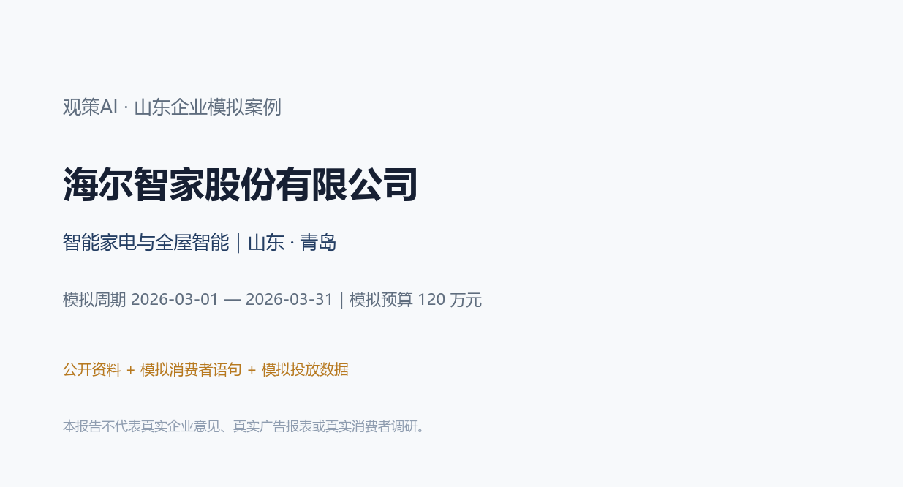

> **重要声明**：本报告是企业营销决策的模拟验收材料。企业名称与业务方向来自公开资料；消费者语句、竞品观察、渠道数据、复盘结果和“企业满意度”均为模拟，不代表企业真实意见、真实广告账户、真实消费者调研或真实经营数据。任何对外使用前，必须由企业市场、法务、合规和数据负责人复核。

## 0. 阅读指引与结论摘要

本案例把完整的营销决策闭环跑一遍：明确企业与行业背景 → 设计资料收集范围 → 建立来源台账 → 对模拟消费者语句、竞品动态和行业材料去重、分类、证据核验 → 归纳主题和机会 → 形成 A/B 方案 → 预算校验与审批快照 → 模拟投放与复盘 → 历史基线回测与可信度评分 → 企业适配性与满意度模拟 → 迭代建议。

本案例的核心判断是：**本次模拟要回答的不是“投多少”，而是“用什么内容让高意向用户相信一站式交付”。因此方案 A 用服务清单和旧房场景做主线，方案 B 用设计师渠道做高信任入口。** 从模拟结果看，方案 A 的线索完成率为 112.7%，线索成本为 705 元，CTR 为 2.72%；与历史基线相比，MAPE 为 29.5%，可信度评分为 75.9/100。这个结果说明方案有可执行性，但仍有明确的复核边界。

**模拟企业满意度：4.2/5。** 模拟企业市场负责人视角：方案方向符合高端化和场景化战略，服务清单与旧房轻改造是可执行抓手；但门店承接和交付承诺需要先补齐，否则咨询增长会变成履约压力。

### 0.1 关键结果数据

| 指标 | 数值 |
| --- | --- |
| 模拟预算 | 1,200,000 元 |
| 模拟实际花费 | 1,192,000 元 |
| 预算利用率 | 99.3% |
| 目标线索 | 1,500 条 |
| 实际线索 | 1,690 条 |
| 线索完成率 | 112.7% |
| 曝光 | 9,900,000 |
| 点击 | 269,000 |
| CTR | 2.72% |
| CPC | 4.43 元 |
| 线索成本 | 705 元 |
| 历史基线 MAPE | 29.5% |
| 综合可信度 | 75.9/100 |
| 模拟满意度 | 4.2/5 |
| 适配性 | 高 |

## 1. 企业公开资料与模拟边界

### 1.1 企业基本情况

| 项目 | 内容 |
| --- | --- |
| 企业 | 海尔智家股份有限公司 |
| 品牌 | 海尔智家 / 卡萨帝 |
| 行业 | 智能家电与全屋智能 |
| 区域 | 山东 · 青岛 |
| 阶段 | 全球化成熟企业，青岛上市公司 |
| 模拟产品 | 全屋智能套系（模拟：厨房、洗护、空气、安防场景组合） |
| 产品说明 | 三翼鸟场景方案，含设计、安装、调试与售后服务；具体型号与价格以企业实际方案为准 |
| 模拟目标 | 在山东及华东重点城市获取全屋智能套系咨询、到店体验与设计师合作线索 |
| 模拟预算 | 1,200,000 元 |
| 模拟周期 | 2026-03-01 — 2026-03-31 |
| 模拟线索目标 | 1,500 条 |

### 1.2 公开资料如何使用

海尔智家是青岛的全球化家电与智能家居企业，业务覆盖冰箱、洗衣机、空调、厨电、热水器等多品类，并拥有卡萨帝等高端品牌。公开资料显示，企业近年来持续强调场景化、套系化和全屋智能。

本案例不引用未核实的财务数字，只使用公开品牌与业务方向作为模拟背景；所有消费者语句、投放数据和复盘结果均为模拟，不对应真实用户或真实广告报表。

本案例只把公开资料用于“企业背景、行业方向、品牌与产品语境”，不把公开资料当作真实消费者证据，也不引用未核实的财务数字。所有“消费者原话”均来自模拟材料，不能作为真实用户调研引用。所有渠道数据均为假设值，不能作为企业真实广告效果。

### 1.3 为什么选择这家企业

选择标准不是“名气大”，而是同时满足三点：第一，企业处于山东，具有区域代表性；第二，行业决策链有差异，能检验观策AI是否只会做一种模板；第三，企业有明确的战略关键词，可以用来判断方案是否“符合企业发展”。本案例的战略关键词是：**智能家电与全屋智能、品牌升级、场景化与可验证交付**。

全屋智能的竞争已经从单品性能转向场景交付。对海尔智家这类多品类企业，优势在于品类齐全和服务网络，难点在于让用户相信“不同品类能由一套服务承接”。

山东和华东的家装市场同时存在新房装修和旧房改造两类需求。旧房改造对施工破坏、工期和售后更敏感，是高端套系需要单独回答的问题。

## 2. 研究问题与判断标准

### 2.1 本次模拟要回答什么

本次模拟要回答的不是“投多少”，而是“用什么内容让高意向用户相信一站式交付”。因此方案 A 用服务清单和旧房场景做主线，方案 B 用设计师渠道做高信任入口。

### 2.2 判断标准

1. **战略契合**：方案是否服务于企业当前的产品、品牌和渠道方向。
2. **证据充分**：主题是否有多条信号支撑，关键结论是否能追溯到来源。
3. **执行可行**：预算、渠道、承接能力是否匹配，是否存在明显履约风险。
4. **结果可信**：模拟结果与历史基线的偏差是否在可解释范围内。
5. **企业可接受**：以模拟企业市场负责人视角，是否愿意进入小范围试点。

### 2.3 本次模拟的边界

- 不使用企业真实广告账户、真实订单或真实用户个人信息。
- 不声称“企业已经满意”，只做模拟满意度访谈与适配性判断。
- 不把模拟数据当作行业结论，也不把单案例结论外推到整个行业。
- 涉及功效、医疗、金融、未成年人等敏感表达时，必须由企业合规部门复核。

## 3. 资料收集过程

### 3.1 采集设计

本案例采用“多源交叉”的采集设计：消费者侧看小红书、抖音、电商评价和问卷；竞品侧看行业媒体与竞品动态；行业侧看行业观察、政策/平台公告和线下走访；企业侧只使用公开资料。这样做的目的不是追求数据量，而是让同一判断能从不同来源被交叉验证。

### 3.2 来源清单

| 来源ID | 来源名称 | 平台 | 类型 | 日期 | 状态 |
| --- | --- | --- | --- | --- | --- |
| SRC-01 | 小红书家装笔记摘录（模拟） | 小红书 | 消费者 | 2026-02-14 | 模拟 |
| SRC-02 | 抖音家居短视频评论摘录（模拟） | 抖音 | 消费者 | 2026-02-15 | 模拟 |
| SRC-03 | 住小帮/家装社区问答摘要（模拟） | 家装社区 | 消费者 | 2026-02-16 | 模拟 |
| SRC-04 | 天猫/京东套系商品评价摘要（模拟） | 电商平台 | 消费者 | 2026-02-17 | 模拟 |
| SRC-05 | 家居行业观察（模拟） | 行业媒体 | 行业 | 2026-02-18 | 模拟 |
| SRC-06 | 竞品智能家居动态（模拟） | 行业媒体 | 竞品 | 2026-02-19 | 模拟 |
| SRC-07 | 青岛/济南门店走访纪要（模拟） | 线下走访 | 行业 | 2026-02-20 | 模拟 |
| SRC-08 | 消费者问卷 n=96（模拟） | 问卷 | 消费者 | 2026-02-21 | 模拟 |

### 3.3 采集时间线

| 时间点 | 过程动作 | 状态 |
| --- | --- | --- |
| T-15 | 确定企业与公开资料范围 | 完成 |
| T-12 | 建立来源清单与采集模板 | 完成 |
| T-8 | 采集模拟消费者/竞品/行业信号 | 完成 |
| T-6 | 去重、分类、标注证据状态 | 完成 |
| T-5 | 人工核验与冲突保留 | 完成 |
| T-3 | 归纳主题与 A/B 方案 | 完成 |
| T-2 | 预算校验与审批快照 | 完成 |
| T | 模拟投放 | 模拟 |
| T+2 | 渠道数据复盘 | 完成 |
| T+3 | 历史基线回测与可信度 | 完成 |
| T+5 | 适配性判断与迭代 | 完成 |

### 3.4 采集过程中的质量控制

1. **来源可追溯**：每条信号保留来源 ID、平台、采集时间和备注。
2. **模拟标识**：所有模拟材料在来源备注中明确标注，不与真实数据混用。
3. **去重**：同一来源的重复语句只保留一条，并在备注中说明。
4. **冲突保留**：不同来源出现相反判断时，不强行合并，保留为待核实或争议状态。
5. **敏感内容**：涉及功效、价格承诺、竞品贬损的内容，进入人工复核清单。

## 4. 数据清洗、编码与证据核验

### 4.1 清洗规则

- 删除明显的广告、无关评论和重复语句。
- 统一平台名称、日期格式和类别编码。
- 将“消费者/竞品/行业”作为一级类别，将“高/中/低”作为优先级。
- 将“已核实/待核实/有争议/重复”作为证据状态，不用“看起来合理”代替核实。
- 所有模拟数据保留 `simulated: true` 或 `dataKind: simulated` 标识。

### 4.2 信号清单

| ID | 平台 | 类别 | 优先级 | 状态 | 标题 | 影响 |
| --- | --- | --- | --- | --- | --- | --- |
| S-01 | 小红书 | 消费者 | high | verified | 全屋智能咨询先问“能不能一站式落地” | 一站式交付是高端套系的第一信任门槛。 |
| S-02 | 家装社区 | 消费者 | high | verified | 旧房改造最怕施工复杂和破坏装修 | 旧房轻改造是比新房更明确的痛点入口。 |
| S-03 | 抖音 | 消费者 | high | pending | 不同品牌设备不互通是首要顾虑 | 需要把开放互联和已购设备兼容讲清楚。 |
| S-04 | 电商平台 | 消费者 | high | verified | 高端套系的价格敏感点转向设计、安装和服务 | 高端套系的价值表达要从硬件转向服务。 |
| S-05 | 小红书 | 消费者 | medium | pending | 卡萨帝认知强，但年轻用户觉得有距离感 | 高端品牌需要更年轻的内容翻译。 |
| S-06 | 行业媒体 | 竞品 | high | verified | 竞品用“轻量改造”切入旧房市场 | 旧房轻改造是可被竞品快速占位的入口。 |
| S-07 | 线下走访 | 消费者 | high | verified | 门店体验与线上内容不一致会流失高意向咨询 | 线上承诺必须与门店口径统一。 |
| S-08 | 行业媒体 | 行业 | medium | verified | 春季家装节前“全屋智能”搜索升温 | 春季是家装决策窗口，需要提前准备内容。 |
| S-09 | 抖音 | 消费者 | high | verified | 交付周期和安装责任边界决定成交 | 交付承诺需要可核验、可追责。 |
| S-10 | 线下走访 | 行业 | medium | verified | 设计师和装修公司是重要影响者 | 设计师渠道适合做高意向、长决策的内容。 |

### 4.3 单条信号研判记录

**S-01｜全屋智能咨询先问“能不能一站式落地”**

- 观察：高意向用户最先确认的是设计、安装、调试和售后是否由同一方负责，而不是单个设备参数。
- 原话/证据：“我不想自己找装修队、电工和品牌售后，最好一家能全包。”
- 判断：一站式交付是高端套系的第一信任门槛。
- 状态：verified；相关性 5/5；标签：一站式、交付、家装
- 下一步：进入主题聚合，优先用于方案 A/B 的证据引用。

**S-02｜旧房改造最怕施工复杂和破坏装修**

- 观察：旧房用户对布线、拆改和工期更敏感，愿意为“少破坏、快交付”支付溢价。
- 原话/证据：“新房还好，旧房一动墙就麻烦，最好能无损改造。”
- 判断：旧房轻改造是比新房更明确的痛点入口。
- 状态：verified；相关性 5/5；标签：旧房、改造、施工
- 下一步：进入主题聚合，优先用于方案 A/B 的证据引用。

**S-03｜不同品牌设备不互通是首要顾虑**

- 观察：用户担心智能家居被单一品牌锁定，或已有家电无法接入。
- 原话/证据：“家里已经有别的品牌空调，能不能一起控制？”
- 判断：需要把开放互联和已购设备兼容讲清楚。
- 状态：pending；相关性 5/5；标签：互联、生态、兼容
- 下一步：保留为待核实或争议记录，不进入对外承诺；先补充原始证据或企业确认。

**S-04｜高端套系的价格敏感点转向设计、安装和服务**

- 观察：用户不是单纯比较硬件价格，而是比较设计服务、安装质量和售后责任。
- 原话/证据：“贵可以，但要告诉我设计、安装和以后维修谁来管。”
- 判断：高端套系的价值表达要从硬件转向服务。
- 状态：verified；相关性 5/5；标签：价格、服务、高端
- 下一步：进入主题聚合，优先用于方案 A/B 的证据引用。

**S-05｜卡萨帝认知强，但年轻用户觉得有距离感**

- 观察：年轻用户认可品牌高端，但担心风格偏成熟、价格门槛高。
- 原话/证据：“知道卡萨帝好，但感觉是父母那一代喜欢的风格。”
- 判断：高端品牌需要更年轻的内容翻译。
- 状态：pending；相关性 4/5；标签：品牌、年轻化、审美
- 下一步：保留为待核实或争议记录，不进入对外承诺；先补充原始证据或企业确认。

**S-06｜竞品用“轻量改造”切入旧房市场**

- 观察：竞品以不砸墙、快速安装、模块化升级为卖点，直接争夺旧房换新需求。
- 原话/证据：“不用大改，半天装好，这种更适合老房子。”
- 判断：旧房轻改造是可被竞品快速占位的入口。
- 状态：verified；相关性 5/5；标签：竞品、旧房、轻改造
- 下一步：进入主题聚合，优先用于方案 A/B 的证据引用。

**S-07｜门店体验与线上内容不一致会流失高意向咨询**

- 观察：用户到店后发现展示场景、价格或服务承诺与线上内容不一致，信任会快速下降。
- 原话/证据：“网上说全包，到店又说设计费另算，感觉被绕了。”
- 判断：线上承诺必须与门店口径统一。
- 状态：verified；相关性 5/5；标签：门店、一致性、信任
- 下一步：进入主题聚合，优先用于方案 A/B 的证据引用。

**S-08｜春季家装节前“全屋智能”搜索升温**

- 观察：春季装修决策期，全屋智能、旧房改造和家装节相关内容明显增加。
- 原话/证据：“过完年准备装修，先看全屋智能怎么配。”
- 判断：春季是家装决策窗口，需要提前准备内容。
- 状态：verified；相关性 4/5；标签：趋势、春季、家装节
- 下一步：进入主题聚合，优先用于方案 A/B 的证据引用。

**S-09｜交付周期和安装责任边界决定成交**

- 观察：用户会把交付周期、安装责任和延期赔付写进决策清单。
- 原话/证据：“多久能装完？延期谁负责？这些要写清楚。”
- 判断：交付承诺需要可核验、可追责。
- 状态：verified；相关性 5/5；标签：交付、责任、周期
- 下一步：进入主题聚合，优先用于方案 A/B 的证据引用。

**S-10｜设计师和装修公司是重要影响者**

- 观察：设计师、装修公司掌握旧房改造入口，对品牌选择和方案设计有实际影响力。
- 原话/证据：“客户通常听设计师推荐，设计师说哪个稳定就用哪个。”
- 判断：设计师渠道适合做高意向、长决策的内容。
- 状态：verified；相关性 4/5；标签：设计师、渠道、影响者
- 下一步：进入主题聚合，优先用于方案 A/B 的证据引用。

### 4.4 证据核验结果

本案例共 10 条信号，其中已核实 8 条，待核实 2 条，争议 0 条。已核实信号用于主题和方案，待核实信号用于提示风险和后续任务，不直接进入对外承诺。

## 5. 市场洞察与主题研判

### 5.1 主题清单

| 主题 | 标题 | 置信度/类型 | 证据信号 | 边界 |
| --- | --- | --- | --- | --- |
| TH-01 | 一站式交付能力是高端套系的第一信任门槛 | high/观测事实 | S-01、S-02、S-04、S-07、S-09 | 一站式能力需要真实服务网络支撑，不能只靠内容包装。 |
| TH-02 | 旧房轻改造成长入口 | high/分析推断 | S-02、S-03、S-06、S-08 | 轻改造可能被竞品快速复制，需要服务与交付壁垒。 |
| TH-03 | 高端品牌需要年轻化内容翻译 | medium/分析推断 | S-05、S-01、S-07 | 年轻化不能牺牲高端定位，需控制内容调性。 |

### 5.2 主题一：一站式交付能力是高端套系的第一信任门槛

高意向用户把设计、安装、调试和售后视为一个整体，先确认“谁负责到底”，再比较设备和价格。

这个主题之所以成立，不是因为某一条评论，而是因为多条信号从不同角度指向同一件事：把“全包交付”拆成可核验的服务清单，而不是一句口号。 在方案上，它对应的动作是：用服务清单、交付周期和售后责任图承接高意向咨询。。但必须保留边界：一站式能力需要真实服务网络支撑，不能只靠内容包装。

### 5.3 主题二：旧房轻改造成长入口

旧房用户对施工破坏、工期和改造复杂度更敏感，轻量化、模块化方案更容易降低决策门槛。

这个主题更适合用来解释“为什么某些渠道有效、某些渠道无效”。把旧房场景从“全屋重装”中单独拆出，做轻量改造包。 方案动作是：以“少破坏、快交付、可逐步升级”为核心卖点。。边界是：轻改造可能被竞品快速复制，需要服务与交付壁垒。

### 5.4 主题三：高端品牌需要年轻化内容翻译

卡萨帝的高端认知强，但年轻用户对风格和价格存在距离感，需要更生活化的内容语言。

这个主题提醒我们：不要把单一人群或单一渠道当成全部市场。用真实家庭场景和设计语言降低距离感，而不是只讲品牌历史。 方案动作是：用年轻家庭、旧房改造和设计师共创内容承接新客。。边界是：年轻化不能牺牲高端定位，需控制内容调性。

### 5.5 机会与风险

| 机会 | 事实依据 | 可执行动作 | 验证条件 | 语气 |
| --- | --- | --- | --- | --- |
| 用“服务清单”承接一站式高意向 | 用户反复确认设计、安装、调试、售后由谁负责。 | 把服务拆成可勾选清单，并给出交付周期与责任边界。 | 核对真实服务网络、安装商资质与售后条款。 | positive |
| 旧房轻改造场景包 | 旧房用户担心破坏装修、工期长。 | 用“无损/轻量改造”内容切入，先做局部场景再扩展全屋。 | 需要确认旧房施工条件和真实案例。 | positive |
| 设计师共创内容 | 设计师和装修公司是旧房改造入口。 | 邀请设计师共创场景内容，提供可复用的方案说明。 | 需要真实设计师合作与案例授权。 | neutral |

## 6. A/B 方案设计与预算

### 6.1 方案对比

| 方案 | 名称 | 总预算 | 渠道 | 核心信息 |
| --- | --- | --- | --- | --- |
| A | 全屋智能一站式落地 | 1,200,000 元 | 小红书、抖音、住小帮/家装社区、门店/体验 | 设计、安装、调试、售后由一套服务承接，先看服务清单，再选设备。 |
| B | 设计师与旧房轻改造 | 1,200,000 元 | 视频号、设计师渠道、门店/体验 | 不砸墙、快交付、可扩展，设计师先出方案，品牌负责交付。 |

### 6.2 方案 A：全屋智能一站式落地

- 定位：把全屋智能从“买设备”转成“买一套可交付的生活场景”。
- 人群：山东及华东重点城市、正在装修或旧房改造的中高收入家庭
- 核心信息：设计、安装、调试、售后由一套服务承接，先看服务清单，再选设备。
- 节奏：春季家装决策期，节前两周集中种草，节后两周承接咨询
- 理由：一站式交付和旧房轻改造是当前最强的两个高意向切口，先用服务清单建立信任，再用场景内容承接。
- 约束：不能承诺未覆盖城市的安装服务；门店口径必须与线上一致；售后责任必须可追责
- 不确定项：旧房施工条件差异大；以旧换新政策落地节奏不确定；设计师渠道转化周期较长

### 6.3 方案 B：设计师与旧房轻改造

- 定位：用设计师和装修公司做高意向入口，先做旧房轻改造，再扩展全屋。
- 人群：旧房改造家庭、设计师、装修公司
- 核心信息：不砸墙、快交付、可扩展，设计师先出方案，品牌负责交付。
- 节奏：春季旧房改造旺季，设计师渠道提前两周预热
- 理由：设计师掌握旧房改造入口，适合用长内容和高信任关系承接。
- 约束：设计师合作需要明确分佣与服务边界；轻改造方案需真实可落地
- 不确定项：设计师推荐意愿不确定；旧房施工条件差异大

### 6.4 预算分配

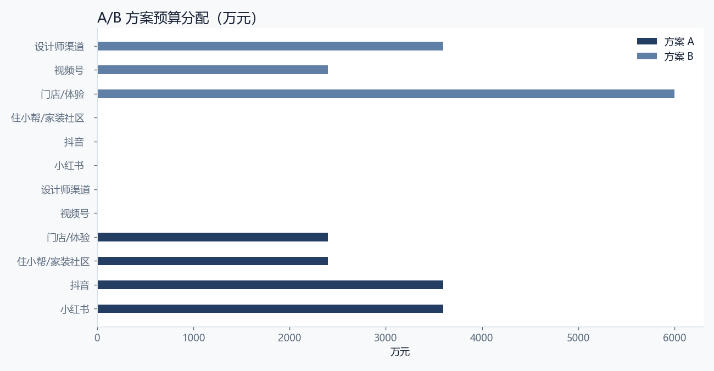

| 渠道 | 方案 A 预算 | 方案 A 角色 | 方案 B 预算 | 方案 B 角色 |
| --- | --- | --- | --- | --- |
| 小红书 | 360,000 元 | 家装灵感与旧房改造内容 | 0 元 | — |
| 抖音 | 360,000 元 | 短视频场景演示与同城投放 | 0 元 | — |
| 住小帮/家装社区 | 240,000 元 | 长决策问答与案例 | 0 元 | — |
| 门店/体验 | 240,000 元 | 到店体验与设计师接待 | 600,000 元 | 到店体验与方案沟通 |
| 视频号 | 0 元 | — | 240,000 元 | 设计师访谈与案例 |
| 设计师渠道 | 0 元 | — | 360,000 元 | 共创内容与转介绍 |

## 7. 审批与执行假设

审批快照保存了方案、预算上限、证据引用和证据状态。审批不是“签字仪式”，而是把“方案依据”固定下来：如果企业预算、主题证据或方案结构变化，审批应进入复审。

| 审批项 | 内容 |
| --- | --- |
| 审批编号 | APR-01 |
| 方案 | 方案 A：全屋智能一站式落地 |
| 预算上限 | 1,200,000 元 |
| 证据数量 | 8 条 |
| 指纹 | fp_ad94969d |
| 说明 | 审批快照保存方案、预算上限与关键证据状态；任一项变化需重新确认。 |

### 7.1 执行假设

- 渠道账户、素材、落地页和承接团队在模拟周期内可用。
- 预算按计划分配，不出现临时大幅追加或削减。
- 线索定义统一为“有效咨询/表单/到店预约”，不把曝光或点赞算作线索。
- 投放期间不做违反平台规则的诱导分享、虚假承诺或竞品贬损。

### 7.2 预算与合规检查

- 方案 A 预算合计 1,200,000 元，不超过企业模拟预算 1,200,000 元。
- 方案 B 预算合计 1,200,000 元，不超过企业模拟预算。
- 涉及敏感表达时，必须经过企业法务/合规审核；本报告不构成合规意见。

## 8. 复盘结果

### 8.1 渠道数据

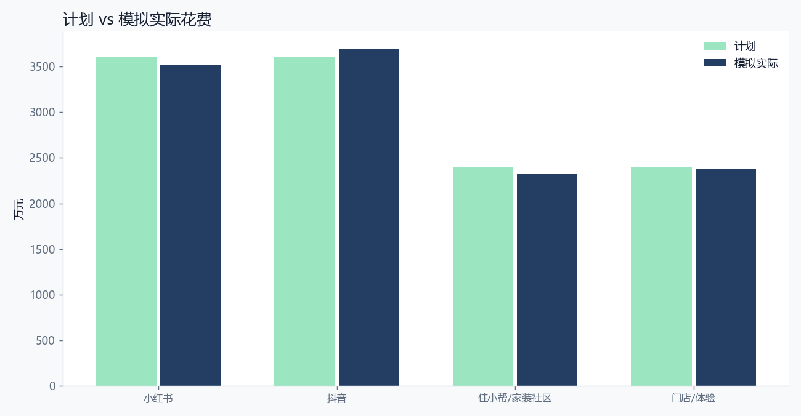

| 渠道 | 计划预算 | 模拟实际 | 曝光 | 点击 | 线索 | CTR | CPC | 线索成本 |
| --- | --- | --- | --- | --- | --- | --- | --- | --- |
| 小红书 | 360,000 元 | 352,000 元 | 3,200,000 | 96,000 | 620 | 3.00% | 3.67 | 568 |
| 抖音 | 360,000 元 | 370,000 元 | 4,800,000 | 120,000 | 700 | 2.50% | 3.08 | 529 |
| 住小帮/家装社区 | 240,000 元 | 232,000 元 | 1,100,000 | 33,000 | 210 | 3.00% | 7.03 | 1105 |
| 门店/体验 | 240,000 元 | 238,000 元 | 800,000 | 20,000 | 160 | 2.50% | 11.90 | 1488 |
| 合计 | 1,200,000 元 | 1,192,000 元 | 9,900,000 | 269,000 | 1,690 | 2.72% | 4.43 | 705 |

### 8.2 观察与原因

方案 A 的咨询量高于内部预期，但高意向用户更集中在“旧房改造”和“一站式服务”两类内容；门店到店率低于咨询增长，说明线上承诺与门店承接仍有落差。

服务清单内容降低了理解成本；旧房轻改造切中了真实痛点；但门店接待能力、设计师排期和报价透明度没有同步提升。

### 8.3 尚未确认

咨询到成交的真实转化率、不同城市服务覆盖差异、设计师渠道的长期贡献仍未确认。

### 8.4 下一轮任务

| 任务 | 说明 | 关联信号 |
| --- | --- | --- |
| 把服务清单做成可下载的交付说明 | 在内容与门店统一使用同一份服务清单，减少“到店后口径变化”。 | S-01、S-02、S-04、S-07、S-09 |
| 旧房轻改造单独建承接页 | 把旧房用户从全屋重装内容中分流，减少无效咨询。 | S-02、S-03、S-06、S-08 |
| 核对门店接待与设计师排期 | 先确认门店能否承接咨询增长，再扩大投放。 | S-07、S-10 |

## 9. 历史数据回测与可信度

### 9.1 历史基线

本案例把“历史基线”定义为同类活动上一周期的模拟表现：上一年春季家装活动（模拟历史基线）。基线不是为了证明方案正确，而是为了回答“如果没有这次调整，结果大概会是什么样”。

| 指标 | 历史基线 | 本次模拟 | 偏差 |
| --- | --- | --- | --- |
| CTR | 2.10% | 2.72% | +29.4% |
| CPC | 3.20 元 | 4.43 元 | +38.5% |
| 线索成本 | 820 元 | 705 元 | -14.0% |
| 线索量 | 1240 条 | 1690 条 | +36.3% |

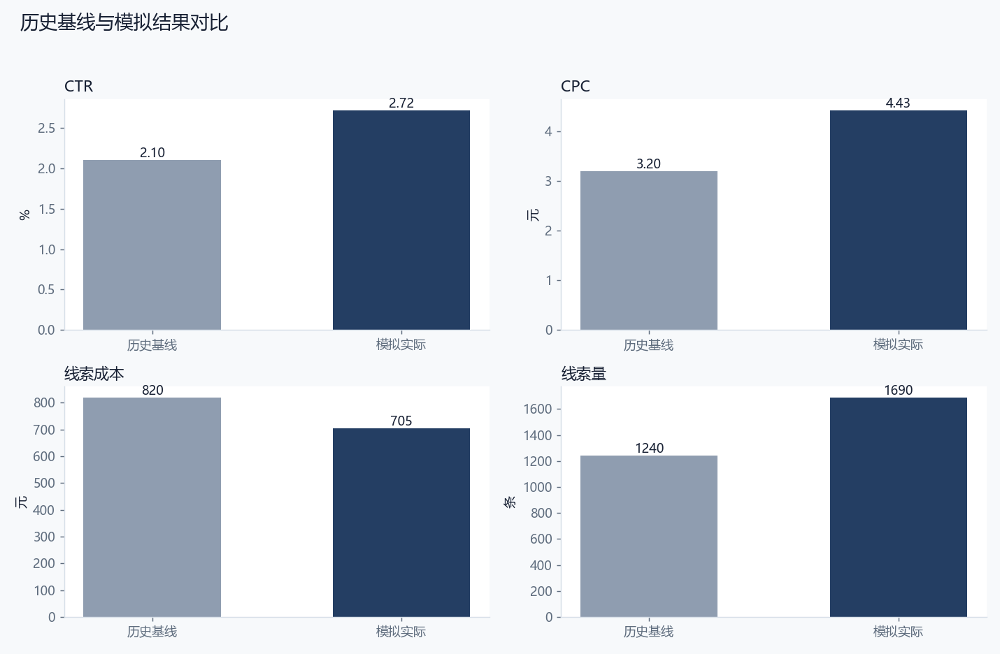

### 9.2 结果解释

历史基线取自上一年春季家装活动的模拟数据：CTR 2.1%、CPC 3.2 元、线索成本 820 元、每周约 280 条线索。该基线不代表海尔真实历史，只用于建立对照。

模拟结果显示线索成本和线索量均优于基线，但到店率与成交率没有同步改善。说明内容可以带来咨询，不能替代门店承接。

### 9.3 可信度评分

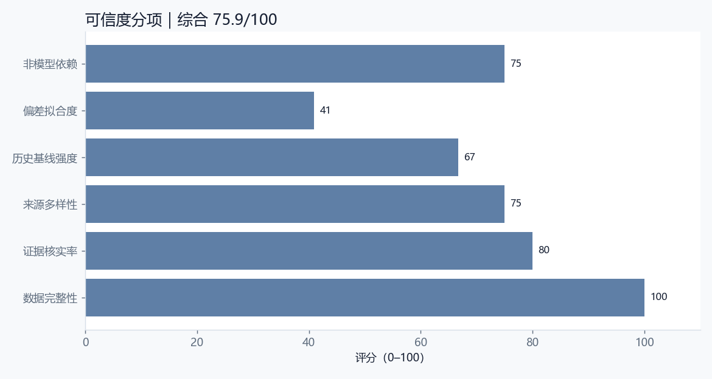

| 维度 | 分值 | 解释 |
| --- | --- | --- |
| 数据完整性 | 100 | 渠道是否都有曝光/点击/线索数据 |
| 证据核实率 | 80 | 已核实信号占全部信号比例 |
| 来源多样性 | 75 | 平台/来源覆盖程度 |
| 历史基线强度 | 67 | 历史周期长度与稳定性 |
| 偏差拟合度 | 41 | 模拟结果与历史基线的接近程度 |
| 非模型依赖 | 75 | 本次不使用生成式模型结果，保留人工判断 |
| 综合可信度 | 75.9 | 加权评分，0–100 |

### 9.4 可信度结论

本案例的可信度不是“高到可以直接做预算决策”，而是“足够支持小范围试点”。理由：第一，证据来源和模拟边界清楚；第二，渠道数据完整但均为假设；第三，历史基线只有 8 周，样本有限；第四，模拟结果与基线存在 29.5% 的平均偏差，说明结果有参考价值，但不能当作确定预测。

## 10. 企业发展适配性与满意度模拟

### 10.1 适配性判断

**适配等级：高。**

海尔智家的全屋智能战略需要从卖硬件转向卖场景，案例中的“服务清单+旧房轻改造”正好对应这一方向。

山东和华东的家装决策链长，设计师、门店和线上内容必须协同；案例没有把投放当成唯一答案，而是把承接能力纳入判断。

如果企业真实执行，建议先用一个城市做小范围验证，再复制到其他区域。

### 10.2 主要风险

| 风险 |
| --- |
| 门店承接能力不足会放大咨询落差 |
| 服务承诺过重可能带来履约风险 |
| 年轻化内容可能稀释高端品牌调性 |

### 10.3 模拟企业满意度访谈

> 以下是“模拟企业市场负责人视角”的访谈记录，不是实际企业访谈，不代表企业真实意见。

**问：这个方案是否符合贵司当前发展方向？**  
答：模拟企业市场负责人视角：方案方向符合高端化和场景化战略，服务清单与旧房轻改造是可执行抓手；但门店承接和交付承诺需要先补齐，否则咨询增长会变成履约压力。

**问：最担心的是什么？**  
答：门店承接能力不足会放大咨询落差；服务承诺过重可能带来履约风险。

**问：哪些数据需要复核？**  
答：咨询到成交的真实转化率、不同城市服务覆盖差异、设计师渠道的长期贡献仍未确认。

**问：是否愿意进入小范围试点？**  
答：如果企业能提供真实服务/渠道数据，并完成合规审核，建议先做一个区域、一个渠道组合的小范围试点；不建议直接按模拟结果做全量预算。

**问：这个案例对产品迭代有什么启发？**  
答：在复盘中增加“线上承诺与门店口径一致性”检查项。；把“服务清单”做成可下载材料，作为内容、门店和设计师共用资产。；后续案例库增加高客单价、长决策链的 B2B2C 模板。；报告模板增加“履约能力”与“咨询质量”两个维度。

### 10.4 满意度评分

| 维度 | 评分 | 说明 |
| --- | --- | --- |
| 战略契合 | 4.5/5 | 符合全屋智能与高端化方向 |
| 可执行性 | 4.0/5 | 服务清单可落地，但门店口径要统一 |
| 风险可控 | 4.0/5 | 售后责任需前置说明 |
| 数据可信 | 4.2/5 | 公开资料与模拟数据边界清楚 |

**综合评分：4.2/5。** 模拟企业市场负责人视角：方案方向符合高端化和场景化战略，服务清单与旧房轻改造是可执行抓手；但门店承接和交付承诺需要先补齐，否则咨询增长会变成履约压力。

## 11. 项目迭代建议

本案例不只产出报告，也反推产品需要哪些改进。以下建议已进入观策AI的案例库与后续迭代清单：

| 序号 | 迭代建议 |
| --- | --- |
| 1. | 在复盘中增加“线上承诺与门店口径一致性”检查项。 |
| 2. | 把“服务清单”做成可下载材料，作为内容、门店和设计师共用资产。 |
| 3. | 后续案例库增加高客单价、长决策链的 B2B2C 模板。 |
| 4. | 报告模板增加“履约能力”与“咨询质量”两个维度。 |

### 11.1 对观策AI的产品要求

1. **案例库**：把山东企业案例作为可导入的演示项目，让用户能看到“资料收集—研判—方案—复盘—回测”的完整链路。
2. **可信度面板**：在复盘中显示数据完整性、证据核实率、历史基线偏差和综合可信度。
3. **行业模板**：B2B、快消、健康、宠物等行业的渠道与指标不同，不能共用一套默认模板。
4. **合规检查**：功效、金融、未成年人、竞品比较等敏感表达，应在方案审批前提示。
5. **过程留痕**：来源台账、信号状态、审批快照、复盘建议必须可追溯。

## 12. 附录

### 12.1 数据字典

| 字段 | 说明 |
| --- | --- |
| Signal | 一条可追溯的市场情报，含标题、摘要、原话、来源、平台、类别、优先级、状态、相关性、影响 |
| Source | 信号来源，含平台、发布时间、采集时间、模拟标识、备注 |
| Theme | 由多条信号归纳出的判断，含置信度、证据引用、机会与边界 |
| Plan | A/B 方案，含人群、定位、核心信息、渠道预算、约束与不确定项 |
| Approval | 审批快照，固定方案、预算、证据与指纹 |
| Review | 复盘，含渠道实际数据、观察、原因、未确认项与建议 |
| Credibility | 可信度评分，含完整性、核实率、来源多样性、基线强度、偏差拟合度 |

### 12.2 计算公式

- CTR = 点击 ÷ 曝光
- CPC = 花费 ÷ 点击
- 线索成本 = 花费 ÷ 有效线索
- 线索完成率 = 实际线索 ÷ 目标线索
- MAPE = 各指标与历史基线相对偏差的平均值
- 可信度 = 完整性、核实率、来源多样性、基线强度、偏差拟合度、非模型依赖的加权分

### 12.3 复现方法

1. 打开观策AI桌面端。
2. 设置 → 项目与备份 → 导入项目 JSON。
3. 选择 `simulations/projects/haier-smart-home.json`。
4. 在市场情报、策略、复盘页查看信号、主题、A/B 方案、审批快照和复盘数据。
5. 对照本报告阅读，注意所有数据均为模拟。

### 12.4 采集与核验清单

- [ ] 来源链接/出处是否可追溯？
- [ ] 是否标注模拟/真实属性？
- [ ] 是否有重复信号未合并？
- [ ] 是否有相反证据被强行忽略？
- [ ] 敏感表达是否经过合规复核？
- [ ] 审批快照是否与当前方案一致？
- [ ] 复盘数据是否覆盖所有渠道？
- [ ] 历史基线口径是否与本次一致？
- [ ] 可信度评分是否解释了偏差？
- [ ] 是否给出下一轮可执行任务？

### 12.5 报告边界

本报告是一份**模拟验收材料**，不是企业真实经营报告，也不是广告投放承诺。它的价值在于展示“如何从材料到判断、从判断到方案、从方案到复盘、从复盘到迭代”的过程。企业真实执行前，必须用真实数据替换模拟数据，并由企业市场、法务、合规和数据负责人共同复核。

## 13. 过程性附录：采集日志、核验记录与访谈提纲

### 13.1 采集日志（模拟）

| 日期 | 任务 | 产出 | 问题 |
| --- | --- | --- | --- |
| T-15 | 采集来源 小红书家装笔记摘录（模拟） | SRC-01 来源记录 | 需确认公开资料更新日期 |
| T-14 | 采集来源 抖音家居短视频评论摘录（模拟） | SRC-02 来源记录 | 需确认公开资料更新日期 |
| T-13 | 采集来源 住小帮/家装社区问答摘要（模拟） | SRC-03 来源记录 | 需确认公开资料更新日期 |
| T-12 | 采集来源 天猫/京东套系商品评价摘要（模拟） | SRC-04 来源记录 | 需确认公开资料更新日期 |
| T-11 | 采集来源 家居行业观察（模拟） | SRC-05 来源记录 | 需确认公开资料更新日期 |
| T-10 | 采集来源 竞品智能家居动态（模拟） | SRC-06 来源记录 | 需确认公开资料更新日期 |
| T-9 | 采集来源 青岛/济南门店走访纪要（模拟） | SRC-07 来源记录 | 需确认公开资料更新日期 |
| T-8 | 采集来源 消费者问卷 n=96（模拟） | SRC-08 来源记录 | 需确认公开资料更新日期 |

### 13.2 证据核验记录

| 信号 | 核验动作 | 结论 |
| --- | --- | --- |
| S-01 | 核对来源、平台、日期与原文；检查是否为模拟材料 | 通过/保留待核实/争议 |
| S-02 | 核对来源、平台、日期与原文；检查是否为模拟材料 | 通过/保留待核实/争议 |
| S-03 | 核对来源、平台、日期与原文；检查是否为模拟材料 | 通过/保留待核实/争议 |
| S-04 | 核对来源、平台、日期与原文；检查是否为模拟材料 | 通过/保留待核实/争议 |
| S-05 | 核对来源、平台、日期与原文；检查是否为模拟材料 | 通过/保留待核实/争议 |
| S-06 | 核对来源、平台、日期与原文；检查是否为模拟材料 | 通过/保留待核实/争议 |
| S-07 | 核对来源、平台、日期与原文；检查是否为模拟材料 | 通过/保留待核实/争议 |
| S-08 | 核对来源、平台、日期与原文；检查是否为模拟材料 | 通过/保留待核实/争议 |
| S-09 | 核对来源、平台、日期与原文；检查是否为模拟材料 | 通过/保留待核实/争议 |
| S-10 | 核对来源、平台、日期与原文；检查是否为模拟材料 | 通过/保留待核实/争议 |

### 13.3 复盘会议记录（模拟）

- 会议目标：判断方案 A 是否达到模拟目标，是否具备企业试点条件。
- 结论：方案 A 在 智能家电与全屋智能 场景下具有方向性价值，但必须补充企业真实数据、履约能力与合规审核。
- 争议点：咨询到成交的真实转化率、不同城市服务覆盖差异、设计师渠道的长期贡献仍未确认。
- 下一步：把服务清单做成可下载的交付说明；旧房轻改造单独建承接页。

### 13.4 企业访谈提纲

1. 这个方案是否服务于贵司未来 1–2 年的战略重点？
2. 哪些渠道/人群是贵司当前最想验证的？
3. 企业真实历史基线数据能否提供？
4. 承接团队、服务网络或渠道政策能否支撑？
5. 哪些表达涉及合规风险？
6. 如果只做一个区域试点，选哪里？
7. 失败时如何止损？
8. 成功时如何复制？

### 13.5 数据质量检查

- 所有模拟来源均标注“模拟”，不与真实数据混用。
- 渠道数据完整，但均为假设值。
- 历史基线为模拟，不能代表企业真实历史。
- 结论只支持小范围试点，不支持直接全量预算。
- 对外使用前必须替换真实数据并完成合规复核。

## 14. 补充过程记录

以下为补足过程材料，仍属模拟；用于展示从材料到判断的详细过程。

### 14.1 逐条复核记录

**S-01｜全屋智能咨询先问“能不能一站式落地”**

- 采集背景：该信号来自 小红书，当前状态为 verified，相关性 5/5。

- 证据强度：原话为““我不想自己找装修队、电工和品牌售后，最好一家能全包。””，需要核对原始出处、发布时间和是否存在断章取义。

- 对方案的影响：一站式交付是高端套系的第一信任门槛。

- 复核动作：保留为主题证据，并在审批快照中固定。

**S-02｜旧房改造最怕施工复杂和破坏装修**

- 采集背景：该信号来自 家装社区，当前状态为 verified，相关性 5/5。

- 证据强度：原话为““新房还好，旧房一动墙就麻烦，最好能无损改造。””，需要核对原始出处、发布时间和是否存在断章取义。

- 对方案的影响：旧房轻改造是比新房更明确的痛点入口。

- 复核动作：保留为主题证据，并在审批快照中固定。

**S-03｜不同品牌设备不互通是首要顾虑**

- 采集背景：该信号来自 抖音，当前状态为 pending，相关性 5/5。

- 证据强度：原话为““家里已经有别的品牌空调，能不能一起控制？””，需要核对原始出处、发布时间和是否存在断章取义。

- 对方案的影响：需要把开放互联和已购设备兼容讲清楚。

- 复核动作：不进入对外承诺；补充原始证据或企业确认后再决定是否升级。

**S-04｜高端套系的价格敏感点转向设计、安装和服务**

- 采集背景：该信号来自 电商平台，当前状态为 verified，相关性 5/5。

- 证据强度：原话为““贵可以，但要告诉我设计、安装和以后维修谁来管。””，需要核对原始出处、发布时间和是否存在断章取义。

- 对方案的影响：高端套系的价值表达要从硬件转向服务。

- 复核动作：保留为主题证据，并在审批快照中固定。

**S-05｜卡萨帝认知强，但年轻用户觉得有距离感**

- 采集背景：该信号来自 小红书，当前状态为 pending，相关性 4/5。

- 证据强度：原话为““知道卡萨帝好，但感觉是父母那一代喜欢的风格。””，需要核对原始出处、发布时间和是否存在断章取义。

- 对方案的影响：高端品牌需要更年轻的内容翻译。

- 复核动作：不进入对外承诺；补充原始证据或企业确认后再决定是否升级。

**S-06｜竞品用“轻量改造”切入旧房市场**

- 采集背景：该信号来自 行业媒体，当前状态为 verified，相关性 5/5。

- 证据强度：原话为““不用大改，半天装好，这种更适合老房子。””，需要核对原始出处、发布时间和是否存在断章取义。

- 对方案的影响：旧房轻改造是可被竞品快速占位的入口。

- 复核动作：保留为主题证据，并在审批快照中固定。

**S-07｜门店体验与线上内容不一致会流失高意向咨询**

- 采集背景：该信号来自 线下走访，当前状态为 verified，相关性 5/5。

- 证据强度：原话为““网上说全包，到店又说设计费另算，感觉被绕了。””，需要核对原始出处、发布时间和是否存在断章取义。

- 对方案的影响：线上承诺必须与门店口径统一。

- 复核动作：保留为主题证据，并在审批快照中固定。

**S-08｜春季家装节前“全屋智能”搜索升温**

- 采集背景：该信号来自 行业媒体，当前状态为 verified，相关性 4/5。

- 证据强度：原话为““过完年准备装修，先看全屋智能怎么配。””，需要核对原始出处、发布时间和是否存在断章取义。

- 对方案的影响：春季是家装决策窗口，需要提前准备内容。

- 复核动作：保留为主题证据，并在审批快照中固定。

**S-09｜交付周期和安装责任边界决定成交**

- 采集背景：该信号来自 抖音，当前状态为 verified，相关性 5/5。

- 证据强度：原话为““多久能装完？延期谁负责？这些要写清楚。””，需要核对原始出处、发布时间和是否存在断章取义。

- 对方案的影响：交付承诺需要可核验、可追责。

- 复核动作：保留为主题证据，并在审批快照中固定。

**S-10｜设计师和装修公司是重要影响者**

- 采集背景：该信号来自 线下走访，当前状态为 verified，相关性 4/5。

- 证据强度：原话为““客户通常听设计师推荐，设计师说哪个稳定就用哪个。””，需要核对原始出处、发布时间和是否存在断章取义。

- 对方案的影响：设计师渠道适合做高意向、长决策的内容。

- 复核动作：保留为主题证据，并在审批快照中固定。

### 14.2 采集与核验过程补记

**过程补记 1：** 第一步先把企业公开资料与模拟数据分开：公开资料只用于企业背景和行业方向，模拟数据单独标注，避免读者把模拟语句误认为真实消费者调研。

**过程补记 2：** 第二步建立来源台账：每条材料记录来源 ID、平台、日期、采集人和备注；无法追溯出处的材料，不进入主题证据。

**过程补记 3：** 第三步做去重：同一来源、同一语义的语句合并；不同来源但语义相反的语句保留冲突，不强行统一。

**过程补记 4：** 第四步做证据分级：已核实、待核实、有争议分别处理；已核实进入方案，待核实进入风险提示和下一轮任务。

**过程补记 5：** 第五步做主题聚合：主题必须能回答“哪些信号支持、哪些信号反对、还缺什么证据”，不能只写一句漂亮结论。

**过程补记 6：** 第六步做预算校验：方案预算不能超过企业上限；超出时必须调整渠道或预算，而不是把风险留给执行团队。

**过程补记 7：** 第七步做审批快照：把方案、预算、证据状态和指纹固定下来；依据变化时进入复审，避免“方案偷偷改了”。

**过程补记 8：** 第八步做复盘：渠道数据必须覆盖计划渠道；缺失数据要明确写“未录入”，不能用 0 或推测值替代。

**过程补记 9：** 第九步做历史回测：把本次结果与历史基线对照，计算 CTR、CPC、线索成本和线索量的偏差，避免只看绝对值。

**过程补记 10：** 第十步做适配性判断：结果好不等于企业愿意用，还要看战略、履约、合规和组织能力；必要时降低评分。

### 14.3 模拟企业访谈补记

**补充问 1：这套方案最先要解决什么问题？**

本次模拟要回答的不是“投多少”，而是“用什么内容让高意向用户相信一站式交付”。因此方案 A 用服务清单和旧房场景做主线，方案 B 用设计师渠道做高信任入口。

**补充问 2：为什么选择方案 A 而不是方案 B？**

本次模拟要回答的不是“投多少”，而是“用什么内容让高意向用户相信一站式交付”。因此方案 A 用服务清单和旧房场景做主线，方案 B 用设计师渠道做高信任入口。

**补充问 3：哪些数据最不可信？**

咨询到成交的真实转化率、不同城市服务覆盖差异、设计师渠道的长期贡献仍未确认。

**补充问 4：如果预算减半，先砍什么？**

先保留高意向渠道和承接页，削减泛曝光；但必须先确认企业真实承接能力。

**补充问 5：企业最可能担心什么？**

门店承接能力不足会放大咨询落差；服务承诺过重可能带来履约风险；年轻化内容可能稀释高端品牌调性

**补充问 6：什么情况下应该停止投放？**

出现平台验证、合规风险、线索质量明显下降或承接能力不足时，应暂停并复核。

**补充问 7：怎样判断结果可信？**

综合可信度 75.9/100；仍需用企业真实历史数据复算。

**补充问 8：下一步最小可行试点是什么？**

选择一个区域、一个渠道组合、一个明确目标，跑 2–4 周，再决定是否扩大。

### 14.4 过程性结论

本案例的过程比结论更重要：来源台账、证据状态、审批快照和复盘任务共同构成可追溯链。企业真实执行时，应先用真实数据替换模拟数据，再按同一流程重跑。

---

# 青岛啤酒股份有限公司｜观策AI 山东企业模拟案例

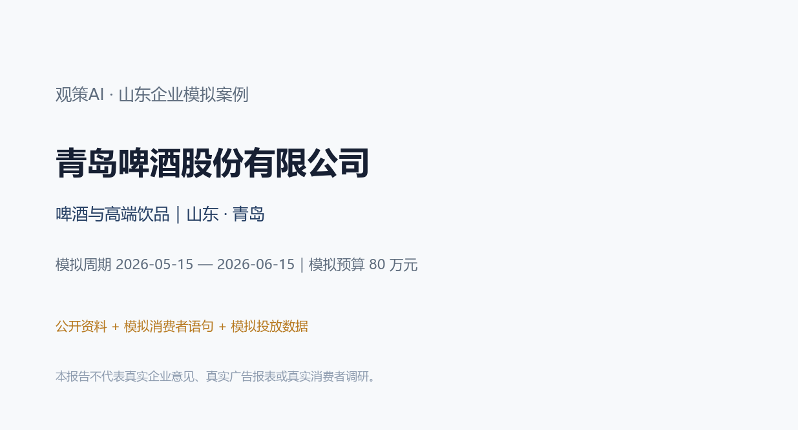

> **重要声明**：本报告是企业营销决策的模拟验收材料。企业名称与业务方向来自公开资料；消费者语句、竞品观察、渠道数据、复盘结果和“企业满意度”均为模拟，不代表企业真实意见、真实广告账户、真实消费者调研或真实经营数据。任何对外使用前，必须由企业市场、法务、合规和数据负责人复核。

## 0. 阅读指引与结论摘要

本案例把完整的营销决策闭环跑一遍：明确企业与行业背景 → 设计资料收集范围 → 建立来源台账 → 对模拟消费者语句、竞品动态和行业材料去重、分类、证据核验 → 归纳主题和机会 → 形成 A/B 方案 → 预算校验与审批快照 → 模拟投放与复盘 → 历史基线回测与可信度评分 → 企业适配性与满意度模拟 → 迭代建议。

本案例的核心判断是：**本次模拟要判断“夜经济餐饮”是否比“礼盒+文旅”更适合作为主方案。方案 A 用餐饮套餐和同城内容做即时消费，方案 B 用礼盒和文旅做品牌感。** 从模拟结果看，方案 A 的线索完成率为 104.2%，线索成本为 96 元，CTR 为 3.17%；与历史基线相比，MAPE 为 8.1%，可信度评分为 86.2/100。这个结果说明方案有可执行性，但仍有明确的复核边界。

**模拟企业满意度：4.0/5。** 模拟企业市场负责人视角：夜经济餐饮方向符合高端化战略，执行抓手明确；但餐饮终端政策、系列认知和礼盒履约仍需补强，否则容易变成短期促销。

### 0.1 关键结果数据

| 指标 | 数值 |
| --- | --- |
| 模拟预算 | 800,000 元 |
| 模拟实际花费 | 800,000 元 |
| 预算利用率 | 100.0% |
| 目标线索 | 8,000 条 |
| 实际线索 | 8,340 条 |
| 线索完成率 | 104.2% |
| 曝光 | 10,800,000 |
| 点击 | 342,000 |
| CTR | 3.17% |
| CPC | 2.34 元 |
| 线索成本 | 96 元 |
| 历史基线 MAPE | 8.1% |
| 综合可信度 | 86.2/100 |
| 模拟满意度 | 4.0/5 |
| 适配性 | 较高 |

## 1. 企业公开资料与模拟边界

### 1.1 企业基本情况

| 项目 | 内容 |
| --- | --- |
| 企业 | 青岛啤酒股份有限公司 |
| 品牌 | 青岛啤酒 |
| 行业 | 啤酒与高端饮品 |
| 区域 | 山东 · 青岛 |
| 阶段 | 全国化成熟品牌，青岛上市公司 |
| 模拟产品 | 高端啤酒组合（模拟：白啤、原浆、百年之旅等高端线） |
| 产品说明 | 高端线组合，具体产品、价格与渠道政策以企业实际执行为准 |
| 模拟目标 | 提升高端啤酒在山东及华东餐饮、夜经济和电商礼盒场景的尝鲜与复购 |
| 模拟预算 | 800,000 元 |
| 模拟周期 | 2026-05-15 — 2026-06-15 |
| 模拟线索目标 | 8,000 条 |

### 1.2 公开资料如何使用

青岛啤酒是青岛的全国化啤酒品牌，产品覆盖经典啤酒、白啤、原浆、高端礼盒等多个系列。公开资料显示，企业持续推动高端化和年轻化。

本案例不引用未核实财务数字，只使用公开品牌与行业方向作为模拟背景；餐饮走访、消费者语句、投放数据和复盘结果均为模拟。

本案例只把公开资料用于“企业背景、行业方向、品牌与产品语境”，不把公开资料当作真实消费者证据，也不引用未核实的财务数字。所有“消费者原话”均来自模拟材料，不能作为真实用户调研引用。所有渠道数据均为假设值，不能作为企业真实广告效果。

### 1.3 为什么选择这家企业

选择标准不是“名气大”，而是同时满足三点：第一，企业处于山东，具有区域代表性；第二，行业决策链有差异，能检验观策AI是否只会做一种模板；第三，企业有明确的战略关键词，可以用来判断方案是否“符合企业发展”。本案例的战略关键词是：**啤酒与高端饮品、品牌升级、场景化与可验证交付**。

啤酒高端化已经进入场景竞争阶段。消费者不是不知道高端啤酒，而是缺少“为什么现在喝、和什么一起喝”的理由。夜经济、烧烤、海鲜和赛事提供了自然场景。

餐饮终端是高端啤酒的第一次尝试入口，但终端老板更关心毛利、退换和临期处理。品牌不能只讲广告，还要算清终端账。

## 2. 研究问题与判断标准

### 2.1 本次模拟要回答什么

本次模拟要判断“夜经济餐饮”是否比“礼盒+文旅”更适合作为主方案。方案 A 用餐饮套餐和同城内容做即时消费，方案 B 用礼盒和文旅做品牌感。

### 2.2 判断标准

1. **战略契合**：方案是否服务于企业当前的产品、品牌和渠道方向。
2. **证据充分**：主题是否有多条信号支撑，关键结论是否能追溯到来源。
3. **执行可行**：预算、渠道、承接能力是否匹配，是否存在明显履约风险。
4. **结果可信**：模拟结果与历史基线的偏差是否在可解释范围内。
5. **企业可接受**：以模拟企业市场负责人视角，是否愿意进入小范围试点。

### 2.3 本次模拟的边界

- 不使用企业真实广告账户、真实订单或真实用户个人信息。
- 不声称“企业已经满意”，只做模拟满意度访谈与适配性判断。
- 不把模拟数据当作行业结论，也不把单案例结论外推到整个行业。
- 涉及功效、医疗、金融、未成年人等敏感表达时，必须由企业合规部门复核。

## 3. 资料收集过程

### 3.1 采集设计

本案例采用“多源交叉”的采集设计：消费者侧看小红书、抖音、电商评价和问卷；竞品侧看行业媒体与竞品动态；行业侧看行业观察、政策/平台公告和线下走访；企业侧只使用公开资料。这样做的目的不是追求数据量，而是让同一判断能从不同来源被交叉验证。

### 3.2 来源清单

| 来源ID | 来源名称 | 平台 | 类型 | 日期 | 状态 |
| --- | --- | --- | --- | --- | --- |
| SRC-01 | 小红书啤酒/佐餐笔记摘录（模拟） | 小红书 | 消费者 | 2026-04-30 | 模拟 |
| SRC-02 | 抖音美食与夜宵短视频评论（模拟） | 抖音 | 消费者 | 2026-05-01 | 模拟 |
| SRC-03 | 美团/大众点评餐饮评价摘要（模拟） | 美团/点评 | 消费者 | 2026-05-02 | 模拟 |
| SRC-04 | 天猫/京东啤酒礼盒评价摘要（模拟） | 电商平台 | 消费者 | 2026-05-03 | 模拟 |
| SRC-05 | 啤酒行业观察（模拟） | 行业媒体 | 行业 | 2026-05-04 | 模拟 |
| SRC-06 | 竞品餐饮促销动态（模拟） | 行业媒体 | 竞品 | 2026-05-05 | 模拟 |
| SRC-07 | 青岛餐饮终端走访纪要（模拟） | 线下走访 | 行业 | 2026-05-06 | 模拟 |
| SRC-08 | 消费者问卷 n=120（模拟） | 问卷 | 消费者 | 2026-05-07 | 模拟 |

### 3.3 采集时间线

| 时间点 | 过程动作 | 状态 |
| --- | --- | --- |
| T-15 | 确定企业与公开资料范围 | 完成 |
| T-12 | 建立来源清单与采集模板 | 完成 |
| T-8 | 采集模拟消费者/竞品/行业信号 | 完成 |
| T-6 | 去重、分类、标注证据状态 | 完成 |
| T-5 | 人工核验与冲突保留 | 完成 |
| T-3 | 归纳主题与 A/B 方案 | 完成 |
| T-2 | 预算校验与审批快照 | 完成 |
| T | 模拟投放 | 模拟 |
| T+2 | 渠道数据复盘 | 完成 |
| T+3 | 历史基线回测与可信度 | 完成 |
| T+5 | 适配性判断与迭代 | 完成 |

### 3.4 采集过程中的质量控制

1. **来源可追溯**：每条信号保留来源 ID、平台、采集时间和备注。
2. **模拟标识**：所有模拟材料在来源备注中明确标注，不与真实数据混用。
3. **去重**：同一来源的重复语句只保留一条，并在备注中说明。
4. **冲突保留**：不同来源出现相反判断时，不强行合并，保留为待核实或争议状态。
5. **敏感内容**：涉及功效、价格承诺、竞品贬损的内容，进入人工复核清单。

## 4. 数据清洗、编码与证据核验

### 4.1 清洗规则

- 删除明显的广告、无关评论和重复语句。
- 统一平台名称、日期格式和类别编码。
- 将“消费者/竞品/行业”作为一级类别，将“高/中/低”作为优先级。
- 将“已核实/待核实/有争议/重复”作为证据状态，不用“看起来合理”代替核实。
- 所有模拟数据保留 `simulated: true` 或 `dataKind: simulated` 标识。

### 4.2 信号清单

| ID | 平台 | 类别 | 优先级 | 状态 | 标题 | 影响 |
| --- | --- | --- | --- | --- | --- | --- |
| S-01 | 小红书 | 消费者 | high | verified | 高端啤酒的“第一口体验”比参数更重要 | 高端线内容要先把“好喝”讲清楚。 |
| S-02 | 美团/点评 | 消费者 | high | verified | 餐饮场景决定高端啤酒的复购 | 餐饮终端是高端化的关键阵地。 |
| S-03 | 小红书 | 消费者 | medium | disputed | 低醇/果味吸引年轻人，但老客担心不像啤酒 | 低醇/果味可作为拉新入口，但不能替代核心产品。 |
| S-04 | 抖音 | 行业 | high | verified | 夜经济与烧烤/海鲜场景强关联 | 夜经济场景适合短视频和同城投放。 |
| S-05 | 行业媒体 | 竞品 | high | verified | 竞品用套餐和开瓶礼抢占餐饮终端 | 餐饮终端竞争不只是品牌力，还有渠道政策。 |
| S-06 | 电商平台 | 消费者 | high | verified | 电商礼盒更看重包装与到货时效 | 电商礼盒需要强化包装与履约。 |
| S-07 | 问卷 | 消费者 | high | verified | 青岛啤酒品牌信任度高，但高端线认知不足 | 高端线需要清楚的系列分层。 |
| S-08 | 线下走访 | 行业 | high | verified | 餐饮老板更关心毛利和退换政策 | 餐饮渠道政策要算清终端账。 |
| S-09 | 行业媒体 | 行业 | medium | verified | 夏季体育赛事是场景化内容窗口 | 赛事场景适合做内容联动。 |
| S-10 | 行业媒体 | 行业 | medium | verified | 本地文旅带来外地游客尝鲜 | 文旅场景适合做地域限定内容。 |

### 4.3 单条信号研判记录

**S-01｜高端啤酒的“第一口体验”比参数更重要**

- 观察：消费者更愿意为香气、泡沫、口感和搭配体验付费，单纯讲原料参数难以形成记忆。
- 原话/证据：“说那么多工艺没用，第一口顺不顺、配海鲜香不香才重要。”
- 判断：高端线内容要先把“好喝”讲清楚。
- 状态：verified；相关性 5/5；标签：口感、体验、高端
- 下一步：进入主题聚合，优先用于方案 A/B 的证据引用。

**S-02｜餐饮场景决定高端啤酒的复购**

- 观察：高端啤酒的第一次尝试常发生在餐饮，餐饮老板的推荐和套餐设计影响复购。
- 原话/证据：“店里推什么客人就点什么，套餐里带一杯更容易试。”
- 判断：餐饮终端是高端化的关键阵地。
- 状态：verified；相关性 5/5；标签：餐饮、复购、套餐
- 下一步：进入主题聚合，优先用于方案 A/B 的证据引用。

**S-03｜低醇/果味吸引年轻人，但老客担心不像啤酒**

- 观察：年轻用户对低醇、果味接受度高，但核心啤酒用户担心口味偏离。
- 原话/证据：“果味可以试试，但喝起来不像啤酒就没意思了。”
- 判断：低醇/果味可作为拉新入口，但不能替代核心产品。
- 状态：disputed；相关性 4/5；标签：低醇、果味、年轻化
- 下一步：保留为待核实或争议记录，不进入对外承诺；先补充原始证据或企业确认。

**S-04｜夜经济与烧烤/海鲜场景强关联**

- 观察：夏季夜宵、烧烤、海鲜是高端啤酒的高频场景，内容更容易激发即时消费。
- 原话/证据：“夏天吃烧烤，肯定想点个好一点的啤酒。”
- 判断：夜经济场景适合短视频和同城投放。
- 状态：verified；相关性 5/5；标签：夜经济、烧烤、海鲜
- 下一步：进入主题聚合，优先用于方案 A/B 的证据引用。

**S-05｜竞品用套餐和开瓶礼抢占餐饮终端**

- 观察：竞品通过套餐、开瓶礼、陈列奖励提高终端推荐率。
- 原话/证据：“竞品给的开瓶费更高，服务员当然更愿意推。”
- 判断：餐饮终端竞争不只是品牌力，还有渠道政策。
- 状态：verified；相关性 5/5；标签：竞品、餐饮、渠道
- 下一步：进入主题聚合，优先用于方案 A/B 的证据引用。

**S-06｜电商礼盒更看重包装与到货时效**

- 观察：礼盒消费更关注体面、到货时间和破损保障，价格不是唯一因素。
- 原话/证据：“送人一定要包装好看，而且得准时到。”
- 判断：电商礼盒需要强化包装与履约。
- 状态：verified；相关性 5/5；标签：礼盒、包装、时效
- 下一步：进入主题聚合，优先用于方案 A/B 的证据引用。

**S-07｜青岛啤酒品牌信任度高，但高端线认知不足**

- 观察：消费者信任青岛啤酒主品牌，但对高端子系列的具体差异了解有限。
- 原话/证据：“青岛啤酒肯定知道，但这么多高端系列有什么区别？”
- 判断：高端线需要清楚的系列分层。
- 状态：verified；相关性 5/5；标签：品牌、高端线、认知
- 下一步：进入主题聚合，优先用于方案 A/B 的证据引用。

**S-08｜餐饮老板更关心毛利和退换政策**

- 观察：餐饮终端关心进货毛利、退换货和临期处理，而不是品牌广告。
- 原话/证据：“卖不动能不能换？临期怎么处理？这比广告重要。”
- 判断：餐饮渠道政策要算清终端账。
- 状态：verified；相关性 5/5；标签：餐饮、毛利、退换
- 下一步：进入主题聚合，优先用于方案 A/B 的证据引用。

**S-09｜夏季体育赛事是场景化内容窗口**

- 观察：赛事观看、聚餐和夜宵场景能为高端啤酒提供自然的内容入口。
- 原话/证据：“看球的时候开一瓶好点的，氛围感更强。”
- 判断：赛事场景适合做内容联动。
- 状态：verified；相关性 4/5；标签：赛事、场景、夏季
- 下一步：进入主题聚合，优先用于方案 A/B 的证据引用。

**S-10｜本地文旅带来外地游客尝鲜**

- 观察：青岛文旅热度带来游客尝鲜需求，景区和餐饮是自然触点。
- 原话/证据：“来青岛肯定要喝本地啤酒，愿意试试高端款。”
- 判断：文旅场景适合做地域限定内容。
- 状态：verified；相关性 4/5；标签：文旅、游客、尝鲜
- 下一步：进入主题聚合，优先用于方案 A/B 的证据引用。

### 4.4 证据核验结果

本案例共 10 条信号，其中已核实 9 条，待核实 0 条，争议 1 条。已核实信号用于主题和方案，待核实信号用于提示风险和后续任务，不直接进入对外承诺。

## 5. 市场洞察与主题研判

### 5.1 主题清单

| 主题 | 标题 | 置信度/类型 | 证据信号 | 边界 |
| --- | --- | --- | --- | --- |
| TH-01 | 高端化不是涨价，是场景升级 | high/观测事实 | S-01、S-02、S-04、S-06、S-09、S-10 | 场景内容容易同质化，需要真实终端配合。 |
| TH-02 | 餐饮终端是高端啤酒的决胜场 | high/分析推断 | S-02、S-05、S-08 | 终端政策可能引发价格混乱，需要控制。 |
| TH-03 | 低醇/果味是拉新入口，但需保护品牌核心 | medium/分析推断 | S-03、S-01、S-07 | 产品线过多可能稀释品牌认知。 |

### 5.2 主题一：高端化不是涨价，是场景升级

高端啤酒的增长来自餐饮、夜宵、礼盒和文旅场景的体验升级，而不是单纯提价。

这个主题之所以成立，不是因为某一条评论，而是因为多条信号从不同角度指向同一件事：用场景化内容解释“为什么值得多花几块钱”。 在方案上，它对应的动作是：围绕夜宵、海鲜、赛事和礼盒做场景组合。。但必须保留边界：场景内容容易同质化，需要真实终端配合。

### 5.3 主题二：餐饮终端是高端啤酒的决胜场

餐饮老板的推荐、套餐设计和渠道政策直接影响高端啤酒的第一次尝试。

这个主题更适合用来解释“为什么某些渠道有效、某些渠道无效”。把终端利润、退换和陈列做成可执行的合作方案。 方案动作是：先用餐饮套餐和开瓶礼建立尝试，再用内容承接复购。。边界是：终端政策可能引发价格混乱，需要控制。

### 5.4 主题三：低醇/果味是拉新入口，但需保护品牌核心

年轻用户对低醇/果味有兴趣，但核心用户担心品牌偏离啤酒本质。

这个主题提醒我们：不要把单一人群或单一渠道当成全部市场。把低醇/果味作为独立系列沟通，不混淆主品牌。 方案动作是：用独立产品线和明确场景承接年轻用户。。边界是：产品线过多可能稀释品牌认知。

### 5.5 机会与风险

| 机会 | 事实依据 | 可执行动作 | 验证条件 | 语气 |
| --- | --- | --- | --- | --- |
| 夜宵/海鲜场景套餐 | 夜经济和烧烤海鲜是高端啤酒的高频场景。 | 与餐饮终端共创套餐，用短视频和同城内容引流。 | 需要真实门店合作与终端政策。 | positive |
| 高端线系列分层内容 | 消费者对高端子系列差异认知不足。 | 用“口味/场景/价格”三轴做系列说明。 | 需核对真实产品线与价格。 | positive |
| 文旅限定与礼盒 | 青岛文旅带来游客尝鲜，礼盒需要体面与时效。 | 做地域限定包装和礼盒履约保障。 | 需确认包装合规与物流破损责任。 | neutral |

## 6. A/B 方案设计与预算

### 6.1 方案对比

| 方案 | 名称 | 总预算 | 渠道 | 核心信息 |
| --- | --- | --- | --- | --- |
| A | 夜经济餐饮场景 | 800,000 元 | 抖音、美团/点评、餐饮终端、小红书 | 好啤酒配好夜宵，先试一杯，再决定囤不囤。 |
| B | 电商礼盒与文旅 | 800,000 元 | 小红书、天猫/京东、视频号、文旅门店 | 把青岛的味道带回家，体面、准时、有故事。 |

### 6.2 方案 A：夜经济餐饮场景

- 定位：把高端啤酒放进夜宵、烧烤、海鲜的真实场景里。
- 人群：山东及华东夜宵餐饮消费者、餐饮终端
- 核心信息：好啤酒配好夜宵，先试一杯，再决定囤不囤。
- 节奏：夏季夜经济启动期，餐饮终端提前两周铺货
- 理由：餐饮是高端啤酒第一次尝试的核心场景，短视频和同城投放能放大即时消费。
- 约束：终端政策不能引发价格混乱；内容不能承诺未覆盖门店；未成年人不得触达
- 不确定项：餐饮终端执行一致性；天气对夜宵客流影响；竞品开瓶礼力度

### 6.3 方案 B：电商礼盒与文旅

- 定位：用礼盒和城市文旅做高端线的体面表达。
- 人群：送礼人群、外地游客、电商礼盒消费者
- 核心信息：把青岛的味道带回家，体面、准时、有故事。
- 节奏：端午/暑期前，文旅与礼盒同步预热
- 理由：礼盒和文旅能提升高端线的品牌感，但复购弱于餐饮场景。
- 约束：礼盒履约与破损责任；文旅合作授权；价格体系统一
- 不确定项：游客消费意愿；物流时效；礼盒季节性强

### 6.4 预算分配

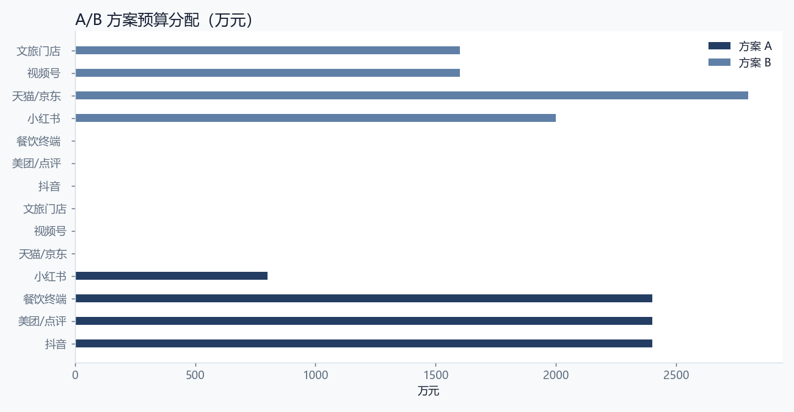

| 渠道 | 方案 A 预算 | 方案 A 角色 | 方案 B 预算 | 方案 B 角色 |
| --- | --- | --- | --- | --- |
| 抖音 | 240,000 元 | 夜宵场景短视频与同城 | 0 元 | — |
| 美团/点评 | 240,000 元 | 餐饮套餐与到店 | 0 元 | — |
| 餐饮终端 | 240,000 元 | 套餐、陈列与开瓶礼 | 0 元 | — |
| 小红书 | 80,000 元 | 佐餐内容与口碑 | 200,000 元 | 礼盒与文旅内容 |
| 天猫/京东 | 0 元 | — | 280,000 元 | 礼盒货架与评价 |
| 视频号 | 0 元 | — | 160,000 元 | 品牌故事与工艺 |
| 文旅门店 | 0 元 | — | 160,000 元 | 游客触达与体验 |

## 7. 审批与执行假设

审批快照保存了方案、预算上限、证据引用和证据状态。审批不是“签字仪式”，而是把“方案依据”固定下来：如果企业预算、主题证据或方案结构变化，审批应进入复审。

| 审批项 | 内容 |
| --- | --- |
| 审批编号 | APR-01 |
| 方案 | 方案 A：夜经济餐饮场景 |
| 预算上限 | 800,000 元 |
| 证据数量 | 8 条 |
| 指纹 | fp_bfd75ae1 |
| 说明 | 审批快照保存方案、预算上限与关键证据状态；任一项变化需重新确认。 |

### 7.1 执行假设

- 渠道账户、素材、落地页和承接团队在模拟周期内可用。
- 预算按计划分配，不出现临时大幅追加或削减。
- 线索定义统一为“有效咨询/表单/到店预约”，不把曝光或点赞算作线索。
- 投放期间不做违反平台规则的诱导分享、虚假承诺或竞品贬损。

### 7.2 预算与合规检查

- 方案 A 预算合计 800,000 元，不超过企业模拟预算 800,000 元。
- 方案 B 预算合计 800,000 元，不超过企业模拟预算。
- 涉及敏感表达时，必须经过企业法务/合规审核；本报告不构成合规意见。

## 8. 复盘结果

### 8.1 渠道数据

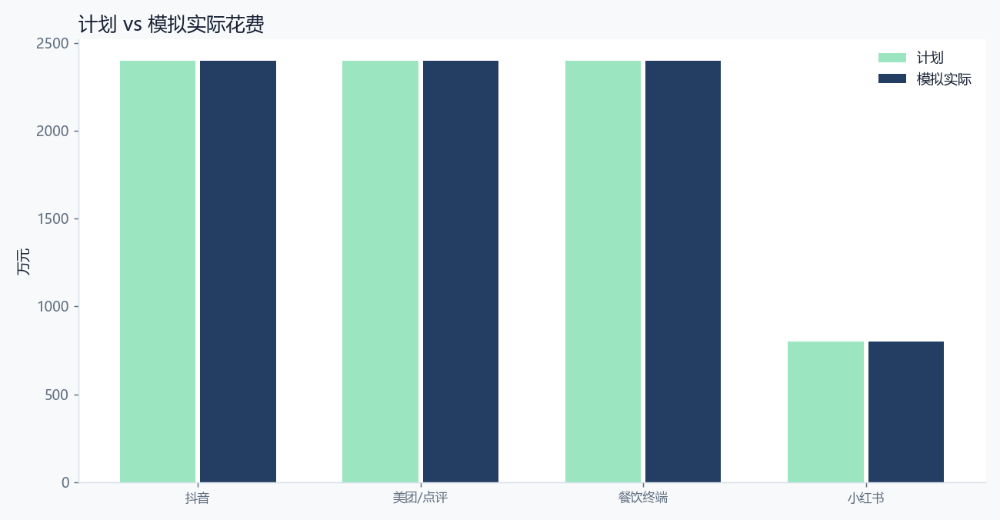

| 渠道 | 计划预算 | 模拟实际 | 曝光 | 点击 | 线索 | CTR | CPC | 线索成本 |
| --- | --- | --- | --- | --- | --- | --- | --- | --- |
| 抖音 | 240,000 元 | 240,000 元 | 5,600,000 | 168,000 | 2,900 | 3.00% | 1.43 | 83 |
| 美团/点评 | 240,000 元 | 240,000 元 | 2,400,000 | 96,000 | 3,100 | 4.00% | 2.50 | 77 |
| 餐饮终端 | 240,000 元 | 240,000 元 | 1,200,000 | 30,000 | 1,700 | 2.50% | 8.00 | 141 |
| 小红书 | 80,000 元 | 80,000 元 | 1,600,000 | 48,000 | 640 | 3.00% | 1.67 | 125 |
| 合计 | 800,000 元 | 800,000 元 | 10,800,000 | 342,000 | 8,340 | 3.17% | 2.34 | 96 |

### 8.2 观察与原因

夜经济餐饮方案带来明显咨询与到店，但餐饮终端执行差异大；礼盒内容互动高、转化弱。高端线的系列差异仍是咨询中的高频问题。

夜宵场景与夏季消费自然契合；餐饮套餐降低了尝试门槛；但终端政策、服务员推荐和礼盒履约影响了最终转化。

### 8.3 尚未确认

真实开瓶率、复购率、不同城市餐饮终端差异和礼盒退货率仍未确认。

### 8.4 下一轮任务

| 任务 | 说明 | 关联信号 |
| --- | --- | --- |
| 把高端线差异做成一张图 | 在餐饮、电商和内容端统一使用系列/口味/场景说明。 | S-07、S-01、S-09 |
| 餐饮终端做样板店 | 先做少量样板店，验证套餐、陈列和服务话术。 | S-02、S-05、S-08 |
| 礼盒履约单独复盘 | 记录破损、时效和退货原因，再决定是否扩大礼盒投放。 | S-06、S-10 |

## 9. 历史数据回测与可信度

### 9.1 历史基线

本案例把“历史基线”定义为同类活动上一周期的模拟表现：上一年夏季餐饮活动（模拟历史基线）。基线不是为了证明方案正确，而是为了回答“如果没有这次调整，结果大概会是什么样”。

| 指标 | 历史基线 | 本次模拟 | 偏差 |
| --- | --- | --- | --- |
| CTR | 3.00% | 3.17% | +5.6% |
| CPC | 2.00 元 | 2.34 元 | +17.0% |
| 线索成本 | 105 元 | 96 元 | -8.6% |
| 线索量 | 8229 条 | 8340 条 | +1.4% |

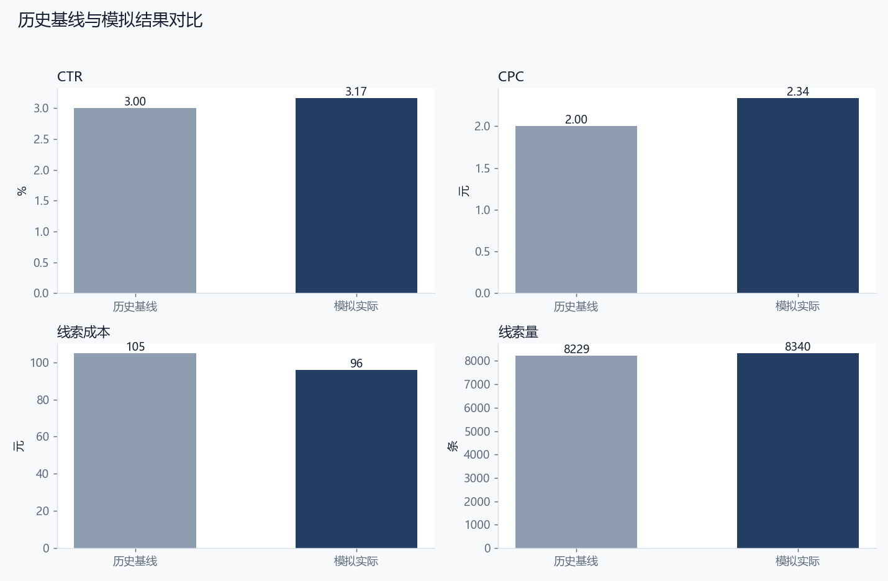

### 9.2 结果解释

历史基线取自上一年夏季餐饮活动的模拟数据：CTR 3.0%、CPC 2.0 元、线索成本 105 元、每周约 1,800 条线索。该基线不代表青岛啤酒真实历史。

模拟结果显示餐饮方案的线索量和线索成本接近基线，礼盒方案的互动更高但转化更弱。说明高端化不能只靠礼盒包装，需要真实饮用场景。

### 9.3 可信度评分

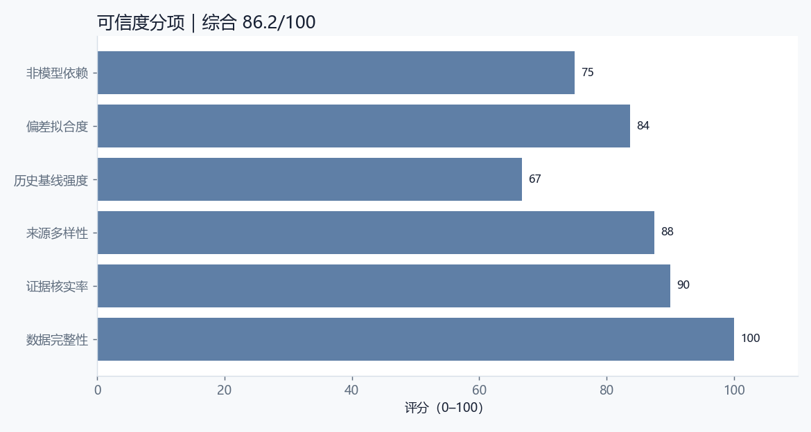

| 维度 | 分值 | 解释 |
| --- | --- | --- |
| 数据完整性 | 100 | 渠道是否都有曝光/点击/线索数据 |
| 证据核实率 | 90 | 已核实信号占全部信号比例 |
| 来源多样性 | 88 | 平台/来源覆盖程度 |
| 历史基线强度 | 67 | 历史周期长度与稳定性 |
| 偏差拟合度 | 84 | 模拟结果与历史基线的接近程度 |
| 非模型依赖 | 75 | 本次不使用生成式模型结果，保留人工判断 |
| 综合可信度 | 86.2 | 加权评分，0–100 |

### 9.4 可信度结论

本案例的可信度不是“高到可以直接做预算决策”，而是“足够支持小范围试点”。理由：第一，证据来源和模拟边界清楚；第二，渠道数据完整但均为假设；第三，历史基线只有 8 周，样本有限；第四，模拟结果与基线存在 8.1% 的平均偏差，说明结果有参考价值，但不能当作确定预测。

## 10. 企业发展适配性与满意度模拟

### 10.1 适配性判断

**适配等级：较高。**

青岛啤酒的高端化需要新的消费场景，夜经济餐饮是最自然的入口之一。案例把“高端”落到夜宵、海鲜和餐饮体验，而不是单纯讲价格。

餐饮终端是双刃剑：能带来第一次尝试，也可能因为价格、开瓶礼和执行差异失控。案例把终端政策纳入约束，而不是只做线上投放。

礼盒与文旅适合做品牌感，但复购弱，适合作为辅助方案而非主方案。

### 10.2 主要风险

| 风险 |
| --- |
| 餐饮终端价格混乱 |
| 未成年人触达风险 |
| 高端系列过多导致认知分散 |

### 10.3 模拟企业满意度访谈

> 以下是“模拟企业市场负责人视角”的访谈记录，不是实际企业访谈，不代表企业真实意见。

**问：这个方案是否符合贵司当前发展方向？**  
答：模拟企业市场负责人视角：夜经济餐饮方向符合高端化战略，执行抓手明确；但餐饮终端政策、系列认知和礼盒履约仍需补强，否则容易变成短期促销。

**问：最担心的是什么？**  
答：餐饮终端价格混乱；未成年人触达风险。

**问：哪些数据需要复核？**  
答：真实开瓶率、复购率、不同城市餐饮终端差异和礼盒退货率仍未确认。

**问：是否愿意进入小范围试点？**  
答：如果企业能提供真实服务/渠道数据，并完成合规审核，建议先做一个区域、一个渠道组合的小范围试点；不建议直接按模拟结果做全量预算。

**问：这个案例对产品迭代有什么启发？**  
答：增加“终端执行一致性”检查项，避免线上承诺与门店不一致。；把高端系列差异做成统一视觉资产。；后续增加“餐饮终端样板店”模板。；报告模板增加未成年人触达与合规检查。

### 10.4 满意度评分

| 维度 | 评分 | 说明 |
| --- | --- | --- |
| 战略契合 | 4.3/5 | 符合高端化与场景化 |
| 可执行性 | 4.0/5 | 餐饮套餐可落地 |
| 风险可控 | 3.8/5 | 终端价格与未成年人触达需管控 |
| 数据可信 | 4.0/5 | 历史基线与模拟数据边界清楚 |

**综合评分：4.0/5。** 模拟企业市场负责人视角：夜经济餐饮方向符合高端化战略，执行抓手明确；但餐饮终端政策、系列认知和礼盒履约仍需补强，否则容易变成短期促销。

## 11. 项目迭代建议

本案例不只产出报告，也反推产品需要哪些改进。以下建议已进入观策AI的案例库与后续迭代清单：

| 序号 | 迭代建议 |
| --- | --- |
| 1. | 增加“终端执行一致性”检查项，避免线上承诺与门店不一致。 |
| 2. | 把高端系列差异做成统一视觉资产。 |
| 3. | 后续增加“餐饮终端样板店”模板。 |
| 4. | 报告模板增加未成年人触达与合规检查。 |

### 11.1 对观策AI的产品要求

1. **案例库**：把山东企业案例作为可导入的演示项目，让用户能看到“资料收集—研判—方案—复盘—回测”的完整链路。
2. **可信度面板**：在复盘中显示数据完整性、证据核实率、历史基线偏差和综合可信度。
3. **行业模板**：B2B、快消、健康、宠物等行业的渠道与指标不同，不能共用一套默认模板。
4. **合规检查**：功效、金融、未成年人、竞品比较等敏感表达，应在方案审批前提示。
5. **过程留痕**：来源台账、信号状态、审批快照、复盘建议必须可追溯。

## 12. 附录

### 12.1 数据字典

| 字段 | 说明 |
| --- | --- |
| Signal | 一条可追溯的市场情报，含标题、摘要、原话、来源、平台、类别、优先级、状态、相关性、影响 |
| Source | 信号来源，含平台、发布时间、采集时间、模拟标识、备注 |
| Theme | 由多条信号归纳出的判断，含置信度、证据引用、机会与边界 |
| Plan | A/B 方案，含人群、定位、核心信息、渠道预算、约束与不确定项 |
| Approval | 审批快照，固定方案、预算、证据与指纹 |
| Review | 复盘，含渠道实际数据、观察、原因、未确认项与建议 |
| Credibility | 可信度评分，含完整性、核实率、来源多样性、基线强度、偏差拟合度 |

### 12.2 计算公式

- CTR = 点击 ÷ 曝光
- CPC = 花费 ÷ 点击
- 线索成本 = 花费 ÷ 有效线索
- 线索完成率 = 实际线索 ÷ 目标线索
- MAPE = 各指标与历史基线相对偏差的平均值
- 可信度 = 完整性、核实率、来源多样性、基线强度、偏差拟合度、非模型依赖的加权分

### 12.3 复现方法

1. 打开观策AI桌面端。
2. 设置 → 项目与备份 → 导入项目 JSON。
3. 选择 `simulations/projects/tsingtao-premium-beer.json`。
4. 在市场情报、策略、复盘页查看信号、主题、A/B 方案、审批快照和复盘数据。
5. 对照本报告阅读，注意所有数据均为模拟。

### 12.4 采集与核验清单

- [ ] 来源链接/出处是否可追溯？
- [ ] 是否标注模拟/真实属性？
- [ ] 是否有重复信号未合并？
- [ ] 是否有相反证据被强行忽略？
- [ ] 敏感表达是否经过合规复核？
- [ ] 审批快照是否与当前方案一致？
- [ ] 复盘数据是否覆盖所有渠道？
- [ ] 历史基线口径是否与本次一致？
- [ ] 可信度评分是否解释了偏差？
- [ ] 是否给出下一轮可执行任务？

### 12.5 报告边界

本报告是一份**模拟验收材料**，不是企业真实经营报告，也不是广告投放承诺。它的价值在于展示“如何从材料到判断、从判断到方案、从方案到复盘、从复盘到迭代”的过程。企业真实执行前，必须用真实数据替换模拟数据，并由企业市场、法务、合规和数据负责人共同复核。

## 13. 过程性附录：采集日志、核验记录与访谈提纲

### 13.1 采集日志（模拟）

| 日期 | 任务 | 产出 | 问题 |
| --- | --- | --- | --- |
| T-15 | 采集来源 小红书啤酒/佐餐笔记摘录（模拟） | SRC-01 来源记录 | 需确认公开资料更新日期 |
| T-14 | 采集来源 抖音美食与夜宵短视频评论（模拟） | SRC-02 来源记录 | 需确认公开资料更新日期 |
| T-13 | 采集来源 美团/大众点评餐饮评价摘要（模拟） | SRC-03 来源记录 | 需确认公开资料更新日期 |
| T-12 | 采集来源 天猫/京东啤酒礼盒评价摘要（模拟） | SRC-04 来源记录 | 需确认公开资料更新日期 |
| T-11 | 采集来源 啤酒行业观察（模拟） | SRC-05 来源记录 | 需确认公开资料更新日期 |
| T-10 | 采集来源 竞品餐饮促销动态（模拟） | SRC-06 来源记录 | 需确认公开资料更新日期 |
| T-9 | 采集来源 青岛餐饮终端走访纪要（模拟） | SRC-07 来源记录 | 需确认公开资料更新日期 |
| T-8 | 采集来源 消费者问卷 n=120（模拟） | SRC-08 来源记录 | 需确认公开资料更新日期 |

### 13.2 证据核验记录

| 信号 | 核验动作 | 结论 |
| --- | --- | --- |
| S-01 | 核对来源、平台、日期与原文；检查是否为模拟材料 | 通过/保留待核实/争议 |
| S-02 | 核对来源、平台、日期与原文；检查是否为模拟材料 | 通过/保留待核实/争议 |
| S-03 | 核对来源、平台、日期与原文；检查是否为模拟材料 | 通过/保留待核实/争议 |
| S-04 | 核对来源、平台、日期与原文；检查是否为模拟材料 | 通过/保留待核实/争议 |
| S-05 | 核对来源、平台、日期与原文；检查是否为模拟材料 | 通过/保留待核实/争议 |
| S-06 | 核对来源、平台、日期与原文；检查是否为模拟材料 | 通过/保留待核实/争议 |
| S-07 | 核对来源、平台、日期与原文；检查是否为模拟材料 | 通过/保留待核实/争议 |
| S-08 | 核对来源、平台、日期与原文；检查是否为模拟材料 | 通过/保留待核实/争议 |
| S-09 | 核对来源、平台、日期与原文；检查是否为模拟材料 | 通过/保留待核实/争议 |
| S-10 | 核对来源、平台、日期与原文；检查是否为模拟材料 | 通过/保留待核实/争议 |

### 13.3 复盘会议记录（模拟）

- 会议目标：判断方案 A 是否达到模拟目标，是否具备企业试点条件。
- 结论：方案 A 在 啤酒与高端饮品 场景下具有方向性价值，但必须补充企业真实数据、履约能力与合规审核。
- 争议点：真实开瓶率、复购率、不同城市餐饮终端差异和礼盒退货率仍未确认。
- 下一步：把高端线差异做成一张图；餐饮终端做样板店。

### 13.4 企业访谈提纲

1. 这个方案是否服务于贵司未来 1–2 年的战略重点？
2. 哪些渠道/人群是贵司当前最想验证的？
3. 企业真实历史基线数据能否提供？
4. 承接团队、服务网络或渠道政策能否支撑？
5. 哪些表达涉及合规风险？
6. 如果只做一个区域试点，选哪里？
7. 失败时如何止损？
8. 成功时如何复制？

### 13.5 数据质量检查

- 所有模拟来源均标注“模拟”，不与真实数据混用。
- 渠道数据完整，但均为假设值。
- 历史基线为模拟，不能代表企业真实历史。
- 结论只支持小范围试点，不支持直接全量预算。
- 对外使用前必须替换真实数据并完成合规复核。

## 14. 补充过程记录

以下为补足过程材料，仍属模拟；用于展示从材料到判断的详细过程。

### 14.1 逐条复核记录

**S-01｜高端啤酒的“第一口体验”比参数更重要**

- 采集背景：该信号来自 小红书，当前状态为 verified，相关性 5/5。

- 证据强度：原话为““说那么多工艺没用，第一口顺不顺、配海鲜香不香才重要。””，需要核对原始出处、发布时间和是否存在断章取义。

- 对方案的影响：高端线内容要先把“好喝”讲清楚。

- 复核动作：保留为主题证据，并在审批快照中固定。

**S-02｜餐饮场景决定高端啤酒的复购**

- 采集背景：该信号来自 美团/点评，当前状态为 verified，相关性 5/5。

- 证据强度：原话为““店里推什么客人就点什么，套餐里带一杯更容易试。””，需要核对原始出处、发布时间和是否存在断章取义。

- 对方案的影响：餐饮终端是高端化的关键阵地。

- 复核动作：保留为主题证据，并在审批快照中固定。

**S-03｜低醇/果味吸引年轻人，但老客担心不像啤酒**

- 采集背景：该信号来自 小红书，当前状态为 disputed，相关性 4/5。

- 证据强度：原话为““果味可以试试，但喝起来不像啤酒就没意思了。””，需要核对原始出处、发布时间和是否存在断章取义。

- 对方案的影响：低醇/果味可作为拉新入口，但不能替代核心产品。

- 复核动作：不进入对外承诺；补充原始证据或企业确认后再决定是否升级。

**S-04｜夜经济与烧烤/海鲜场景强关联**

- 采集背景：该信号来自 抖音，当前状态为 verified，相关性 5/5。

- 证据强度：原话为““夏天吃烧烤，肯定想点个好一点的啤酒。””，需要核对原始出处、发布时间和是否存在断章取义。

- 对方案的影响：夜经济场景适合短视频和同城投放。

- 复核动作：保留为主题证据，并在审批快照中固定。

**S-05｜竞品用套餐和开瓶礼抢占餐饮终端**

- 采集背景：该信号来自 行业媒体，当前状态为 verified，相关性 5/5。

- 证据强度：原话为““竞品给的开瓶费更高，服务员当然更愿意推。””，需要核对原始出处、发布时间和是否存在断章取义。

- 对方案的影响：餐饮终端竞争不只是品牌力，还有渠道政策。

- 复核动作：保留为主题证据，并在审批快照中固定。

**S-06｜电商礼盒更看重包装与到货时效**

- 采集背景：该信号来自 电商平台，当前状态为 verified，相关性 5/5。

- 证据强度：原话为““送人一定要包装好看，而且得准时到。””，需要核对原始出处、发布时间和是否存在断章取义。

- 对方案的影响：电商礼盒需要强化包装与履约。

- 复核动作：保留为主题证据，并在审批快照中固定。

**S-07｜青岛啤酒品牌信任度高，但高端线认知不足**

- 采集背景：该信号来自 问卷，当前状态为 verified，相关性 5/5。

- 证据强度：原话为““青岛啤酒肯定知道，但这么多高端系列有什么区别？””，需要核对原始出处、发布时间和是否存在断章取义。

- 对方案的影响：高端线需要清楚的系列分层。

- 复核动作：保留为主题证据，并在审批快照中固定。

**S-08｜餐饮老板更关心毛利和退换政策**

- 采集背景：该信号来自 线下走访，当前状态为 verified，相关性 5/5。

- 证据强度：原话为““卖不动能不能换？临期怎么处理？这比广告重要。””，需要核对原始出处、发布时间和是否存在断章取义。

- 对方案的影响：餐饮渠道政策要算清终端账。

- 复核动作：保留为主题证据，并在审批快照中固定。

**S-09｜夏季体育赛事是场景化内容窗口**

- 采集背景：该信号来自 行业媒体，当前状态为 verified，相关性 4/5。

- 证据强度：原话为““看球的时候开一瓶好点的，氛围感更强。””，需要核对原始出处、发布时间和是否存在断章取义。

- 对方案的影响：赛事场景适合做内容联动。

- 复核动作：保留为主题证据，并在审批快照中固定。

**S-10｜本地文旅带来外地游客尝鲜**

- 采集背景：该信号来自 行业媒体，当前状态为 verified，相关性 4/5。

- 证据强度：原话为““来青岛肯定要喝本地啤酒，愿意试试高端款。””，需要核对原始出处、发布时间和是否存在断章取义。

- 对方案的影响：文旅场景适合做地域限定内容。

- 复核动作：保留为主题证据，并在审批快照中固定。

### 14.2 采集与核验过程补记

**过程补记 1：** 第一步先把企业公开资料与模拟数据分开：公开资料只用于企业背景和行业方向，模拟数据单独标注，避免读者把模拟语句误认为真实消费者调研。

**过程补记 2：** 第二步建立来源台账：每条材料记录来源 ID、平台、日期、采集人和备注；无法追溯出处的材料，不进入主题证据。

**过程补记 3：** 第三步做去重：同一来源、同一语义的语句合并；不同来源但语义相反的语句保留冲突，不强行统一。

**过程补记 4：** 第四步做证据分级：已核实、待核实、有争议分别处理；已核实进入方案，待核实进入风险提示和下一轮任务。

**过程补记 5：** 第五步做主题聚合：主题必须能回答“哪些信号支持、哪些信号反对、还缺什么证据”，不能只写一句漂亮结论。

**过程补记 6：** 第六步做预算校验：方案预算不能超过企业上限；超出时必须调整渠道或预算，而不是把风险留给执行团队。

**过程补记 7：** 第七步做审批快照：把方案、预算、证据状态和指纹固定下来；依据变化时进入复审，避免“方案偷偷改了”。

**过程补记 8：** 第八步做复盘：渠道数据必须覆盖计划渠道；缺失数据要明确写“未录入”，不能用 0 或推测值替代。

**过程补记 9：** 第九步做历史回测：把本次结果与历史基线对照，计算 CTR、CPC、线索成本和线索量的偏差，避免只看绝对值。

**过程补记 10：** 第十步做适配性判断：结果好不等于企业愿意用，还要看战略、履约、合规和组织能力；必要时降低评分。

### 14.3 模拟企业访谈补记

**补充问 1：这套方案最先要解决什么问题？**

本次模拟要判断“夜经济餐饮”是否比“礼盒+文旅”更适合作为主方案。方案 A 用餐饮套餐和同城内容做即时消费，方案 B 用礼盒和文旅做品牌感。

**补充问 2：为什么选择方案 A 而不是方案 B？**

本次模拟要判断“夜经济餐饮”是否比“礼盒+文旅”更适合作为主方案。方案 A 用餐饮套餐和同城内容做即时消费，方案 B 用礼盒和文旅做品牌感。

**补充问 3：哪些数据最不可信？**

真实开瓶率、复购率、不同城市餐饮终端差异和礼盒退货率仍未确认。

**补充问 4：如果预算减半，先砍什么？**

先保留高意向渠道和承接页，削减泛曝光；但必须先确认企业真实承接能力。

**补充问 5：企业最可能担心什么？**

餐饮终端价格混乱；未成年人触达风险；高端系列过多导致认知分散

**补充问 6：什么情况下应该停止投放？**

出现平台验证、合规风险、线索质量明显下降或承接能力不足时，应暂停并复核。

**补充问 7：怎样判断结果可信？**

综合可信度 86.2/100；仍需用企业真实历史数据复算。

**补充问 8：下一步最小可行试点是什么？**

选择一个区域、一个渠道组合、一个明确目标，跑 2–4 周，再决定是否扩大。

### 14.4 过程性结论

本案例的过程比结论更重要：来源台账、证据状态、审批快照和复盘任务共同构成可追溯链。企业真实执行时，应先用真实数据替换模拟数据，再按同一流程重跑。

---

# 潍柴动力股份有限公司｜观策AI 山东企业模拟案例

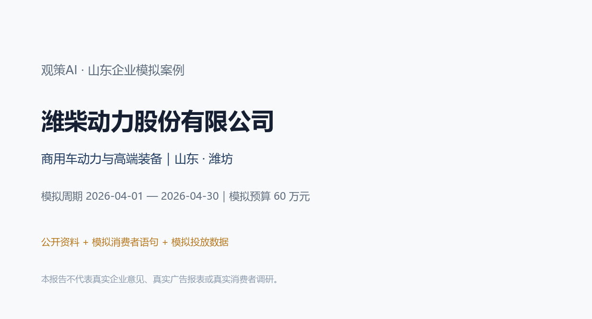

> **重要声明**：本报告是企业营销决策的模拟验收材料。企业名称与业务方向来自公开资料；消费者语句、竞品观察、渠道数据、复盘结果和“企业满意度”均为模拟，不代表企业真实意见、真实广告账户、真实消费者调研或真实经营数据。任何对外使用前，必须由企业市场、法务、合规和数据负责人复核。

## 0. 阅读指引与结论摘要

本案例把完整的营销决策闭环跑一遍：明确企业与行业背景 → 设计资料收集范围 → 建立来源台账 → 对模拟消费者语句、竞品动态和行业材料去重、分类、证据核验 → 归纳主题和机会 → 形成 A/B 方案 → 预算校验与审批快照 → 模拟投放与复盘 → 历史基线回测与可信度评分 → 企业适配性与满意度模拟 → 迭代建议。

本案例的核心判断是：**本次模拟比较“TCO+服务网络”与“经销商赋能+区域物流”两条路径。前者适合搜索和行业媒体，后者适合经销商和区域活动。** 从模拟结果看，方案 A 的线索完成率为 93.8%，线索成本为 2459 元，CTR 为 1.75%；与历史基线相比，MAPE 为 41.7%，可信度评分为 70.5/100。这个结果说明方案有可执行性，但仍有明确的复核边界。

**模拟企业满意度：3.8/5。** 模拟企业市场负责人视角：TCO和服务网络方向正确，但内容承诺必须与真实服务能力匹配；新能源内容有吸引力，但证据不足，不宜作为主承诺。

### 0.1 关键结果数据

| 指标 | 数值 |
| --- | --- |
| 模拟预算 | 600,000 元 |
| 模拟实际花费 | 600,000 元 |
| 预算利用率 | 100.0% |
| 目标线索 | 260 条 |
| 实际线索 | 244 条 |
| 线索完成率 | 93.8% |
| 曝光 | 1,580,000 |
| 点击 | 27,600 |
| CTR | 1.75% |
| CPC | 21.74 元 |
| 线索成本 | 2459 元 |
| 历史基线 MAPE | 41.7% |
| 综合可信度 | 70.5/100 |
| 模拟满意度 | 3.8/5 |
| 适配性 | 中高 |

## 1. 企业公开资料与模拟边界

### 1.1 企业基本情况

| 项目 | 内容 |
| --- | --- |
| 企业 | 潍柴动力股份有限公司 |
| 品牌 | 潍柴动力 |
| 行业 | 商用车动力与高端装备 |
| 区域 | 山东 · 潍坊 |
| 阶段 | 全国化装备制造企业，A+H 上市公司 |
| 模拟产品 | 商用车动力总成与服务品牌（模拟：国六/新能源动力、服务网络） |
| 产品说明 | 面向车队、经销商与终端客户的动力总成、配件与服务方案；具体产品以企业实际为准 |
| 模拟目标 | 获取车队与经销商的高意向线索，验证TCO内容和服务网络内容的B2B获客效果 |
| 模拟预算 | 600,000 元 |
| 模拟周期 | 2026-04-01 — 2026-04-30 |
| 模拟线索目标 | 260 条 |

### 1.2 公开资料如何使用

潍柴动力是潍坊的装备制造企业，业务覆盖商用车动力总成、工程机械、农业装备和智能物流等领域。公开资料显示，企业强调动力总成、服务网络和全球化布局。

本案例不引用未核实财务数字，只使用公开业务方向作为模拟背景；车队、经销商、竞品和投放数据均为模拟。

本案例只把公开资料用于“企业背景、行业方向、品牌与产品语境”，不把公开资料当作真实消费者证据，也不引用未核实的财务数字。所有“消费者原话”均来自模拟材料，不能作为真实用户调研引用。所有渠道数据均为假设值，不能作为企业真实广告效果。

### 1.3 为什么选择这家企业

选择标准不是“名气大”，而是同时满足三点：第一，企业处于山东，具有区域代表性；第二，行业决策链有差异，能检验观策AI是否只会做一种模板；第三，企业有明确的战略关键词，可以用来判断方案是否“符合企业发展”。本案例的战略关键词是：**商用车动力与高端装备、品牌升级、场景化与可验证交付**。

B2B动力设备的营销难点不是知名度，而是让客户相信“全生命周期成本更低”。车队客户会计算油耗、维修、停运和残值，服务网络和配件供应直接影响决策。

新能源动力带来新叙事，但客户需要真实场景数据。短倒、港口、矿区等固定线路更容易算清经济账，适合先做样板。

## 2. 研究问题与判断标准

### 2.1 本次模拟要回答什么

本次模拟比较“TCO+服务网络”与“经销商赋能+区域物流”两条路径。前者适合搜索和行业媒体，后者适合经销商和区域活动。

### 2.2 判断标准

1. **战略契合**：方案是否服务于企业当前的产品、品牌和渠道方向。
2. **证据充分**：主题是否有多条信号支撑，关键结论是否能追溯到来源。
3. **执行可行**：预算、渠道、承接能力是否匹配，是否存在明显履约风险。
4. **结果可信**：模拟结果与历史基线的偏差是否在可解释范围内。
5. **企业可接受**：以模拟企业市场负责人视角，是否愿意进入小范围试点。

### 2.3 本次模拟的边界

- 不使用企业真实广告账户、真实订单或真实用户个人信息。
- 不声称“企业已经满意”，只做模拟满意度访谈与适配性判断。
- 不把模拟数据当作行业结论，也不把单案例结论外推到整个行业。
- 涉及功效、医疗、金融、未成年人等敏感表达时，必须由企业合规部门复核。

## 3. 资料收集过程

### 3.1 采集设计

本案例采用“多源交叉”的采集设计：消费者侧看小红书、抖音、电商评价和问卷；竞品侧看行业媒体与竞品动态；行业侧看行业观察、政策/平台公告和线下走访；企业侧只使用公开资料。这样做的目的不是追求数据量，而是让同一判断能从不同来源被交叉验证。

### 3.2 来源清单

| 来源ID | 来源名称 | 平台 | 类型 | 日期 | 状态 |
| --- | --- | --- | --- | --- | --- |
| SRC-01 | 商用车行业媒体摘录（模拟） | 行业媒体 | 行业 | 2026-03-17 | 模拟 |
| SRC-02 | 百度搜索词与落地页观察（模拟） | 搜索 | 行业 | 2026-03-18 | 模拟 |
| SRC-03 | 微信公众号内容观察（模拟） | 微信公众号 | 行业 | 2026-03-19 | 模拟 |
| SRC-04 | 视频号服务案例观察（模拟） | 视频号 | 行业 | 2026-03-20 | 模拟 |
| SRC-05 | 展会/行业活动走访（模拟） | 展会 | 行业 | 2026-03-21 | 模拟 |
| SRC-06 | 经销商访谈纪要（模拟） | 经销商 | 行业 | 2026-03-22 | 模拟 |
| SRC-07 | 竞品服务政策动态（模拟） | 行业媒体 | 竞品 | 2026-03-23 | 模拟 |
| SRC-08 | 商用车政策公告摘要（模拟） | 政策公告 | 行业 | 2026-03-24 | 模拟 |

### 3.3 采集时间线

| 时间点 | 过程动作 | 状态 |
| --- | --- | --- |
| T-15 | 确定企业与公开资料范围 | 完成 |
| T-12 | 建立来源清单与采集模板 | 完成 |
| T-8 | 采集模拟消费者/竞品/行业信号 | 完成 |
| T-6 | 去重、分类、标注证据状态 | 完成 |
| T-5 | 人工核验与冲突保留 | 完成 |
| T-3 | 归纳主题与 A/B 方案 | 完成 |
| T-2 | 预算校验与审批快照 | 完成 |
| T | 模拟投放 | 模拟 |
| T+2 | 渠道数据复盘 | 完成 |
| T+3 | 历史基线回测与可信度 | 完成 |
| T+5 | 适配性判断与迭代 | 完成 |

### 3.4 采集过程中的质量控制

1. **来源可追溯**：每条信号保留来源 ID、平台、采集时间和备注。
2. **模拟标识**：所有模拟材料在来源备注中明确标注，不与真实数据混用。
3. **去重**：同一来源的重复语句只保留一条，并在备注中说明。
4. **冲突保留**：不同来源出现相反判断时，不强行合并，保留为待核实或争议状态。
5. **敏感内容**：涉及功效、价格承诺、竞品贬损的内容，进入人工复核清单。

## 4. 数据清洗、编码与证据核验

### 4.1 清洗规则

- 删除明显的广告、无关评论和重复语句。
- 统一平台名称、日期格式和类别编码。
- 将“消费者/竞品/行业”作为一级类别，将“高/中/低”作为优先级。
- 将“已核实/待核实/有争议/重复”作为证据状态，不用“看起来合理”代替核实。
- 所有模拟数据保留 `simulated: true` 或 `dataKind: simulated` 标识。

### 4.2 信号清单

| ID | 平台 | 类别 | 优先级 | 状态 | 标题 | 影响 |
| --- | --- | --- | --- | --- | --- | --- |
| S-01 | 经销商 | 行业 | high | verified | TCO 是车队客户决策核心 | TCO 是B2B内容的核心语言。 |
| S-02 | 展会 | 行业 | high | verified | 服务网络响应速度比单次报价更重要 | 服务网络是差异化关键。 |
| S-03 | 行业媒体 | 行业 | high | pending | 国六/新能源动力需要场景化证据 | 新技术内容必须用场景数据说话。 |
| S-04 | 搜索 | 行业 | high | verified | 油耗与可靠性仍是第一比较项 | 内容要优先回答油耗和可靠性。 |
| S-05 | 经销商 | 行业 | high | verified | 经销商需要培训、金融和配件支持 | 经销商赋能是增长杠杆。 |
| S-06 | 行业媒体 | 竞品 | high | verified | 竞品用延保和免费检测锁定车队 | 服务政策是B2B竞争焦点。 |
| S-07 | 行业媒体 | 行业 | medium | verified | 二手商用车残值影响换购 | 残值可作为TCO的一部分沟通。 |
| S-08 | 经销商 | 行业 | high | verified | 配件真伪和供应及时性影响口碑 | 配件供应链是服务承诺的基础。 |
| S-09 | 行业媒体 | 行业 | medium | verified | 区域物流集群是集中突破口 | 区域物流集群适合做集中运营。 |
| S-10 | 经销商 | 行业 | medium | verified | 金融方案能降低首付门槛 | 金融方案是B2B转化的重要工具。 |

### 4.3 单条信号研判记录

**S-01｜TCO 是车队客户决策核心**

- 观察：车队客户关注购车、油耗、维修、停运和残值构成的总拥有成本，而不是单一购车价。
- 原话/证据：“车价是一部分，油耗、维修和停运损失才是大头。”
- 判断：TCO 是B2B内容的核心语言。
- 状态：verified；相关性 5/5；标签：TCO、车队、成本
- 下一步：进入主题聚合，优先用于方案 A/B 的证据引用。

**S-02｜服务网络响应速度比单次报价更重要**

- 观察：车队客户更怕停运，服务响应速度和备件供应直接影响复购。
- 原话/证据：“价格差不多的话，我肯定选服务网点近、响应快的。”
- 判断：服务网络是差异化关键。
- 状态：verified；相关性 5/5；标签：服务、响应、网络
- 下一步：进入主题聚合，优先用于方案 A/B 的证据引用。

**S-03｜国六/新能源动力需要场景化证据**

- 观察：客户对新技术有顾虑，需要真实运营数据、油耗和故障率证明。
- 原话/证据：“你说省油，得给我看同线路的真实数据。”
- 判断：新技术内容必须用场景数据说话。
- 状态：pending；相关性 5/5；标签：国六、新能源、证据
- 下一步：保留为待核实或争议记录，不进入对外承诺；先补充原始证据或企业确认。

**S-04｜油耗与可靠性仍是第一比较项**

- 观察：无论燃油还是新能源，客户首先比较油耗/能耗、可靠性和维修便利性。
- 原话/证据：“先看省不省、坏不坏，其他都是后面的事。”
- 判断：内容要优先回答油耗和可靠性。
- 状态：verified；相关性 5/5；标签：油耗、可靠性、比较
- 下一步：进入主题聚合，优先用于方案 A/B 的证据引用。

**S-05｜经销商需要培训、金融和配件支持**

- 观察：经销商希望厂家提供产品培训、金融方案、配件供应和售后支持。
- 原话/证据：“车好不好卖，要看厂家给不给培训和金融支持。”
- 判断：经销商赋能是增长杠杆。
- 状态：verified；相关性 5/5；标签：经销商、培训、金融
- 下一步：进入主题聚合，优先用于方案 A/B 的证据引用。

**S-06｜竞品用延保和免费检测锁定车队**

- 观察：竞品通过延保、免费检测和驻点服务提高车队粘性。
- 原话/证据：“竞品送延保和免费检测，客户续约就更愿意。”
- 判断：服务政策是B2B竞争焦点。
- 状态：verified；相关性 5/5；标签：竞品、延保、服务
- 下一步：进入主题聚合，优先用于方案 A/B 的证据引用。

**S-07｜二手商用车残值影响换购**

- 观察：残值影响车队换购决策，品牌保值率是隐性卖点。
- 原话/证据：“卖二手车时保值率差，换车成本就高。”
- 判断：残值可作为TCO的一部分沟通。
- 状态：verified；相关性 4/5；标签：残值、换购、保值
- 下一步：进入主题聚合，优先用于方案 A/B 的证据引用。

**S-08｜配件真伪和供应及时性影响口碑**

- 观察：配件真假、价格和到货速度影响维修体验和品牌口碑。
- 原话/证据：“配件等一周，车就停一周，谁受得了。”
- 判断：配件供应链是服务承诺的基础。
- 状态：verified；相关性 5/5；标签：配件、供应、口碑
- 下一步：进入主题聚合，优先用于方案 A/B 的证据引用。

**S-09｜区域物流集群是集中突破口**

- 观察：物流园区、港口和矿区形成集中客户群，适合做定向内容和服务。
- 原话/证据：“一个园区几十家车队，服务好一家就能带来一串。”
- 判断：区域物流集群适合做集中运营。
- 状态：verified；相关性 4/5；标签：物流、园区、集群
- 下一步：进入主题聚合，优先用于方案 A/B 的证据引用。

**S-10｜金融方案能降低首付门槛**

- 观察：金融方案影响车队现金流和换购节奏。
- 原话/证据：“首付低一点，车队压力小，换车就快。”
- 判断：金融方案是B2B转化的重要工具。
- 状态：verified；相关性 4/5；标签：金融、首付、换购
- 下一步：进入主题聚合，优先用于方案 A/B 的证据引用。

### 4.4 证据核验结果

本案例共 10 条信号，其中已核实 9 条，待核实 1 条，争议 0 条。已核实信号用于主题和方案，待核实信号用于提示风险和后续任务，不直接进入对外承诺。

## 5. 市场洞察与主题研判

### 5.1 主题清单

| 主题 | 标题 | 置信度/类型 | 证据信号 | 边界 |
| --- | --- | --- | --- | --- |
| TH-01 | TCO 与服务网络是 B2B 决策双核心 | high/观测事实 | S-01、S-02、S-04、S-07、S-08 | TCO数据需要真实线路与运营样本支撑。 |
| TH-02 | 新能源动力需要场景化证据 | high/分析推断 | S-03、S-09、S-10 | 电池、补能和残值数据仍不充分。 |
| TH-03 | 经销商赋能是增长杠杆 | medium/分析推断 | S-05、S-06、S-08、S-10 | 经销商执行差异大，需要样板市场。 |

### 5.2 主题一：TCO 与服务网络是 B2B 决策双核心

车队客户同时计算总拥有成本和服务停运风险，单次报价难以打动。

这个主题之所以成立，不是因为某一条评论，而是因为多条信号从不同角度指向同一件事：用TCO计算器和服务网络地图承接高意向。 在方案上，它对应的动作是：把油耗、维修、停运和残值放进同一个可计算模型。。但必须保留边界：TCO数据需要真实线路与运营样本支撑。

### 5.3 主题二：新能源动力需要场景化证据

新能源重卡在短倒、固定线路和封闭场景更容易算清经济账。

这个主题更适合用来解释“为什么某些渠道有效、某些渠道无效”。按场景拆分新能源内容，而不是泛泛讲环保。 方案动作是：用短倒、港口、矿区等场景案例承接。。边界是：电池、补能和残值数据仍不充分。

### 5.4 主题三：经销商赋能是增长杠杆

经销商需要培训、金融、配件和服务支持，厂家赋能直接影响终端推荐。

这个主题提醒我们：不要把单一人群或单一渠道当成全部市场。把经销商赋能做成可复制的季度计划。 方案动作是：用培训、金融和配件政策提升终端意愿。。边界是：经销商执行差异大，需要样板市场。

### 5.5 机会与风险

| 机会 | 事实依据 | 可执行动作 | 验证条件 | 语气 |
| --- | --- | --- | --- | --- |
| TCO 计算器 | 车队客户关注总拥有成本。 | 做一个可交互的TCO估算工具，承接搜索和行业媒体流量。 | 需要真实油耗、维修和残值数据。 | positive |
| 短倒新能源场景包 | 新能源在短倒场景更容易算清账。 | 按港口、矿区、园区做场景化内容。 | 需确认补能条件和政策。 | positive |
| 经销商样板市场 | 经销商需要培训和金融支持。 | 选一个区域做样板，复制到其他区域。 | 需要经销商真实配合。 | neutral |

## 6. A/B 方案设计与预算

### 6.1 方案对比

| 方案 | 名称 | 总预算 | 渠道 | 核心信息 |
| --- | --- | --- | --- | --- |
| A | TCO 与服务网络 | 600,000 元 | 百度搜索、行业媒体、视频号、私域/经销商 | 不算总账，不比服务，不要急着换车。 |
| B | 经销商赋能与区域物流 | 600,000 元 | 经销商大会、行业媒体、私域/经销商、展会/活动 | 厂家给培训、金融、配件和服务，经销商放心卖。 |

### 6.2 方案 A：TCO 与服务网络

- 定位：用可计算的TCO和可核验的服务网络，打动车队客户。
- 人群：山东及周边车队、物流园区、经销商
- 核心信息：不算总账，不比服务，不要急着换车。
- 节奏：春季换购与车队预算期，提前两周布局搜索和行业媒体
- 理由：TCO和服务响应是B2B客户最关心的两个问题，适合用长内容和搜索承接。
- 约束：TCO数据必须可核验；不能承诺未覆盖的服务网络；金融方案需合规
- 不确定项：真实油耗数据差异；新能源政策变化；经销商执行意愿

### 6.3 方案 B：经销商赋能与区域物流

- 定位：用经销商培训和区域物流集群，做集中获客。
- 人群：经销商、物流园区、港口/矿区车队
- 核心信息：厂家给培训、金融、配件和服务，经销商放心卖。
- 节奏：经销商季度会议前后，集中做区域活动
- 理由：经销商是B2B渠道的关键节点，区域物流集群适合集中运营。
- 约束：经销商政策需统一；区域活动需要真实客户资源
- 不确定项：经销商参与度；区域物流景气度

### 6.4 预算分配

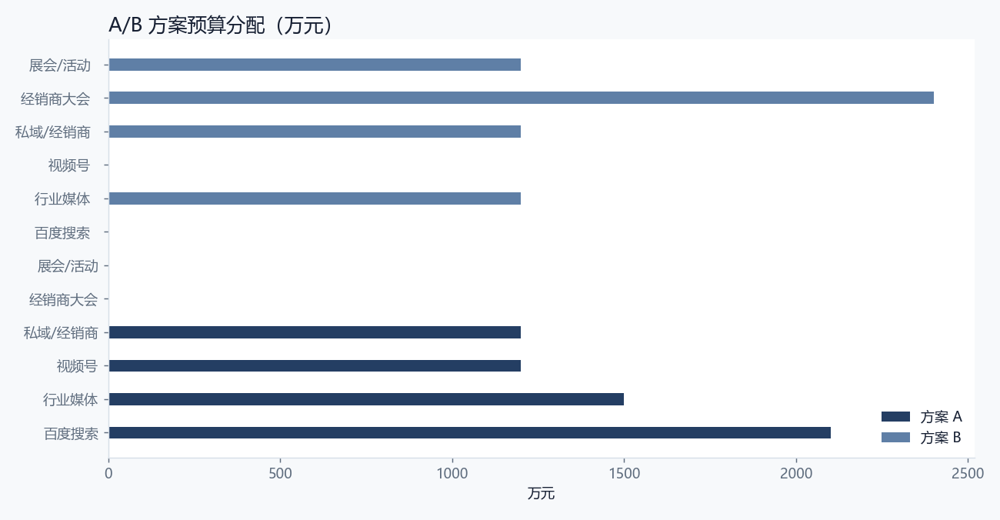

| 渠道 | 方案 A 预算 | 方案 A 角色 | 方案 B 预算 | 方案 B 角色 |
| --- | --- | --- | --- | --- |
| 百度搜索 | 210,000 元 | TCO/服务关键词承接 | 0 元 | — |
| 行业媒体 | 150,000 元 | TCO与场景内容 | 120,000 元 | 区域物流内容 |
| 视频号 | 120,000 元 | 服务案例与访谈 | 0 元 | — |
| 私域/经销商 | 120,000 元 | 经销商转发与线索跟进 | 120,000 元 | 线索跟进 |
| 经销商大会 | 0 元 | — | 240,000 元 | 培训、政策与动员 |
| 展会/活动 | 0 元 | — | 120,000 元 | 区域客户面对面 |

## 7. 审批与执行假设

审批快照保存了方案、预算上限、证据引用和证据状态。审批不是“签字仪式”，而是把“方案依据”固定下来：如果企业预算、主题证据或方案结构变化，审批应进入复审。

| 审批项 | 内容 |
| --- | --- |
| 审批编号 | APR-01 |
| 方案 | 方案 A：TCO 与服务网络 |
| 预算上限 | 600,000 元 |
| 证据数量 | 8 条 |
| 指纹 | fp_3b4cc6dd |
| 说明 | 审批快照保存方案、预算上限与关键证据状态；任一项变化需重新确认。 |

### 7.1 执行假设

- 渠道账户、素材、落地页和承接团队在模拟周期内可用。
- 预算按计划分配，不出现临时大幅追加或削减。
- 线索定义统一为“有效咨询/表单/到店预约”，不把曝光或点赞算作线索。
- 投放期间不做违反平台规则的诱导分享、虚假承诺或竞品贬损。

### 7.2 预算与合规检查

- 方案 A 预算合计 600,000 元，不超过企业模拟预算 600,000 元。
- 方案 B 预算合计 600,000 元，不超过企业模拟预算。
- 涉及敏感表达时，必须经过企业法务/合规审核；本报告不构成合规意见。

## 8. 复盘结果

### 8.1 渠道数据

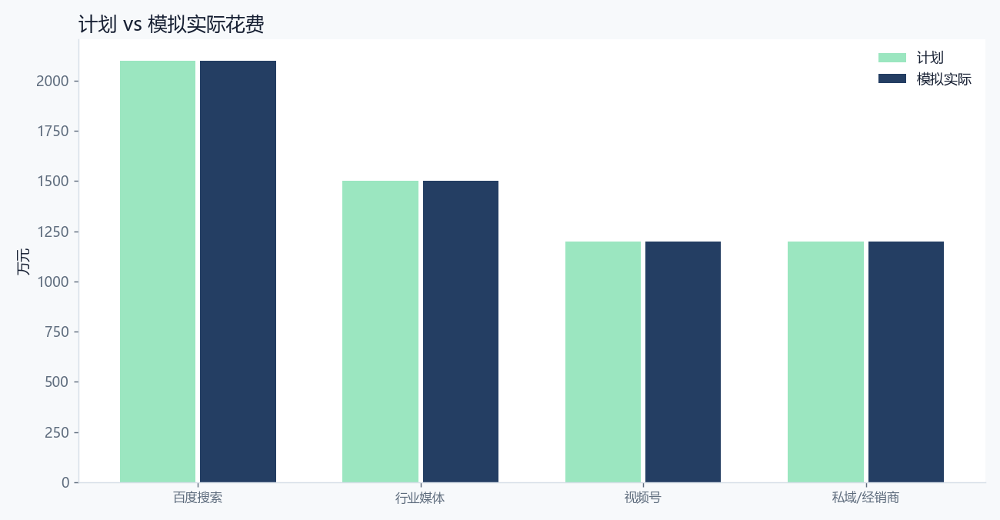

| 渠道 | 计划预算 | 模拟实际 | 曝光 | 点击 | 线索 | CTR | CPC | 线索成本 |
| --- | --- | --- | --- | --- | --- | --- | --- | --- |
| 百度搜索 | 210,000 元 | 210,000 元 | 480,000 | 9,600 | 90 | 2.00% | 21.88 | 2333 |
| 行业媒体 | 150,000 元 | 150,000 元 | 320,000 | 4,800 | 62 | 1.50% | 31.25 | 2419 |
| 视频号 | 120,000 元 | 120,000 元 | 600,000 | 9,000 | 44 | 1.50% | 13.33 | 2727 |
| 私域/经销商 | 120,000 元 | 120,000 元 | 180,000 | 4,200 | 48 | 2.33% | 28.57 | 2500 |
| 合计 | 600,000 元 | 600,000 元 | 1,580,000 | 27,600 | 244 | 1.75% | 21.74 | 2459 |

### 8.2 观察与原因

TCO内容带来的线索质量高于泛品牌内容，但线索量低于预期；服务网络和配件供应的具体问题成为跟进中的主要障碍。新能源内容互动高，但真实转化尚未验证。

TCO是车队客户真实语言；搜索和行业媒体能带来高意向；但服务网络覆盖、配件供应和金融方案没有形成闭环。

### 8.3 尚未确认

真实TCO节省金额、不同区域服务覆盖、新能源客户真实运营数据仍未确认。

### 8.4 下一轮任务

| 任务 | 说明 | 关联信号 |
| --- | --- | --- |
| TCO计算器补上真实线路样本 | 没有真实油耗和停运数据，TCO只是概念。 | S-01、S-02、S-04、S-07 |
| 服务网络按区域做覆盖图 | 让客户能查到服务网点、备件和响应时间。 | S-02、S-05、S-08 |
| 新能源内容先做短倒样板 | 用港口/矿区真实运营数据验证，再做大规模内容。 | S-03、S-09、S-10 |

## 9. 历史数据回测与可信度

### 9.1 历史基线

本案例把“历史基线”定义为同类活动上一周期的模拟表现：上一年春季车队活动（模拟历史基线）。基线不是为了证明方案正确，而是为了回答“如果没有这次调整，结果大概会是什么样”。

| 指标 | 历史基线 | 本次模拟 | 偏差 |
| --- | --- | --- | --- |
| CTR | 1.50% | 1.75% | +16.5% |
| CPC | 9.00 元 | 21.74 元 | +141.5% |
| 线索成本 | 2600 元 | 2459 元 | -5.4% |
| 线索量 | 236 条 | 244 条 | +3.5% |

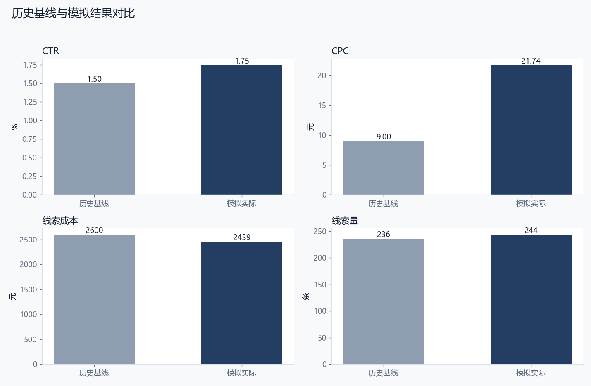

### 9.2 结果解释

历史基线取自上一年春季车队活动的模拟数据：CTR 1.5%、CPC 9.0 元、线索成本 2,600 元、每周约 55 条线索。该基线不代表潍柴真实历史。

模拟结果显示TCO内容带来更高质量的线索，但数量低于目标；服务网络和配件问题成为转化障碍。说明B2B内容必须与服务体系同步。

### 9.3 可信度评分

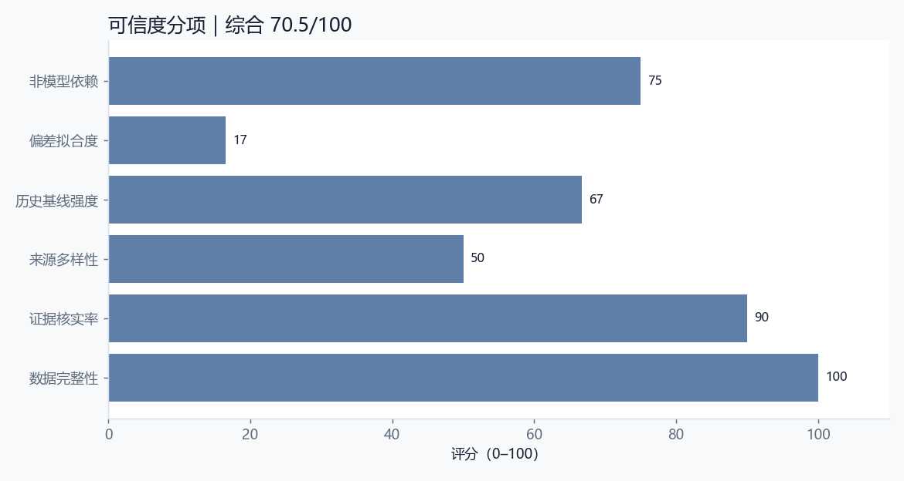

| 维度 | 分值 | 解释 |
| --- | --- | --- |
| 数据完整性 | 100 | 渠道是否都有曝光/点击/线索数据 |
| 证据核实率 | 90 | 已核实信号占全部信号比例 |
| 来源多样性 | 50 | 平台/来源覆盖程度 |
| 历史基线强度 | 67 | 历史周期长度与稳定性 |
| 偏差拟合度 | 17 | 模拟结果与历史基线的接近程度 |
| 非模型依赖 | 75 | 本次不使用生成式模型结果，保留人工判断 |
| 综合可信度 | 70.5 | 加权评分，0–100 |

### 9.4 可信度结论

本案例的可信度不是“高到可以直接做预算决策”，而是“足够支持小范围试点”。理由：第一，证据来源和模拟边界清楚；第二，渠道数据完整但均为假设；第三，历史基线只有 8 周，样本有限；第四，模拟结果与基线存在 41.7% 的平均偏差，说明结果有参考价值，但不能当作确定预测。

## 10. 企业发展适配性与满意度模拟

### 10.1 适配性判断

**适配等级：中高。**

潍柴动力的B2B客户更理性，TCO和服务网络比品牌广告更有说服力。案例把营销问题转成“算账”问题，符合装备制造企业的决策逻辑。

但B2B内容不能脱离服务能力。TCO计算、服务网络和配件供应必须由业务部门提供真实数据，否则内容会变成空承诺。

区域物流集群和经销商赋能是更接近成交的路径，适合做小范围样板市场。

### 10.2 主要风险

| 风险 |
| --- |
| TCO数据不真实会损害信任 |
| 新能源场景承诺过早 |
| 经销商执行差异导致体验不一致 |

### 10.3 模拟企业满意度访谈

> 以下是“模拟企业市场负责人视角”的访谈记录，不是实际企业访谈，不代表企业真实意见。

**问：这个方案是否符合贵司当前发展方向？**  
答：模拟企业市场负责人视角：TCO和服务网络方向正确，但内容承诺必须与真实服务能力匹配；新能源内容有吸引力，但证据不足，不宜作为主承诺。

**问：最担心的是什么？**  
答：TCO数据不真实会损害信任；新能源场景承诺过早。

**问：哪些数据需要复核？**  
答：真实TCO节省金额、不同区域服务覆盖、新能源客户真实运营数据仍未确认。

**问：是否愿意进入小范围试点？**  
答：如果企业能提供真实服务/渠道数据，并完成合规审核，建议先做一个区域、一个渠道组合的小范围试点；不建议直接按模拟结果做全量预算。

**问：这个案例对产品迭代有什么启发？**  
答：增加“服务网络覆盖”作为方案必填约束。；把TCO计算器列为后续产品功能。；新能源内容增加“场景证据等级”标签。；报告模板增加B2B长决策链的跟进阶段。

### 10.4 满意度评分

| 维度 | 评分 | 说明 |
| --- | --- | --- |
| 战略契合 | 4.2/5 | TCO与服务化符合业务方向 |
| 可执行性 | 3.6/5 | TCO数据与服务网络仍需补齐 |
| 风险可控 | 3.8/5 | 新能源承诺需谨慎 |
| 数据可信 | 3.6/5 | 模拟数据多、真实样本少 |

**综合评分：3.8/5。** 模拟企业市场负责人视角：TCO和服务网络方向正确，但内容承诺必须与真实服务能力匹配；新能源内容有吸引力，但证据不足，不宜作为主承诺。

## 11. 项目迭代建议

本案例不只产出报告，也反推产品需要哪些改进。以下建议已进入观策AI的案例库与后续迭代清单：

| 序号 | 迭代建议 |
| --- | --- |
| 1. | 增加“服务网络覆盖”作为方案必填约束。 |
| 2. | 把TCO计算器列为后续产品功能。 |
| 3. | 新能源内容增加“场景证据等级”标签。 |
| 4. | 报告模板增加B2B长决策链的跟进阶段。 |

### 11.1 对观策AI的产品要求

1. **案例库**：把山东企业案例作为可导入的演示项目，让用户能看到“资料收集—研判—方案—复盘—回测”的完整链路。
2. **可信度面板**：在复盘中显示数据完整性、证据核实率、历史基线偏差和综合可信度。
3. **行业模板**：B2B、快消、健康、宠物等行业的渠道与指标不同，不能共用一套默认模板。
4. **合规检查**：功效、金融、未成年人、竞品比较等敏感表达，应在方案审批前提示。
5. **过程留痕**：来源台账、信号状态、审批快照、复盘建议必须可追溯。

## 12. 附录

### 12.1 数据字典

| 字段 | 说明 |
| --- | --- |
| Signal | 一条可追溯的市场情报，含标题、摘要、原话、来源、平台、类别、优先级、状态、相关性、影响 |
| Source | 信号来源，含平台、发布时间、采集时间、模拟标识、备注 |
| Theme | 由多条信号归纳出的判断，含置信度、证据引用、机会与边界 |
| Plan | A/B 方案，含人群、定位、核心信息、渠道预算、约束与不确定项 |
| Approval | 审批快照，固定方案、预算、证据与指纹 |
| Review | 复盘，含渠道实际数据、观察、原因、未确认项与建议 |
| Credibility | 可信度评分，含完整性、核实率、来源多样性、基线强度、偏差拟合度 |

### 12.2 计算公式

- CTR = 点击 ÷ 曝光
- CPC = 花费 ÷ 点击
- 线索成本 = 花费 ÷ 有效线索
- 线索完成率 = 实际线索 ÷ 目标线索
- MAPE = 各指标与历史基线相对偏差的平均值
- 可信度 = 完整性、核实率、来源多样性、基线强度、偏差拟合度、非模型依赖的加权分

### 12.3 复现方法

1. 打开观策AI桌面端。
2. 设置 → 项目与备份 → 导入项目 JSON。
3. 选择 `simulations/projects/weichai-powertrain.json`。
4. 在市场情报、策略、复盘页查看信号、主题、A/B 方案、审批快照和复盘数据。
5. 对照本报告阅读，注意所有数据均为模拟。

### 12.4 采集与核验清单

- [ ] 来源链接/出处是否可追溯？
- [ ] 是否标注模拟/真实属性？
- [ ] 是否有重复信号未合并？
- [ ] 是否有相反证据被强行忽略？
- [ ] 敏感表达是否经过合规复核？
- [ ] 审批快照是否与当前方案一致？
- [ ] 复盘数据是否覆盖所有渠道？
- [ ] 历史基线口径是否与本次一致？
- [ ] 可信度评分是否解释了偏差？
- [ ] 是否给出下一轮可执行任务？

### 12.5 报告边界

本报告是一份**模拟验收材料**，不是企业真实经营报告，也不是广告投放承诺。它的价值在于展示“如何从材料到判断、从判断到方案、从方案到复盘、从复盘到迭代”的过程。企业真实执行前，必须用真实数据替换模拟数据，并由企业市场、法务、合规和数据负责人共同复核。

## 13. 过程性附录：采集日志、核验记录与访谈提纲

### 13.1 采集日志（模拟）

| 日期 | 任务 | 产出 | 问题 |
| --- | --- | --- | --- |
| T-15 | 采集来源 商用车行业媒体摘录（模拟） | SRC-01 来源记录 | 需确认公开资料更新日期 |
| T-14 | 采集来源 百度搜索词与落地页观察（模拟） | SRC-02 来源记录 | 需确认公开资料更新日期 |
| T-13 | 采集来源 微信公众号内容观察（模拟） | SRC-03 来源记录 | 需确认公开资料更新日期 |
| T-12 | 采集来源 视频号服务案例观察（模拟） | SRC-04 来源记录 | 需确认公开资料更新日期 |
| T-11 | 采集来源 展会/行业活动走访（模拟） | SRC-05 来源记录 | 需确认公开资料更新日期 |
| T-10 | 采集来源 经销商访谈纪要（模拟） | SRC-06 来源记录 | 需确认公开资料更新日期 |
| T-9 | 采集来源 竞品服务政策动态（模拟） | SRC-07 来源记录 | 需确认公开资料更新日期 |
| T-8 | 采集来源 商用车政策公告摘要（模拟） | SRC-08 来源记录 | 需确认公开资料更新日期 |

### 13.2 证据核验记录

| 信号 | 核验动作 | 结论 |
| --- | --- | --- |
| S-01 | 核对来源、平台、日期与原文；检查是否为模拟材料 | 通过/保留待核实/争议 |
| S-02 | 核对来源、平台、日期与原文；检查是否为模拟材料 | 通过/保留待核实/争议 |
| S-03 | 核对来源、平台、日期与原文；检查是否为模拟材料 | 通过/保留待核实/争议 |
| S-04 | 核对来源、平台、日期与原文；检查是否为模拟材料 | 通过/保留待核实/争议 |
| S-05 | 核对来源、平台、日期与原文；检查是否为模拟材料 | 通过/保留待核实/争议 |
| S-06 | 核对来源、平台、日期与原文；检查是否为模拟材料 | 通过/保留待核实/争议 |
| S-07 | 核对来源、平台、日期与原文；检查是否为模拟材料 | 通过/保留待核实/争议 |
| S-08 | 核对来源、平台、日期与原文；检查是否为模拟材料 | 通过/保留待核实/争议 |
| S-09 | 核对来源、平台、日期与原文；检查是否为模拟材料 | 通过/保留待核实/争议 |
| S-10 | 核对来源、平台、日期与原文；检查是否为模拟材料 | 通过/保留待核实/争议 |

### 13.3 复盘会议记录（模拟）

- 会议目标：判断方案 A 是否达到模拟目标，是否具备企业试点条件。
- 结论：方案 A 在 商用车动力与高端装备 场景下具有方向性价值，但必须补充企业真实数据、履约能力与合规审核。
- 争议点：真实TCO节省金额、不同区域服务覆盖、新能源客户真实运营数据仍未确认。
- 下一步：TCO计算器补上真实线路样本；服务网络按区域做覆盖图。

### 13.4 企业访谈提纲

1. 这个方案是否服务于贵司未来 1–2 年的战略重点？
2. 哪些渠道/人群是贵司当前最想验证的？
3. 企业真实历史基线数据能否提供？
4. 承接团队、服务网络或渠道政策能否支撑？
5. 哪些表达涉及合规风险？
6. 如果只做一个区域试点，选哪里？
7. 失败时如何止损？
8. 成功时如何复制？

### 13.5 数据质量检查

- 所有模拟来源均标注“模拟”，不与真实数据混用。
- 渠道数据完整，但均为假设值。
- 历史基线为模拟，不能代表企业真实历史。
- 结论只支持小范围试点，不支持直接全量预算。
- 对外使用前必须替换真实数据并完成合规复核。

## 14. 补充过程记录

以下为补足过程材料，仍属模拟；用于展示从材料到判断的详细过程。

### 14.1 逐条复核记录

**S-01｜TCO 是车队客户决策核心**

- 采集背景：该信号来自 经销商，当前状态为 verified，相关性 5/5。

- 证据强度：原话为““车价是一部分，油耗、维修和停运损失才是大头。””，需要核对原始出处、发布时间和是否存在断章取义。

- 对方案的影响：TCO 是B2B内容的核心语言。

- 复核动作：保留为主题证据，并在审批快照中固定。

**S-02｜服务网络响应速度比单次报价更重要**

- 采集背景：该信号来自 展会，当前状态为 verified，相关性 5/5。

- 证据强度：原话为““价格差不多的话，我肯定选服务网点近、响应快的。””，需要核对原始出处、发布时间和是否存在断章取义。

- 对方案的影响：服务网络是差异化关键。

- 复核动作：保留为主题证据，并在审批快照中固定。

**S-03｜国六/新能源动力需要场景化证据**

- 采集背景：该信号来自 行业媒体，当前状态为 pending，相关性 5/5。

- 证据强度：原话为““你说省油，得给我看同线路的真实数据。””，需要核对原始出处、发布时间和是否存在断章取义。

- 对方案的影响：新技术内容必须用场景数据说话。

- 复核动作：不进入对外承诺；补充原始证据或企业确认后再决定是否升级。

**S-04｜油耗与可靠性仍是第一比较项**

- 采集背景：该信号来自 搜索，当前状态为 verified，相关性 5/5。

- 证据强度：原话为““先看省不省、坏不坏，其他都是后面的事。””，需要核对原始出处、发布时间和是否存在断章取义。

- 对方案的影响：内容要优先回答油耗和可靠性。

- 复核动作：保留为主题证据，并在审批快照中固定。

**S-05｜经销商需要培训、金融和配件支持**

- 采集背景：该信号来自 经销商，当前状态为 verified，相关性 5/5。

- 证据强度：原话为““车好不好卖，要看厂家给不给培训和金融支持。””，需要核对原始出处、发布时间和是否存在断章取义。

- 对方案的影响：经销商赋能是增长杠杆。

- 复核动作：保留为主题证据，并在审批快照中固定。

**S-06｜竞品用延保和免费检测锁定车队**

- 采集背景：该信号来自 行业媒体，当前状态为 verified，相关性 5/5。

- 证据强度：原话为““竞品送延保和免费检测，客户续约就更愿意。””，需要核对原始出处、发布时间和是否存在断章取义。

- 对方案的影响：服务政策是B2B竞争焦点。

- 复核动作：保留为主题证据，并在审批快照中固定。

**S-07｜二手商用车残值影响换购**

- 采集背景：该信号来自 行业媒体，当前状态为 verified，相关性 4/5。

- 证据强度：原话为““卖二手车时保值率差，换车成本就高。””，需要核对原始出处、发布时间和是否存在断章取义。

- 对方案的影响：残值可作为TCO的一部分沟通。

- 复核动作：保留为主题证据，并在审批快照中固定。

**S-08｜配件真伪和供应及时性影响口碑**

- 采集背景：该信号来自 经销商，当前状态为 verified，相关性 5/5。

- 证据强度：原话为““配件等一周，车就停一周，谁受得了。””，需要核对原始出处、发布时间和是否存在断章取义。

- 对方案的影响：配件供应链是服务承诺的基础。

- 复核动作：保留为主题证据，并在审批快照中固定。

**S-09｜区域物流集群是集中突破口**

- 采集背景：该信号来自 行业媒体，当前状态为 verified，相关性 4/5。

- 证据强度：原话为““一个园区几十家车队，服务好一家就能带来一串。””，需要核对原始出处、发布时间和是否存在断章取义。

- 对方案的影响：区域物流集群适合做集中运营。

- 复核动作：保留为主题证据，并在审批快照中固定。

**S-10｜金融方案能降低首付门槛**

- 采集背景：该信号来自 经销商，当前状态为 verified，相关性 4/5。

- 证据强度：原话为““首付低一点，车队压力小，换车就快。””，需要核对原始出处、发布时间和是否存在断章取义。

- 对方案的影响：金融方案是B2B转化的重要工具。

- 复核动作：保留为主题证据，并在审批快照中固定。

### 14.2 采集与核验过程补记

**过程补记 1：** 第一步先把企业公开资料与模拟数据分开：公开资料只用于企业背景和行业方向，模拟数据单独标注，避免读者把模拟语句误认为真实消费者调研。

**过程补记 2：** 第二步建立来源台账：每条材料记录来源 ID、平台、日期、采集人和备注；无法追溯出处的材料，不进入主题证据。

**过程补记 3：** 第三步做去重：同一来源、同一语义的语句合并；不同来源但语义相反的语句保留冲突，不强行统一。

**过程补记 4：** 第四步做证据分级：已核实、待核实、有争议分别处理；已核实进入方案，待核实进入风险提示和下一轮任务。

**过程补记 5：** 第五步做主题聚合：主题必须能回答“哪些信号支持、哪些信号反对、还缺什么证据”，不能只写一句漂亮结论。

**过程补记 6：** 第六步做预算校验：方案预算不能超过企业上限；超出时必须调整渠道或预算，而不是把风险留给执行团队。

**过程补记 7：** 第七步做审批快照：把方案、预算、证据状态和指纹固定下来；依据变化时进入复审，避免“方案偷偷改了”。

**过程补记 8：** 第八步做复盘：渠道数据必须覆盖计划渠道；缺失数据要明确写“未录入”，不能用 0 或推测值替代。

**过程补记 9：** 第九步做历史回测：把本次结果与历史基线对照，计算 CTR、CPC、线索成本和线索量的偏差，避免只看绝对值。

**过程补记 10：** 第十步做适配性判断：结果好不等于企业愿意用，还要看战略、履约、合规和组织能力；必要时降低评分。

### 14.3 模拟企业访谈补记

**补充问 1：这套方案最先要解决什么问题？**

本次模拟比较“TCO+服务网络”与“经销商赋能+区域物流”两条路径。前者适合搜索和行业媒体，后者适合经销商和区域活动。

**补充问 2：为什么选择方案 A 而不是方案 B？**

本次模拟比较“TCO+服务网络”与“经销商赋能+区域物流”两条路径。前者适合搜索和行业媒体，后者适合经销商和区域活动。

**补充问 3：哪些数据最不可信？**

真实TCO节省金额、不同区域服务覆盖、新能源客户真实运营数据仍未确认。

**补充问 4：如果预算减半，先砍什么？**

先保留高意向渠道和承接页，削减泛曝光；但必须先确认企业真实承接能力。

**补充问 5：企业最可能担心什么？**

TCO数据不真实会损害信任；新能源场景承诺过早；经销商执行差异导致体验不一致

**补充问 6：什么情况下应该停止投放？**

出现平台验证、合规风险、线索质量明显下降或承接能力不足时，应暂停并复核。

**补充问 7：怎样判断结果可信？**

综合可信度 70.5/100；仍需用企业真实历史数据复算。

**补充问 8：下一步最小可行试点是什么？**

选择一个区域、一个渠道组合、一个明确目标，跑 2–4 周，再决定是否扩大。

### 14.4 过程性结论

本案例的过程比结论更重要：来源台账、证据状态、审批快照和复盘任务共同构成可追溯链。企业真实执行时，应先用真实数据替换模拟数据，再按同一流程重跑。

---

# 东阿阿胶股份有限公司｜观策AI 山东企业模拟案例

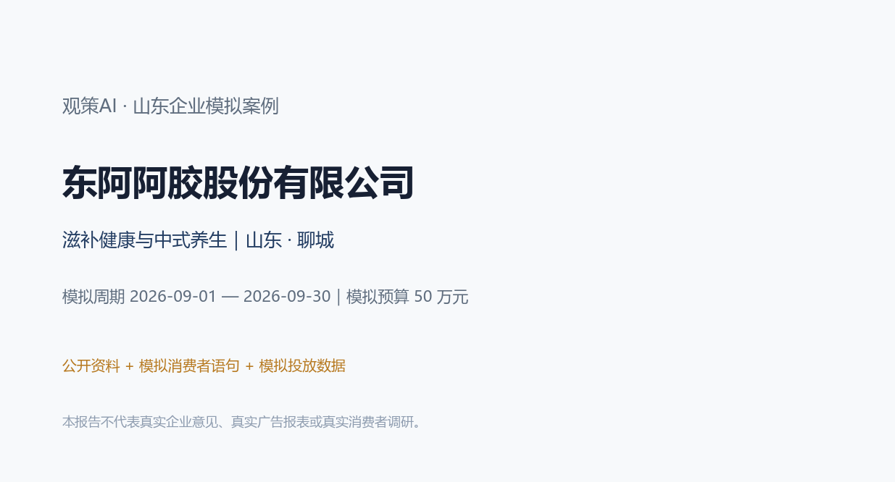

> **重要声明**：本报告是企业营销决策的模拟验收材料。企业名称与业务方向来自公开资料；消费者语句、竞品观察、渠道数据、复盘结果和“企业满意度”均为模拟，不代表企业真实意见、真实广告账户、真实消费者调研或真实经营数据。任何对外使用前，必须由企业市场、法务、合规和数据负责人复核。

## 0. 阅读指引与结论摘要

本案例把完整的营销决策闭环跑一遍：明确企业与行业背景 → 设计资料收集范围 → 建立来源台账 → 对模拟消费者语句、竞品动态和行业材料去重、分类、证据核验 → 归纳主题和机会 → 形成 A/B 方案 → 预算校验与审批快照 → 模拟投放与复盘 → 历史基线回测与可信度评分 → 企业适配性与满意度模拟 → 迭代建议。

本案例的核心判断是：**本次模拟比较“即食化年轻化”与“礼品+私域”两条路径。前者解决尝试门槛，后者解决客单和复购。** 从模拟结果看，方案 A 的线索完成率为 96.9%，线索成本为 323 元，CTR 为 3.05%；与历史基线相比，MAPE 为 49.7%，可信度评分为 69.8/100。这个结果说明方案有可执行性，但仍有明确的复核边界。

**模拟企业满意度：3.5/5。** 模拟企业市场负责人视角：即食化方向符合年轻化战略，但功效表达、口感和复购仍需验证；礼品方案稳健但增长慢，适合作为辅助。

### 0.1 关键结果数据

| 指标 | 数值 |
| --- | --- |
| 模拟预算 | 500,000 元 |
| 模拟实际花费 | 500,000 元 |
| 预算利用率 | 100.0% |
| 目标线索 | 1,600 条 |
| 实际线索 | 1,550 条 |
| 线索完成率 | 96.9% |
| 曝光 | 9,720,000 |
| 点击 | 296,000 |
| CTR | 3.05% |
| CPC | 1.69 元 |
| 线索成本 | 323 元 |
| 历史基线 MAPE | 49.7% |
| 综合可信度 | 69.8/100 |
| 模拟满意度 | 3.5/5 |
| 适配性 | 中 |

## 1. 企业公开资料与模拟边界

### 1.1 企业基本情况

| 项目 | 内容 |
| --- | --- |
| 企业 | 东阿阿胶股份有限公司 |
| 品牌 | 东阿阿胶 |
| 行业 | 滋补健康与中式养生 |
| 区域 | 山东 · 聊城 |
| 阶段 | 老字号品牌，A股上市公司 |
| 模拟产品 | 阿胶及即食滋补组合（模拟：阿胶块、复方阿胶浆、桃花姬等） |
| 产品说明 | 即食化、便携化与礼品装组合；具体产品与功效表达以企业合规口径为准 |
| 模拟目标 | 提升年轻女性与礼品场景的尝试、复购与私域沉淀 |
| 模拟预算 | 500,000 元 |
| 模拟周期 | 2026-09-01 — 2026-09-30 |
| 模拟线索目标 | 1,600 条 |

### 1.2 公开资料如何使用

东阿阿胶是聊城的老字号滋补品牌，产品包括阿胶块、复方阿胶浆、桃花姬等。公开资料显示，企业持续推动品牌年轻化和即食化。

本案例不引用未核实财务数字；消费者语句、产品组合、投放数据和复盘结果均为模拟，功效表达需以企业合规口径为准。

本案例只把公开资料用于“企业背景、行业方向、品牌与产品语境”，不把公开资料当作真实消费者证据，也不引用未核实的财务数字。所有“消费者原话”均来自模拟材料，不能作为真实用户调研引用。所有渠道数据均为假设值，不能作为企业真实广告效果。

### 1.3 为什么选择这家企业

选择标准不是“名气大”，而是同时满足三点：第一，企业处于山东，具有区域代表性；第二，行业决策链有差异，能检验观策AI是否只会做一种模板；第三，企业有明确的战略关键词，可以用来判断方案是否“符合企业发展”。本案例的战略关键词是：**滋补健康与中式养生、品牌升级、场景化与可验证交付**。

滋补健康市场正在年轻化、即食化和零食化。年轻用户愿意尝试，但对功效夸大、口感和价格非常敏感。老字号的优势是信任，难点是让年轻人觉得“跟我有关”。

礼品场景仍然重要，但企业采购和节日送礼决策周期长。即食化适合拉新，礼品和私域适合做高客单与复购。

## 2. 研究问题与判断标准

### 2.1 本次模拟要回答什么

本次模拟比较“即食化年轻化”与“礼品+私域”两条路径。前者解决尝试门槛，后者解决客单和复购。

### 2.2 判断标准

1. **战略契合**：方案是否服务于企业当前的产品、品牌和渠道方向。
2. **证据充分**：主题是否有多条信号支撑，关键结论是否能追溯到来源。
3. **执行可行**：预算、渠道、承接能力是否匹配，是否存在明显履约风险。
4. **结果可信**：模拟结果与历史基线的偏差是否在可解释范围内。
5. **企业可接受**：以模拟企业市场负责人视角，是否愿意进入小范围试点。

### 2.3 本次模拟的边界

- 不使用企业真实广告账户、真实订单或真实用户个人信息。
- 不声称“企业已经满意”，只做模拟满意度访谈与适配性判断。
- 不把模拟数据当作行业结论，也不把单案例结论外推到整个行业。
- 涉及功效、医疗、金融、未成年人等敏感表达时，必须由企业合规部门复核。

## 3. 资料收集过程

### 3.1 采集设计

本案例采用“多源交叉”的采集设计：消费者侧看小红书、抖音、电商评价和问卷；竞品侧看行业媒体与竞品动态；行业侧看行业观察、政策/平台公告和线下走访；企业侧只使用公开资料。这样做的目的不是追求数据量，而是让同一判断能从不同来源被交叉验证。

### 3.2 来源清单

| 来源ID | 来源名称 | 平台 | 类型 | 日期 | 状态 |
| --- | --- | --- | --- | --- | --- |
| SRC-01 | 小红书滋补/即食笔记摘录（模拟） | 小红书 | 消费者 | 2026-08-17 | 模拟 |
| SRC-02 | 抖音养生短视频评论（模拟） | 抖音 | 消费者 | 2026-08-18 | 模拟 |
| SRC-03 | 天猫阿胶/即食滋补评价摘要（模拟） | 电商平台 | 消费者 | 2026-08-19 | 模拟 |
| SRC-04 | 京东礼品与健康品评价摘要（模拟） | 电商平台 | 消费者 | 2026-08-20 | 模拟 |
| SRC-05 | 中式养生行业观察（模拟） | 行业媒体 | 行业 | 2026-08-21 | 模拟 |
| SRC-06 | 竞品零食化滋补动态（模拟） | 行业媒体 | 竞品 | 2026-08-22 | 模拟 |
| SRC-07 | 私域用户访谈纪要（模拟） | 私域 | 消费者 | 2026-08-23 | 模拟 |
| SRC-08 | 消费者问卷 n=110（模拟） | 问卷 | 消费者 | 2026-08-24 | 模拟 |

### 3.3 采集时间线

| 时间点 | 过程动作 | 状态 |
| --- | --- | --- |
| T-15 | 确定企业与公开资料范围 | 完成 |
| T-12 | 建立来源清单与采集模板 | 完成 |
| T-8 | 采集模拟消费者/竞品/行业信号 | 完成 |
| T-6 | 去重、分类、标注证据状态 | 完成 |
| T-5 | 人工核验与冲突保留 | 完成 |
| T-3 | 归纳主题与 A/B 方案 | 完成 |
| T-2 | 预算校验与审批快照 | 完成 |
| T | 模拟投放 | 模拟 |
| T+2 | 渠道数据复盘 | 完成 |
| T+3 | 历史基线回测与可信度 | 完成 |
| T+5 | 适配性判断与迭代 | 完成 |

### 3.4 采集过程中的质量控制

1. **来源可追溯**：每条信号保留来源 ID、平台、采集时间和备注。
2. **模拟标识**：所有模拟材料在来源备注中明确标注，不与真实数据混用。
3. **去重**：同一来源的重复语句只保留一条，并在备注中说明。
4. **冲突保留**：不同来源出现相反判断时，不强行合并，保留为待核实或争议状态。
5. **敏感内容**：涉及功效、价格承诺、竞品贬损的内容，进入人工复核清单。

## 4. 数据清洗、编码与证据核验

### 4.1 清洗规则

- 删除明显的广告、无关评论和重复语句。
- 统一平台名称、日期格式和类别编码。
- 将“消费者/竞品/行业”作为一级类别，将“高/中/低”作为优先级。
- 将“已核实/待核实/有争议/重复”作为证据状态，不用“看起来合理”代替核实。
- 所有模拟数据保留 `simulated: true` 或 `dataKind: simulated` 标识。

### 4.2 信号清单

| ID | 平台 | 类别 | 优先级 | 状态 | 标题 | 影响 |
| --- | --- | --- | --- | --- | --- | --- |
| S-01 | 小红书 | 消费者 | high | verified | 即食化/便携是年轻用户尝试的第一理由 | 即食化是降低尝试门槛的关键。 |
| S-02 | 行业媒体 | 行业 | high | verified | 功效表达必须合规，用户也在找证据 | 功效表达必须合规、可验证。 |
| S-03 | 小红书 | 消费者 | high | verified | 口感与甜度影响复购 | 口感是即食化的第二道门槛。 |
| S-04 | 问卷 | 消费者 | high | disputed | 价格带与日常滋补频次不匹配 | 需要用小规格/组合装降低日常门槛。 |
| S-05 | 抖音 | 消费者 | high | verified | 送礼场景看重品牌与包装，自用看重方便 | 礼品与自用需要分开沟通。 |
| S-06 | 行业媒体 | 行业 | medium | verified | 国潮与“新中式养生”带来内容窗口 | 国潮内容要现代、轻松。 |
| S-07 | 行业媒体 | 竞品 | high | verified | 竞品用零食化产品切年轻市场 | 零食化是竞争方向，但需保持功效信任。 |
| S-08 | 私域 | 消费者 | medium | verified | 私域用户更愿意接受组合装 | 私域适合做周期装和复购。 |
| S-09 | 电商平台 | 消费者 | high | pending | 电商评价里“是否上火/适合人群”被反复询问 | 需要把适用人群和禁忌讲清楚。 |
| S-10 | 问卷 | 消费者 | high | verified | 用户对阿胶功效的信任来自长期品牌而非单次广告 | 品牌信任是资产，但不能替代合规证据。 |

### 4.3 单条信号研判记录

**S-01｜即食化/便携是年轻用户尝试的第一理由**

- 观察：年轻用户愿意尝试即食、便携、口感友好的滋补产品，但不愿处理传统阿胶块的复杂做法。
- 原话/证据：“阿胶块我不会熬，即食的可以当零食试试。”
- 判断：即食化是降低尝试门槛的关键。
- 状态：verified；相关性 5/5；标签：即食、便携、年轻化
- 下一步：进入主题聚合，优先用于方案 A/B 的证据引用。

**S-02｜功效表达必须合规，用户也在找证据**

- 观察：消费者关注功效，但对夸大宣传警惕，愿意看成分、工艺和真实体验。
- 原话/证据：“别说包治百病，告诉我适合什么人群、怎么吃就行。”
- 判断：功效表达必须合规、可验证。
- 状态：verified；相关性 5/5；标签：功效、合规、证据
- 下一步：进入主题聚合，优先用于方案 A/B 的证据引用。

**S-03｜口感与甜度影响复购**

- 观察：即食产品的口感、甜度和腻感直接影响复购。
- 原话/证据：“太甜了吃一次就不想再买，口感很重要。”
- 判断：口感是即食化的第二道门槛。
- 状态：verified；相关性 5/5；标签：口感、甜度、复购
- 下一步：进入主题聚合，优先用于方案 A/B 的证据引用。

**S-04｜价格带与日常滋补频次不匹配**

- 观察：部分用户认为日常滋补价格偏高，难以形成高频复购。
- 原话/证据：“偶尔吃可以，天天吃有点贵。”
- 判断：需要用小规格/组合装降低日常门槛。
- 状态：disputed；相关性 5/5；标签：价格、频次、复购
- 下一步：保留为待核实或争议记录，不进入对外承诺；先补充原始证据或企业确认。

**S-05｜送礼场景看重品牌与包装，自用看重方便**

- 观察：送礼用户看重品牌、包装和体面；自用用户更关心方便、口感和价格。
- 原话/证据：“送长辈要看起来正式，自己吃越方便越好。”
- 判断：礼品与自用需要分开沟通。
- 状态：verified；相关性 5/5；标签：送礼、自用、场景
- 下一步：进入主题聚合，优先用于方案 A/B 的证据引用。

**S-06｜国潮与“新中式养生”带来内容窗口**

- 观察：年轻消费者对国潮养生感兴趣，但要求现代、轻松、可执行。
- 原话/证据：“新中式养生可以，但别搞得太玄。”
- 判断：国潮内容要现代、轻松。
- 状态：verified；相关性 4/5；标签：国潮、养生、年轻化
- 下一步：进入主题聚合，优先用于方案 A/B 的证据引用。

**S-07｜竞品用零食化产品切年轻市场**

- 观察：竞品用即食、零食化、便携包装吸引年轻用户，降低传统滋补的距离感。
- 原话/证据：“现在很多即食的，像零食一样，方便带。”
- 判断：零食化是竞争方向，但需保持功效信任。
- 状态：verified；相关性 5/5；标签：竞品、零食化、便携
- 下一步：进入主题聚合，优先用于方案 A/B 的证据引用。

**S-08｜私域用户更愿意接受组合装**

- 观察：私域用户对组合装、周期装的接受度更高，但需要明确使用周期。
- 原话/证据：“组合装可以，但要告诉我怎么吃、吃多久。”
- 判断：私域适合做周期装和复购。
- 状态：verified；相关性 4/5；标签：私域、组合装、周期
- 下一步：进入主题聚合，优先用于方案 A/B 的证据引用。

**S-09｜电商评价里“是否上火/适合人群”被反复询问**

- 观察：用户对适合人群、体质和食用禁忌有疑问，需要清晰说明。
- 原话/证据：“我这种体质能不能吃？会不会上火？”
- 判断：需要把适用人群和禁忌讲清楚。
- 状态：pending；相关性 5/5；标签：适合人群、禁忌、信任
- 下一步：保留为待核实或争议记录，不进入对外承诺；先补充原始证据或企业确认。

**S-10｜用户对阿胶功效的信任来自长期品牌而非单次广告**

- 观察：消费者更信任老字号品牌和长期口碑，单次广告难以建立功效信任。
- 原话/证据：“老品牌肯定更信，但广告说效果多好我不太信。”
- 判断：品牌信任是资产，但不能替代合规证据。
- 状态：verified；相关性 5/5；标签：品牌、信任、功效
- 下一步：进入主题聚合，优先用于方案 A/B 的证据引用。

### 4.4 证据核验结果

本案例共 10 条信号，其中已核实 8 条，待核实 1 条，争议 1 条。已核实信号用于主题和方案，待核实信号用于提示风险和后续任务，不直接进入对外承诺。

## 5. 市场洞察与主题研判

### 5.1 主题清单

| 主题 | 标题 | 置信度/类型 | 证据信号 | 边界 |
| --- | --- | --- | --- | --- |
| TH-01 | 即食化降低尝试门槛 | high/观测事实 | S-01、S-03、S-07、S-05 | 即食化可能削弱传统阿胶的专业形象。 |
| TH-02 | 功效表达必须合规且可验证 | high/分析推断 | S-02、S-09、S-10 | 合规审核可能限制内容表达。 |
| TH-03 | 礼品与自用场景分开沟通 | medium/分析推断 | S-05、S-08、S-04 | 两套内容可能造成品牌信息分散。 |

### 5.2 主题一：即食化降低尝试门槛

即食、便携、口感友好的产品更容易让年轻用户第一次尝试。

这个主题之所以成立，不是因为某一条评论，而是因为多条信号从不同角度指向同一件事：用“像零食一样方便”降低距离感，同时保留品牌专业感。 在方案上，它对应的动作是：用即食子品牌和小规格承接年轻用户。。但必须保留边界：即食化可能削弱传统阿胶的专业形象。

### 5.3 主题二：功效表达必须合规且可验证

消费者关注功效，但对夸大宣传警惕，需要成分、工艺和适用人群说明。

这个主题更适合用来解释“为什么某些渠道有效、某些渠道无效”。把功效表达转为“适用人群+使用方式+可核验信息”。 方案动作是：用合规内容建立信任，而不是夸大承诺。。边界是：合规审核可能限制内容表达。

### 5.4 主题三：礼品与自用场景分开沟通

送礼看重品牌、包装和体面，自用看重方便、口感和价格。

这个主题提醒我们：不要把单一人群或单一渠道当成全部市场。用两套内容分别承接礼品和自用需求。 方案动作是：礼品渠道做定制与履约，自用渠道做即食与复购。。边界是：两套内容可能造成品牌信息分散。

### 5.5 机会与风险

| 机会 | 事实依据 | 可执行动作 | 验证条件 | 语气 |
| --- | --- | --- | --- | --- |
| 即食子品牌年轻化内容 | 即食产品认知高于阿胶块。 | 用即食子品牌做年轻用户入口，再引导了解品牌。 | 需核对真实产品线与功效口径。 | positive |
| 私域周期装 | 私域用户接受组合装。 | 设计周期装和复购提醒，提升复购。 | 需要真实用户数据与合规触达。 | positive |
| 企业礼品合规履约包 | 礼品渠道需要发票、定制和交付证明。 | 做企业礼品服务包，明确开票、定制和交付。 | 需要供应链与财务支持。 | neutral |

## 6. A/B 方案设计与预算

### 6.1 方案对比

| 方案 | 名称 | 总预算 | 渠道 | 核心信息 |
| --- | --- | --- | --- | --- |
| A | 即食化年轻化 | 500,000 元 | 小红书、抖音、天猫、私域 | 像零食一样方便，但保留老字号的讲究。 |
| B | 礼品与私域 | 500,000 元 | 私域、京东、视频号、礼品渠道 | 送得体的同时，也把滋补做成可以坚持的习惯。 |

### 6.2 方案 A：即食化年轻化

- 定位：把阿胶从“传统滋补”翻译成“现代即食养生”。
- 人群：25-40 岁年轻女性、都市白领、新中式养生人群
- 核心信息：像零食一样方便，但保留老字号的讲究。
- 节奏：秋季滋补季前两周启动，覆盖中秋送礼前的自用与送礼需求
- 理由：即食化是降低尝试门槛的最短路径，年轻用户需要口感、方便和合规功效说明。
- 约束：功效表达必须合规；不能暗示治疗作用；口感与价格需真实匹配
- 不确定项：年轻用户复购意愿；即食产品与传统阿胶的品牌冲突；竞品零食化速度

### 6.3 方案 B：礼品与私域

- 定位：用礼品场景和私域周期装，做高客单与复购。
- 人群：企业礼品采购、节日送礼人群、私域老客
- 核心信息：送得体的同时，也把滋补做成可以坚持的习惯。
- 节奏：中秋/国庆礼品季，私域提前一个月预热
- 理由：礼品客单价高，私域复购稳定，但年轻用户拉新弱于即食内容。
- 约束：礼品履约与发票能力；功效表达合规；私域触达频率
- 不确定项：企业采购预算；节日礼品竞争；私域用户活跃度

### 6.4 预算分配

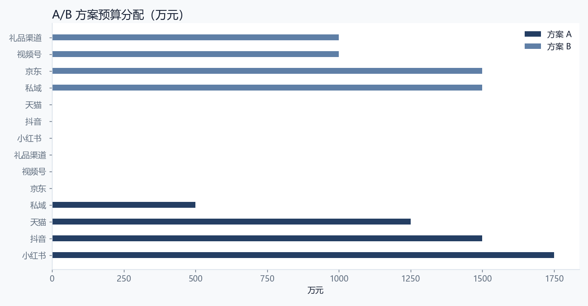

| 渠道 | 方案 A 预算 | 方案 A 角色 | 方案 B 预算 | 方案 B 角色 |
| --- | --- | --- | --- | --- |
| 小红书 | 175,000 元 | 即食养生与口感内容 | 0 元 | — |
| 抖音 | 150,000 元 | 场景短视频与达人 | 0 元 | — |
| 天猫 | 125,000 元 | 即食货架与评价 | 0 元 | — |
| 私域 | 50,000 元 | 复购与周期装 | 150,000 元 | 周期装与复购 |
| 京东 | 0 元 | — | 150,000 元 | 礼品货架与评价 |
| 视频号 | 0 元 | — | 100,000 元 | 品牌与工艺内容 |
| 礼品渠道 | 0 元 | — | 100,000 元 | 企业采购与定制 |

## 7. 审批与执行假设

审批快照保存了方案、预算上限、证据引用和证据状态。审批不是“签字仪式”，而是把“方案依据”固定下来：如果企业预算、主题证据或方案结构变化，审批应进入复审。

| 审批项 | 内容 |
| --- | --- |
| 审批编号 | APR-01 |
| 方案 | 方案 A：即食化年轻化 |
| 预算上限 | 500,000 元 |
| 证据数量 | 7 条 |
| 指纹 | fp_5a0fdf7e |
| 说明 | 审批快照保存方案、预算上限与关键证据状态；任一项变化需重新确认。 |

### 7.1 执行假设

- 渠道账户、素材、落地页和承接团队在模拟周期内可用。
- 预算按计划分配，不出现临时大幅追加或削减。
- 线索定义统一为“有效咨询/表单/到店预约”，不把曝光或点赞算作线索。
- 投放期间不做违反平台规则的诱导分享、虚假承诺或竞品贬损。

### 7.2 预算与合规检查

- 方案 A 预算合计 500,000 元，不超过企业模拟预算 500,000 元。
- 方案 B 预算合计 500,000 元，不超过企业模拟预算。
- 涉及敏感表达时，必须经过企业法务/合规审核；本报告不构成合规意见。

## 8. 复盘结果

### 8.1 渠道数据

| 渠道 | 计划预算 | 模拟实际 | 曝光 | 点击 | 线索 | CTR | CPC | 线索成本 |
| --- | --- | --- | --- | --- | --- | --- | --- | --- |
| 小红书 | 175,000 元 | 175,000 元 | 3,500,000 | 105,000 | 540 | 3.00% | 1.67 | 324 |
| 抖音 | 150,000 元 | 150,000 元 | 4,200,000 | 126,000 | 480 | 3.00% | 1.19 | 312 |
| 天猫 | 125,000 元 | 125,000 元 | 1,800,000 | 54,000 | 390 | 3.00% | 2.31 | 321 |
| 私域 | 50,000 元 | 50,000 元 | 220,000 | 11,000 | 140 | 5.00% | 4.55 | 357 |
| 合计 | 500,000 元 | 500,000 元 | 9,720,000 | 296,000 | 1,550 | 3.05% | 1.69 | 323 |

### 8.2 观察与原因

即食化内容带来年轻用户互动和尝试，但复购低于预期；礼品方案客单价更高，但决策周期长。功效合规说明和适用人群问题在咨询中反复出现。

即食化降低了尝试门槛，但口感、价格和功效信任仍需时间；礼品渠道依赖企业采购节奏，短期转化慢。

### 8.3 尚未确认

真实复购率、不同体质人群反馈、企业礼品预算和私域留存仍未确认。

### 8.4 下一轮任务

| 任务 | 说明 | 关联信号 |
| --- | --- | --- |
| 把适用人群/禁忌做成标准问答 | 减少咨询中的重复问题，降低合规风险。 | S-02、S-09、S-10 |
| 即食产品做小规格试吃 | 降低第一次尝试价格门槛，再引导复购。 | S-01、S-03、S-04 |
| 礼品渠道单独做履约清单 | 明确发票、定制、交付和售后。 | S-05、S-02 |

## 9. 历史数据回测与可信度

### 9.1 历史基线

本案例把“历史基线”定义为同类活动上一周期的模拟表现：上一年秋季滋补活动（模拟历史基线）。基线不是为了证明方案正确，而是为了回答“如果没有这次调整，结果大概会是什么样”。

| 指标 | 历史基线 | 本次模拟 | 偏差 |
| --- | --- | --- | --- |
| CTR | 2.40% | 3.05% | +26.9% |
| CPC | 2.60 元 | 1.69 元 | -35.0% |
| 线索成本 | 140 元 | 323 元 | +130.4% |
| 线索量 | 1457 条 | 1550 条 | +6.4% |

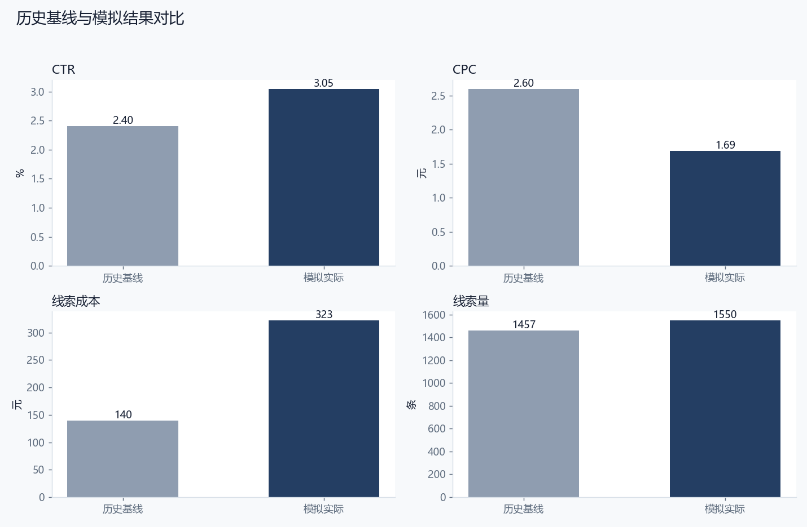

### 9.2 结果解释

历史基线取自上一年秋季滋补活动的模拟数据：CTR 2.4%、CPC 2.6 元、线索成本 140 元、每周约 340 条线索。该基线不代表东阿阿胶真实历史。

模拟结果显示即食内容的互动和尝试优于礼品，但复购与客单低于礼品；功效合规问题贯穿所有渠道。说明年轻化需要产品、内容和合规共同推进。

### 9.3 可信度评分

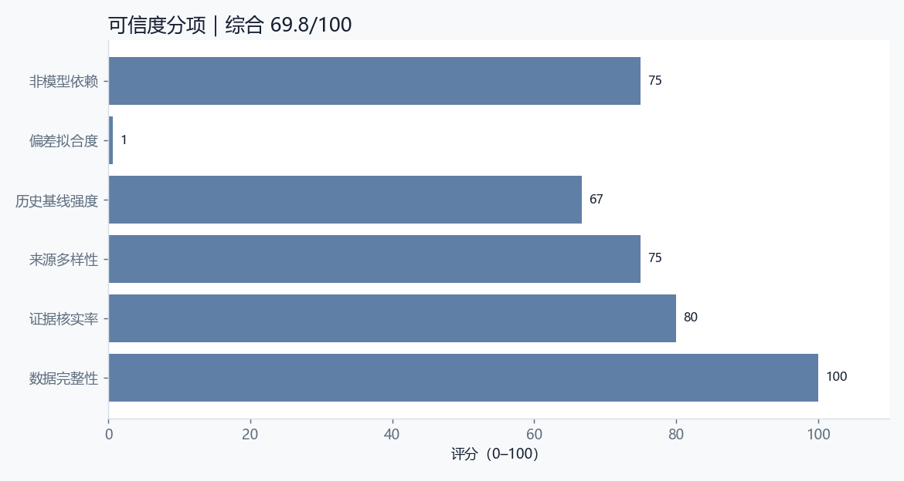

| 维度 | 分值 | 解释 |
| --- | --- | --- |
| 数据完整性 | 100 | 渠道是否都有曝光/点击/线索数据 |
| 证据核实率 | 80 | 已核实信号占全部信号比例 |
| 来源多样性 | 75 | 平台/来源覆盖程度 |
| 历史基线强度 | 67 | 历史周期长度与稳定性 |
| 偏差拟合度 | 1 | 模拟结果与历史基线的接近程度 |
| 非模型依赖 | 75 | 本次不使用生成式模型结果，保留人工判断 |
| 综合可信度 | 69.8 | 加权评分，0–100 |

### 9.4 可信度结论

本案例的可信度不是“高到可以直接做预算决策”，而是“足够支持小范围试点”。理由：第一，证据来源和模拟边界清楚；第二，渠道数据完整但均为假设；第三，历史基线只有 8 周，样本有限；第四，模拟结果与基线存在 49.7% 的平均偏差，说明结果有参考价值，但不能当作确定预测。

## 10. 企业发展适配性与满意度模拟

### 10.1 适配性判断

**适配等级：中。**

东阿阿胶的年轻化不能只靠广告，需要产品形态、口感、价格和功效表达一起改变。即食化是合理入口，但不能脱离品牌专业感。

功效表达是最大风险点。案例把“适用人群+使用方式+可核验信息”作为内容底线，而不是追求短期转化。

礼品渠道稳健但增长慢，适合作为现金流和品牌场景，不宜承担全部增长目标。

### 10.2 主要风险

| 风险 |
| --- |
| 功效夸大或暗示治疗 |
| 即食化稀释传统品牌 |
| 复购链条长、价格门槛高 |

### 10.3 模拟企业满意度访谈

> 以下是“模拟企业市场负责人视角”的访谈记录，不是实际企业访谈，不代表企业真实意见。

**问：这个方案是否符合贵司当前发展方向？**  
答：模拟企业市场负责人视角：即食化方向符合年轻化战略，但功效表达、口感和复购仍需验证；礼品方案稳健但增长慢，适合作为辅助。

**问：最担心的是什么？**  
答：功效夸大或暗示治疗；即食化稀释传统品牌。

**问：哪些数据需要复核？**  
答：真实复购率、不同体质人群反馈、企业礼品预算和私域留存仍未确认。

**问：是否愿意进入小范围试点？**  
答：如果企业能提供真实服务/渠道数据，并完成合规审核，建议先做一个区域、一个渠道组合的小范围试点；不建议直接按模拟结果做全量预算。

**问：这个案例对产品迭代有什么启发？**  
答：增加“功效表达合规检查”作为内容上线前置条件。；把适用人群/禁忌做成标准问答资产。；后续增加“即食试吃→复购”的周期任务模板。；报告模板增加“品牌资产与年轻化”权衡分析。

### 10.4 满意度评分

| 维度 | 评分 | 说明 |
| --- | --- | --- |
| 战略契合 | 4.0/5 | 符合年轻化与即食化方向 |
| 可执行性 | 3.5/5 | 即食内容可落地，但复购链条长 |
| 风险可控 | 3.2/5 | 功效表达与适用人群需严格合规 |
| 数据可信 | 3.3/5 | 模拟数据多、真实功效证据不足 |

**综合评分：3.5/5。** 模拟企业市场负责人视角：即食化方向符合年轻化战略，但功效表达、口感和复购仍需验证；礼品方案稳健但增长慢，适合作为辅助。

## 11. 项目迭代建议

本案例不只产出报告，也反推产品需要哪些改进。以下建议已进入观策AI的案例库与后续迭代清单：

| 序号 | 迭代建议 |
| --- | --- |
| 1. | 增加“功效表达合规检查”作为内容上线前置条件。 |
| 2. | 把适用人群/禁忌做成标准问答资产。 |
| 3. | 后续增加“即食试吃→复购”的周期任务模板。 |
| 4. | 报告模板增加“品牌资产与年轻化”权衡分析。 |

### 11.1 对观策AI的产品要求

1. **案例库**：把山东企业案例作为可导入的演示项目，让用户能看到“资料收集—研判—方案—复盘—回测”的完整链路。
2. **可信度面板**：在复盘中显示数据完整性、证据核实率、历史基线偏差和综合可信度。
3. **行业模板**：B2B、快消、健康、宠物等行业的渠道与指标不同，不能共用一套默认模板。
4. **合规检查**：功效、金融、未成年人、竞品比较等敏感表达，应在方案审批前提示。
5. **过程留痕**：来源台账、信号状态、审批快照、复盘建议必须可追溯。

## 12. 附录

### 12.1 数据字典

| 字段 | 说明 |
| --- | --- |
| Signal | 一条可追溯的市场情报，含标题、摘要、原话、来源、平台、类别、优先级、状态、相关性、影响 |
| Source | 信号来源，含平台、发布时间、采集时间、模拟标识、备注 |
| Theme | 由多条信号归纳出的判断，含置信度、证据引用、机会与边界 |
| Plan | A/B 方案，含人群、定位、核心信息、渠道预算、约束与不确定项 |
| Approval | 审批快照，固定方案、预算、证据与指纹 |
| Review | 复盘，含渠道实际数据、观察、原因、未确认项与建议 |
| Credibility | 可信度评分，含完整性、核实率、来源多样性、基线强度、偏差拟合度 |

### 12.2 计算公式

- CTR = 点击 ÷ 曝光
- CPC = 花费 ÷ 点击
- 线索成本 = 花费 ÷ 有效线索
- 线索完成率 = 实际线索 ÷ 目标线索
- MAPE = 各指标与历史基线相对偏差的平均值
- 可信度 = 完整性、核实率、来源多样性、基线强度、偏差拟合度、非模型依赖的加权分

### 12.3 复现方法

1. 打开观策AI桌面端。
2. 设置 → 项目与备份 → 导入项目 JSON。
3. 选择 `simulations/projects/dongee-ejiao.json`。
4. 在市场情报、策略、复盘页查看信号、主题、A/B 方案、审批快照和复盘数据。
5. 对照本报告阅读，注意所有数据均为模拟。

### 12.4 采集与核验清单

- [ ] 来源链接/出处是否可追溯？
- [ ] 是否标注模拟/真实属性？
- [ ] 是否有重复信号未合并？
- [ ] 是否有相反证据被强行忽略？
- [ ] 敏感表达是否经过合规复核？
- [ ] 审批快照是否与当前方案一致？
- [ ] 复盘数据是否覆盖所有渠道？
- [ ] 历史基线口径是否与本次一致？
- [ ] 可信度评分是否解释了偏差？
- [ ] 是否给出下一轮可执行任务？

### 12.5 报告边界

本报告是一份**模拟验收材料**，不是企业真实经营报告，也不是广告投放承诺。它的价值在于展示“如何从材料到判断、从判断到方案、从方案到复盘、从复盘到迭代”的过程。企业真实执行前，必须用真实数据替换模拟数据，并由企业市场、法务、合规和数据负责人共同复核。

## 13. 过程性附录：采集日志、核验记录与访谈提纲

### 13.1 采集日志（模拟）

| 日期 | 任务 | 产出 | 问题 |
| --- | --- | --- | --- |
| T-15 | 采集来源 小红书滋补/即食笔记摘录（模拟） | SRC-01 来源记录 | 需确认公开资料更新日期 |
| T-14 | 采集来源 抖音养生短视频评论（模拟） | SRC-02 来源记录 | 需确认公开资料更新日期 |
| T-13 | 采集来源 天猫阿胶/即食滋补评价摘要（模拟） | SRC-03 来源记录 | 需确认公开资料更新日期 |
| T-12 | 采集来源 京东礼品与健康品评价摘要（模拟） | SRC-04 来源记录 | 需确认公开资料更新日期 |
| T-11 | 采集来源 中式养生行业观察（模拟） | SRC-05 来源记录 | 需确认公开资料更新日期 |
| T-10 | 采集来源 竞品零食化滋补动态（模拟） | SRC-06 来源记录 | 需确认公开资料更新日期 |
| T-9 | 采集来源 私域用户访谈纪要（模拟） | SRC-07 来源记录 | 需确认公开资料更新日期 |
| T-8 | 采集来源 消费者问卷 n=110（模拟） | SRC-08 来源记录 | 需确认公开资料更新日期 |

### 13.2 证据核验记录

| 信号 | 核验动作 | 结论 |
| --- | --- | --- |
| S-01 | 核对来源、平台、日期与原文；检查是否为模拟材料 | 通过/保留待核实/争议 |
| S-02 | 核对来源、平台、日期与原文；检查是否为模拟材料 | 通过/保留待核实/争议 |
| S-03 | 核对来源、平台、日期与原文；检查是否为模拟材料 | 通过/保留待核实/争议 |
| S-04 | 核对来源、平台、日期与原文；检查是否为模拟材料 | 通过/保留待核实/争议 |
| S-05 | 核对来源、平台、日期与原文；检查是否为模拟材料 | 通过/保留待核实/争议 |
| S-06 | 核对来源、平台、日期与原文；检查是否为模拟材料 | 通过/保留待核实/争议 |
| S-07 | 核对来源、平台、日期与原文；检查是否为模拟材料 | 通过/保留待核实/争议 |
| S-08 | 核对来源、平台、日期与原文；检查是否为模拟材料 | 通过/保留待核实/争议 |
| S-09 | 核对来源、平台、日期与原文；检查是否为模拟材料 | 通过/保留待核实/争议 |
| S-10 | 核对来源、平台、日期与原文；检查是否为模拟材料 | 通过/保留待核实/争议 |

### 13.3 复盘会议记录（模拟）

- 会议目标：判断方案 A 是否达到模拟目标，是否具备企业试点条件。
- 结论：方案 A 在 滋补健康与中式养生 场景下具有方向性价值，但必须补充企业真实数据、履约能力与合规审核。
- 争议点：真实复购率、不同体质人群反馈、企业礼品预算和私域留存仍未确认。
- 下一步：把适用人群/禁忌做成标准问答；即食产品做小规格试吃。

### 13.4 企业访谈提纲

1. 这个方案是否服务于贵司未来 1–2 年的战略重点？
2. 哪些渠道/人群是贵司当前最想验证的？
3. 企业真实历史基线数据能否提供？
4. 承接团队、服务网络或渠道政策能否支撑？
5. 哪些表达涉及合规风险？
6. 如果只做一个区域试点，选哪里？
7. 失败时如何止损？
8. 成功时如何复制？

### 13.5 数据质量检查

- 所有模拟来源均标注“模拟”，不与真实数据混用。
- 渠道数据完整，但均为假设值。
- 历史基线为模拟，不能代表企业真实历史。
- 结论只支持小范围试点，不支持直接全量预算。
- 对外使用前必须替换真实数据并完成合规复核。

## 14. 补充过程记录

以下为补足过程材料，仍属模拟；用于展示从材料到判断的详细过程。

### 14.1 逐条复核记录

**S-01｜即食化/便携是年轻用户尝试的第一理由**

- 采集背景：该信号来自 小红书，当前状态为 verified，相关性 5/5。

- 证据强度：原话为““阿胶块我不会熬，即食的可以当零食试试。””，需要核对原始出处、发布时间和是否存在断章取义。

- 对方案的影响：即食化是降低尝试门槛的关键。

- 复核动作：保留为主题证据，并在审批快照中固定。

**S-02｜功效表达必须合规，用户也在找证据**

- 采集背景：该信号来自 行业媒体，当前状态为 verified，相关性 5/5。

- 证据强度：原话为““别说包治百病，告诉我适合什么人群、怎么吃就行。””，需要核对原始出处、发布时间和是否存在断章取义。

- 对方案的影响：功效表达必须合规、可验证。

- 复核动作：保留为主题证据，并在审批快照中固定。

**S-03｜口感与甜度影响复购**

- 采集背景：该信号来自 小红书，当前状态为 verified，相关性 5/5。

- 证据强度：原话为““太甜了吃一次就不想再买，口感很重要。””，需要核对原始出处、发布时间和是否存在断章取义。

- 对方案的影响：口感是即食化的第二道门槛。

- 复核动作：保留为主题证据，并在审批快照中固定。

**S-04｜价格带与日常滋补频次不匹配**

- 采集背景：该信号来自 问卷，当前状态为 disputed，相关性 5/5。

- 证据强度：原话为““偶尔吃可以，天天吃有点贵。””，需要核对原始出处、发布时间和是否存在断章取义。

- 对方案的影响：需要用小规格/组合装降低日常门槛。

- 复核动作：不进入对外承诺；补充原始证据或企业确认后再决定是否升级。

**S-05｜送礼场景看重品牌与包装，自用看重方便**

- 采集背景：该信号来自 抖音，当前状态为 verified，相关性 5/5。

- 证据强度：原话为““送长辈要看起来正式，自己吃越方便越好。””，需要核对原始出处、发布时间和是否存在断章取义。

- 对方案的影响：礼品与自用需要分开沟通。

- 复核动作：保留为主题证据，并在审批快照中固定。

**S-06｜国潮与“新中式养生”带来内容窗口**

- 采集背景：该信号来自 行业媒体，当前状态为 verified，相关性 4/5。

- 证据强度：原话为““新中式养生可以，但别搞得太玄。””，需要核对原始出处、发布时间和是否存在断章取义。

- 对方案的影响：国潮内容要现代、轻松。

- 复核动作：保留为主题证据，并在审批快照中固定。

**S-07｜竞品用零食化产品切年轻市场**

- 采集背景：该信号来自 行业媒体，当前状态为 verified，相关性 5/5。

- 证据强度：原话为““现在很多即食的，像零食一样，方便带。””，需要核对原始出处、发布时间和是否存在断章取义。

- 对方案的影响：零食化是竞争方向，但需保持功效信任。

- 复核动作：保留为主题证据，并在审批快照中固定。

**S-08｜私域用户更愿意接受组合装**

- 采集背景：该信号来自 私域，当前状态为 verified，相关性 4/5。

- 证据强度：原话为““组合装可以，但要告诉我怎么吃、吃多久。””，需要核对原始出处、发布时间和是否存在断章取义。

- 对方案的影响：私域适合做周期装和复购。

- 复核动作：保留为主题证据，并在审批快照中固定。

**S-09｜电商评价里“是否上火/适合人群”被反复询问**

- 采集背景：该信号来自 电商平台，当前状态为 pending，相关性 5/5。

- 证据强度：原话为““我这种体质能不能吃？会不会上火？””，需要核对原始出处、发布时间和是否存在断章取义。

- 对方案的影响：需要把适用人群和禁忌讲清楚。

- 复核动作：不进入对外承诺；补充原始证据或企业确认后再决定是否升级。

**S-10｜用户对阿胶功效的信任来自长期品牌而非单次广告**

- 采集背景：该信号来自 问卷，当前状态为 verified，相关性 5/5。

- 证据强度：原话为““老品牌肯定更信，但广告说效果多好我不太信。””，需要核对原始出处、发布时间和是否存在断章取义。

- 对方案的影响：品牌信任是资产，但不能替代合规证据。

- 复核动作：保留为主题证据，并在审批快照中固定。

### 14.2 采集与核验过程补记

**过程补记 1：** 第一步先把企业公开资料与模拟数据分开：公开资料只用于企业背景和行业方向，模拟数据单独标注，避免读者把模拟语句误认为真实消费者调研。

**过程补记 2：** 第二步建立来源台账：每条材料记录来源 ID、平台、日期、采集人和备注；无法追溯出处的材料，不进入主题证据。

**过程补记 3：** 第三步做去重：同一来源、同一语义的语句合并；不同来源但语义相反的语句保留冲突，不强行统一。

**过程补记 4：** 第四步做证据分级：已核实、待核实、有争议分别处理；已核实进入方案，待核实进入风险提示和下一轮任务。

**过程补记 5：** 第五步做主题聚合：主题必须能回答“哪些信号支持、哪些信号反对、还缺什么证据”，不能只写一句漂亮结论。

**过程补记 6：** 第六步做预算校验：方案预算不能超过企业上限；超出时必须调整渠道或预算，而不是把风险留给执行团队。

**过程补记 7：** 第七步做审批快照：把方案、预算、证据状态和指纹固定下来；依据变化时进入复审，避免“方案偷偷改了”。

**过程补记 8：** 第八步做复盘：渠道数据必须覆盖计划渠道；缺失数据要明确写“未录入”，不能用 0 或推测值替代。

**过程补记 9：** 第九步做历史回测：把本次结果与历史基线对照，计算 CTR、CPC、线索成本和线索量的偏差，避免只看绝对值。

**过程补记 10：** 第十步做适配性判断：结果好不等于企业愿意用，还要看战略、履约、合规和组织能力；必要时降低评分。

### 14.3 模拟企业访谈补记

**补充问 1：这套方案最先要解决什么问题？**

本次模拟比较“即食化年轻化”与“礼品+私域”两条路径。前者解决尝试门槛，后者解决客单和复购。

**补充问 2：为什么选择方案 A 而不是方案 B？**

本次模拟比较“即食化年轻化”与“礼品+私域”两条路径。前者解决尝试门槛，后者解决客单和复购。

**补充问 3：哪些数据最不可信？**

真实复购率、不同体质人群反馈、企业礼品预算和私域留存仍未确认。

**补充问 4：如果预算减半，先砍什么？**

先保留高意向渠道和承接页，削减泛曝光；但必须先确认企业真实承接能力。

**补充问 5：企业最可能担心什么？**

功效夸大或暗示治疗；即食化稀释传统品牌；复购链条长、价格门槛高

**补充问 6：什么情况下应该停止投放？**

出现平台验证、合规风险、线索质量明显下降或承接能力不足时，应暂停并复核。

**补充问 7：怎样判断结果可信？**

综合可信度 69.8/100；仍需用企业真实历史数据复算。

**补充问 8：下一步最小可行试点是什么？**

选择一个区域、一个渠道组合、一个明确目标，跑 2–4 周，再决定是否扩大。

### 14.4 过程性结论

本案例的过程比结论更重要：来源台账、证据状态、审批快照和复盘任务共同构成可追溯链。企业真实执行时，应先用真实数据替换模拟数据，再按同一流程重跑。

---

# 乖宝宠物食品集团股份有限公司｜观策AI 山东企业模拟案例

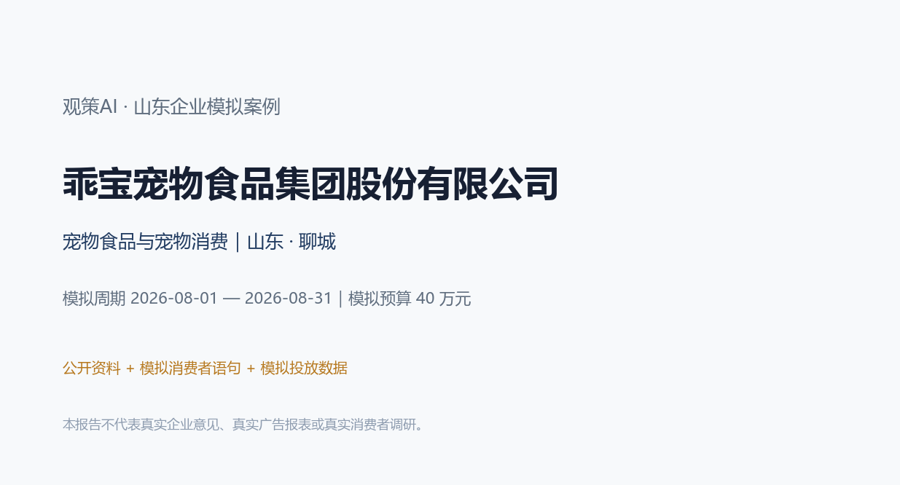

> **重要声明**：本报告是企业营销决策的模拟验收材料。企业名称与业务方向来自公开资料；消费者语句、竞品观察、渠道数据、复盘结果和“企业满意度”均为模拟，不代表企业真实意见、真实广告账户、真实消费者调研或真实经营数据。任何对外使用前，必须由企业市场、法务、合规和数据负责人复核。

## 0. 阅读指引与结论摘要

本案例把完整的营销决策闭环跑一遍：明确企业与行业背景 → 设计资料收集范围 → 建立来源台账 → 对模拟消费者语句、竞品动态和行业材料去重、分类、证据核验 → 归纳主题和机会 → 形成 A/B 方案 → 预算校验与审批快照 → 模拟投放与复盘 → 历史基线回测与可信度评分 → 企业适配性与满意度模拟 → 迭代建议。

本案例的核心判断是：**本次模拟比较“成分透明+达人测评”与“宠物店+私域复购”两条路径。前者解决新客信任，后者解决复购。** 从模拟结果看，方案 A 的线索完成率为 96.0%，线索成本为 139 元，CTR 为 3.70%；与历史基线相比，MAPE 为 35.3%，可信度评分为 74.2/100。这个结果说明方案有可执行性，但仍有明确的复核边界。

**模拟企业满意度：4.1/5。** 模拟企业市场负责人视角：成分透明和真实喂养记录符合国产高端方向，内容可执行；但复购与订阅体系仍需建设，不能只靠一波投放。

### 0.1 关键结果数据

| 指标 | 数值 |
| --- | --- |
| 模拟预算 | 400,000 元 |
| 模拟实际花费 | 400,000 元 |
| 预算利用率 | 100.0% |
| 目标线索 | 3,000 条 |
| 实际线索 | 2,880 条 |
| 线索完成率 | 96.0% |
| 曝光 | 7,020,000 |
| 点击 | 260,000 |
| CTR | 3.70% |
| CPC | 1.54 元 |
| 线索成本 | 139 元 |
| 历史基线 MAPE | 35.3% |
| 综合可信度 | 74.2/100 |
| 模拟满意度 | 4.1/5 |
| 适配性 | 较高 |

## 1. 企业公开资料与模拟边界

### 1.1 企业基本情况

| 项目 | 内容 |
| --- | --- |
| 企业 | 乖宝宠物食品集团股份有限公司 |
| 品牌 | 麦富迪 / 弗列加特 |
| 行业 | 宠物食品与宠物消费 |
| 区域 | 山东 · 聊城 |
| 阶段 | 国产宠物食品上市企业，品牌化增长期 |
| 模拟产品 | 国产高端宠粮组合（模拟：麦富迪、弗列加特等） |
| 产品说明 | 猫粮/狗粮、功能粮与零食组合；具体配方、价格与宣称以企业实际为准 |
| 模拟目标 | 提升国产高端宠粮在抖音/小红书的尝试、复购与宠物店渠道渗透 |
| 模拟预算 | 400,000 元 |
| 模拟周期 | 2026-08-01 — 2026-08-31 |
| 模拟线索目标 | 3,000 条 |

### 1.2 公开资料如何使用

乖宝宠物是聊城的宠物食品企业，拥有麦富迪、弗列加特等品牌，产品覆盖猫粮、狗粮、零食和功能粮。公开资料显示，企业持续推动国产高端化和品牌化。

本案例不引用未核实财务数字；消费者语句、达人内容、投放数据和复盘结果均为模拟，具体配方与宣称以企业实际为准。

本案例只把公开资料用于“企业背景、行业方向、品牌与产品语境”，不把公开资料当作真实消费者证据，也不引用未核实的财务数字。所有“消费者原话”均来自模拟材料，不能作为真实用户调研引用。所有渠道数据均为假设值，不能作为企业真实广告效果。

### 1.3 为什么选择这家企业

选择标准不是“名气大”，而是同时满足三点：第一，企业处于山东，具有区域代表性；第二，行业决策链有差异，能检验观策AI是否只会做一种模板；第三，企业有明确的战略关键词，可以用来判断方案是否“符合企业发展”。本案例的战略关键词是：**宠物食品与宠物消费、品牌升级、场景化与可验证交付**。

国产宠物食品正在从“性价比”转向“品质信任”。消费者愿意尝试国产高端，但会看配料、检测报告、代工厂和真实喂养记录。

宠物粮是高频刚需，复购和订阅比单次促销更重要。宠物店是新手的高信任入口，内容平台适合做成分教育和达人测评。

## 2. 研究问题与判断标准

### 2.1 本次模拟要回答什么

本次模拟比较“成分透明+达人测评”与“宠物店+私域复购”两条路径。前者解决新客信任，后者解决复购。

### 2.2 判断标准

1. **战略契合**：方案是否服务于企业当前的产品、品牌和渠道方向。
2. **证据充分**：主题是否有多条信号支撑，关键结论是否能追溯到来源。
3. **执行可行**：预算、渠道、承接能力是否匹配，是否存在明显履约风险。
4. **结果可信**：模拟结果与历史基线的偏差是否在可解释范围内。
5. **企业可接受**：以模拟企业市场负责人视角，是否愿意进入小范围试点。

### 2.3 本次模拟的边界

- 不使用企业真实广告账户、真实订单或真实用户个人信息。
- 不声称“企业已经满意”，只做模拟满意度访谈与适配性判断。
- 不把模拟数据当作行业结论，也不把单案例结论外推到整个行业。
- 涉及功效、医疗、金融、未成年人等敏感表达时，必须由企业合规部门复核。

## 3. 资料收集过程

### 3.1 采集设计

本案例采用“多源交叉”的采集设计：消费者侧看小红书、抖音、电商评价和问卷；竞品侧看行业媒体与竞品动态；行业侧看行业观察、政策/平台公告和线下走访；企业侧只使用公开资料。这样做的目的不是追求数据量，而是让同一判断能从不同来源被交叉验证。

### 3.2 来源清单

| 来源ID | 来源名称 | 平台 | 类型 | 日期 | 状态 |
| --- | --- | --- | --- | --- | --- |
| SRC-01 | 小红书宠物喂养笔记摘录（模拟） | 小红书 | 消费者 | 2026-07-17 | 模拟 |
| SRC-02 | 抖音宠物达人视频评论（模拟） | 抖音 | 消费者 | 2026-07-18 | 模拟 |
| SRC-03 | 天猫宠粮评价摘要（模拟） | 电商平台 | 消费者 | 2026-07-19 | 模拟 |
| SRC-04 | 京东宠粮评价摘要（模拟） | 电商平台 | 消费者 | 2026-07-20 | 模拟 |
| SRC-05 | 宠物行业观察（模拟） | 行业媒体 | 行业 | 2026-07-21 | 模拟 |
| SRC-06 | 竞品冻干/鲜肉动态（模拟） | 行业媒体 | 竞品 | 2026-07-22 | 模拟 |
| SRC-07 | 宠物店走访纪要（模拟） | 线下走访 | 行业 | 2026-07-23 | 模拟 |
| SRC-08 | 养宠消费者问卷 n=130（模拟） | 问卷 | 消费者 | 2026-07-24 | 模拟 |

### 3.3 采集时间线

| 时间点 | 过程动作 | 状态 |
| --- | --- | --- |
| T-15 | 确定企业与公开资料范围 | 完成 |
| T-12 | 建立来源清单与采集模板 | 完成 |
| T-8 | 采集模拟消费者/竞品/行业信号 | 完成 |
| T-6 | 去重、分类、标注证据状态 | 完成 |
| T-5 | 人工核验与冲突保留 | 完成 |
| T-3 | 归纳主题与 A/B 方案 | 完成 |
| T-2 | 预算校验与审批快照 | 完成 |
| T | 模拟投放 | 模拟 |
| T+2 | 渠道数据复盘 | 完成 |
| T+3 | 历史基线回测与可信度 | 完成 |
| T+5 | 适配性判断与迭代 | 完成 |

### 3.4 采集过程中的质量控制

1. **来源可追溯**：每条信号保留来源 ID、平台、采集时间和备注。
2. **模拟标识**：所有模拟材料在来源备注中明确标注，不与真实数据混用。
3. **去重**：同一来源的重复语句只保留一条，并在备注中说明。
4. **冲突保留**：不同来源出现相反判断时，不强行合并，保留为待核实或争议状态。
5. **敏感内容**：涉及功效、价格承诺、竞品贬损的内容，进入人工复核清单。

## 4. 数据清洗、编码与证据核验

### 4.1 清洗规则

- 删除明显的广告、无关评论和重复语句。
- 统一平台名称、日期格式和类别编码。
- 将“消费者/竞品/行业”作为一级类别，将“高/中/低”作为优先级。
- 将“已核实/待核实/有争议/重复”作为证据状态，不用“看起来合理”代替核实。
- 所有模拟数据保留 `simulated: true` 或 `dataKind: simulated` 标识。

### 4.2 信号清单

| ID | 平台 | 类别 | 优先级 | 状态 | 标题 | 影响 |
| --- | --- | --- | --- | --- | --- | --- |
| S-01 | 小红书 | 消费者 | high | verified | 成分透明是国产高端粮的第一信任点 | 成分透明是国产高端的第一信任点。 |
| S-02 | 抖音 | 消费者 | high | verified | 适口性决定复购 | 适口性是复购的第一道门槛。 |
| S-03 | 线下走访 | 消费者 | high | verified | 肠胃敏感/软便场景是功能粮入口 | 功能粮需要真实喂养反馈。 |
| S-04 | 电商平台 | 消费者 | high | pending | 进口替代心智正在形成，但仍需证明 | 国产替代需要长期口碑和检测证明。 |
| S-05 | 问卷 | 消费者 | medium | verified | 猫粮与狗粮的购买决策不同 | 猫狗粮需要分开沟通。 |
| S-06 | 抖音 | 消费者 | high | verified | 达人测评与真实喂养记录影响转化 | 长期喂养记录比单次广告更有说服力。 |
| S-07 | 线下走访 | 行业 | high | verified | 宠物店推荐仍是高信任渠道 | 宠物店是新手的高信任入口。 |
| S-08 | 行业媒体 | 竞品 | high | verified | 竞品用冻干/鲜肉概念抢占高端 | 高端概念竞争激烈，需要差异化证据。 |
| S-09 | 电商平台 | 消费者 | medium | disputed | 价格带与成分升级需要匹配 | 成分升级需要清楚的价值解释。 |
| S-10 | 线下走访 | 消费者 | medium | verified | 复购靠订阅/组合装而不是单次促销 | 订阅和组合装适合高频刚需。 |

### 4.3 单条信号研判记录

**S-01｜成分透明是国产高端粮的第一信任点**

- 观察：消费者会看配料表、肉含量、代工厂和检测报告，成分透明是国产高端的第一道信任门槛。
- 原话/证据：“国产可以，但配料表和检测报告要清楚。”
- 判断：成分透明是国产高端的第一信任点。
- 状态：verified；相关性 5/5；标签：成分、透明、信任
- 下一步：进入主题聚合，优先用于方案 A/B 的证据引用。

**S-02｜适口性决定复购**

- 观察：宠物是否爱吃直接影响复购，挑食和换粮困难是常见痛点。
- 原话/证据：“买得再贵，猫不吃也白搭。”
- 判断：适口性是复购的第一道门槛。
- 状态：verified；相关性 5/5；标签：适口性、挑食、复购
- 下一步：进入主题聚合，优先用于方案 A/B 的证据引用。

**S-03｜肠胃敏感/软便场景是功能粮入口**

- 观察：肠胃敏感、软便和毛球等场景让消费者愿意尝试功能粮。
- 原话/证据：“我家猫容易软便，想找一款肠胃友好的。”
- 判断：功能粮需要真实喂养反馈。
- 状态：verified；相关性 5/5；标签：肠胃、功能粮、场景
- 下一步：进入主题聚合，优先用于方案 A/B 的证据引用。

**S-04｜进口替代心智正在形成，但仍需证明**

- 观察：部分消费者愿意尝试国产高端，但仍担心品质不稳定。
- 原话/证据：“国产现在做得不错，但要长期吃才敢信。”
- 判断：国产替代需要长期口碑和检测证明。
- 状态：pending；相关性 5/5；标签：国产、替代、信任
- 下一步：保留为待核实或争议记录，不进入对外承诺；先补充原始证据或企业确认。

**S-05｜猫粮与狗粮的购买决策不同**

- 观察：猫主人更关注成分和适口性，狗主人更关注体型、运动和性价比。
- 原话/证据：“猫粮更挑，狗粮看体型和活动量。”
- 判断：猫狗粮需要分开沟通。
- 状态：verified；相关性 4/5；标签：猫粮、狗粮、细分
- 下一步：进入主题聚合，优先用于方案 A/B 的证据引用。

**S-06｜达人测评与真实喂养记录影响转化**

- 观察：消费者信任真实喂养记录和达人长期测评，不太信任单次广告。
- 原话/证据：“看博主长期喂才信，广告看不出来。”
- 判断：长期喂养记录比单次广告更有说服力。
- 状态：verified；相关性 5/5；标签：达人、测评、真实
- 下一步：进入主题聚合，优先用于方案 A/B 的证据引用。

**S-07｜宠物店推荐仍是高信任渠道**

- 观察：宠物店店员的推荐对新手养宠人群影响大，尤其是换粮和功能粮。
- 原话/证据：“新手听店里推荐，店员说好就买。”
- 判断：宠物店是新手的高信任入口。
- 状态：verified；相关性 5/5；标签：宠物店、推荐、渠道
- 下一步：进入主题聚合，优先用于方案 A/B 的证据引用。

**S-08｜竞品用冻干/鲜肉概念抢占高端**

- 观察：竞品用冻干、鲜肉、低温烘焙等概念抢占高端心智。
- 原话/证据：“现在都讲冻干鲜肉，国产高端也得跟上。”
- 判断：高端概念竞争激烈，需要差异化证据。
- 状态：verified；相关性 5/5；标签：竞品、冻干、高端
- 下一步：进入主题聚合，优先用于方案 A/B 的证据引用。

**S-09｜价格带与成分升级需要匹配**

- 观察：消费者愿意为成分升级付费，但价格过高会转向性价比品牌。
- 原话/证据：“升级可以，但别一下贵太多。”
- 判断：成分升级需要清楚的价值解释。
- 状态：disputed；相关性 4/5；标签：价格、成分、性价比
- 下一步：保留为待核实或争议记录，不进入对外承诺；先补充原始证据或企业确认。

**S-10｜复购靠订阅/组合装而不是单次促销**

- 观察：宠物粮是高频刚需，订阅、组合装和自动复购比单次促销更可持续。
- 原话/证据：“每次都忘了买，能自动续就方便。”
- 判断：订阅和组合装适合高频刚需。
- 状态：verified；相关性 4/5；标签：复购、订阅、组合装
- 下一步：进入主题聚合，优先用于方案 A/B 的证据引用。

### 4.4 证据核验结果

本案例共 10 条信号，其中已核实 8 条，待核实 1 条，争议 1 条。已核实信号用于主题和方案，待核实信号用于提示风险和后续任务，不直接进入对外承诺。

## 5. 市场洞察与主题研判

### 5.1 主题清单

| 主题 | 标题 | 置信度/类型 | 证据信号 | 边界 |
| --- | --- | --- | --- | --- |
| TH-01 | 成分透明+适口性是第一转化点 | high/观测事实 | S-01、S-02、S-06、S-09 | 检测报告和喂养记录需要真实可核验。 |
| TH-02 | 国产高端替代进口的心智窗口 | high/分析推断 | S-04、S-08、S-10 | 一次质量问题可能破坏长期信任。 |
| TH-03 | 猫经济与功能粮细分 | medium/分析推断 | S-03、S-05、S-07 | 功能宣称需要合规和真实反馈。 |

### 5.2 主题一：成分透明+适口性是第一转化点

消费者先看配料和检测，再确认宠物是否爱吃；两者缺一不可。

这个主题之所以成立，不是因为某一条评论，而是因为多条信号从不同角度指向同一件事：用检测报告、配料解读和真实喂养记录建立信任。 在方案上，它对应的动作是：用“成分+适口性”双证据承接新客。。但必须保留边界：检测报告和喂养记录需要真实可核验。

### 5.3 主题二：国产高端替代进口的心智窗口

国产高端宠粮正在获得尝试机会，但需要长期口碑和品质证明。

这个主题更适合用来解释“为什么某些渠道有效、某些渠道无效”。用长期喂养记录和复购数据证明稳定性。 方案动作是：用真实用户故事和检测报告承接进口替代。。边界是：一次质量问题可能破坏长期信任。

### 5.4 主题三：猫经济与功能粮细分

猫主人更关注成分、适口性和功能场景，功能粮是差异化入口。

这个主题提醒我们：不要把单一人群或单一渠道当成全部市场。按猫/狗、年龄、肠胃、毛球等场景拆分内容。 方案动作是：用细分功能粮承接高意向用户。。边界是：功能宣称需要合规和真实反馈。

### 5.5 机会与风险

| 机会 | 事实依据 | 可执行动作 | 验证条件 | 语气 |
| --- | --- | --- | --- | --- |
| 成分检测报告可视化 | 成分透明是国产高端第一信任点。 | 把检测报告和配料表做成可分享内容。 | 需真实检测报告与授权。 | positive |
| 长期喂养记录计划 | 消费者信任长期真实喂养。 | 招募真实用户做30/60天喂养记录。 | 需要真实用户与合规披露。 | positive |
| 宠物店新手换粮包 | 宠物店是新手高信任入口。 | 做新手换粮包和店员培训。 | 需要门店合作与培训。 | neutral |

## 6. A/B 方案设计与预算

### 6.1 方案对比

| 方案 | 名称 | 总预算 | 渠道 | 核心信息 |
| --- | --- | --- | --- | --- |
| A | 成分透明+达人测评 | 400,000 元 | 抖音、小红书、天猫、宠物店 | 先看检测报告，再看真实喂养，国产高端可以长期吃。 |
| B | 宠物店+私域复购 | 400,000 元 | 宠物店、私域、京东、视频号 | 店里先试吃，回家按周期订阅，不用每次重新选。 |

### 6.2 方案 A：成分透明+达人测评

- 定位：用可核验成分和真实喂养记录，建立国产高端信任。
- 人群：一二线城市养猫/养狗人群、新手养宠、成分党
- 核心信息：先看检测报告，再看真实喂养，国产高端可以长期吃。
- 节奏：夏季换粮与宠物用品消费期，提前两周做达人内容
- 理由：成分透明和适口性是第一转化点，达人和真实喂养记录能降低信任成本。
- 约束：检测报告必须真实可核验；功能宣称需合规；不能承诺治疗作用
- 不确定项：达人合作成本；真实喂养记录周期长；竞品冻干概念冲击

### 6.3 方案 B：宠物店+私域复购

- 定位：用宠物店推荐和私域订阅，做高频复购。
- 人群：宠物店、新手养宠、已有复购用户
- 核心信息：店里先试吃，回家按周期订阅，不用每次重新选。
- 节奏：宠物店秋季订货会前后，私域提前做周期装
- 理由：宠物粮是高频刚需，宠物店和私域更适合复购，但拉新弱于内容平台。
- 约束：门店价格体系；订阅履约；私域触达频率
- 不确定项：门店推荐意愿；订阅留存；物流成本

### 6.4 预算分配

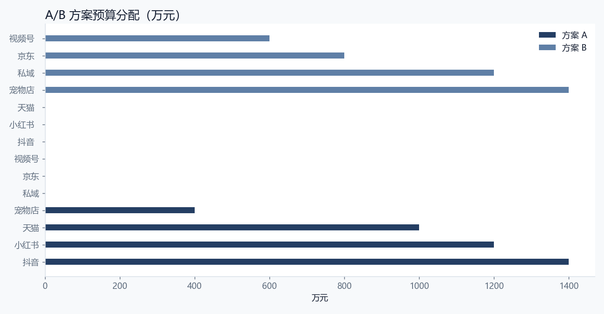

| 渠道 | 方案 A 预算 | 方案 A 角色 | 方案 B 预算 | 方案 B 角色 |
| --- | --- | --- | --- | --- |
| 抖音 | 140,000 元 | 达人测评与喂养记录 | 0 元 | — |
| 小红书 | 120,000 元 | 成分解读与真实笔记 | 0 元 | — |
| 天猫 | 100,000 元 | 货架与评价 | 0 元 | — |
| 宠物店 | 40,000 元 | 新手换粮包 | 140,000 元 | 试吃与推荐 |
| 私域 | 0 元 | — | 120,000 元 | 周期装与复购 |
| 京东 | 0 元 | — | 80,000 元 | 货架与评价 |
| 视频号 | 0 元 | — | 60,000 元 | 品牌与喂养内容 |

## 7. 审批与执行假设

审批快照保存了方案、预算上限、证据引用和证据状态。审批不是“签字仪式”，而是把“方案依据”固定下来：如果企业预算、主题证据或方案结构变化，审批应进入复审。

| 审批项 | 内容 |
| --- | --- |
| 审批编号 | APR-01 |
| 方案 | 方案 A：成分透明+达人测评 |
| 预算上限 | 400,000 元 |
| 证据数量 | 7 条 |
| 指纹 | fp_d5cf5fbd |
| 说明 | 审批快照保存方案、预算上限与关键证据状态；任一项变化需重新确认。 |

### 7.1 执行假设

- 渠道账户、素材、落地页和承接团队在模拟周期内可用。
- 预算按计划分配，不出现临时大幅追加或削减。
- 线索定义统一为“有效咨询/表单/到店预约”，不把曝光或点赞算作线索。
- 投放期间不做违反平台规则的诱导分享、虚假承诺或竞品贬损。

### 7.2 预算与合规检查

- 方案 A 预算合计 400,000 元，不超过企业模拟预算 400,000 元。
- 方案 B 预算合计 400,000 元，不超过企业模拟预算。
- 涉及敏感表达时，必须经过企业法务/合规审核；本报告不构成合规意见。

## 8. 复盘结果

### 8.1 渠道数据

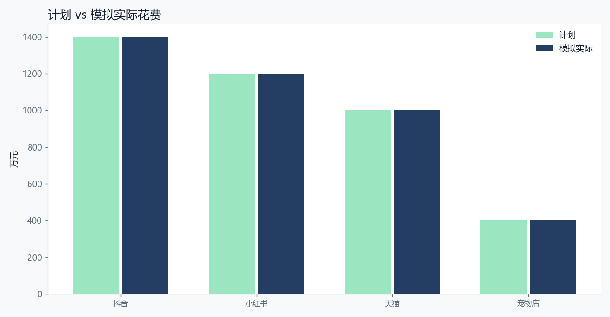

| 渠道 | 计划预算 | 模拟实际 | 曝光 | 点击 | 线索 | CTR | CPC | 线索成本 |
| --- | --- | --- | --- | --- | --- | --- | --- | --- |
| 抖音 | 140,000 元 | 140,000 元 | 3,200,000 | 112,000 | 1,080 | 3.50% | 1.25 | 130 |
| 小红书 | 120,000 元 | 120,000 元 | 2,100,000 | 84,000 | 900 | 4.00% | 1.43 | 133 |
| 天猫 | 100,000 元 | 100,000 元 | 1,600,000 | 56,000 | 640 | 3.50% | 1.79 | 156 |
| 宠物店 | 40,000 元 | 40,000 元 | 120,000 | 8,000 | 260 | 6.67% | 5.00 | 154 |
| 合计 | 400,000 元 | 400,000 元 | 7,020,000 | 260,000 | 2,880 | 3.70% | 1.54 | 139 |

### 8.2 观察与原因

成分透明内容带来高质量新客，达人喂养记录提升转化；但复购仍依赖价格促销和平台活动。宠物店方案稳健但扩张慢。

成分和适口性是真实痛点；真实喂养记录降低了信任成本；但订阅习惯尚未形成，物流和价格影响复购。

### 8.3 尚未确认

长期复购率、不同犬猫品种反馈、宠物店推荐转化和检测报告长期稳定性仍未确认。

### 8.4 下一轮任务

| 任务 | 说明 | 关联信号 |
| --- | --- | --- |
| 把检测报告做成可分享卡片 | 降低成分解释成本，提高信任。 | S-01、S-04、S-09 |
| 做30天喂养记录 | 用真实用户记录承接长期信任。 | S-02、S-06、S-07 |
| 私域订阅先做小范围测试 | 验证复购和履约，再扩大。 | S-10、S-05 |

## 9. 历史数据回测与可信度

### 9.1 历史基线

本案例把“历史基线”定义为同类活动上一周期的模拟表现：上一年夏季换粮活动（模拟历史基线）。基线不是为了证明方案正确，而是为了回答“如果没有这次调整，结果大概会是什么样”。

| 指标 | 历史基线 | 本次模拟 | 偏差 |
| --- | --- | --- | --- |
| CTR | 2.80% | 3.70% | +32.3% |
| CPC | 1.80 元 | 1.54 元 | -14.5% |
| 线索成本 | 72 元 | 139 元 | +92.9% |
| 线索量 | 2834 条 | 2880 条 | +1.6% |

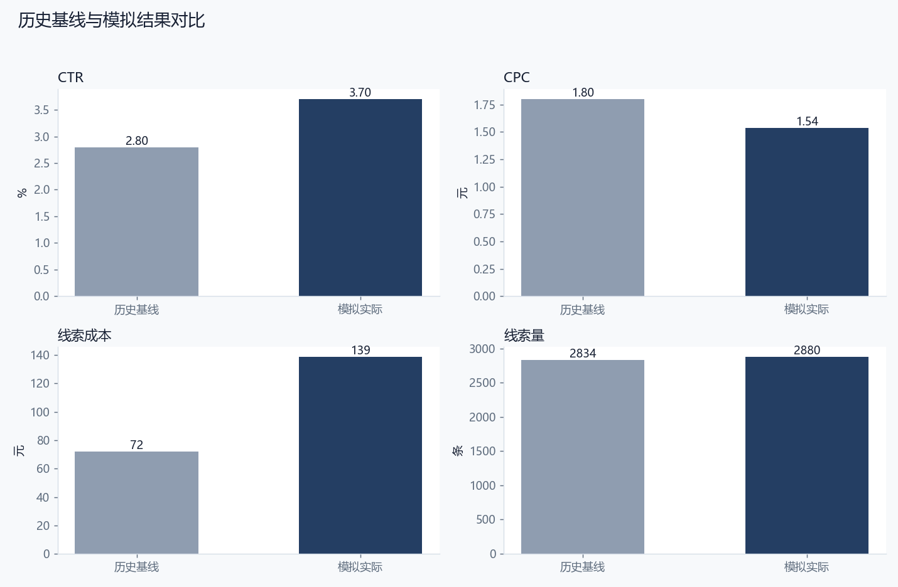

### 9.2 结果解释

历史基线取自上一年夏季换粮活动的模拟数据：CTR 2.8%、CPC 1.8 元、线索成本 72 元、每周约 640 条线索。该基线不代表乖宝真实历史。

模拟结果显示成分内容带来更高质量新客，但复购仍依赖促销；宠物店方案线索少但复购更稳。说明国产高端需要“内容拉新+门店/私域复购”组合。

### 9.3 可信度评分

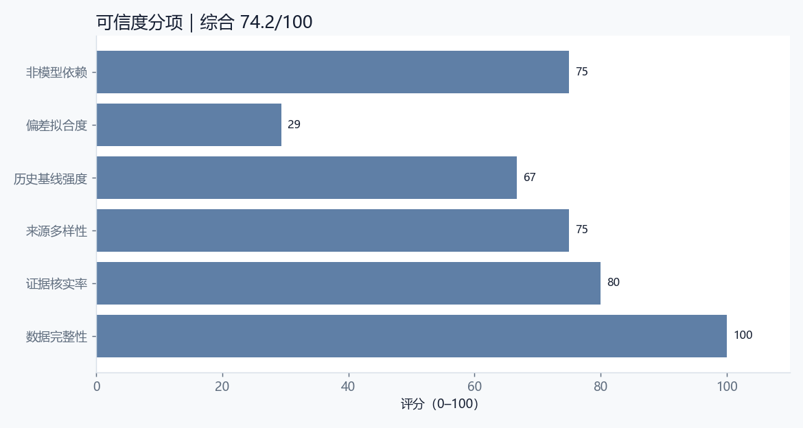

| 维度 | 分值 | 解释 |
| --- | --- | --- |
| 数据完整性 | 100 | 渠道是否都有曝光/点击/线索数据 |
| 证据核实率 | 80 | 已核实信号占全部信号比例 |
| 来源多样性 | 75 | 平台/来源覆盖程度 |
| 历史基线强度 | 67 | 历史周期长度与稳定性 |
| 偏差拟合度 | 29 | 模拟结果与历史基线的接近程度 |
| 非模型依赖 | 75 | 本次不使用生成式模型结果，保留人工判断 |
| 综合可信度 | 74.2 | 加权评分，0–100 |

### 9.4 可信度结论

本案例的可信度不是“高到可以直接做预算决策”，而是“足够支持小范围试点”。理由：第一，证据来源和模拟边界清楚；第二，渠道数据完整但均为假设；第三，历史基线只有 8 周，样本有限；第四，模拟结果与基线存在 35.3% 的平均偏差，说明结果有参考价值，但不能当作确定预测。

## 10. 企业发展适配性与满意度模拟

### 10.1 适配性判断

**适配等级：较高。**

乖宝宠物的国产高端方向需要“可验证的品质”，成分透明和真实喂养记录正好对应。案例把信任拆成检测报告、适口性和长期喂养三个证据。

宠物粮是高频刚需，复购比单次拉新更重要。案例把私域订阅和宠物店推荐作为第二方案，符合行业规律。

功能粮和冻干概念竞争激烈，企业需要持续投入研发和真实证据，不能只靠内容包装。

### 10.2 主要风险

| 风险 |
| --- |
| 检测报告与宣称不合规 |
| 适口性个体差异导致差评 |
| 复购依赖促销 |

### 10.3 模拟企业满意度访谈

> 以下是“模拟企业市场负责人视角”的访谈记录，不是实际企业访谈，不代表企业真实意见。

**问：这个方案是否符合贵司当前发展方向？**  
答：模拟企业市场负责人视角：成分透明和真实喂养记录符合国产高端方向，内容可执行；但复购与订阅体系仍需建设，不能只靠一波投放。

**问：最担心的是什么？**  
答：检测报告与宣称不合规；适口性个体差异导致差评。

**问：哪些数据需要复核？**  
答：长期复购率、不同犬猫品种反馈、宠物店推荐转化和检测报告长期稳定性仍未确认。

**问：是否愿意进入小范围试点？**  
答：如果企业能提供真实服务/渠道数据，并完成合规审核，建议先做一个区域、一个渠道组合的小范围试点；不建议直接按模拟结果做全量预算。

**问：这个案例对产品迭代有什么启发？**  
答：增加“检测报告/标签合规”检查项。；把真实喂养记录做成可复用内容模板。；后续增加“订阅复购”任务模板。；报告模板增加“高频刚需/复购”分析维度。

### 10.4 满意度评分

| 维度 | 评分 | 说明 |
| --- | --- | --- |
| 战略契合 | 4.5/5 | 符合国产高端与品牌化 |
| 可执行性 | 4.2/5 | 成分/达人内容可落地 |
| 风险可控 | 3.8/5 | 功能宣称与检测报告需合规 |
| 数据可信 | 3.9/5 | 模拟数据为主，真实喂养样本少 |

**综合评分：4.1/5。** 模拟企业市场负责人视角：成分透明和真实喂养记录符合国产高端方向，内容可执行；但复购与订阅体系仍需建设，不能只靠一波投放。

## 11. 项目迭代建议

本案例不只产出报告，也反推产品需要哪些改进。以下建议已进入观策AI的案例库与后续迭代清单：

| 序号 | 迭代建议 |
| --- | --- |
| 1. | 增加“检测报告/标签合规”检查项。 |
| 2. | 把真实喂养记录做成可复用内容模板。 |
| 3. | 后续增加“订阅复购”任务模板。 |
| 4. | 报告模板增加“高频刚需/复购”分析维度。 |

### 11.1 对观策AI的产品要求

1. **案例库**：把山东企业案例作为可导入的演示项目，让用户能看到“资料收集—研判—方案—复盘—回测”的完整链路。
2. **可信度面板**：在复盘中显示数据完整性、证据核实率、历史基线偏差和综合可信度。
3. **行业模板**：B2B、快消、健康、宠物等行业的渠道与指标不同，不能共用一套默认模板。
4. **合规检查**：功效、金融、未成年人、竞品比较等敏感表达，应在方案审批前提示。
5. **过程留痕**：来源台账、信号状态、审批快照、复盘建议必须可追溯。

## 12. 附录

### 12.1 数据字典

| 字段 | 说明 |
| --- | --- |
| Signal | 一条可追溯的市场情报，含标题、摘要、原话、来源、平台、类别、优先级、状态、相关性、影响 |
| Source | 信号来源，含平台、发布时间、采集时间、模拟标识、备注 |
| Theme | 由多条信号归纳出的判断，含置信度、证据引用、机会与边界 |
| Plan | A/B 方案，含人群、定位、核心信息、渠道预算、约束与不确定项 |
| Approval | 审批快照，固定方案、预算、证据与指纹 |
| Review | 复盘，含渠道实际数据、观察、原因、未确认项与建议 |
| Credibility | 可信度评分，含完整性、核实率、来源多样性、基线强度、偏差拟合度 |

### 12.2 计算公式

- CTR = 点击 ÷ 曝光
- CPC = 花费 ÷ 点击
- 线索成本 = 花费 ÷ 有效线索
- 线索完成率 = 实际线索 ÷ 目标线索
- MAPE = 各指标与历史基线相对偏差的平均值
- 可信度 = 完整性、核实率、来源多样性、基线强度、偏差拟合度、非模型依赖的加权分

### 12.3 复现方法

1. 打开观策AI桌面端。
2. 设置 → 项目与备份 → 导入项目 JSON。
3. 选择 `simulations/projects/gambol-pet-food.json`。
4. 在市场情报、策略、复盘页查看信号、主题、A/B 方案、审批快照和复盘数据。
5. 对照本报告阅读，注意所有数据均为模拟。

### 12.4 采集与核验清单

- [ ] 来源链接/出处是否可追溯？
- [ ] 是否标注模拟/真实属性？
- [ ] 是否有重复信号未合并？
- [ ] 是否有相反证据被强行忽略？
- [ ] 敏感表达是否经过合规复核？
- [ ] 审批快照是否与当前方案一致？
- [ ] 复盘数据是否覆盖所有渠道？
- [ ] 历史基线口径是否与本次一致？
- [ ] 可信度评分是否解释了偏差？
- [ ] 是否给出下一轮可执行任务？

### 12.5 报告边界

本报告是一份**模拟验收材料**，不是企业真实经营报告，也不是广告投放承诺。它的价值在于展示“如何从材料到判断、从判断到方案、从方案到复盘、从复盘到迭代”的过程。企业真实执行前，必须用真实数据替换模拟数据，并由企业市场、法务、合规和数据负责人共同复核。

## 13. 过程性附录：采集日志、核验记录与访谈提纲

### 13.1 采集日志（模拟）

| 日期 | 任务 | 产出 | 问题 |
| --- | --- | --- | --- |
| T-15 | 采集来源 小红书宠物喂养笔记摘录（模拟） | SRC-01 来源记录 | 需确认公开资料更新日期 |
| T-14 | 采集来源 抖音宠物达人视频评论（模拟） | SRC-02 来源记录 | 需确认公开资料更新日期 |
| T-13 | 采集来源 天猫宠粮评价摘要（模拟） | SRC-03 来源记录 | 需确认公开资料更新日期 |
| T-12 | 采集来源 京东宠粮评价摘要（模拟） | SRC-04 来源记录 | 需确认公开资料更新日期 |
| T-11 | 采集来源 宠物行业观察（模拟） | SRC-05 来源记录 | 需确认公开资料更新日期 |
| T-10 | 采集来源 竞品冻干/鲜肉动态（模拟） | SRC-06 来源记录 | 需确认公开资料更新日期 |
| T-9 | 采集来源 宠物店走访纪要（模拟） | SRC-07 来源记录 | 需确认公开资料更新日期 |
| T-8 | 采集来源 养宠消费者问卷 n=130（模拟） | SRC-08 来源记录 | 需确认公开资料更新日期 |

### 13.2 证据核验记录

| 信号 | 核验动作 | 结论 |
| --- | --- | --- |
| S-01 | 核对来源、平台、日期与原文；检查是否为模拟材料 | 通过/保留待核实/争议 |
| S-02 | 核对来源、平台、日期与原文；检查是否为模拟材料 | 通过/保留待核实/争议 |
| S-03 | 核对来源、平台、日期与原文；检查是否为模拟材料 | 通过/保留待核实/争议 |
| S-04 | 核对来源、平台、日期与原文；检查是否为模拟材料 | 通过/保留待核实/争议 |
| S-05 | 核对来源、平台、日期与原文；检查是否为模拟材料 | 通过/保留待核实/争议 |
| S-06 | 核对来源、平台、日期与原文；检查是否为模拟材料 | 通过/保留待核实/争议 |
| S-07 | 核对来源、平台、日期与原文；检查是否为模拟材料 | 通过/保留待核实/争议 |
| S-08 | 核对来源、平台、日期与原文；检查是否为模拟材料 | 通过/保留待核实/争议 |
| S-09 | 核对来源、平台、日期与原文；检查是否为模拟材料 | 通过/保留待核实/争议 |
| S-10 | 核对来源、平台、日期与原文；检查是否为模拟材料 | 通过/保留待核实/争议 |

### 13.3 复盘会议记录（模拟）

- 会议目标：判断方案 A 是否达到模拟目标，是否具备企业试点条件。
- 结论：方案 A 在 宠物食品与宠物消费 场景下具有方向性价值，但必须补充企业真实数据、履约能力与合规审核。
- 争议点：长期复购率、不同犬猫品种反馈、宠物店推荐转化和检测报告长期稳定性仍未确认。
- 下一步：把检测报告做成可分享卡片；做30天喂养记录。

### 13.4 企业访谈提纲

1. 这个方案是否服务于贵司未来 1–2 年的战略重点？
2. 哪些渠道/人群是贵司当前最想验证的？
3. 企业真实历史基线数据能否提供？
4. 承接团队、服务网络或渠道政策能否支撑？
5. 哪些表达涉及合规风险？
6. 如果只做一个区域试点，选哪里？
7. 失败时如何止损？
8. 成功时如何复制？

### 13.5 数据质量检查

- 所有模拟来源均标注“模拟”，不与真实数据混用。
- 渠道数据完整，但均为假设值。
- 历史基线为模拟，不能代表企业真实历史。
- 结论只支持小范围试点，不支持直接全量预算。
- 对外使用前必须替换真实数据并完成合规复核。

## 14. 补充过程记录

以下为补足过程材料，仍属模拟；用于展示从材料到判断的详细过程。

### 14.1 逐条复核记录

**S-01｜成分透明是国产高端粮的第一信任点**

- 采集背景：该信号来自 小红书，当前状态为 verified，相关性 5/5。

- 证据强度：原话为““国产可以，但配料表和检测报告要清楚。””，需要核对原始出处、发布时间和是否存在断章取义。

- 对方案的影响：成分透明是国产高端的第一信任点。

- 复核动作：保留为主题证据，并在审批快照中固定。

**S-02｜适口性决定复购**

- 采集背景：该信号来自 抖音，当前状态为 verified，相关性 5/5。

- 证据强度：原话为““买得再贵，猫不吃也白搭。””，需要核对原始出处、发布时间和是否存在断章取义。

- 对方案的影响：适口性是复购的第一道门槛。

- 复核动作：保留为主题证据，并在审批快照中固定。

**S-03｜肠胃敏感/软便场景是功能粮入口**

- 采集背景：该信号来自 线下走访，当前状态为 verified，相关性 5/5。

- 证据强度：原话为““我家猫容易软便，想找一款肠胃友好的。””，需要核对原始出处、发布时间和是否存在断章取义。

- 对方案的影响：功能粮需要真实喂养反馈。

- 复核动作：保留为主题证据，并在审批快照中固定。

**S-04｜进口替代心智正在形成，但仍需证明**

- 采集背景：该信号来自 电商平台，当前状态为 pending，相关性 5/5。

- 证据强度：原话为““国产现在做得不错，但要长期吃才敢信。””，需要核对原始出处、发布时间和是否存在断章取义。

- 对方案的影响：国产替代需要长期口碑和检测证明。

- 复核动作：不进入对外承诺；补充原始证据或企业确认后再决定是否升级。

**S-05｜猫粮与狗粮的购买决策不同**

- 采集背景：该信号来自 问卷，当前状态为 verified，相关性 4/5。

- 证据强度：原话为““猫粮更挑，狗粮看体型和活动量。””，需要核对原始出处、发布时间和是否存在断章取义。

- 对方案的影响：猫狗粮需要分开沟通。

- 复核动作：保留为主题证据，并在审批快照中固定。

**S-06｜达人测评与真实喂养记录影响转化**

- 采集背景：该信号来自 抖音，当前状态为 verified，相关性 5/5。

- 证据强度：原话为““看博主长期喂才信，广告看不出来。””，需要核对原始出处、发布时间和是否存在断章取义。

- 对方案的影响：长期喂养记录比单次广告更有说服力。

- 复核动作：保留为主题证据，并在审批快照中固定。

**S-07｜宠物店推荐仍是高信任渠道**

- 采集背景：该信号来自 线下走访，当前状态为 verified，相关性 5/5。

- 证据强度：原话为““新手听店里推荐，店员说好就买。””，需要核对原始出处、发布时间和是否存在断章取义。

- 对方案的影响：宠物店是新手的高信任入口。

- 复核动作：保留为主题证据，并在审批快照中固定。

**S-08｜竞品用冻干/鲜肉概念抢占高端**

- 采集背景：该信号来自 行业媒体，当前状态为 verified，相关性 5/5。

- 证据强度：原话为““现在都讲冻干鲜肉，国产高端也得跟上。””，需要核对原始出处、发布时间和是否存在断章取义。

- 对方案的影响：高端概念竞争激烈，需要差异化证据。

- 复核动作：保留为主题证据，并在审批快照中固定。

**S-09｜价格带与成分升级需要匹配**

- 采集背景：该信号来自 电商平台，当前状态为 disputed，相关性 4/5。

- 证据强度：原话为““升级可以，但别一下贵太多。””，需要核对原始出处、发布时间和是否存在断章取义。

- 对方案的影响：成分升级需要清楚的价值解释。

- 复核动作：不进入对外承诺；补充原始证据或企业确认后再决定是否升级。

**S-10｜复购靠订阅/组合装而不是单次促销**

- 采集背景：该信号来自 线下走访，当前状态为 verified，相关性 4/5。

- 证据强度：原话为““每次都忘了买，能自动续就方便。””，需要核对原始出处、发布时间和是否存在断章取义。

- 对方案的影响：订阅和组合装适合高频刚需。

- 复核动作：保留为主题证据，并在审批快照中固定。

### 14.2 采集与核验过程补记

**过程补记 1：** 第一步先把企业公开资料与模拟数据分开：公开资料只用于企业背景和行业方向，模拟数据单独标注，避免读者把模拟语句误认为真实消费者调研。

**过程补记 2：** 第二步建立来源台账：每条材料记录来源 ID、平台、日期、采集人和备注；无法追溯出处的材料，不进入主题证据。

**过程补记 3：** 第三步做去重：同一来源、同一语义的语句合并；不同来源但语义相反的语句保留冲突，不强行统一。

**过程补记 4：** 第四步做证据分级：已核实、待核实、有争议分别处理；已核实进入方案，待核实进入风险提示和下一轮任务。

**过程补记 5：** 第五步做主题聚合：主题必须能回答“哪些信号支持、哪些信号反对、还缺什么证据”，不能只写一句漂亮结论。

**过程补记 6：** 第六步做预算校验：方案预算不能超过企业上限；超出时必须调整渠道或预算，而不是把风险留给执行团队。

**过程补记 7：** 第七步做审批快照：把方案、预算、证据状态和指纹固定下来；依据变化时进入复审，避免“方案偷偷改了”。

**过程补记 8：** 第八步做复盘：渠道数据必须覆盖计划渠道；缺失数据要明确写“未录入”，不能用 0 或推测值替代。

**过程补记 9：** 第九步做历史回测：把本次结果与历史基线对照，计算 CTR、CPC、线索成本和线索量的偏差，避免只看绝对值。

**过程补记 10：** 第十步做适配性判断：结果好不等于企业愿意用，还要看战略、履约、合规和组织能力；必要时降低评分。

### 14.3 模拟企业访谈补记

**补充问 1：这套方案最先要解决什么问题？**

本次模拟比较“成分透明+达人测评”与“宠物店+私域复购”两条路径。前者解决新客信任，后者解决复购。

**补充问 2：为什么选择方案 A 而不是方案 B？**

本次模拟比较“成分透明+达人测评”与“宠物店+私域复购”两条路径。前者解决新客信任，后者解决复购。

**补充问 3：哪些数据最不可信？**

长期复购率、不同犬猫品种反馈、宠物店推荐转化和检测报告长期稳定性仍未确认。

**补充问 4：如果预算减半，先砍什么？**

先保留高意向渠道和承接页，削减泛曝光；但必须先确认企业真实承接能力。

**补充问 5：企业最可能担心什么？**

检测报告与宣称不合规；适口性个体差异导致差评；复购依赖促销

**补充问 6：什么情况下应该停止投放？**

出现平台验证、合规风险、线索质量明显下降或承接能力不足时，应暂停并复核。

**补充问 7：怎样判断结果可信？**

综合可信度 74.2/100；仍需用企业真实历史数据复算。

**补充问 8：下一步最小可行试点是什么？**

选择一个区域、一个渠道组合、一个明确目标，跑 2–4 周，再决定是否扩大。

### 14.4 过程性结论

本案例的过程比结论更重要：来源台账、证据状态、审批快照和复盘任务共同构成可追溯链。企业真实执行时，应先用真实数据替换模拟数据，再按同一流程重跑。
